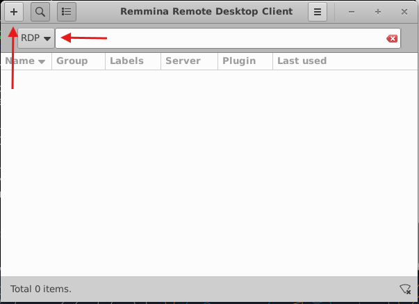
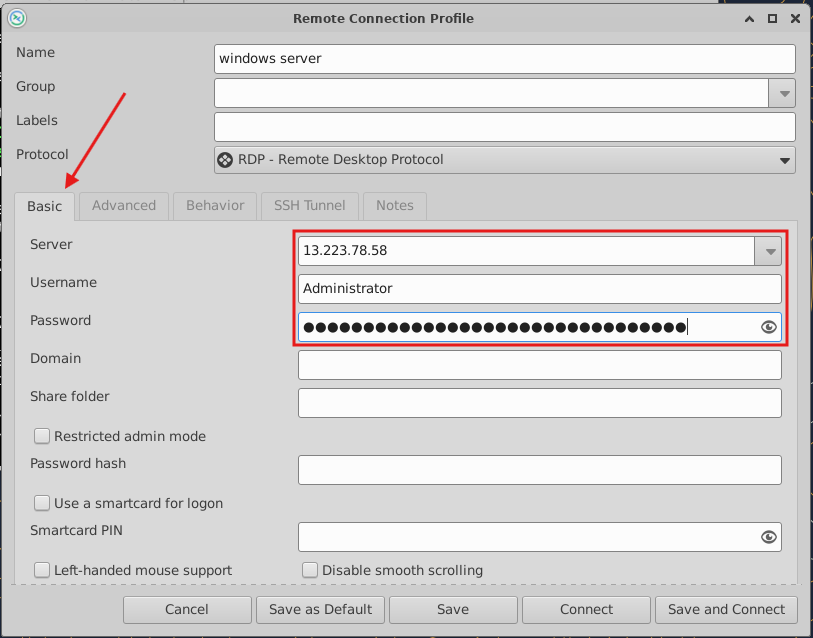
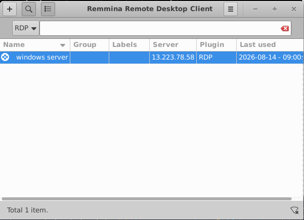
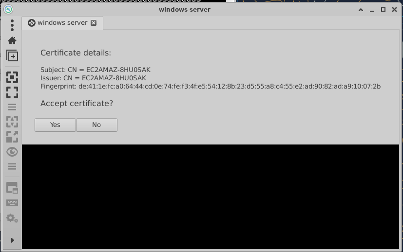
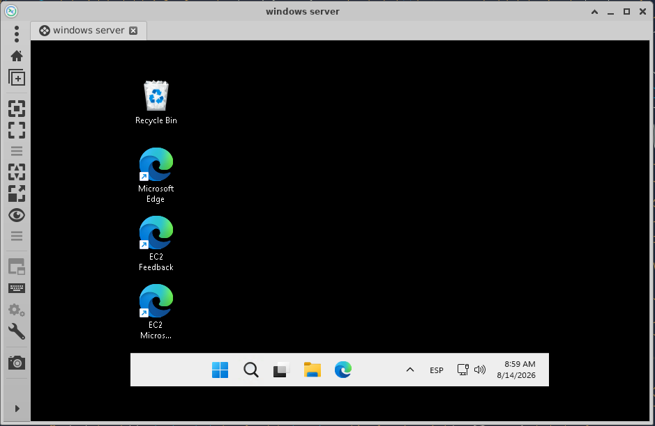
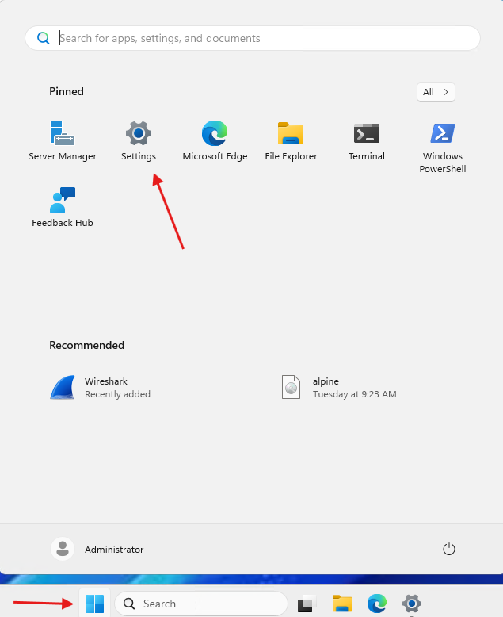
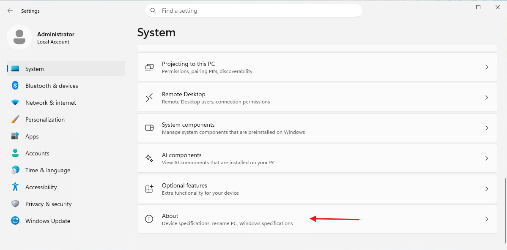
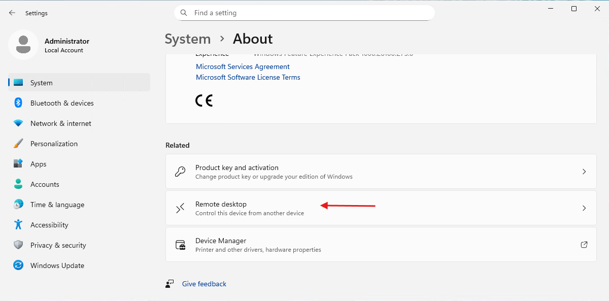
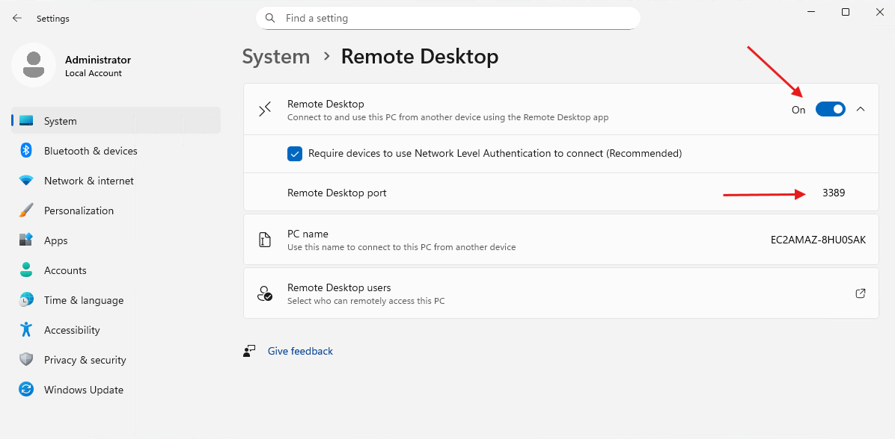

<div class="interactive-progress-tracker">
  <div class="tracker-header">
    <span>🏆 <strong>Progrés d'aquesta secció:</strong> <span class="tracker-count">0 de 4 superats (0%)</span></span>
    <span class="tracker-pts">⭐ <strong>0 punts</strong></span>
  </div>
  <div class="tracker-bar">
    <div class="tracker-fill" style="width: 0%;"></div>
  </div>
</div>

# 1.8 - Tasca RA6-CEf-1 - Connexió remota des de Ubuntu Server 24.04 LTS a SO Windows

> **📌 Obligatori seguir les normes per a la presentació de treballs escritos.**
> 

Per a poder connectar-nos des d'una distribució de Linux a Windows necessitarem una aplicació d'accés a escriptori com **Remmina**.

### 8.1 Comprovació i instal·lació de Remmina

- 

Remmina no ve instal·lada en totes les distribucions de Linux així que comprobarem si la tenim instal·lada.

```bash
remmina --version
```

- 

Si ens retorna un missatge d'error, instalarem l'aplicació.

```bash
sudo apt install remmina -y
```

### 8.2 Connexió a la instància de Windows Server 2025

- 

Executem l'aplicació

```bash
remmina
```



- 

Introducimos els paràmetres de la connexió



- 

Guardamos els parametros de la connexió i lanzamos la connexió



- 

Aceptamos el certificat.  

Realitzar captura de pantalla



- 

Si tot ha anat bé, estarem en l'escriptori de la nostra màquina Windows Server.  

Realitzar captura de pantalla



- 

Respondre a la pregunta Descriure el flux de connexions remotas realitzat anteriorment.

### 8.3 Possibles problemes de connexió a la instància de Windows Server 2025

Com ja hem vist totes dues màquines han d'estar en condicions d'acceptar connexions remotas per RDP.

Així ja que, verificarem si Windows Server està configurado per a acceptar connexions remotas.

- 

Anem a **Settings**.



- 

Abaix del tot seleccionem **About**.



- 

Cerquem Remote desktop.



- 

Comprovem la configuració del **Remote Desktop**



> **📌 Com podem veure, la imatge de Windows Server usada en AWS accepta per defecte les connexions RDP. De no ser així no podriamos habernos connectat a la instància en una pràctica anterior.**
>


---

## 🎮 Reptes Interactius d'Autoavaluació (+100 XP)

Comprova el teu domini sobre **1.8 - Tasca RA6-CEf-1 - Connexió remota des de Ubuntu Server 24.04 LTS a SO Windows** superant aquests 4 reptes gamificats (+25 punts cadascun):

<div class="interactive-mcq" data-answer="A" data-hint="Revisa els conceptes teòrics i pràctics d'aquesta secció.">
  <div class="mcq-question">🎯 <strong>Repte 1 (+25 pts):</strong> Quina diferència fonamental existeix entre els protocols d'accés remot en línia d'ordres SSH i Telnet?</div>
  <div class="mcq-options">
    <button type="button" class="btn-mcq-opt" data-opt="A">A) SSH xifra tota la sessió i les credencials d'autenticació, mentre que Telnet transmet tota la informació en text pla.</button>
    <button type="button" class="btn-mcq-opt" data-opt="B">B) Telnet utilitza xifratge asimètric RSA i SSH no utilitza cap xifratge.</button>
    <button type="button" class="btn-mcq-opt" data-opt="C">C) SSH només funciona en Windows Server i Telnet només en Ubuntu.</button>
    <button type="button" class="btn-mcq-opt" data-opt="D">D) Cap de les anteriors és correcta.</button>
  </div>
  <div class="quiz-feedback"></div>
</div>

<div class="interactive-mcq" data-answer="D" data-hint="Comprova l'apartat corresponent de la unitat.">
  <div class="mcq-question">🎯 <strong>Repte 2 (+25 pts):</strong> Quin client multiprotocol utilitzem en sistemes Linux (com Ubuntu Desktop/Server amb GUI) per a connectar-nos per RDP a una instància de Windows Server 2025 en AWS?</div>
  <div class="mcq-options">
    <button type="button" class="btn-mcq-opt" data-opt="A">A) PuTTYgen</button>
    <button type="button" class="btn-mcq-opt" data-opt="B">B) nslookup</button>
    <button type="button" class="btn-mcq-opt" data-opt="C">C) Cap de les anteriors és correcta.</button>
    <button type="button" class="btn-mcq-opt" data-opt="D">D) Remmina</button>
  </div>
  <div class="quiz-feedback"></div>
</div>

<div class="interactive-vf" data-answer="V" data-hint="Verifica l'afirmació amb els apunts de la unitat.">
  <div class="vf-statement">✅ <strong>Repte 3 (Vertader o Fals · +25 pts):</strong> Exposar directament el port RDP (3389) a Internet sense mesures addicionals com VPN o restricció d'IP al grup de seguretat suposa un risc crític d'atacs de força bruta.</div>
  <div class="vf-buttons">
    <button type="button" class="btn-vf" data-opt="V">Vertader (V)</button>
    <button type="button" class="btn-vf" data-opt="F">Fals (F)</button>
  </div>
  <div class="quiz-feedback" style="width: 100%;"></div>
</div>

<div class="interactive-quiz" data-answer="3389" data-hint="Comença per 33 i acaba en 89.">
  <div class="quiz-question">⌨️ <strong>Repte 4 (+25 pts):</strong> Quin número de port TCP/UDP utilitza per defecte el protocol d'Escriptori Remot de Microsoft (RDP)?</div>
  <div class="quiz-controls">
    <input type="text" class="quiz-input" placeholder="Escriu la resposta..." />
    <button type="button" class="btn-quiz-check">Comprovar</button>
  </div>
  <div class="quiz-feedback"></div>
</div>

### 📋 Llista de Comprovació i Rúbrica d'Assoliment

Marca cada criteri a mesura que completes l'estudi o la resolució pràctica d'aquesta pàgina (**1.8 - Tasca RA6-CEf-1 - Connexió remota des de Ubuntu Server 24.04 LTS a SO Windows**):

- [ ] He llegit detingudament la teoria o l'enunciat d'aquesta secció i he anotat els conceptes clau.
- [ ] He revisat els esquemes, taules o blocs de codi i he verificat que sé aplicar-los a l'entorn de treball.
- [ ] He resolt correctament els **4 reptes interactius** superiors obtenint els **100 punts XP**.
- [ ] He descarregat el comprovant oficial en PDF per a adjuntar-lo a la tasca d'**Aules**.

<div class="aules-delivery-card">
  <h3>📤 Comprovant de Lliurament per a Aules</h3>
  <p>Quan hages completat els reptes interactius i la llista d'autoavaluació d'aquesta pàgina, introdueix el teu nom i descarrega el teu certificat oficial en PDF per a adjuntar-lo a la tasca d'<strong>Aules</strong>.</p>
  <div class="aules-student-field">
    <label for="aules-student-name">👤 Nom i Cognoms de l'Alumne/a:</label>
    <input type="text" id="aules-student-name" class="aules-student-name" placeholder="Ex: Joan Garcia Pérez" />
  </div>
  <div class="aules-score-badge">
    <span class="aules-score-count">0/4 reptes completats (0%) · 0 punts · 0/4 criteris d'autoavaluació</span>
  </div>
  <div class="aules-actions">
    <button type="button" class="btn-aules-dl" data-module="SEX" data-unit="UD01" data-activity="ut0108">📥 Descarregar Comprovant PDF</button>
    <button type="button" class="btn-aules-copy">📋 Copiar Resum al Porta-retalls</button>
  </div>
  <div class="aules-toast"></div>
</div>

