<div class="interactive-progress-tracker">
  <div class="tracker-header">
    <span>🏆 <strong>Progreso de esta sección:</strong> <span class="tracker-count">0 de 4 superados (0%)</span></span>
    <span class="tracker-pts">⭐ <strong>0 puntos</strong></span>
  </div>
  <div class="tracker-bar">
    <div class="tracker-fill" style="width: 0%;"></div>
  </div>
</div>

# 1.9 - Administración remota segura con SSH (Secure Shell)

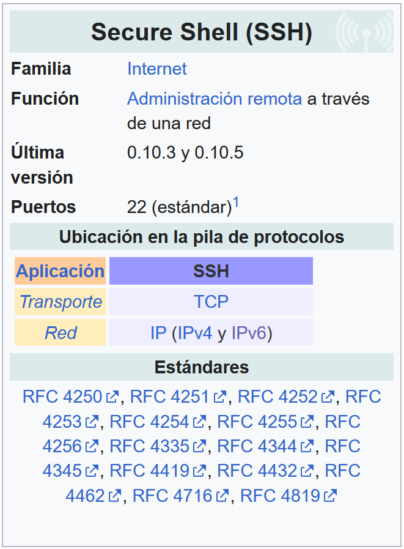

1. 

El protocol SSH (Secure Shell) és **un protocol de xarxa** dissenyat per a accedir, administrar i controlar dispositius de forma remota a través d'una connexió totalment cifrada.

1. 

Surgió com un reemplazo segur per a protocols tradicionals com **Telnet** o **FTP**, que transmitían la informació i les contrasenyes en text pla.

1. 

SSH opera en la capa d'aplicació del model TCP/IP i funciona de la següent manera:

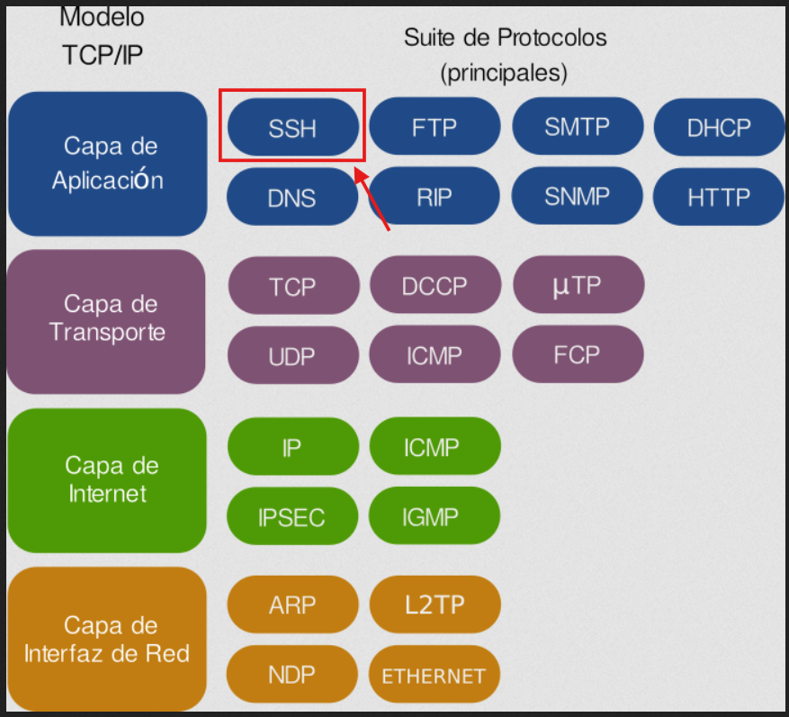

  - **Capa de Aplicació:** SSH proporciona serveis directos a l'usuari o administrador (com l'ejecució remota de comandes, transferència segura de fitxers vía SFTP/SCP i túneles de ports).

  - **Capa de Transport:** Es apoya directament en el protocol TCP (generalment a través del port 22) per a garantir que les dades es entreguen de forma fiable i ordenada abans d'establir el cifrado.

### 9.1 Ús bàsic de SSH

1. 

Per a connectar dos equips mitjançant SSH s'utilitza un model **client-servidor**:

  - **Client:** La màquina local des de la que ens conectamos (CLI en Linux/macOS o GUI's com PuTTY/OpenSSH en Windows).  

  - **Servidor:** Equip o servidor remoto que escolta peticions de connexió (normalment en el port TCP 22).

1. 

El comanda bàsic en la terminal es compon de:  

    

```bash
ssh usuario@direccion_ip_o_dominio
```

  - **ssh:** Indica al sistema que inicie una sessió cifrada Secure Shell.

  - **usuari:** Compta a la que deseamos accedir (p.e. root).

  - **direccion_ip_o_dominio:** Adreça del servidor al que ens conectamos (p.e. 192.168.1.1 o servidor.com).

### 9.2 Mecanismes de cifrado en SSH

SSH combina **3 mètodes criptográfics distints** per a garantir la privacitat, l'autenticació i la integritat de les dades.

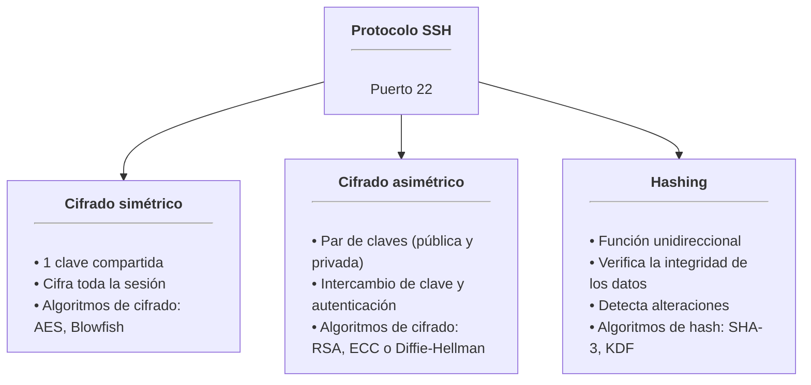

1. 

**Cifrado simétric**  

  1. El cifrado simétric utilitza **una única clau secreta** tant per a **cifrar com per a descifrar** la informació en tots dos costats.  

  1. **Ús en SSH:** Xifra la totalitat del trànsit i els comandes enviats durant la sessió activa.

  1. **Seguretat:** La clau no es transmet per la xarxa. El client i el servidor la generen de manera independent durant la salutació inicial mitjançant un algoritme d'intercanvi de claus.

1. 

**Cifrado Asimétric**  

  1. El cifrado asimétric empra **un parell de claus matemáticament enlazades**.

    - **Una clau pública** que es pot compartir librement.

    - **Una clau privada** que ha de mantenerse secreta.  

  1. El que es xifra amb la clau pública només pot descifrar-se amb la clau privada corresponent.  

  1. **Ús en SSH:** No s'utilitza per a cifrar tota la sessió (per ser computacionalment més lent), sinó per a:

    - **Autenticar** la identitat del client i del servidor.

    - **Negociar** de forma segura la clau simétrica que s'usarà en la sessió.

1. 

**Hashing (Verificació de Integritat)**  

  1. **L'hashing** transforma qualsevol entrada de dades en un valor únic de longitud fixa de forma unidireccional. No és possible de revertir és a dir, amb l'hash no és possible obtindre la informació original.  

  1. **Ús en SSH:** SSH utilitza HMAC (Hash-based Message Authentication Codes) per a assegurar que els comandes i informació transmitits no hagen sigut interceptats o alterats per tercers en tránsito.

### 9.3 Estableciment d'una connexió SSH

En la següent imatge es mostren, de forma simplificada, les principals etapas que intervenen en l'estableciment d'una connexió SSH.

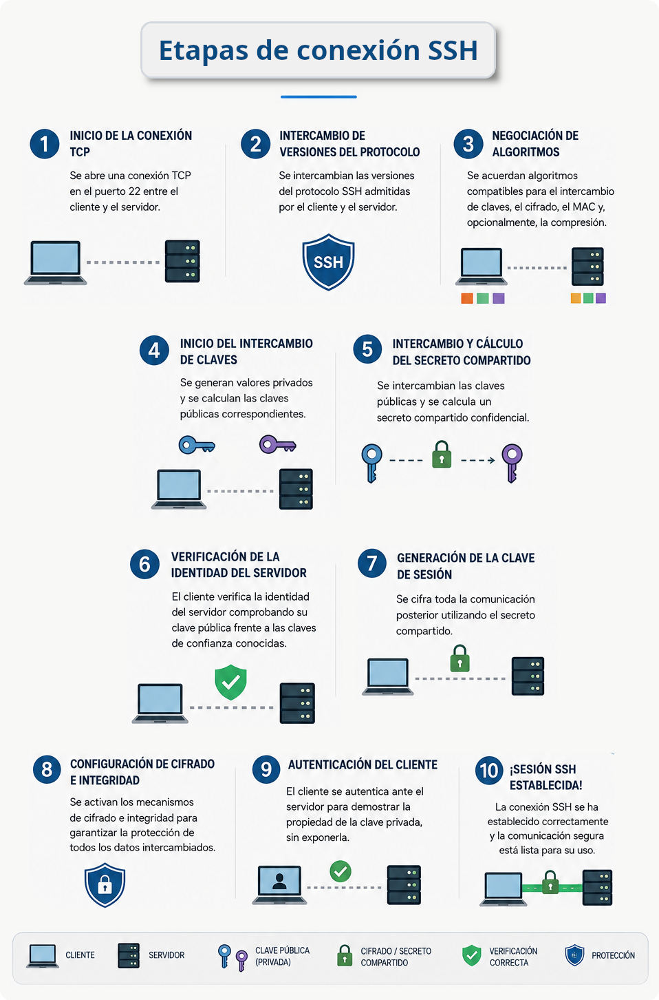

**1 - Inici de la connexió TCP:**  

- El client estableix una connexió TCP amb el servidor, normalment a través del port (d'escolta) 22.  

**2 - Intercanvi de versions:**  

- Client i servidor intercambian informació sobre les versions del protocol SSH que admeten.

- Negociació d'algoritmes: Totes dues parts acuerdan els algoritmes criptográfics que utilizarán per a l'intercanvi de claus, el cifrado, la integritat (MAC) i, opcionalment, la compresió de les dades.  

**3-4-5 - Intercanvi de claus i generació del secreto compartit:**

- Mitjançant un protocol d'intercanvi de claus, com Diffie-Hellman o ECDH, client i servidor generen un secreto compartit que permitirá establir les claus de sessió utilitzades per a cifrar la comunicació.

**6 - Verificació de la identitat del servidor:**

- El client verifica la identitat del servidor mitjançant la seua clau pública, que es compara amb una clau prèviament coneguda o emmagatzemada en el fitxer known_hosts.  

**7-8 - Configuració del cifrado:**

- Una vegada establit el secreto compartit, es activan els mecanismes de cifrado i integritat per a protegir les comunicacions posteriors.  

**9 - Autenticació de l'usuari:**

- El client demuestra la seua identitat ante el servidor, normalment mitjançant contrasenya, clau pública/privada SSH o altres mecanismes d'autenticació configurats en el servidor.  

**10 - Estableciment de la sessió:**

- Una vegada autenticado l'usuari, es estableix una sessió SSH i el client pot solicitar un shell remoto, executar comandes o utilitzar altres serveis proporcionats per SSH.  

### 9.4 Funcionamineto de SSH

Veurem el que ocorre quan escrivim `ssh usuario@direccion_ip_o_dominio` i pulsamos Enter.

> **📌 Fase 1: Connexió TCP**
> 

> **📌 SSH funciona sobre TCP, normalment en el port 22**
> 

> **📌 El client inicia l'handshake TCP estàndard:**
> 

> 1. Client → Servidor: SYN

> 1. Servidor → Client: SYN-ACK

> 1. Client → Servidor: ACK

> **📌 Un vegada que la connexió aquesta establecida, comença el protocol SSH."**
> 

> **📌 Fase 2: Intercanvi de versió del protocol**
> 

> **📌 Tots dos costats anuncian la seua versió de SSH:**
> 

> 1. **Client:**  SSH-2.0-OpenSSH_8.9

> 1. **Servidor:** SSH-2.0-OpenSSH_8.4

> **📌 Acuerdan usar SSH-2.
> Si algun només suporta SSH-1, els clients moderns es negarán a connectar (i han de fer-ho).**
> 

> **📌 Fase 3: Intercanvi de claus**
> 

> 1. Ací comença la criptografía.  

> 1. **Objectiu:** crear una clau secreta compartida que cap espía puga conèixer.

> 1. L'algoritme més comú és **Diffie-Hellman** de curva elíptica (ECDH):

> **📌 Intercanvi de claus (versió simplificada)**
> 

> 1. Client i servidor acuerdan els paràmetres matemátics (la curva)

> 1. El client genera:  valor privat (a), valor públic (A)  

> 1. El servidor genera: valor privat (b), valor públic (B)

> 1. Intercambian els valors públics (A i B)

> 1. **Un atacante pot veure A i B però no el servidrá de res al no dsponer de a i b**.

> 1. El client calcula:  secreto_compartido = a*B  

> 1. El servidor calcula: secreto_compartido = b*A  

> 1. **Tots dos arriben al MATEIX secreto!**.

> 1. Aquest secreto compartit serveix per a derivar les claus de cifrado de la sessió

> **📌 La clau de tot açò:**
> 

> - **El secreto compartit mai es transmet**.  

> - Un atacante que observe tots els paquets segueix sense poder calcular-lo.

> **📌 Fase 4: Autenticació del servidor (claus d'host)**
> 

> 1. Alguna cosa que molts passen per alt: abans de que ens autentiquemos ante el servidor, el servidor es autentica ante nosaltres.

> 1. Quan ens conectemos a un servidor per primera vegada, veurem açò:  

> The authenticity of host 'server.com (192.168.1.100)' can't be established.
> 
ED25519 key fingerprint is SHA256:AbCdEf1234567890...
> 
Are you sure you want to continue connecting (yes/no/[fingerprint])?  

> 1. Amb açò, el servidor està demostrant la seua identitat mitjançant la seua clau d'host.

>   - Si escrivim `yes`, la huella (fingerprint) es guarda en `~/.ssh/known_hosts`  

>   - En futuras connexions es verifica que la clau del servidor coincida  

>   - Si no coincideix, SSH dirá:

> @@@@@@@@@@@@@@@@@@@@@@@@@@@@@@@@
> 
@    WARNING: REMOTE HOST IDENTIFICATION HAS CHANGED!     @
> 
@@@@@@@@@@@@@@@@@@@@@@@@@@@@@@@@
> 
IT IS POSSIBLE THAT SOMEONE IS DOING SOMETHING NASTY!  

> 1. Açò protegeix contra ataques d'intermediario (man-in-the-middle). Si un atacante intercepta la connexió i presenta el seu propi servidor, la huella no coincidirá.

>   - **Consejo:** en la primera connexió, verificar la huella per un canal alternatiu (proveïdor d'hosting, etc.).

> **📌 Fase 5: Autenticació de l'usuari.
>      En aquesta fase demostrarem quienes som.
>      SSH admet diversos mètodes**
> 

> **📌 Mètode 1: Autenticació per contrasenya**
> 

> 

```bash
ssh `user@server.com`  
(luego se solicita la contraseña)
```

Encara que simple, no es recomana per diverses raons:  

- Les contrasenyes poden ser atacades per fuerza bruta

- Són vulnerables a keyloggers

- S'ha d'escriure cada vegada (sense automatització)

> **📌 Mètode 2: Autenticació per clau pública (preferido)**
> 

> S'utilitza criptografía asimétrica, és a dir, un parell de claus:

| Clau | Ubicació | Propòsit |
| --- | --- | --- |
| Clau privada | El nostre ordinador (`~/.ssh/id_ed25519`) | Mai ix de la teua màquina. Demuestra la nostra identitat. |
| Clau pública | Servidor (`~/.ssh/authorized_keys`) | Es pot compartir librement. Verifica les firmas hechas amb la clau privada. |

> La clau privada mai ix de la nostra màquina. El servidor només veu una prova de que disposem d'ella.

> **📌 Mètode 3: Autenticació basada en certificats**
> 

> - S'usa en entorns empresarials. 

> - Una Autoritat de Certificació (CA) firma les claus dels usuaris, i els servidors confían en la CA en lloc d'en claus individuals.

> **📌 Fase 6: Sessió cifrada**
> 

> 1. Una vegada completat l'intercanvi de claus, tot el trànsit es xifra amb **cifrado simétric** (AES-256, ChaCha20, etc.), inclosa la pròpia autenticació de l'usuari.

> 1. Per què passar del cifrado asimétric al simétric?
> 
**Per velocitat:** el cifrado simétric és aproximadament 1000 vegades més ràpid.

> 1. A més, cada paquet inclou un MAC (Message Authentication Code, codi d'autenticació de missatge): una suma de comprovació criptográfica que detecta qualsevol manipulació. Amb cifrats moderns com AES-GCM o ChaCha20-Poly1305, aquesta verificació va integrada en el propi cifrado (cifrado autenticado).

### 9.5 Tasca RA6-CEf-2 - Connexió SSH des de SO windows amb PuTTy

> **📌 Obligatorio seguir las normas para la presentación de trabajos escritos.**
> 

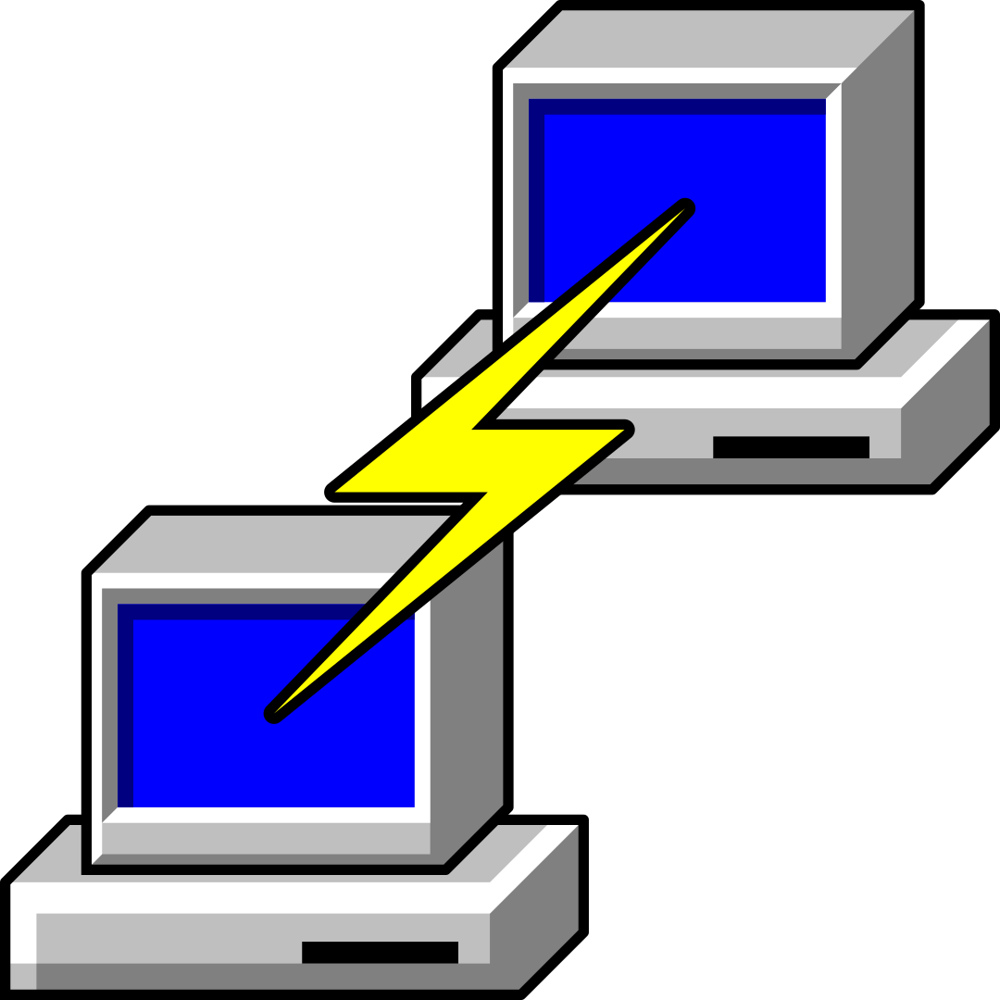

- En aquesta tasca instalarem PuTTY en la nostra **instància de Windows Server** i no conectarem per **SSH** a la instància de **Unbuntu Server**.

> **📌 Abans de res ens conectarem a la nostra instància de Windows Server**
> 

- Descargamos l'aplicació des de [la pàgina oficial](https://www.chiark.greenend.org.uk/~sgtatham/putty/latest.html) i la instalarem **en la nostra instància de Windows Server**.

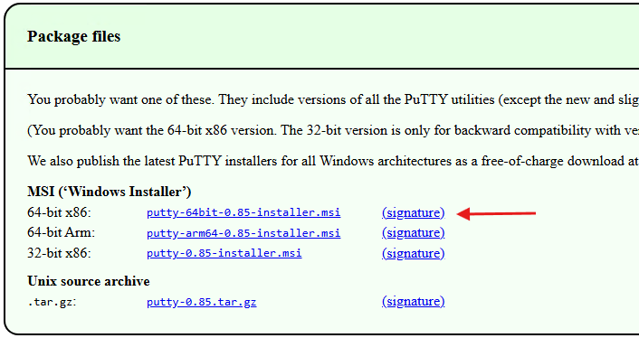

- Una vegada instal·lat **PuTTy** consultarem [la documentació de AWS](https://docs.aws.amazon.com/es_es/AWSEC2/latest/UserGuide/connect-linux-inst-from-windows.html) i la seguirem pas a pas.

#### 9.5.1 Convertir la clau privada amb PuTTYgen

- Executem PuTTYgen (instal·lat al mateix temps que PuTTy).  

- En **Type of key to generate**, elegimos RSA.  

- 

Si la versió de PuTTYGen no inclou aquesta opció, eligirem SSH-2 RSA.

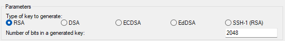

- 

Elegimos Load.  

- De forma predeterminada, PuTTYgen només mostra fitxers amb **l'extensió .ppk**.  

- Per a localitzar el fitxer .pem, seleccionem l'opció de mostrar tots els tipus de fitxer.  

- 

Seleccionem **el fitxer .pem** per al parell de claus que es especificó quan es lanzó la instància i, a continuació, eligimos **Open (Obrir)**.

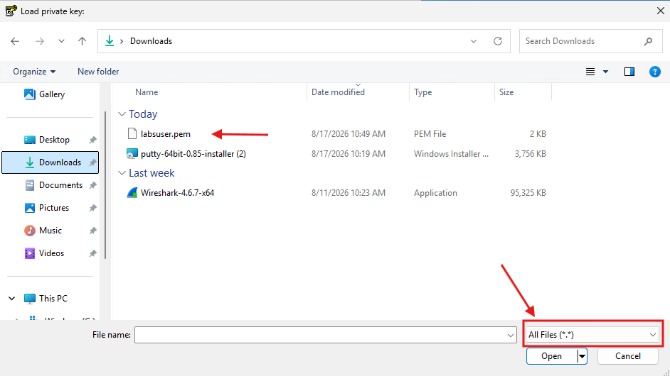

- 

Si la importació es ha fet correctament, no apareixerà un avís similar a la següent imatge.  

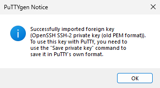

  

- 

Després elegimos **Save private key** per a guardar la clau en un format que PuTTY puga utilitzar.

> **📌 Si no posem cap contrasenya per al fitxer de claus, PuTTYgen mostrarà una advertencia (eligimos Yes si no volem posar contrasenya).**
> 

> 

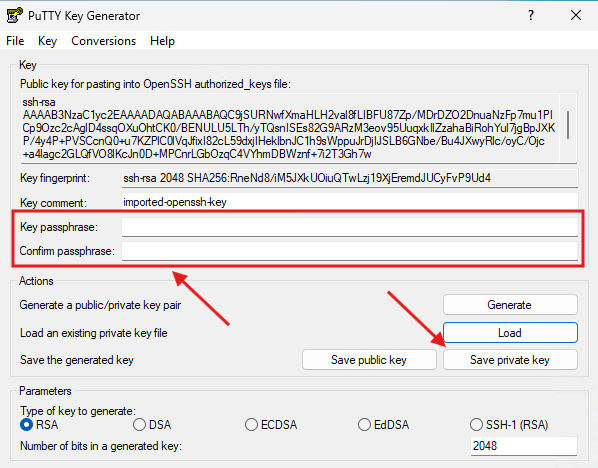

- Especificarem un nom per al fitxer de claus.  

**PuTTY añadirá l'extensió de fitxer .ppk automàticament**.

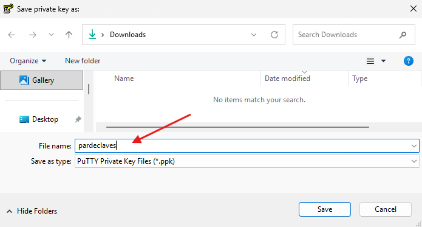

#### 9.5.2 Connexió amb la instància de Linux

- 

Executem PuTTY a anem a **Connection** → **SSH** → **Auth** i en **Private key file** cargamos el fitxer de claus que acabamos de crear.

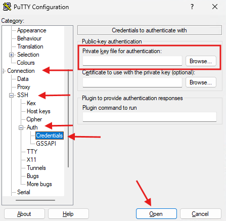

- 

En la pantalla principal, introducimos la IP de la nostra instància de **Ubuntu Server** i lanzamos la connexió.  

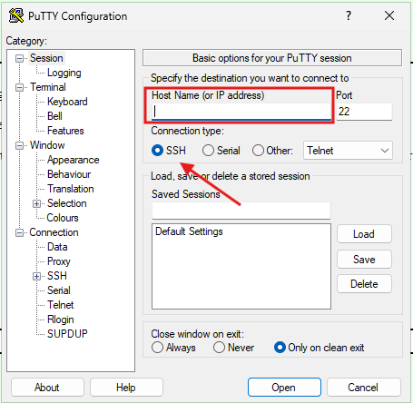

- 

Si hem posat contrasenya al nostre fitxer de claus, l'introducimos.

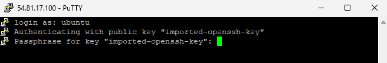

- 

Obviamos les advertencias de seguretat.  

Realitzar captura de pantalla

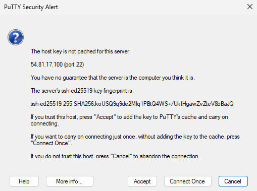

- 

Si tot ha anat bé, tindrem accés a la terminal de la nostra instància.  

Realitzar captura de pantalla

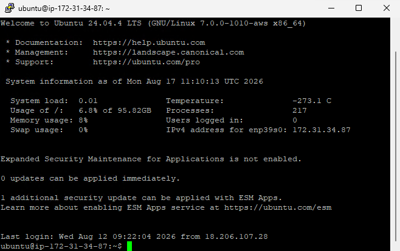

#### 9.5.3 Migració del fitxer de claus

> **📌 Preparació de la següent tasca**
> 

- 

Per a poder realitzar la següent pràctica, necessitarem enviar el fitxer amb el parell de claus de les nostres instàncies (LabUser) a la intancia que usarem de client per a la connexió SSH.  

- 

Eixe tipus de proceder no és **una bona pràctica, des del punt de vista de la seguretat informàtica** però, el farem per a facilitar la connexió SSH entre instàncies amb distribucions Linux en AWS.

- 

Primer recuperarem la IP pública de la instància a la que enviarem el fitxer de claus.

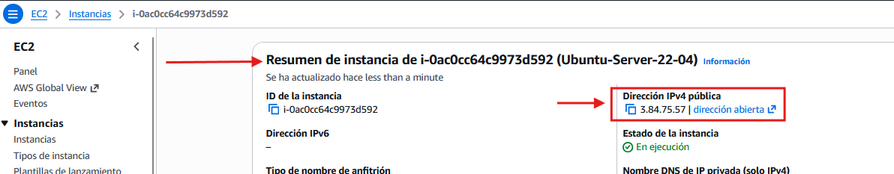

- 

Després enviarem el fitxer de claus **fitxer.pem** a la instància client amb l'aplicació **pscp** de l'ecosistema PuTTy.  

Per a això, usarem la següent sintaxi.  

```bash
pscp -i archivo.ppk archivo.pem ubuntu@IP-publica directorio
```

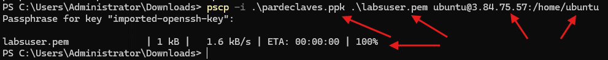

- 

Si ens conectamos per consola de AWS a la instància client, podrem comprovar que el fitxer es ha enviat correctament.

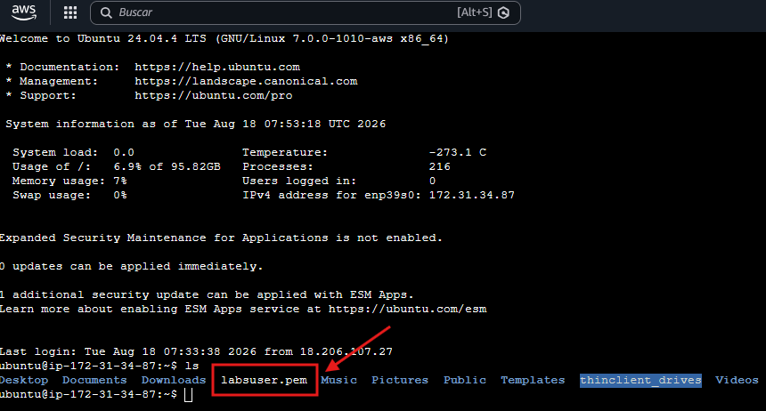

### 9.6 Tasca RA6-CEf-3 - Connexió SSH entre instàncies Linux

> **📌 Obligatorio seguir las normas para la presentación de trabajos escritos.**
> 

#### 9.6.1 Preparació de l'entorn

- 

Abans de res, crearem una altra instància de Ubuntu-server, deixant la configuració del tipus d'instància així com de la capacitat d'almacenatge amb els valors per defecte (t3.micro, 8GB).

- 

Ens conectamos a la instància de Ubuntu-Server **on hem enviat el fitxer.pem amb el parell de claus** i comprobarem que el client SSH està instal·lat.

```bash
ssh -V
```

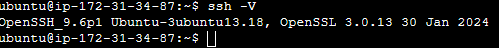

- 

També farem el mateix amb el servidor SSH i comprobarem que està funcionant.

```bash
sshd -V 2<&1
```

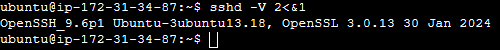

```bash
systemctl status ssh
```

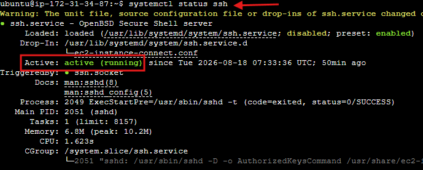

#### 9.4.2 Primera connexió SSH entre màquines Linux

- 

Usarem la sintáxis vista anteriorment però, li añadirem el fitxer de claus:

```bash
ssh -i archivo.pem usuario@direccion_ip_o_dominio
```

És probable que no salte un error al tindre permisos de lectura del fitxer massa permisivos.

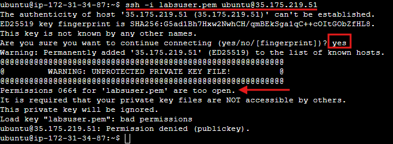

- 

Cambiamos els permisos a només lectura pel propietari amb:

```bash
chmod 400 labsuser.pem
```

On:

```bash
4         0      0
     │         │      │
     ▼         ▼      ▼
propietario  grupo  otros
     │         │      │
     ▼         ▼      ▼
    leer      nada   nada
```

- 

Comprovem els nous permisos del fitxer de clau.

```bash
ls -l labsuser.pem
```

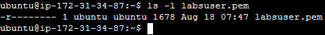

- 

Ens tornem a connectar a la màquina Ubuntu-Server servidor i aquesta vegada, accedim sense problemes.  

Realitzar captura de pantalla

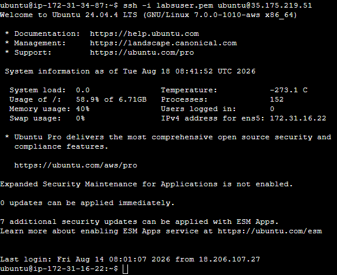


---

## 🎮 Reptes Interactius d'Autoavaluació (+100 XP)

Comprova el teu domini sobre **1.9 - Administració remota segura amb SSH (Secure Shell)** superant aquests 4 reptes gamificats (+25 puntos cadascun):

<div class="interactive-mcq" data-answer="D" data-hint="Revisa els conceptes teòrics i pràctics d'aquesta secció.">
  <div class="mcq-question">🎯 <strong>Repte 1 (+25 pts):</strong> Per a connectar-se des de Windows amb PuTTY a una instància Ubuntu Server en AWS que proporciona una clau privada en format .pem, quina eina s'ha d'utilitzar prèviament?</div>
  <div class="mcq-options">
    <button type="button" class="btn-mcq-opt" data-opt="A">A) Wireshark, per a desencriptar la clau .pem en la xarxa.</button>
    <button type="button" class="btn-mcq-opt" data-opt="B">B) FileZilla Server, per a compilar el fitxer .pem.</button>
    <button type="button" class="btn-mcq-opt" data-opt="C">C) Cap de les anteriors és correcta.</button>
    <button type="button" class="btn-mcq-opt" data-opt="D">D) PuTTYgen, per a convertir el fitxer .pem al format natiu .ppk de PuTTY.</button>
  </div>
  <div class="quiz-feedback"></div>
</div>

<div class="interactive-mcq" data-answer="C" data-hint="Comprova l'apartat corresponent de la unitat.">
  <div class="mcq-question">🎯 <strong>Repte 2 (+25 pts):</strong> En quin fitxer del directori ~/.ssh/ d'un servidor Linux s'emmagatzemen les claus públiques autoritzades per a l'accés SSH sense contrasenya?</div>
  <div class="mcq-options">
    <button type="button" class="btn-mcq-opt" data-opt="A">A) id_rsa.priv</button>
    <button type="button" class="btn-mcq-opt" data-opt="B">B) Cap de les anteriors és correcta.</button>
    <button type="button" class="btn-mcq-opt" data-opt="C">C) authorized_keys</button>
    <button type="button" class="btn-mcq-opt" data-opt="D">D) known_hosts</button>
  </div>
  <div class="quiz-feedback"></div>
</div>

<div class="interactive-vf" data-answer="V" data-hint="Verifica l'afirmació amb els apuntos de la unitat.">
  <div class="vf-statement">✅ <strong>Repte 3 (Vertader o Fals · +25 pts):</strong> En acabar una pràctica en AWS Academy Learner Lab, cal aturar (Stop) les instàncies EC2 per a evitar consumir el pressupost de crèdits del laboratori.</div>
  <div class="vf-buttons">
    <button type="button" class="btn-vf" data-opt="V">Vertader (V)</button>
    <button type="button" class="btn-vf" data-opt="F">Fals (F)</button>
  </div>
  <div class="quiz-feedback" style="width: 100%;"></div>
</div>

<div class="interactive-quiz" data-answer="ssh" data-hint="Les 3 lletres de Secure Shell.">
  <div class="quiz-question">⌨️ <strong>Repte 4 (+25 pts):</strong> Quina ordre de consola s'utilitza en Linux i Windows PowerShell per a iniciar una connexió segura de terminal remot cap a un servidor?</div>
  <div class="quiz-controls">
    <input type="text" class="quiz-input" placeholder="Escriu la resposta..." />
    <button type="button" class="btn-quiz-check">Comprovar</button>
  </div>
  <div class="quiz-feedback"></div>
</div>

### 📋 Llista de Comprovació i Rúbrica d'Assoliment

Marca cada criteri a mesura que completes l'estudi o la resolució pràctica d'aquesta pàgina (**1.9 - Administració remota segura amb SSH (Secure Shell)**):

- [ ] He llegit detingudament la teoria o l'enunciat d'aquesta secció i he anotat els conceptes clau.
- [ ] He revisat els esquemes, taules o blocs de codi i he verificat que sé aplicar-los a l'entorn de treball.
- [ ] He resolt correctament els **4 reptes interactius** superiors obtenint els **100 puntos XP**.
- [ ] He descarregat el comprovant oficial en PDF per a adjuntar-lo a la tasca d'**Aules**.

<div class="aules-delivery-card">
  <h3>📤 Comprovant de Lliurament per a Aules</h3>
  <p>Quan hages completat els reptes interactius i la llista d'autoavaluació d'aquesta pàgina, introdueix el teu nom i descarrega el teu certificat oficial en PDF per a adjuntar-lo a la tasca d'<strong>Aules</strong>.</p>
  <div class="aules-student-field">
    <label for="aules-student-name">👤 Nom i Cognoms de l'Alumne/a:</label>
    <input type="text" id="aules-student-name" class="aules-student-name" placeholder="Ex: Joan Garcia Pérez" />
  </div>
  <div class="aules-score-badge">
    <span class="aules-score-count">0/4 reptes completats (0%) · 0 puntos · 0/4 criteris d'autoavaluació</span>
  </div>
  <div class="aules-actions">
    <button type="button" class="btn-aules-dl" data-module="SEX" data-unit="UD01" data-activity="ut0109">📥 Descarregar Comprovant PDF</button>
    <button type="button" class="btn-aules-copy">📋 Copiar Resum al Porta-retalls</button>
  </div>
  <div class="aules-toast"></div>
</div>

