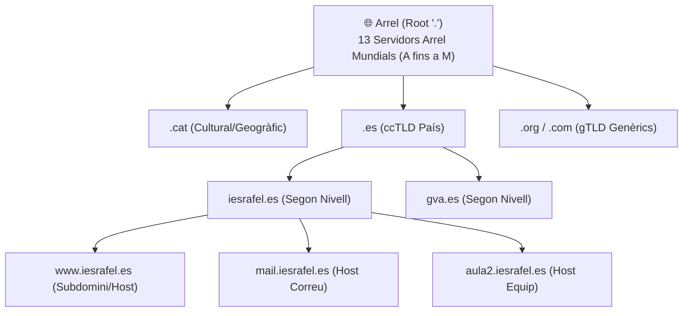

# UT02 — Servei de Resolució de Noms de Domini (DNS)

El **Sistema de Noms de Domini (DNS - *Domain Name System*)** és el servei d'infraestructura més crític d'Internet. S'encarrega de traduir noms fàcilment memoritzables pels humans com `www.iesrafel.internal` a adreces IP numèriques que els routers i encaminadors necessiten per a transportar els paquets de dades.

---

## 📌 1. Estructura Jeràrquica de l'Espai de Noms

El DNS funciona com una base de dades distribuïda i jeràrquica en forma d'arbre invertit:



- **FQDN (*Fully Qualified Domain Name*):** Nom de domini complet acabat en punt (ex.: `servidor1.iesrafel.es.`).
- **Resolució Recursiva:** El client fa la pregunta al seu servidor DNS local (`192.168.1.1`) i aquest s'encarrega de fer totes les consultes necessàries fins a retornar la IP final al client.
- **Resolució Iterativa:** El servidor DNS consulta seqüencialment l'Arrel $\to$ el TLD $\to$ el servidor autoritatiu del domini.

---

## 📌 2. Tipologia de Registres de Recursos (Resource Records - RR)

Dins d'un fitxer de zona DNS, cada entrada s'anomena registre de recurs (RR):

| Tipus de Registre | Nom Complet | Funció Tècnica | Exemple de Sintaxi |
| :---: | :--- | :--- | :--- |
| **SOA** | *Start of Authority* | Primer registre de la zona. Defineix paràmetres de control i número de sèrie. | `@ IN SOA ns1.iesrafel.es. admin.iesrafel.es. (...)` |
| **NS** | *Name Server* | Identifica els servidors DNS autoritatius per a la zona. | `@ IN NS ns1.iesrafel.es.` |
| **A** | *IPv4 Address* | Assigna un nom de host a una adreça IPv4 (32 bits). | `servidor IN A 192.168.1.10` |
| **AAAA** | *IPv6 Address* | Assigna un nom de host a una adreça IPv6 (128 bits). | `servidor IN AAAA 2001:db8::10` |
| **CNAME** | *Canonical Name* | Àlies o sobrenom que apunta a un altre nom canònic (registre A). | `www IN CNAME servidor.iesrafel.es.` |
| **MX** | *Mail Exchanger* | Especifica el servidor de correu del domini amb prioritat numèrica. | `@ IN MX 10 correu.iesrafel.es.` |
| **PTR** | *Pointer* | Resolució inversa (converteix IP a FQDN) en la zona `in-addr.arpa`. | `10 IN PTR servidor.iesrafel.es.` |

---

## 📌 3. Desplegament de Bind9 en Ubuntu Server

**Bind9** (*Berkeley Internet Name Domain*) és el servidor DNS de codi obert més utilitzat arreu del món:

```bash
# 1. Instal·lar Bind9 i eines de diagnòstic DNS
sudo apt update && sudo apt install bind9 bind9utils dnsutils -y
```

### A) Configuració dels Reenviadors (`/etc/bind/named.conf.options`):
Si el nostre servidor no coneix un domini públic extern (com `google.com`), reenvia la consulta als servidors DNS públics:
```text
options {
    directory "/var/cache/bind";
    forwarders {
        1.1.1.1;
        8.8.8.8;
    };
    dnssec-validation auto;
    listen-on { any; };
    allow-query { any; };
};
```

### B) Declaració de Zones a `/etc/bind/named.conf.local`:
```text
// Zona directa
zone "iesrafel.internal" {
    type master;
    file "/etc/bind/db.iesrafel.internal";
};

// Zona inversa (per a la xarxa 192.168.1.0/24)
zone "1.168.192.in-addr.arpa" {
    type master;
    file "/etc/bind/db.192.168.1";
};
```

### C) Creació del Fitxer de Zona Directa (`/etc/bind/db.iesrafel.internal`):
```text
$TTL    604800
@       IN      SOA     ns1.iesrafel.internal. admin.iesrafel.internal. (
                              2026101301 ; Serial (YYYYMMDDNN)
                                  604800 ; Refresh (1 setmana)
                                   86400 ; Retry (1 dia)
                                 2419200 ; Expire (4 setmanes)
                                  604800 ) ; Negative Cache TTL
; Servidors de Noms
@       IN      NS      ns1.iesrafel.internal.

; Registres d'Amfitrions (Hosts)
ns1     IN      A       192.168.1.10
servidor IN     A       192.168.1.10
correu  IN      A       192.168.1.20

; Àlies (CNAME)
www     IN      CNAME   servidor
ftp     IN      CNAME   servidor

; Servidor de Correu
@       IN      MX      10 correu.iesrafel.internal.
```

### D) Creació del Fitxer de Zona Inversa (`/etc/bind/db.192.168.1`):
```text
$TTL    604800
@       IN      SOA     ns1.iesrafel.internal. admin.iesrafel.internal. (
                              2026101301 ; Serial
                                  604800 ; Refresh
                                   86400 ; Retry
                                 2419200 ; Expire
                                  604800 ) ; Negative Cache TTL
; Servidors de Noms
@       IN      NS      ns1.iesrafel.internal.

; Punter Invers (PTR): Últim octet de la IP -> FQDN
10      IN      PTR     servidor.iesrafel.internal.
20      IN      PTR     correu.iesrafel.internal.
```

---

## 📌 4. Verificació de Sintaxi i Eines de Diagnòstic

Abans de reiniciar el servei Bind9 cal comprovar que els fitxers no contenen cap error tipogràfic:

```bash
# Validar el fitxer de configuració general
sudo named-checkconf

# Validar la zona directa
sudo named-checkzone iesrafel.internal /etc/bind/db.iesrafel.internal

# Validar la zona inversa
sudo named-checkzone 1.168.192.in-addr.arpa /etc/bind/db.192.168.1

# Si tot torna 'OK', reiniciar el servei
sudo systemctl restart bind9
```

### Comprovació amb `dig` i `nslookup`:
```bash
# Prova de resolució directa contra el nostre servidor local
dig @127.0.0.1 www.iesrafel.internal +short
# Retorn esperat:
# servidor.iesrafel.internal.
# 192.168.1.10

# Prova de resolució inversa
dig @127.0.0.1 -x 192.168.1.10 +short
# Retorn esperat:
# servidor.iesrafel.internal.
```
