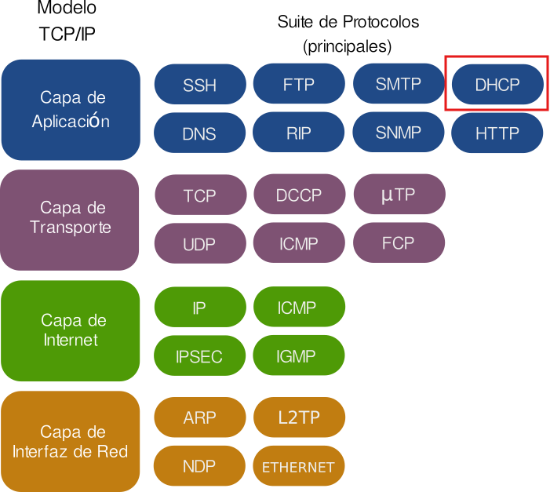
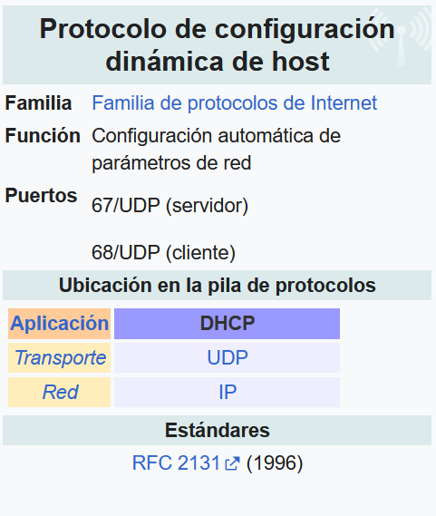
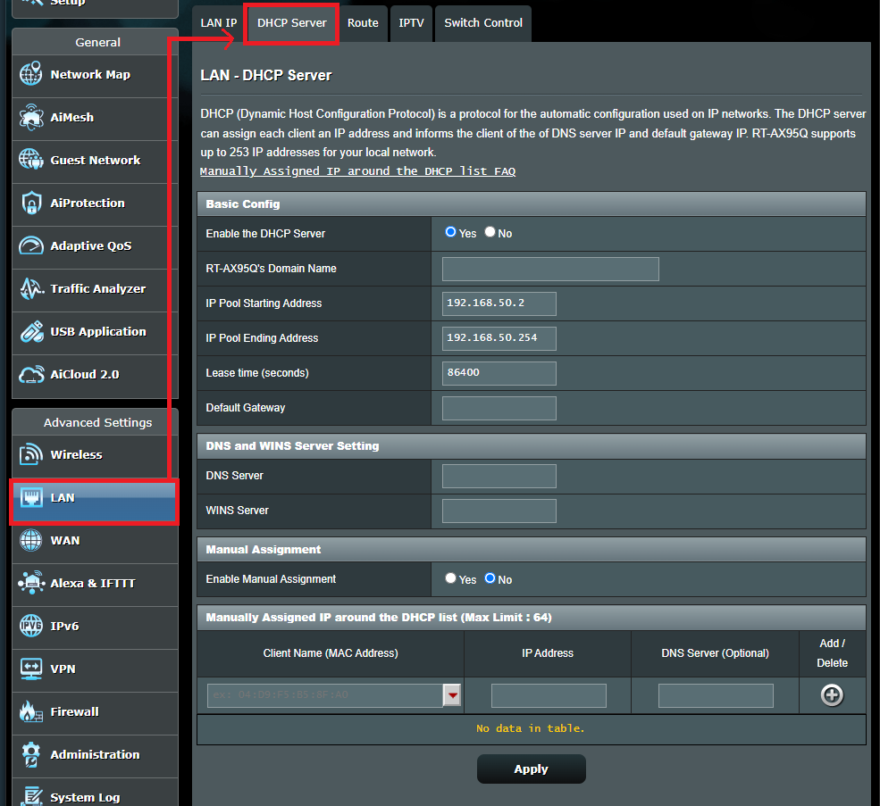
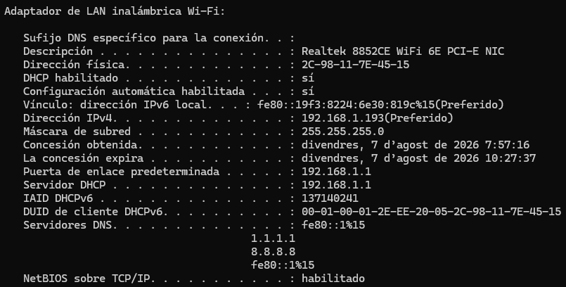
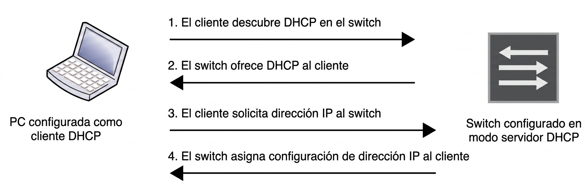

  

    🏆 <strong>Progrés d'aquesta secció:</strong> 0 de 4 superats (0%)
    ⭐ <strong>0 punts</strong>
  

  

    

  

# 2.2 - DHCP (Dynamic Host Configuration Protocol)

1. El DHCP (Dynamic Host Configuration Protocol) és un protocol de xarxa que permet als dispositius obtindre automàticament una adreça IP i altres paràmetres necessaris per a connectar-se a la xarxa, com la **màscara de subxarxa**, la **porta d'enllaç predeterminada** i els **servidors DNS**.

1. Açò elimina la necessitat de **configurar manualment cada dispositiu**, facilitant enormement l'administració de xarxes grans.

1. Abans del DHCP, les xarxes dependían del protocol BOOTP (Bootstrap Protocol), que proporcionava configuracions bàsiques, com l'assignació d'adreces IP. No obstant això, BOOTP presentava diverses limitacions:

  - **Configuració manual:** Els administradors debían assignar manualment una IP a cada dispositiu, el que era tedioso i poc pràctic en xarxes grans.

  - **Assignació estàtica:** Les adreces IP eren fixes, el que significava que cada dispositiu mantenía la mateixa adreça encara que es desconectara, el que no permitía un ús eficient de les adreces disponibles.

  - **Falta de flexibilitat:** No estava dissenyat per a gestionar xarxes dinàmiques o mòbils, com dispositius que es mueven entre diferents àrees de cobertura o xarxes.

### 2.1 Característiques principals de DHCP

1. 

**Assignació automàtica de IPs:**  

DHCP permet l'assignació dinàmica d'adreces IP als dispositius quan es connecten a la xarxa. Açò assegura que no haja conflictos d'adreces IP duplicades.

1. 

**Escalabilitat:**  

Ideal per a xarxes grans, on administrar adreces IP de manera manual seria inviable. Amb DHCP, es poden gestionar cientos o milers de dispositius de manera eficient.

1. 

**Facilitat de configuració:**  

A l'automatitzar l'assignació de IPs i altres paràmetres de xarxa, els administradors poden reduir significativament el temps i esforç que implicaría configurar manualment cada dispositiu.

1. 

**Compatibilitat amb diferents tipus d'assignació:**  

  - **Assignació manual:** L'administrador assigna una IP específica a un dispositiu, encara que aquest es conecte de manera dinàmica.

  - **Assignació automàtica:** El servidor DHCP assigna una IP de forma permanente a un dispositiu des del moment de la seua primera connexió.

  - **Assignació dinàmica:** El servidor DHCP assigna una IP per un temps limitat (lease time), després de la qual cosa la IP pot ser reasignada si no es renueva l'arrendament.

1. 

**Administració centralitzada:**  

Amb un servidor DHCP centralitzat, els administradors poden gestionar i actualitzar les configuracions de xarxa des d'un només lloc, en lloc d'accedir a cada dispositiu de manera individual.

### 2.2 Components del funcionament de DHCP

1. L'arquitectura de DHCP està formada per tres elements principals:

  - **Els servidors DHCP**

  - **Els clients DHCP**

  - **Els agentes de retransmisió DHCP (també anomenats relés DHCP)**

1. La comunicació entre client i servidor es realitza a través d'un intercanvi de missatges DHCP, mitjançant el qual el client obté i renueva tant la concessió de la seua adreça IP com el resta de paràmetres de configuració de xarxa.

💡 Què paràmetres de xarxa pot assignar un servidor DHCP a un client?

- Adreça IP

- Màscara de subxarxa

- Porta d'enllaç predeterminada

💡 I a més...

- Servidor DNS

- Domini de cerca (search domain)

- Temps de concessió (lease time)

- Identificador de classe de proveïdor (Vendor Class Identifier)

- Número d'intentos de retransmisió

- Intervalo entre reintentos

#### 2.2.1 Servidor DHCP

1. 

El servidor DHCP constituye la peça central de tot el protocol. El seu cometido és lliurar adreces IP i resta paràmetres de xarxa als equips que les solicitan. Per a això, manté un conjunt d'adreces disponibles (conegut com pool) i controla les concessions que es van otorgant a cada client.

1. 

Entre els paràmetres que el servidor pot assignar als clients es troben:

  - **Adreces IP dinàmiques** i temporals tomades d'un pool, asignades a qualsevol client dins d'una subred determinada (concessió dinàmica).

  - **Adreces IP fixes** associades a un client concret segons la seua adreça MAC (concessió estàtica).

  - **Màscara de subxarxa**

  - **Porta d'enllaç predeterminada**

  - **Servidor DNS**

1. 

Asimismo, el servidor DHCP guarda de forma persistente la informació de xarxa entregada als clients. Ja que DHCP nació com una evolució de BOOTP, els servidors DHCP també són capaços d'atendre solicitudes procedentes d'aquest protocol anterior.

> **📌 Exemple de configuració d'un servidor DHCP d'un router Asus rt-ax58u"**
> 

> 

#### 2.2.2 Client DHCP

1. 

Es considera client DHCP a qualsevol dispositiu IP de la xarxa configurado per a comportar-se com host i solicitar a un servidor DHCP els paràmetres necessaris per a funcionar, entre ells la seua adreça IP.

1. 

Quan un equip actua com client DHCP, obté la seua configuració TCP/IP (inclosa l'adreça IP) des d'un servidor DHCP extern a través de qualsevol dels seus interfícies físiques.

1. 

Per a habilitar aquest comportament és necessari configurar una interfície lògica del dispositiu, de mode que solicite l'adreça al servidor DHCP corresponent. A més, han de definir-se els següents paràmetres:

  - **L'identificador de classe de proveïdor** (Vendor Class Identifier, DHCP opció 60). Indica què tipus de dispositiu, fabricant o model és.

  - **El temps de concessió** (lease time). És el periodo durant el qual el client pot usar l'adreça IP que li asignó el servidor. A l'acercar-se el venciment (normalment el 50%), el client intentará renovar-la.

  - **L'adreça del servidor DHCP**. És la IP del servidor al que el client dirigirá els seus solicitudes. Normalment el client descubre al servidor mitjançant un DISCOVER en broadcast, però en alguns dispositius es pot fixar l'adreça concreta per a enviar les peticions en unicast.

  - **El número d'intentos de retransmisió**. DHCP funciona sobre UDP, que no garanteix la lliurament, així que si el client no rep resposta al seu DISCOVER o REQUEST, ha de reenviar-lo. Aquest paràmetre defineix quantes vegades el reintentará abans de donar-se per vencido. Si es agota sense èxit, el client considera que no hi ha servidor disponible i, segons l'equip, pot deixar la interfície sense adreça o usar una adreça link-local (169.254.x.x).

  - **L'intervalo entre reintentos**. És el temps d'espera entre un intento i el següent. Juntament amb el número de reintentos determina quant tarda el dispositiu en rendir-se.

1. 

Les concessions obtenides com client poden renovar-se posteriorment.

> **📌 En la següent imatge es mostra un fragment del resultat de l'ejecució del comanda `ipconfig /all` en un equip amb Windows 11, on es pot observar que l'adreça IP ha sigut assignada per un servidor DHCP**
> 

> 

#### 2.2.3 Relé DHCP (DHCP relay agent)

- L'agente de retransmisió DHCP és un host TCP/IP de la qual funció consisteix en **fer de puente entre clients i servidors DHCP** quan tots dos es troben en subredes distintes, reenviant els missatges corresponents entre ells.

- Gràcies a aquest mecanisme, en xarxes de gran mida amb múltiples subredes, basta amb un únic servidor DHCP per a atendre a tots els clients, sempre que existisquen agentes de retransmisió situats en els routers que interconectan aquestes subredes.

- Un mateix dispositiu pot combinar tots dos rols si gestiona distintes interfícies o subredes, però no pot actuar simultàniament com servidor DHCP i com agente de retransmisió DHCP per a una mateixa interfície o subred.

- La diferència entre tots dos rols és clara: el servidor respon directament al client entregándole una adreça IP del seu propi rang, mentre que l'agente de retransmisió es limita a reenviar els missatges DHCP entre el client i el servidor configurado, fins i tot quan tots dos pertanyen a xarxes IP distintes.

### 2.3 Model client servidor DHCP

- Ja l'hem mencionado diverses vegades. El protocol **DHCP** segueix un model client-servidor, on el servidor DHCP és responsable d'assignar adreces IP i altres paràmetres de xarxa als clients que el solicitan.

- El procés de comunicació entre client i servidor es realitza mitjançant un intercanvi de missatges, que permet al client obtindre la seua configuració de xarxa de manera automàtica.

El procés d'assignació d'adreces IP mitjançant DHCP segueix un cicle de quatre passos, conegut com DORA:

1. **Discover (Descubriment):**  

Quan un dispositiu (client) es connecta a la xarxa, envia un missatge de broadcast anomenat "DHCP Discover" per a trobar servidors DHCP disponibles.

1. **Offer (Oferta):**  

Els servidors DHCP responden amb un missatge "DHCP Offer", que conté una adreça IP disponible i altres paràmetres de xarxa.

1. **Request (Solicitud):**  

El client selecciona una oferta i respon amb un "DHCP Request" per a acceptar la IP ofrecida.

1. **Acknowledge (Confirmació):**  

El servidor DHCP respon amb un missatge "DHCP Acknowledge", confirmant que la IP ha sigut assignada i que el dispositiu pot usar-la.

### 2.4 Avantatges i desavantatges de DHCP

> **📌 Avantatges de DHCP**
> 

> - **Reducció d'errors humans:** A l'automatitzar el procés, es minimizan els errors que poden ocórrer durant la configuració manual d'adreces IP.

> - **Optimització de recursos:** La capacitat de reutilitzar adreces IP gràcies al temps d'arrendament ajuda a optimitzar l'ús de l'espai d'adreces IP en la xarxa.

> - **Configuració remota:** Els administradors poden realitzar canvis en la configuració de xarxa sense necessitat d'accés físic als dispositius.

> **📌 Desavantatges de DHCP**
> 

> - **Falta de control sobre l'assignació de IPs:** A l'usar DHCP, pot haver menys control directe sobre què dispositius reben què IPs, a menys que es configure l'assignació manual.

> - **Punt únic de fallada:** Si el servidor DHCP falla, els dispositius nous o que necessiten renovar la seua adreça IP no podran connectar-se a la xarxa correctament.

---

## 🎮 Reptes Interactius d'Autoavaluació (+100 XP)

Comprova el teu domini sobre **2.2 - DHCP (Dynamic Host Configuration Protocol)** superant aquests 4 reptes gamificats (+25 punts cadascun):

  
🎯 <strong>Repte 1 (+25 pts):</strong> Quins són els quatre missatges que componen el procés d'assignació dinàmica d'IP en DHCP (acrònim DORA)?

  

    <button type="button" class="btn-mcq-opt" data-opt="A">A) DHCPDISCOVER, DHCPOFFER, DHCPREQUEST i DHCPACK</button>
    <button type="button" class="btn-mcq-opt" data-opt="B">B) DNSQUERY, DNSOFFER, DNSREQUEST i DNSACK</button>
    <button type="button" class="btn-mcq-opt" data-opt="C">C) SYN, SYN-ACK, ACK i FIN</button>
    <button type="button" class="btn-mcq-opt" data-opt="D">D) Cap de les anteriors és correcta.</button>
  

  

  
🎯 <strong>Repte 2 (+25 pts):</strong> Per què en un laboratori d'AWS EC2 hem de crear una xarxa virtual aïllada (amb Hyper-V o KVM/libvirt) dins de la instància amfitriona per a provar el nostre propi servidor DHCP?

  

    <button type="button" class="btn-mcq-opt" data-opt="A">A) Perquè el protocol DHCP no funciona sobre sistemes operatius de 64 bits.</button>
    <button type="button" class="btn-mcq-opt" data-opt="B">B) Perquè Windows Server i Ubuntu Server no tenen cap rol o paquet de servidor DHCP.</button>
    <button type="button" class="btn-mcq-opt" data-opt="C">C) Cap de les anteriors és correcta.</button>
    <button type="button" class="btn-mcq-opt" data-opt="D">D) Perquè la xarxa VPC d'AWS ja té el seu propi servidor DHCP gestionat i bloqueja el trànsit de broadcast DHCP entre instàncies EC2.</button>
  

  

  
✅ <strong>Repte 3 (Vertader o Fals · +25 pts):</strong> Una reserva DHCP permet assignar sempre la mateixa adreça IP a un equip concret vinculant-la a la seua adreça física MAC.

  

    <button type="button" class="btn-vf" data-opt="V">Vertader (V)</button>
    <button type="button" class="btn-vf" data-opt="F">Fals (F)</button>
  

  

  
⌨️ <strong>Repte 4 (+25 pts):</strong> Quins ports UDP utilitza el protocol DHCP (escriu el port del servidor, p. ex. 67)?

  

    <input type="text" class="quiz-input" placeholder="Escriu la resposta..." />
    <button type="button" class="btn-quiz-check">Comprovar</button>
  

  

### 📋 Llista de Comprovació i Rúbrica d'Assoliment

Marca cada criteri a mesura que completes l'estudi o la resolució pràctica d'aquesta pàgina (**2.2 - DHCP (Dynamic Host Configuration Protocol)**):

- [ ] He llegit detingudament la teoria o l'enunciat d'aquesta secció i he anotat els conceptes clau.
- [ ] He revisat els esquemes, taules o blocs de codi i he verificat que sé aplicar-los a l'entorn de treball.
- [ ] He resolt correctament els **4 reptes interactius** superiors obtenint els **100 punts XP**.
- [ ] He descarregat el comprovant oficial en PDF per a adjuntar-lo a la tasca d'**Aules**.

  <h3>📤 Comprovant de Lliurament per a Aules</h3>
  
Quan hages completat els reptes interactius i la llista d'autoavaluació d'aquesta pàgina, introdueix el teu nom i descarrega el teu certificat oficial en PDF per a adjuntar-lo a la tasca d'<strong>Aules</strong>.

  

    <label for="aules-student-name">👤 Nom i Cognoms de l'Alumne/a:</label>
    <input type="text" id="aules-student-name" class="aules-student-name" placeholder="Ex: Joan Garcia Pérez" />
  

  

    0/4 reptes completats (0%) · 0 punts · 0/4 criteris d'autoavaluació
  

  

    <button type="button" class="btn-aules-dl" data-module="SEX" data-unit="UD02" data-activity="ut0202">📥 Descarregar Comprovant PDF</button>
    <button type="button" class="btn-aules-copy">📋 Copiar Resum al Porta-retalls</button>
  

  

