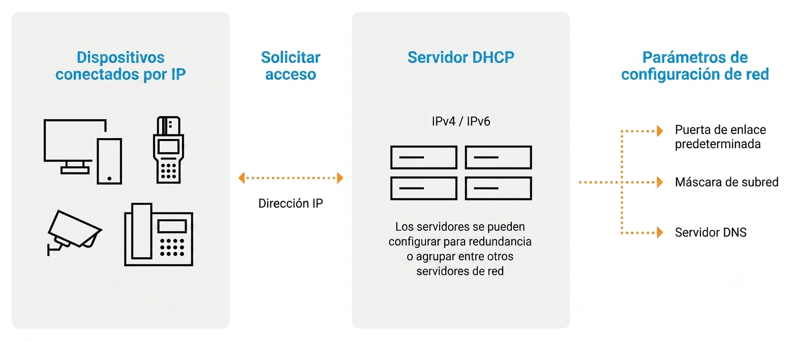

  

    🏆 <strong>Progrés d'aquesta secció:</strong> 0 de 4 superats (0%)
    ⭐ <strong>0 punts</strong>
  

  

    

  

# 2.3 - Configuració de DHCP

### 3.1 Configuració d'un equip a la xarxa informàtica

- 

Qualsevol equip que pertany a una xarxa requereix que es configure amb uns paràmetres mínims, que són **l'adreça IP, la màscara i la porta d'enllaç per defecte**.  

- 

L'adreça IP identifica a l'equip de manera única, i la màscara permet determinar la xarxa o subred en la que es troba l'equip.

- 

Amb aquests dos paràmetres és suficient per a tindre conectivitat en la xarxa. Si es vol disposar d'accés fora de la xarxa pròpia (per exemple, a Internet o al resta de la xarxa corporativa), és necessari definir també **la porta d'enllaç predeterminada**.

- 

A banda de la configuració bàsica, els equips poden necessitar (i de fet el necessiten) més paràmetres de configuració com, per exemple: el nom de l'host, el servidor DNS, el fitxer d'inici a descarregar, etc.

### 3.2 Assignació de IP

- 

Tot equip de xarxa necessita disposar d'una adreça IP que l'identifique de manera única en la xarxa.

- 

Exemple: La majoria dels usuaris disposen en casa d'un equip (o més) connectats a un router que proporciona l'accés a Internet. Aquest equip està configurado com client DHCP i, a l'iniciar-se, rep la configuració de xarxa del router.

#### 3.2.1 Adreça IP estàtica

- Una adreça **IP estàtica** és una adreça que s'assigna manualment a un dispositiu i permanece fixa al llarg del temps.

- A diferència d'una **IP dinàmica** (assignada per DHCP), l'adreça estàtica no canvia, el que és útil en casos on es necessita una IP constant, com en servidors o dispositius crítics.

> **📌 Característiques de les adreces IP estátiques:**
> 

> - **Permanencia:** L'adreça no canvia, a menys que l'administrador el decida.

> - **Configuració manual:** Les adreces han d'asignar-se manualment en el dispositiu o servidor de xarxa.

> - **Ús en dispositius crítics:** Solen asignar-se a servidors, impresoras, routers, cámaras de seguretat i altres equips que requereixen estabilitat.

> **📌 Avantatges de les IP estátiques:**
> 

> - **Accés remoto constant:** És més senzill accedir a dispositius de forma remota sense preocupar-se per canvis de IP.

> - **Estabilitat en serveis de xarxa:** És ideal per a serveis que requereixen una adreça IP fixa, com servidors de correu, web o bases de dades.

> - **Configuració de regles de xarxa:** Facilita la creació de regles per a firewalls o VPN, ja que l'adreça és predecible.

> **📌 Desavantatges de les IP estátiques:**
> 

> - **Conflictos de IP:** Si no es gestiona adequadament, pot haver conflictos quan dos dispositius intentan usar la mateixa adreça.

> - **Major carrega administrativa:** Requereix major treball manual, el que aumenta la possibilitat d'errors en xarxes grans.

> - **Menor flexibilitat:** En xarxes amb molts dispositius que es connecten i desconectan, les adreces estátiques són menys pràctiques.

#### 3.2.2 Adreça IP dinàmica

- Una adreça **IP dinàmica** és una adreça que s'assigna automàticament a un dispositiu per un servidor DHCP i pot canviar amb el temps.

- Açò permet una gestió més eficient de les adreces IP, especialment en xarxes grans o amb molts dispositius que es connecten i desconectan.

> **📌 Característiques de les adreces IP dinàmiques:**
> 

> - **Assignació automàtica:** El servidor DHCP assigna l'adreça IP sense intervenció manual.

> - **Temporalitat:** L'adreça pot canviar després d'un período de temps (lease time) o quan el dispositiu es reconecta a la xarxa.

> - **Ús eficient de l'espai d'adreces:** Permet reutilitzar adreces IP, optimitzant el seu ús en xarxes amb molts dispositius.

> **📌 Avantatges de les IP dinàmiques:**
> 

> - **Facilitat d'administració:** Redueix la carrega administrativa a l'eliminar la necessitat d'assignar adreces manualment.

> - **Flexibilitat:** Ideal per a xarxes amb dispositius que es connecten i desconectan freqüentment, com laptops, smartphones i tablets.

> - **Prevenció de conflictos de IP:** El servidor DHCP gestiona les adreces, minimitzant el risc de conflictos.

> **📌 Desavantatges de les IP dinàmiques:**
> 

> - **Canvi d'adreça:** L'adreça IP pot canviar, el que pot ser problemátic per a serveis que requereixen una IP constant.

> - **Dependència del servidor DHCP:** Si el servidor falla, els dispositius poden no obtindre una adreça IP vàlida.

> - **Menor control sobre l'assignació:** Pot ser més difícil rastrear què dispositiu té què adreça IP en un moment donat.

---

## 🎮 Reptes Interactius d'Autoavaluació (+100 XP)

Comprova el teu domini sobre **2.3 - Configuració de DHCP** superant aquests 4 reptes gamificats (+25 punts cadascun):

  
🎯 <strong>Repte 1 (+25 pts):</strong> En Ubuntu Server amb KVM/libvirt, quin dispositiu del sistema hem de comprovar que existeix per a verificar que la virtualització imbricada (Nested Virtualization) està activa?

  

    <button type="button" class="btn-mcq-opt" data-opt="A">A) /etc/fstab</button>
    <button type="button" class="btn-mcq-opt" data-opt="B">B) /var/log/syslog</button>
    <button type="button" class="btn-mcq-opt" data-opt="C">C) Cap de les anteriors és correcta.</button>
    <button type="button" class="btn-mcq-opt" data-opt="D">D) /dev/kvm</button>
  

  

  
🎯 <strong>Repte 2 (+25 pts):</strong> Com s'anomena el període de temps durant el qual un servidor DHCP cedeix l'ús d'una adreça IP a un client abans que haja de renovar-la?

  

    <button type="button" class="btn-mcq-opt" data-opt="A">A) Temps de vida útil del paquet (TTL ICMP).</button>
    <button type="button" class="btn-mcq-opt" data-opt="B">B) Cap de les anteriors és correcta.</button>
    <button type="button" class="btn-mcq-opt" data-opt="C">C) Concessió o lloguer (Lease time).</button>
    <button type="button" class="btn-mcq-opt" data-opt="D">D) Zona d'exclusió permanent.</button>
  

  

  
✅ <strong>Repte 3 (Vertader o Fals · +25 pts):</strong> El missatge inicial DHCPDISCOVER s'envia des del client amb adreça IP d'origen 0.0.0.0 i adreça IP de destinació de broadcast 255.255.255.255.

  

    <button type="button" class="btn-vf" data-opt="V">Vertader (V)</button>
    <button type="button" class="btn-vf" data-opt="F">Fals (F)</button>
  

  

  
⌨️ <strong>Repte 4 (+25 pts):</strong> Quin és l'acrònim de 4 lletres que resumeix les quatre fases d'assignació d'adreça IP en DHCP?

  

    <input type="text" class="quiz-input" placeholder="Escriu la resposta..." />
    <button type="button" class="btn-quiz-check">Comprovar</button>
  

  

### 📋 Llista de Comprovació i Rúbrica d'Assoliment

Marca cada criteri a mesura que completes l'estudi o la resolució pràctica d'aquesta pàgina (**2.3 - Configuració de DHCP**):

- [ ] He llegit detingudament la teoria o l'enunciat d'aquesta secció i he anotat els conceptes clau.
- [ ] He revisat els esquemes, taules o blocs de codi i he verificat que sé aplicar-los a l'entorn de treball.
- [ ] He resolt correctament els **4 reptes interactius** superiors obtenint els **100 punts XP**.
- [ ] He descarregat el comprovant oficial en PDF per a adjuntar-lo a la tasca d'**Aules**.

  <h3>📤 Comprovant de Lliurament per a Aules</h3>
  
Quan hages completat els reptes interactius i la llista d'autoavaluació d'aquesta pàgina, introdueix el teu nom i descarrega el teu certificat oficial en PDF per a adjuntar-lo a la tasca d'<strong>Aules</strong>.

  

    <label for="aules-student-name">👤 Nom i Cognoms de l'Alumne/a:</label>
    <input type="text" id="aules-student-name" class="aules-student-name" placeholder="Ex: Joan Garcia Pérez" />
  

  

    0/4 reptes completats (0%) · 0 punts · 0/4 criteris d'autoavaluació
  

  

    <button type="button" class="btn-aules-dl" data-module="SEX" data-unit="UD02" data-activity="ut0203">📥 Descarregar Comprovant PDF</button>
    <button type="button" class="btn-aules-copy">📋 Copiar Resum al Porta-retalls</button>
  

  

