<div class="interactive-progress-tracker">
  <div class="tracker-header">
    <span>🏆 <strong>Progreso de esta sección:</strong> <span class="tracker-count">0 de 4 superados (0%)</span></span>
    <span class="tracker-pts">⭐ <strong>0 puntos</strong></span>
  </div>
  <div class="tracker-bar">
    <div class="tracker-fill" style="width: 0%;"></div>
  </div>
</div>

# 2.5 - Tarea RA1-CEcd-1 - Instalación y configuración de un DHCP con Windows Server en AWS

> **📌 Obligatorio seguir las normas para la presentación de trabajos escritos.**
> 

### 5.1 Objectiu de la pràctica

- Desplegar un servidor DHCP en Windows Server sobre AWS amb virtualizació imbricada.

- En aquest primer pas instalarem i configurarem el rol **DHCP Server** en Windows Server, i observarem en temps real com diversos equips client obtenen la seua configuració IP (DHCPDISCOVER → OFFER → REQUEST → ACK), reserves, exclusions, àmbits (scopes), opcions d'àmbit (DNS, porta d'enllaç, etc.).

### 5.2 Limitacions de AWS per al desplegament d'un servei DHCP

- 

Dins de **una VPC** (virtual private cloud) de AWS, **el trànsit broadcast/multicast no es propaga entre instàncies**.

- 

DHCP depèn de broadcasts (`255.255.255.255`), així que un client en una instància EC2 **mai "veurà" un DHCPOFFER** d'una altra instància EC2 en la mateixa subred.  

- 

Cada targeta de xarxa ENI (Elastic Network Interface) rep el seu IP exclusivament **del DHCP intern de AWS, que no es pot sustituir**.

- 

**Solució:** Montar tota la pràctica **dins** d'una sola instància EC2, usant un hipervisor imbricat (Hyper-V) on sí existeix broadcast real entre les VMs virtuals.

> **📌 Novetat Feb 2026**
> 

> - Des del **16 de febrer de 2026**, AWS suporta oficialment virtualizació imbricada en instàncies EC2 **normals** (no metal).  

> - Familias soportades actualment: `C8i`, `M8i`, `R8i`, `C8id`, `R8id`, `M8id`, `C8i-flex`, `R8i-flex`, `M8i-flex`, `X8i`, `C7i`, `R7i`, `M7i`, `C7id`, `R7id`, `M7id`, `C7i-flex`, `R7i-flex`, `M7i-flex`, `I7i`. 

> - Només procesadors Intel (no Graviton). Hipervisors L1 suportats: **Hyper-V** i **KVM**.

### 5.3 Arquitectura del laboratorio

> **📌 Diagrama de la infraestructura de xarxa**
> 

> 

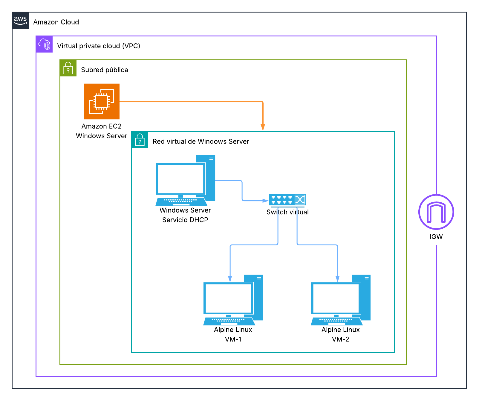

- Dispondremos d'una instància EC2 amb Windows Server 2025 Base (veure apuntes de `Acceso y control remoto`), sobre la que instalarem el rol **DHCP Server**.

- Configurarem un **switch virtual intern** en Hyper-V, de mode que el trànsit broadcast/multicast quede confinado dins de l'hipervisor.

- Lanzarem 2 clients Linux Alpine, que obtendrán la seua configuració IP del servidor DHCP de Windows Server.

- Observarem en temps real com es produeix el procés d'assignació d'adreces IP mitjançant DHCP (DORA: Discover → Offer → Request → Acknowledge) amb l'analitzador de xarxes **Wireshark**.

#### 5.3.1 Activar la virtualizació de EC2 en AWS

> **📌 Activar la virtualizació de la CPU per la consola de AWS**
> 

> - 

> Abrimos el **cloudshell de AWS**.
> 


> - 

> Escrivim els següents comandes:
> 
**Nota IMPORTANT:** Canviar la id de l'exemple per la **id de la vostra instància**.

```bash
# 1. Parar la instancia (aunque la acabes de arrancar)
aws ec2 stop-instances --instance-ids i-069fe851e6325d765

# 2. Esperar a que quede realmente parada
aws ec2 wait instance-stopped --instance-ids i-069fe851e6325d765

# 3. Activar nested virtualization con el comando correcto
aws ec2 modify-instance-cpu-options \
  --instance-id i-069fe851e6325d765 \
  --nested-virtualization enabled

# 4. Arrancarla de nuevo
aws ec2 start-instances --instance-ids i-069fe851e6325d765
```

- 

Powershell de AWS una vegada obert.

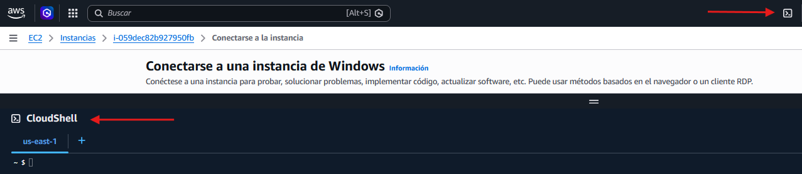

- Comandes en ejecució.  

Realitzar captura de pantalla  

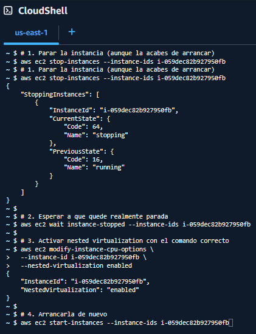

#### 5.3.2 Comprovar el nested virtualization en una instància

Per a això, ens conectarem a la instància de Windows Server creada en pràctiques anteriors.

> **📌 Comprovació del Nested Virtualization**
> 

> - 

> Abrimos el Windows Powershell i escrivim el següent comanda

```bash
Get-WindowsFeature -Name Hyper-V
```

- 

Si Obtenim el següent resultat ([ ] buit + Available), significa que està **disponible per no instal·lat**.

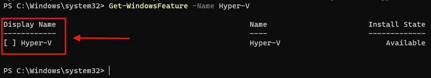

> **📌 Activació del Nested Vitualization**
> 

> - Activarem la virtualizació imbricada amb el següent comanda.

```bash
Install-WindowsFeature -Name Hyper-V -IncludeManagementTools -Restart
```

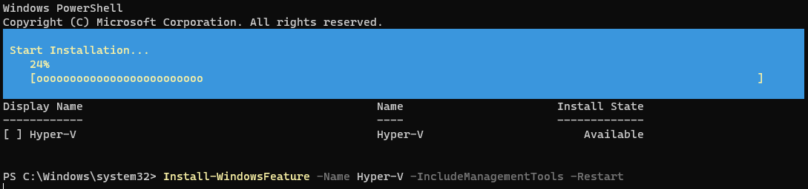

- Com hem inclòs l'opció de reinicio del sistema (-Restart), perderem la connexió amb la instància...

> **📌 Comprovació del Nested Virtualization per CLI**
> 

> - Ens conectamos de nou a la instància.
Abrimos el Windows Powershell i escrivim el següent comanda

```bash
Get-WindowsFeature -Name Hyper-V
```

- Si ens apareix [X] Hyper-V, significa que el servei es ha instal·lat correctament.  

Realitzar captura de pantalla    

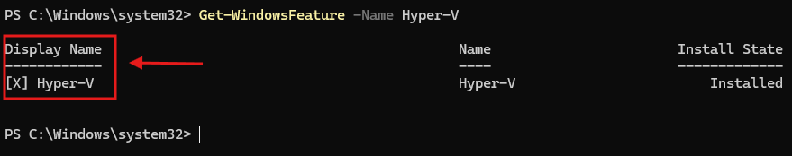

> **📌 Comprovació del Nested Virtualization en la consola de Windows Server**
> 

> - Abrimos el **Server Manager**.

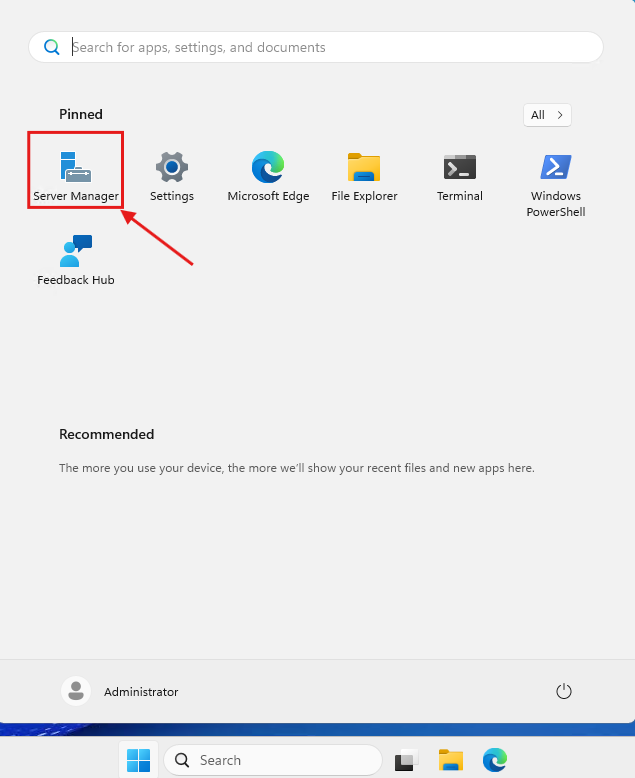

> - Seleccionem Local Server → Services → cerquem hyper-V
> 
Realitzar captura de pantalla  
> 

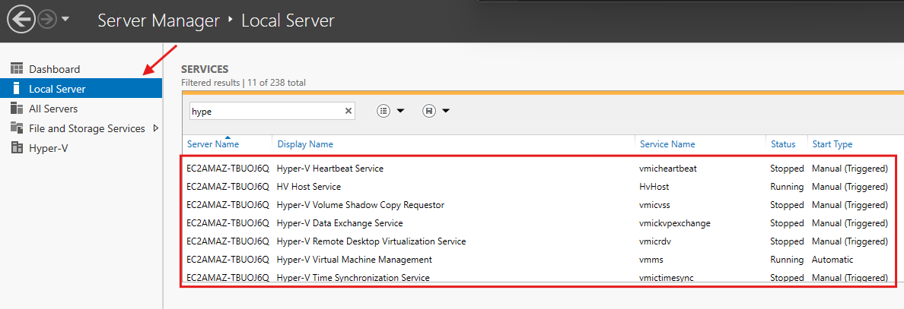

#### 5.3.3 Crear el switch virtual intern

- 

Anem a **Hyper-V Manager** → **Virtual Switch Manager**:

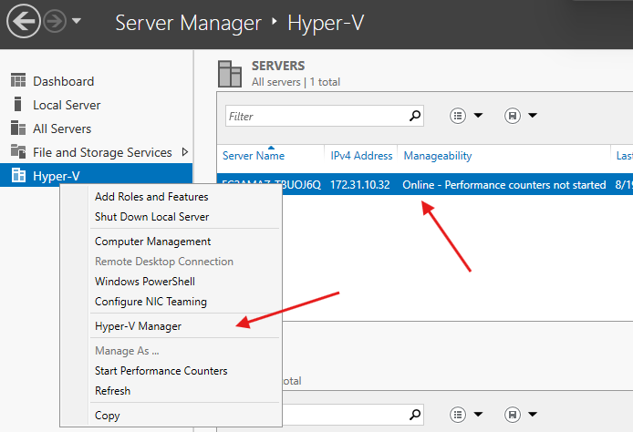

- 

Després seleccionem → **New virtual network switch**

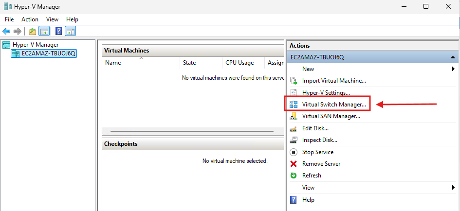

- 

Tipus: **Internal**. Açò assegura que el trànsit DHCP mai saldrá cap a la xarxa de AWS ni a altres instàncies de la VPC/subred.

- 

També seleccionarem **Enable virtual LAN id...**. D'eixe mode l'adaptador de xarxa virtual apareixerà com qualsevol un altre adaptador físic.  

Realitzar captura de pantalla

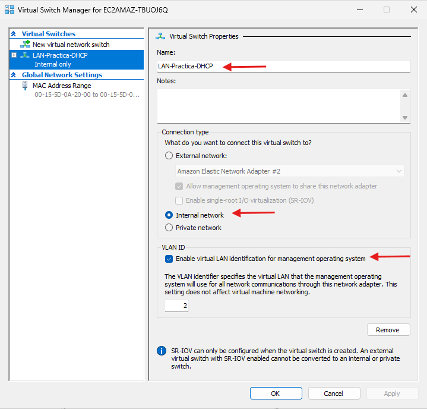

Després de **ipconfig**

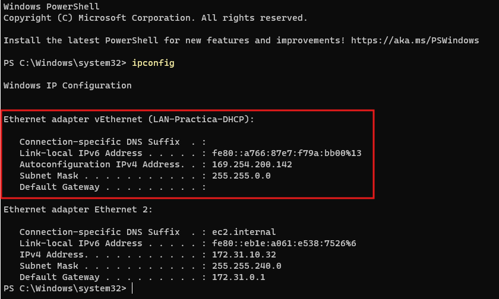

- 

Si tornem a **Hyper-V** → **SERVERS** → Refrescamos l'estat del servidor veurem que tenim una IP interna del servidor en la nostra xarxa virtual privada, sent la una altra IP, la IP de la instància dins de **la VPC de AWS**.  

Realitzar captura de pantalla

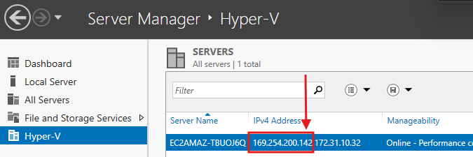

#### 5.3.4 Configurar els paràmetres de xarxa

- Com podem veure en les capturas anteriors, el servidor té assignada la IP 169.254.200.142.

- Açò s'ha de a la falta d'un servidor DHCP en la xarxa virtual, el que provoca l'activació automàtica d'una adreça APIPA (Automatic Private IP Addressing).

- 

Fins a que no despleguemos el servidor DHCP, l'assignació de IPs en la xarxa privada no podrà realitzar-se de forma automàtica, per la qual cosa configurarem manualment la IP del servidor que més avant farà el ROL de servidor DHCP.

- 

Ens dirigimos a **Local Server** → **Properties** → **vEthernet**

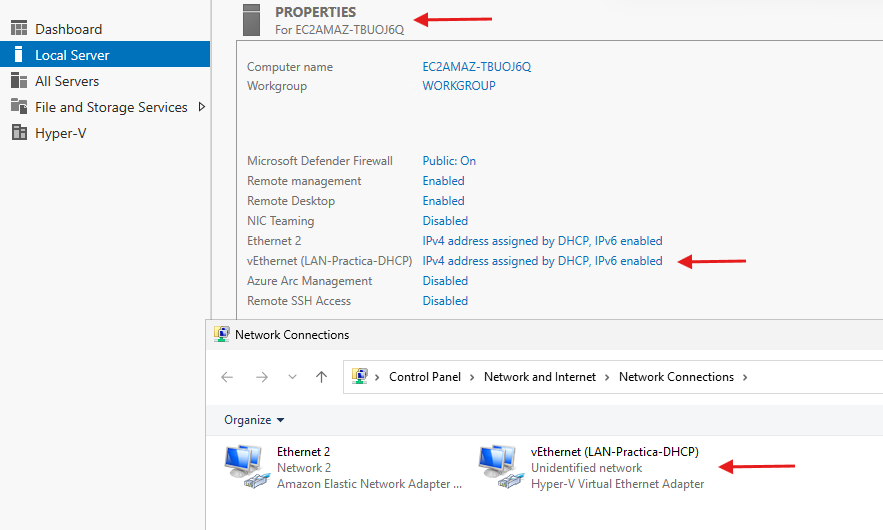

- 

Una vegada encontrado l'adaptador, configurarem **el protocol TCP/IPv4**.

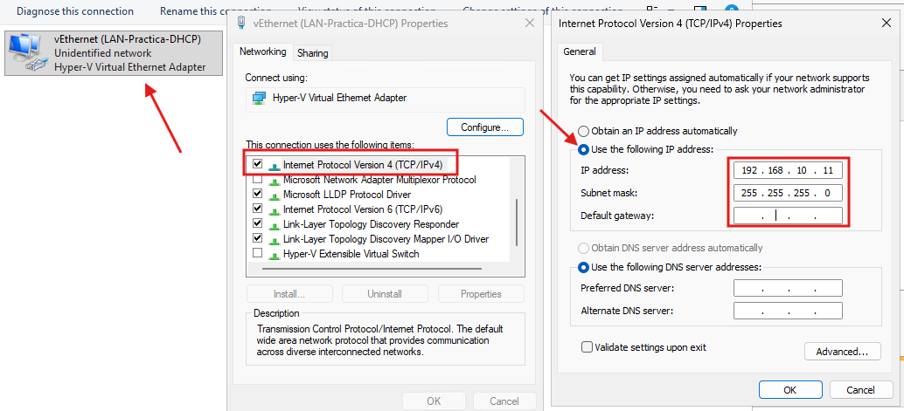

- 

Refrescamos la informació i ja tindrem la IP esperada per al nostre servidor.  

Realitzar captura de pantalla  

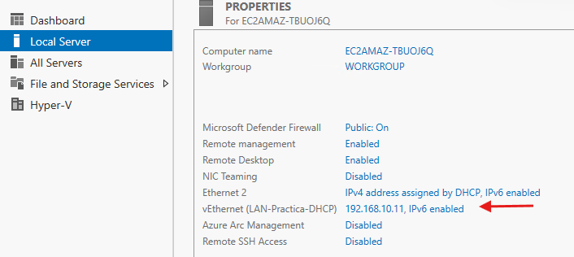

- 

Amb açò ja tindrem montada la xarxa virtual de Windows Server. El següent pas serà montar el servei DHCP sobre el servidor de Windows Server.

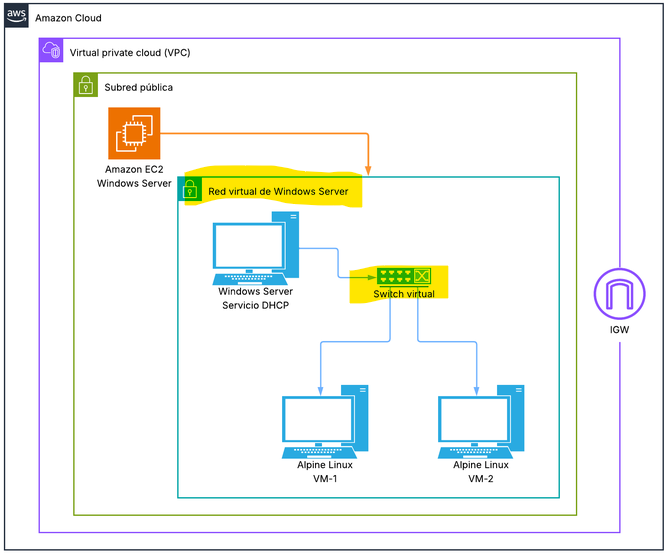

### 5.4 Instal·lació i configuració del rol DHCP en l'host (Windows Server anfitrión)

#### 5.4.1 Instal·lar el rol DHCP

- Ens dirigimos a la consola de Windows Server i seleccionem **Add rols and features**.

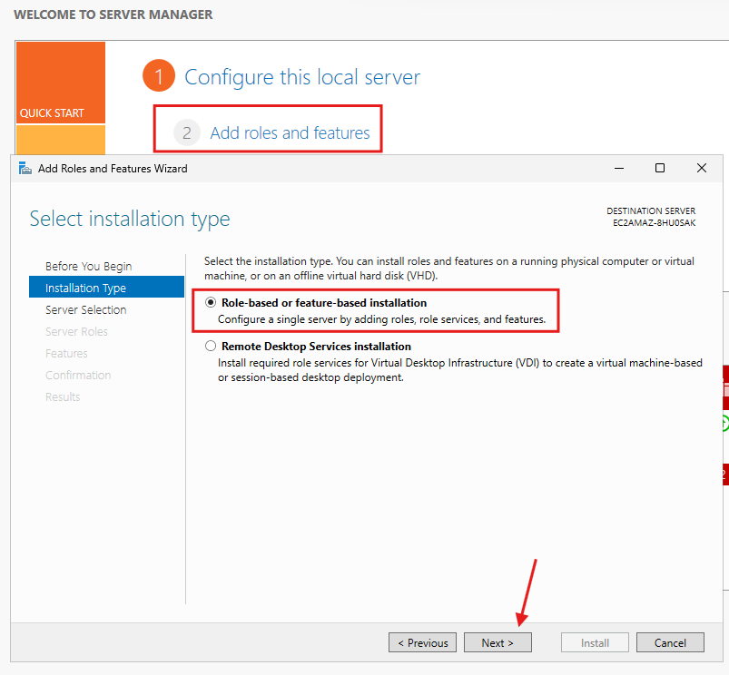

- En server rols seleccionem el servei que volem implementar.  

Realitzar captura de pantalla

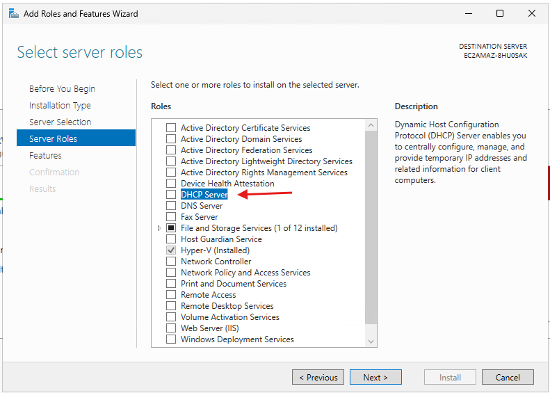

- Confirmamos les caracteristiques necessàries per al servivio DHCP.

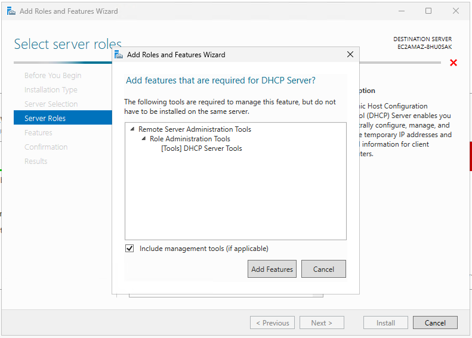

- Recordatorios: De res serveix llançar un servei sense un plantejament previo.

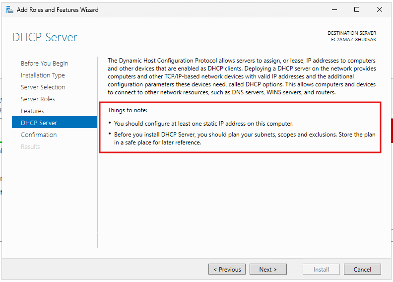

- La instal·lació del servei DHCP **no requereix reinicio** però, seleccionarem l'opció de tots modes.

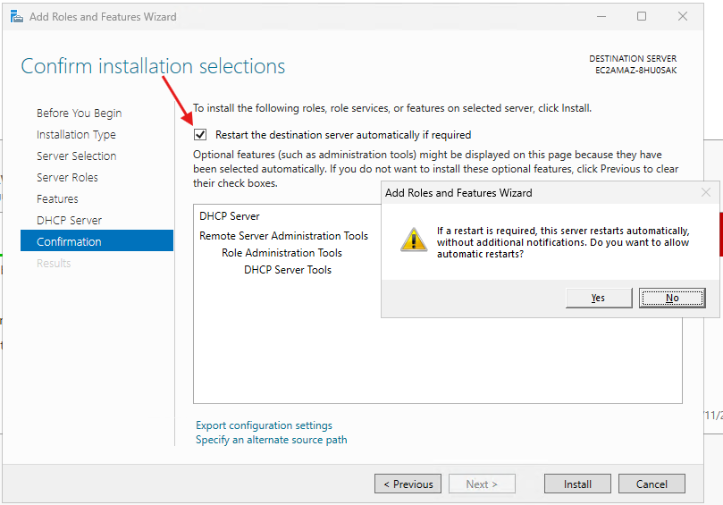

- S'inicia la instal·lació.

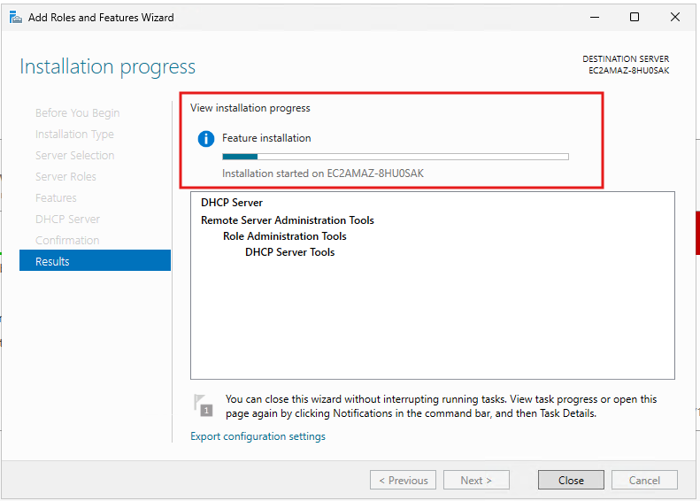

- Al final l'instalador dirá que el DHCP requereix configuració. El farem en el següent pas. De moment cerramos l'assistent.

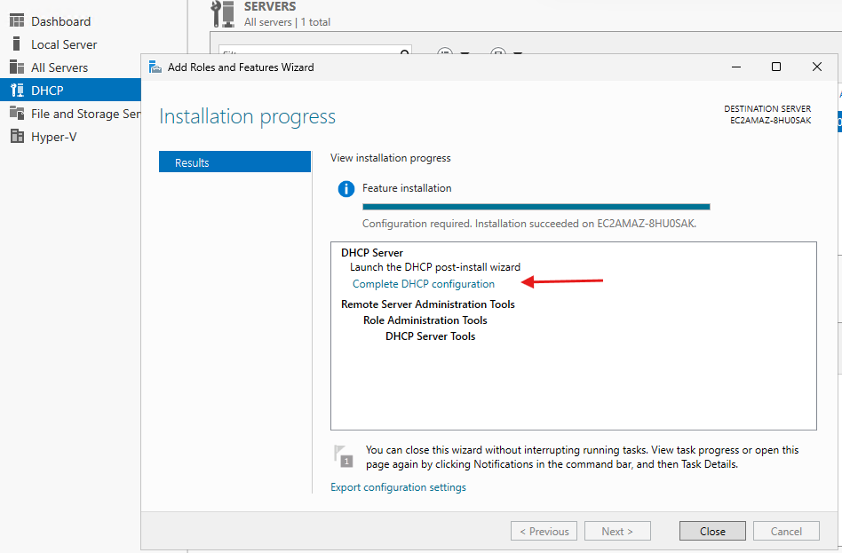

#### 5.4.2 Configurar el rol DHCP

- Tornem al panell de control on veurem que tenim el servei DHCP disponible.

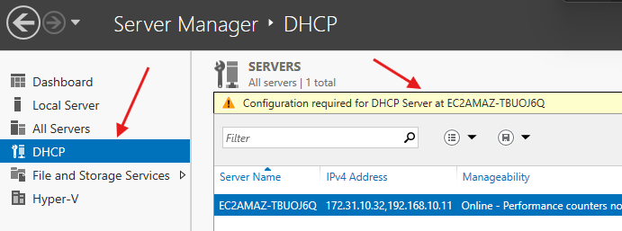

- Completem la configuració del DHCP.

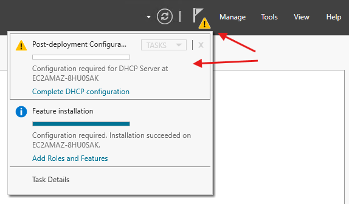

- Fem un commit.

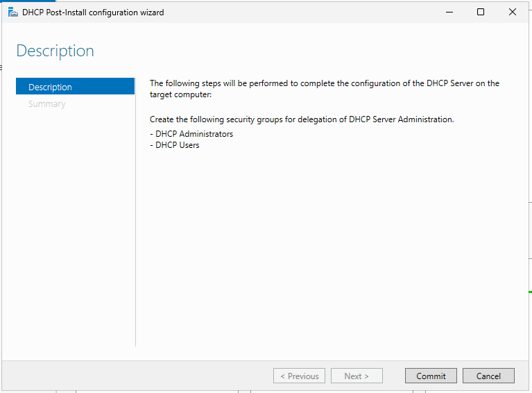

- Anem al panell de control del DHCP i comprovem que el servei sobre IPv4 i IPv6 està implementat.

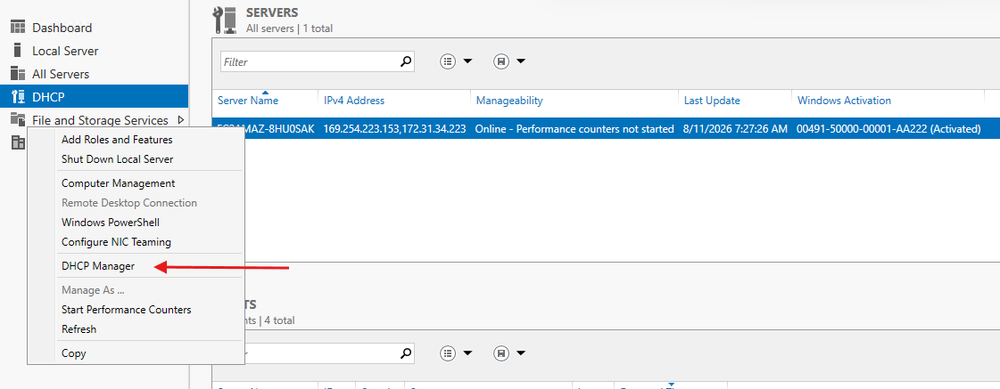

  

Realitzar captura de pantalla

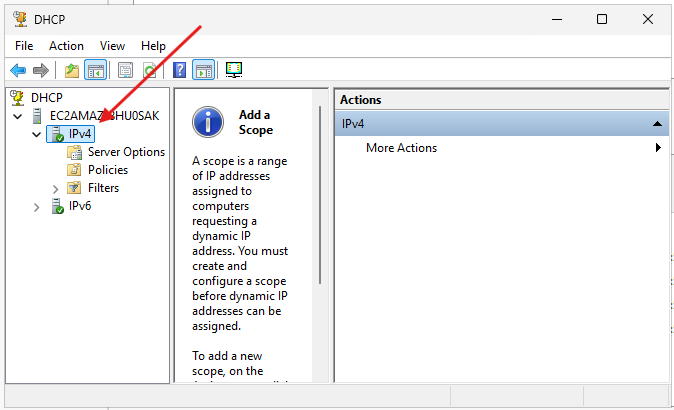

#### 5.4.3 Crear l'àmbit (scope)

Una vegada instal·lat el rol de servidor DHCP, el següent pas és crear un àmbit (scope), és a dir, el rang d'adreces IP que el servidor podrà assignar automàticament als equips de la xarxa.

En aquest apartat configurarem aquest rang juntament amb els paràmetres bàsics necessaris (màscara de subxarxa, porta d'enllaç, duració de la concessió, etc.) perquè els clients de la xarxa privada puguen obtindre la seua configuració de xarxa de forma automàtica.

- Anem a la consola de configuració de DHCP.

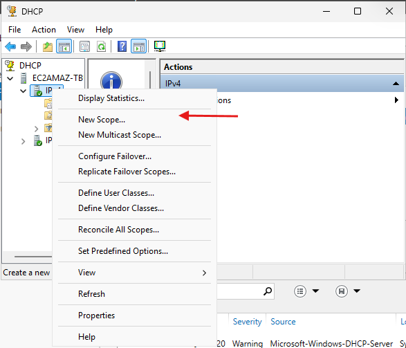

- Seleccionem **new scope** i donem un nom a l'àmbit.

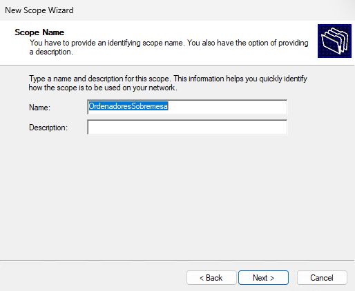

- Establecerem un rang d'adreces en funció de les nostres necessitats. També tindrem en compta deixar fóra del rang DHCP les adreces IP reservades per als sistemes que requereixen **IP estàtica** (switches, servidors de domini, servidors DHCP, impresoras o sistemes d'emmagatzematge en xarxa).

- 

Finalment, haurem de reservar un altre rang d'adreces IP per als dispositius no anclats a la xarxa, com tabletas, ordinadors portátiles o telèfons mòbils.

> **📌 Cura!**
> 

> Deixar fóra del rang DHCP al servidor DHCP i a la porta d'enllaç predeterminada, ja que si no el fem, el servidor DHCP podria assignar aquestes adreces a altres clients, provocant conflictos de IP i problemes de conectivitat en la xarxa.  

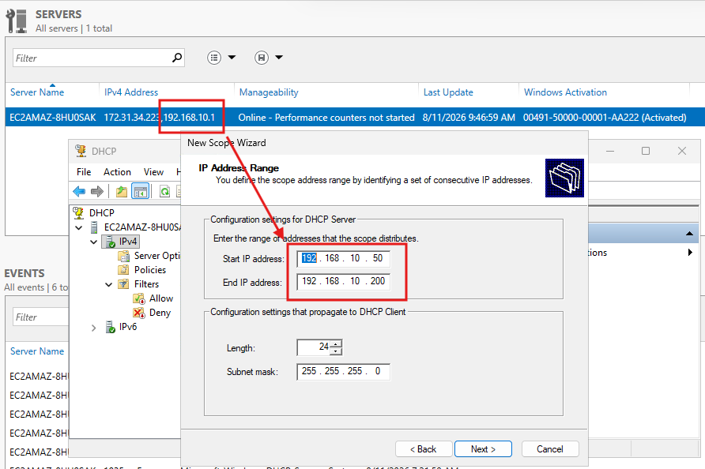

- 

Dejamos en blanc la pantalla de **Add Exclusions and Delay**.

- Configurar la duració del lease (lease duration) és a dir, el temps durant el qual un client mantendrá assignada una adreça IP abans de tindre que renovar-la. Aquest valor ha d'ajustar-se segons el tipus de xarxa i de dispositius que la componen: en xarxes estables amb equips fixos convé establir una duració llarga (diversos dies), mentre que en xarxes amb gran quantitat de dispositius mòbils o temporals resulta més adequat un lease corto, ja que permet liberar i reutilitzar les adreces IP amb major freqüència.
En el nostre cas, establecerem una duració de lease de 8 dies (valor per defecte).

- En **Configure DHCP Options** seleccionem l'opció **No** per a configurar-lo més avant.

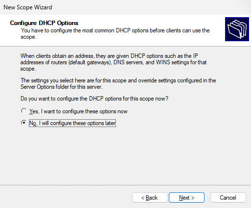

- En post installation no saldrá un avís de reiniciar el servei.

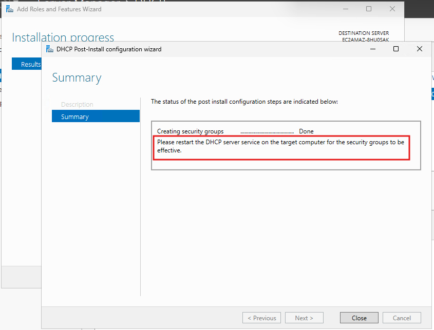

- Reiniciamos el servei.

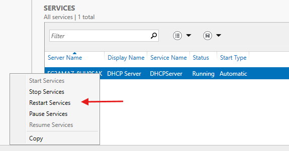

#### 5.4.4 Activar el scope

- Anem a la consola de DHCP i veurem el nostre scope en roig (desactivado).

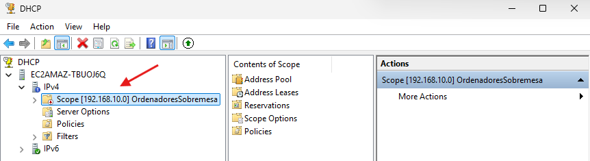

- Farem clic dret i l'activarem.  

Realitzar captura de pantalla

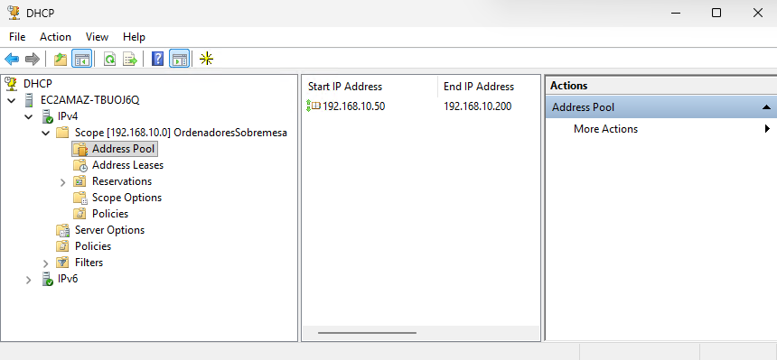

#### 5.4.5 Configurar opcions de l'àmbit

Les opcions d'àmbit són paràmetres de configuració addicionals que el servidor DHCP pot assignar als clients DHCP per exemple el DNS i la porta d'enllaç (encaminador).

- Anem a scope i seleccionem **Configure Options...**

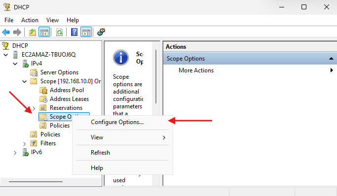

- Cerquem l'opció **003 Encaminador**, que permitirá, **en un escenario real**, a les màquines connectades a la xarxa accedir a Internet. **No configurarem el DNS**, ja que el veurem en una altra unitat, ni definirem un controlador de domini, ja que la implementació de **Active Directory** es tratará més avant.  

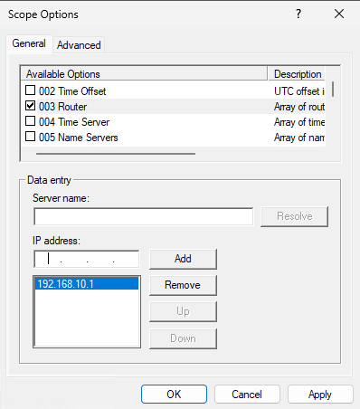

- Comprovem que l'opció es ha guardat correctament.  

Realitzar captura de pantalla  

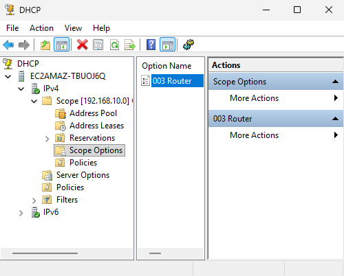

#### 5.4.6 Best Practices analyzer

No és una eina especifica del servei DHCP sinó de tot l'ecosistema de Windows Server.

- Anem a BPA → **TASKS** → Start BPA Scan

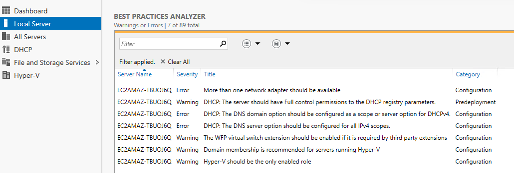

> **📌 Nota**
> 

> Alguns dels errors o advertencias que apareixen s'han de a les limitacions de la nostra infraestructura. No els tindrem en compta.

#### 5.4.7 Comprovar el servei per CLI

```bash
Get-DhcpServerV4Scope
Get-DhcpServerV4OptionValue -ScopeId 192.168.10.0
```

Realitzar captura de pantalla  

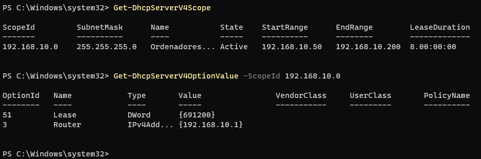

```bash
ipconfig
```

Realitzar captura de pantalla  

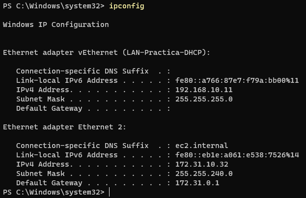

- Amb açò ja tindrem montada la xarxa virtual de Windows Server i el servidor DHCP. El següent pas serà montar clients amb Alpine Linux i comprovar si les asignacions de IP i l'accés a internet es fa correctament.

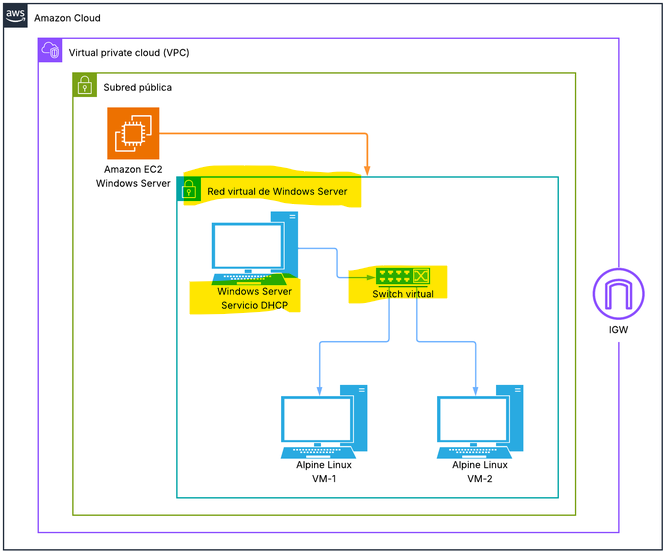

### 5.5 Creació de les màquines virtuals client

- Amb RAM limitada (`m7i.large` amb 8 GiB), el més eficient és que **el propi host Windows Server actúe com servidor DHCP** i usar Hyper-V només per a les VMs client.  

- Com client, **Alpine Linux** és l'opció més lleugera (256–512 MB per VM) i perfectament vàlida per a veure el procés DHCP complet.

#### 5.5.1 Creació de les carpetes de treball

Crearem dos carpetes de treball: **ISOs** i **VMs**.

- **ISO** contendrá els fitxers .iso dels sistemes operatius que descargarem.

- **VM** contendrá els discs duros de les màquines virtuals que lanzarem.

La creació de les carpetes es pot realitzar tant des de l'explorador de fitxers com en línia de comandes:

```bash
New-Item -Path "C:\ISO" -ItemType Directory -Force
New-Item -Path "C:\VM" -ItemType Directory -Force
```

#### 5.5.2 Descarregar el ISO

- Com ja hem comentado, descargarem [Alpine Linux](https://alpinelinux.org/downloads/) al ser una versió molt lleugera de linux.

- La versió elegida per a les nostres pràctiques serà la versió optimitzada per a virtualizació i arquitectura de 32 bits (Virtual + x86).

- A l'igual que per a la creació de les carpetes, la imatge es pot descarregar amb l'ajuda del navegador o per línia de comandes.

```bash
Invoke-WebRequest -Uri "https://dl-cdn.alpinelinux.org/alpine/v3.24/releases/x86/alpine-virt-3.24.1-x86.iso" -OutFile "C:\ISO\alpine.iso"
```

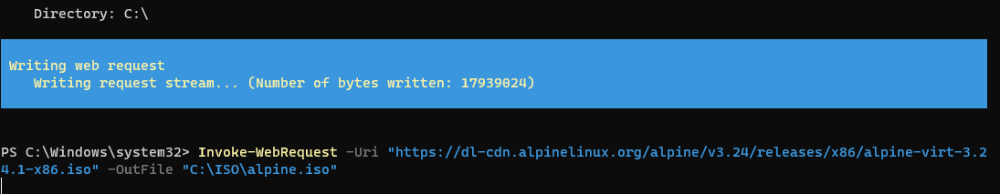

- Comprovem que la descarrega és correcta (ha de rondar els 45-50 MB):

```bash
Get-Item "C:\ISO\alpine.iso" | Select-Object Name, Length
```

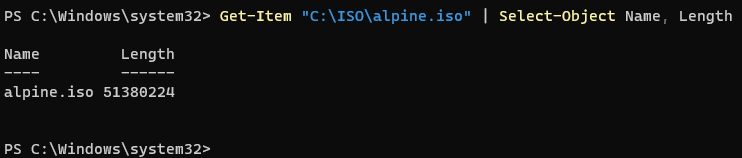

#### 5.5.3 Crear la VM

> **📌 Podem usar l'assistent per a la creació de la màquina virtual.**
> 

> - Per a això anirem a **Hyper-V Manager** → **New** → **Virtual Machine**"

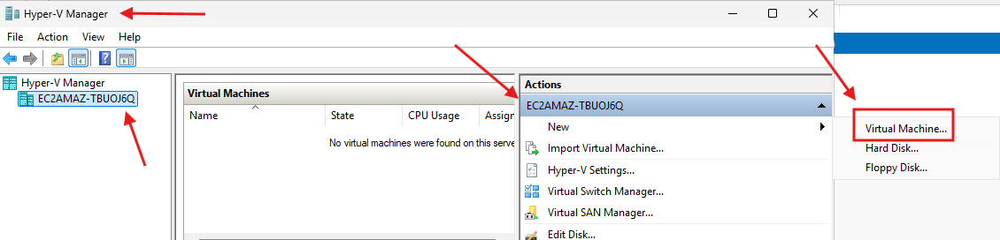

> - Donem un nom a la màquina.

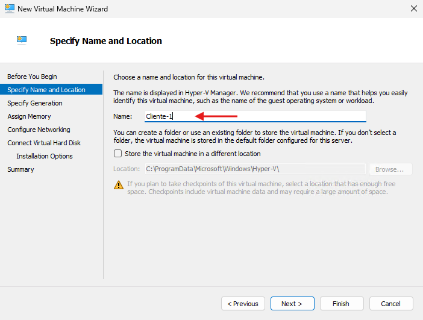

> - Seleccionem **Generation 1**.

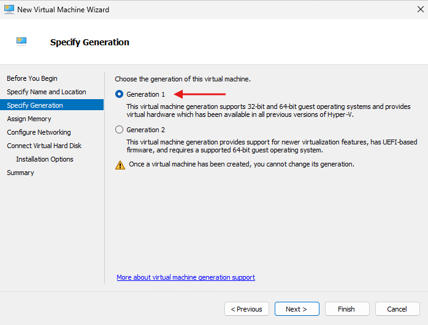

> - Assignem 512MB de memòria RAM per a la màquina.

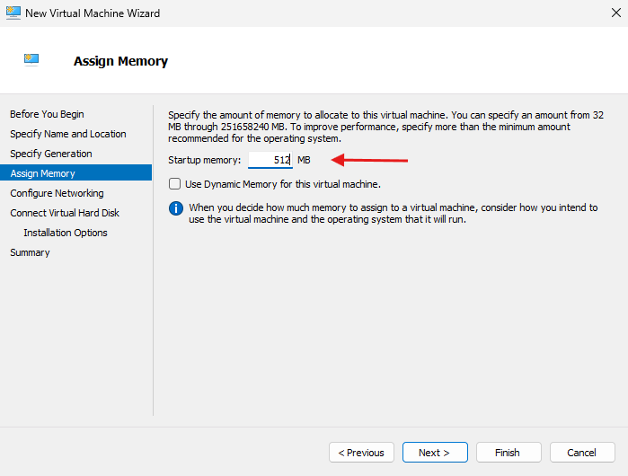

> - Conectamos la màquina al nostre switch virtual.


> - Disc duro virtual. Ubicarem el disc duro en la carpeta **VM* creada anteriorment.


> - Opcions d'instal·lació del SO. En **Image file** posem la ubicació de la nostra imatge.iso.


> - Finalitzem la creació de la màquina virtual.


> **📌 Creació de la màquina virtual per línia de comanda.**
> 

> - 

> Declarar la màquina:

```bash
New-VM -Name "Cliente-1" `
-MemoryStartupBytes 256MB `
-Generation 1 `
-NewVHDPath "C:\VM\Cliente-1.vhdx" `
-NewVHDSizeBytes 4GB `
-SwitchName "LAN-Práctica-DHCP"
```

- 

Declarar la unitat de DVD  i montar el **ISO**.

> **📌 Les VMs Generation 1 traen una unitat de DVD per defecte (a diferència de Generation 2, on cal añadirla explícitament amb Add-VMDvdDrive).
> Per tant, basta amb usar Set-VMDvdDrive per a montar la ISO en la unitat ja existent.**
> 

```bash
Set-VMDvdDrive -VMName "CLIENTE-1" -Path "C:\ISOs\alpine.iso"
Get-VMDvdDrive -VMName "CLIENTE-1"   # debe mostrar el Path del ISO
```

- 

Definir l'ordre d'arrencada (DVD abans que xarxa)

```bash
Stop-VM -Name "Cliente-1" -TurnOff -Force
Set-VMFirmware -VMName "Cliente-1" -FirstBootDevice (Get-VMDvdDrive -VMName "Cliente-1")
Start-VM -Name "Cliente-1"
```

#### 5.5.4 Arrancar la VM

- Arrancamos la màquina virtual des del **Hyper-V Manager**


- Esperamos a que es cargue el SO.


- La contrasenya del login és **root**.  

Realitzar captura de pantalla  


#### 5.5.5 Verificar la connexió a la xarxa a l'assignació de la IP per part del DHCP

- 

Dins de la consola de la VM confirmarem el nom real de la interfície (eth0, enp0s3...):  

    

```bash
ip link show
```

Realitzar captura de pantalla


- 

Si apareix "state DOWN", levantarem la interfície.
    

```bash
ip link set eth0 up
```


- 

Solicitamos una adreça IP amb:
    

```bash
udhcpc -i eth0
```

Realitzar captura de pantalla  


- 

Com podem veure, la solicitud no es realitza. Això es pot haver de a, almenys 2 causas.  


 No hem associat el **Switch Virtual** a la nostra **màquina anfitrión**.


 Quan hem creat el switch virtual hem autoritzat el VLAN ID → El deseleccionarem.


- 

Solicitamos de nou una adreça IP:
    

```bash
udhcpc -i eth0
```

Realitzar captura de pantalla  


### 5.6 Supervisió del procés de broadcast i assignació (DORA) amb Wireshark

- En aquesta part supervisarem l'activida de xarxa amb **Wireshark** per a veure el procés DORA: DHCPDISCOVER → DHCPOFFER → DHCPREQUEST → DHCPACK.

- Wireshark és un popular analitzador de protocols de xarxa de codi obert.  

- Permet capturar i examinar **en temps real** el trànsit de dades que passa per una xarxa de comunicacions, mostrant els paquets individuals d'informació.

#### 5.6.1 Descarregar i instal·lar Wireshark

> **📌 Per línia de comandes**
> 

```bash
Invoke-WebRequest -Uri "https://2.na.dl.wireshark.org/win64/Wireshark-latest-x64.exe" -OutFile "C:\Wireshark-installer.exe"
Start-Process "C:\Wireshark-installer.exe"
```

> **📌 Descarregar des de la pàgina oficial**
> 

> 


#### 5.6.2 Primeres capturas amb Wireshark

- Una vegada en ejecució l'aplicació ens mostrarà tots els adaptadors de xarxa disponibles.  

Realitzar captura de pantalla  


- Si no es detecta cap activitat de xarxa, posem forçar trànsit fent ping des de la màquina virtual amb Alpine Linux a altres dispositvos de la xarxa (en el nostre cas, a la instància de `Windows Server`).  

D'eixa manera també ens asegurarem que tot funciona correctament.  

- Si no conseguimos fer ping però si podem fer ping des del nostre servidor DHCP, és possible que es deba a la configuració del **firewall de windows**.  

Per a això executarem `wf.msc` i comprobarem si tenim restriccions sobre el trànsit `ICMP` d'entrada a la nostra màquina `Windows-server`.


- després de solucionar possibles problemes, generarem trànsit de xarxa per a familiarizarnos amb la interfície de `Wireshark`.  

Realitzar captura de pantalla  


#### 5.6.3 Capturas del DORA entre MV i DHCP

- Wireshark només captura el trànsit a partir del moment en el qual es està executant. Per eixe motiu haurem de forçar el DORA entre MV i DHCP. Per a això forzarem a la MV a retornar la IP assignada i negociarem una altra.

- Primer comprobarem que la MV està connectada a la xarxa. Si no l'està levantarem el servei.  

Realitzar captura de pantalla  


- Si la MV estava connectada, devolverem la IP assignada.


- Forzamos la negociació d'una nova IP amb el servidor DHCP.  

Realitzar captura de pantalla  


- Aplicant filtres o simplement ordenant els protocols en ordre alfabetic podrem veure les 4 fases del processa DORA.  

Realitzar captura de pantalla  


### 5.7 Tasca RA1-CEfgh-1 - Creació d'una altra màquina virtual

Per a comprovar que els coneixements han sigut asimilats correctament.

1. Llançar una altra màquina virtual i comprovar amb Wireshark el procés DORA.  

Realitzar captura de pantalla  

1. La màquina virtual podrà ser del mateix tipus que la MV anterior o estar montada amb un SO de **Windows**.  

Realitzar captura de pantalla  

1. Si elegís aquesta última opció, podreís descarregar un SO d'ús limitat des de [el centre d'avaluació de Microsoft](https://www.microsoft.com/es-es/evalcenter/).

> **📌 Comandes per a retornar IP i solicitar-la de nou**
> 

```bash
ipconfig /release
ipconfig /renew
ipconfig /all
```


---

## 🎮 Reptes Interactius d'Autoavaluació (+100 XP)

Comprova el teu domini sobre **2.5 - Tasca RA1-CEcd-1 - Instal·lació i configuració d'un DHCP amb Windows Server en AWS** superant aquests 4 reptes gamificats (+25 puntos cadascun):

<div class="interactive-mcq" data-answer="A" data-hint="Revisa els conceptes teòrics i pràctics d'aquesta secció.">
  <div class="mcq-question">🎯 <strong>Repte 1 (+25 pts):</strong> Quins són els quatre missatges que componen el procés d'assignació dinàmica d'IP en DHCP (acrònim DORA)?</div>
  <div class="mcq-options">
    <button type="button" class="btn-mcq-opt" data-opt="A">A) DHCPDISCOVER, DHCPOFFER, DHCPREQUEST i DHCPACK</button>
    <button type="button" class="btn-mcq-opt" data-opt="B">B) DNSQUERY, DNSOFFER, DNSREQUEST i DNSACK</button>
    <button type="button" class="btn-mcq-opt" data-opt="C">C) SYN, SYN-ACK, ACK i FIN</button>
    <button type="button" class="btn-mcq-opt" data-opt="D">D) Cap de les anteriors és correcta.</button>
  </div>
  <div class="quiz-feedback"></div>
</div>

<div class="interactive-mcq" data-answer="D" data-hint="Comprova l'apartat corresponent de la unitat.">
  <div class="mcq-question">🎯 <strong>Repte 2 (+25 pts):</strong> Per què en un laboratori d'AWS EC2 hem de crear una xarxa virtual aïllada (amb Hyper-V o KVM/libvirt) dins de la instància amfitriona per a provar el nostre propi servidor DHCP?</div>
  <div class="mcq-options">
    <button type="button" class="btn-mcq-opt" data-opt="A">A) Perquè el protocol DHCP no funciona sobre sistemes operatius de 64 bits.</button>
    <button type="button" class="btn-mcq-opt" data-opt="B">B) Perquè Windows Server i Ubuntu Server no tenen cap rol o paquet de servidor DHCP.</button>
    <button type="button" class="btn-mcq-opt" data-opt="C">C) Cap de les anteriors és correcta.</button>
    <button type="button" class="btn-mcq-opt" data-opt="D">D) Perquè la xarxa VPC d'AWS ja té el seu propi servidor DHCP gestionat i bloqueja el trànsit de broadcast DHCP entre instàncies EC2.</button>
  </div>
  <div class="quiz-feedback"></div>
</div>

<div class="interactive-vf" data-answer="V" data-hint="Verifica l'afirmació amb els apuntos de la unitat.">
  <div class="vf-statement">✅ <strong>Repte 3 (Vertader o Fals · +25 pts):</strong> Una reserva DHCP permet assignar sempre la mateixa adreça IP a un equip concret vinculant-la a la seua adreça física MAC.</div>
  <div class="vf-buttons">
    <button type="button" class="btn-vf" data-opt="V">Vertader (V)</button>
    <button type="button" class="btn-vf" data-opt="F">Fals (F)</button>
  </div>
  <div class="quiz-feedback" style="width: 100%;"></div>
</div>

<div class="interactive-quiz" data-answer="67" data-hint="El servidor escolta al port UDP 67 i el client al 68.">
  <div class="quiz-question">⌨️ <strong>Repte 4 (+25 pts):</strong> Quins ports UDP utilitza el protocol DHCP (escriu el port del servidor, p. ex. 67)?</div>
  <div class="quiz-controls">
    <input type="text" class="quiz-input" placeholder="Escriu la resposta..." />
    <button type="button" class="btn-quiz-check">Comprovar</button>
  </div>
  <div class="quiz-feedback"></div>
</div>

### 📋 Llista de Comprovació i Rúbrica d'Assoliment

Marca cada criteri a mesura que completes l'estudi o la resolució pràctica d'aquesta pàgina (**2.5 - Tasca RA1-CEcd-1 - Instal·lació i configuració d'un DHCP amb Windows Server en AWS**):

- [ ] He llegit detingudament la teoria o l'enunciat d'aquesta secció i he anotat els conceptes clau.
- [ ] He revisat els esquemes, taules o blocs de codi i he verificat que sé aplicar-los a l'entorn de treball.
- [ ] He resolt correctament els **4 reptes interactius** superiors obtenint els **100 puntos XP**.
- [ ] He descarregat el comprovant oficial en PDF per a adjuntar-lo a la tasca d'**Aules**.

<div class="aules-delivery-card">
  <h3>📤 Comprovant de Lliurament per a Aules</h3>
  <p>Quan hages completat els reptes interactius i la llista d'autoavaluació d'aquesta pàgina, introdueix el teu nom i descarrega el teu certificat oficial en PDF per a adjuntar-lo a la tasca d'<strong>Aules</strong>.</p>
  <div class="aules-student-field">
    <label for="aules-student-name">👤 Nom i Cognoms de l'Alumne/a:</label>
    <input type="text" id="aules-student-name" class="aules-student-name" placeholder="Ex: Joan Garcia Pérez" />
  </div>
  <div class="aules-score-badge">
    <span class="aules-score-count">0/4 reptes completats (0%) · 0 puntos · 0/4 criteris d'autoavaluació</span>
  </div>
  <div class="aules-actions">
    <button type="button" class="btn-aules-dl" data-module="SEX" data-unit="UD02" data-activity="ut0205">📥 Descarregar Comprovant PDF</button>
    <button type="button" class="btn-aules-copy">📋 Copiar Resum al Porta-retalls</button>
  </div>
  <div class="aules-toast"></div>
</div>

