<div class="interactive-progress-tracker">
  <div class="tracker-header">
    <span>🏆 <strong>Progreso de esta sección:</strong> <span class="tracker-count">0 de 4 superados (0%)</span></span>
    <span class="tracker-pts">⭐ <strong>0 puntos</strong></span>
  </div>
  <div class="tracker-bar">
    <div class="tracker-fill" style="width: 0%;"></div>
  </div>
</div>

# 2.6 - Tarea RA1-CEcd-2 - Instalación y configuración de un DHCP con Ubuntu Server en AWS

### 6.1 Objectiu de la pràctica

- Desplegar un servidor DHCP en Ubuntu Server 26.04 LTS sobre AWS amb virtualizació imbricada.

- En aquest primer pas instalarem i configurarem el rol **DHCP Server** en Ubuntu Server, i observarem en temps real com diversos equips client obtenen la seua configuració IP (DHCPDISCOVER → OFFER → REQUEST → ACK), reserves, exclusions, àmbits (scopes), opcions d'àmbit (DNS, porta d'enllaç, etc.).

### 6.2 Arquitectura del laboratorio

- Instància EC2 (m7i.large, 60GB, Unbuntu Server 26.04 LTS

- Virtualizació KVM + QEMU + libvirt)

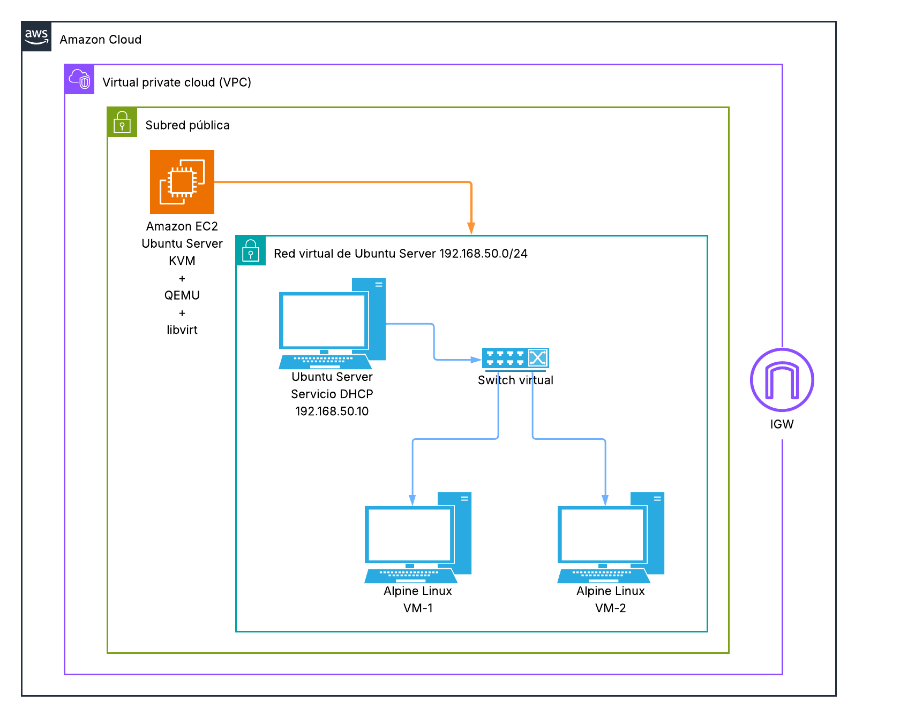

> **📌 Explicació dels elements de l'arquitectura**
> 

> - **KVM + QEMU + libvirt** és la pila de virtualizació nativa de Linux i està pensada per a virtualizació de servidors. 

>   - **KVM** → proporciona la virtualizació mitjançant el kernel.

>   - **QEMU** → executa/emula el maquinari de les màquines virtuals.

>   - **libvirt** → capa d'administració de KVM/QEMU.

> - **virt-manager** → interfície gràfica per a administrar libvirt.

> **📌 Equivalencia amb Windows Server**
> 

| Windows Server | Ubuntu Server |
| --- | --- |
| **Hyper-V** | **KVM + QEMU** |
| Hyper-V Manager | **virt-manager** |
| PowerShell / eines Hyper-V | **virsh / virt-install** |
| Virtual Switch | **Xarxes virtuals de libvirt / bridges** |
| VM | VM KVM/QEMU |
| VHDX | qcow2 / raw |
| Hyper-V NAT / switches | NAT / bridge de libvirt |

### 6.3 Instal·lació d'escritorios en Ubuntu Server 26.04

- Per a facilitar algunes etapas de la configuració d'aquesta pràctica, instalarem una interfície gràfica sobre la instància de Ubuntu Server que hem creat anteriorment.

- Instal·lar un escriptori gràfic no es sol recomanar en entorns de producció, per rendiment i seguretat però, dins d'un context de pràctiques, pot estar plenament justificado.

- A continuació es donen els procediments d'instal·lació de 2 escritorios: **Xfce Desktop Environment** i el molt conegut **GNOME**.

> **📌 Instal·lació de XFCE + Xrdp**
> 

> 1. 

> Ens conectamos a la nostra instància des de la consola de AWS.

> 1. 

> Instalamos les actualizacions disponibles en els repositorios.

```bash
sudo apt update && sudo apt upgrade -y
```

1. 

Instalamos XFCE i Xrdp

```bash
# Instalamos el entorno gráfico, el servidor de escritorio remoto y el componente que permite a Xrdp utilizar Xorg.
sudo apt install -y xfce4 xfce4-goodies xrdp xorgxrdp
```

1. 

Configurar la sessió gràfica.

```bash
echo "startxfce4" > ~/.xsession
```

1. 

Crear un nou usuari

```bash
sudo adduser NuevoUsuario
```

1. 

Donar al nou usuari els mateixos privilegis que els que tenim amb l'usuari `ubuntu`

```bash
sudo usermod -aG $(id -nG ubuntu | sed 's/ /,/g') NuevoUsuario
echo 'NuevoUsuario ALL=(ALL) NOPASSWD:ALL' | sudo tee /etc/sudoers.d/90-NuevoUsuario
sudo chmod 440 /etc/sudoers.d/90-NuevoUsuario
```

1. 

Comprovar que funciona:

```bash
sudo visudo -c
su - NuevoUsuario
sudo whoami
```

1. 

Configurar el servei Xrdp

```bash
sudo adduser xrdp ssl-cert
sudo systemctl enable --now xrdp
sudo systemctl restart xrdp
```

> **📌 Instal·lació de GNOME des de 0 sobre una màquina Ubuntu Server 26.04 recién lanzada**
> 

> 1. 

> Actualitzar

```bash
sudo apt update && sudo apt upgrade -y
# Comprobar si es necesario hacer reboot
```

1. 

Crear un nou usuari

```bash
sudo adduser NuevoUsuario
```

1. 

Donar al nou usuari els mateixos privilegis que els que tenim amb l'usuari `ubuntu`

```bash
sudo usermod -aG $(id -nG ubuntu | sed 's/ /,/g') NuevoUsuario
echo 'NuevoUsuario ALL=(ALL) NOPASSWD:ALL' | sudo tee /etc/sudoers.d/90-NuevoUsuario
sudo chmod 440 /etc/sudoers.d/90-NuevoUsuario
```

1. 

Comprovar que funciona:

```bash
sudo visudo -c
su - NuevoUsuario
sudo whoami
```

1. 

Instal·lar GNOME i RDP (kdump-tools: triar "No")

```bash
# Escritorio completo
sudo apt install ubuntu-desktop gnome-remote-desktop pkexec openssl -y
# Escritorio minimo (instalar este)
sudo apt install ubuntu-desktop-minimal gnome-remote-desktop pkexec openssl -y
```

Si durant la instal·lació apareix la pantalla següent, eligirem **No** com opció.  

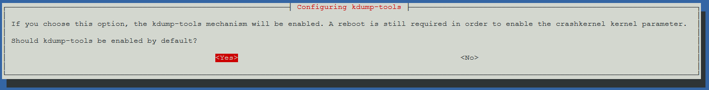

> **📌 Què és kdump-tools**
> 

>   - **kdump-tools** és un mecanisme que, quan el kernel sufre un fallada grave (kernel panic), arranca un segon kernel xicotet per a guardar un volcado de memòria (crash dump). Eixe volcado serveix per a que un desenvolupador o administrador analice després per què falló el sistema.

>   - És una eina de diagnóstic avançat, pensada sobre tot per a servidors en producció o depuració del kernel.

>   - Reserva una part de la RAM de forma permanente (el paràmetre crashkernel), que no podrà usar-se per a una altra cosa. En equips amb poca memòria, això es nota.

>   - Per a un ús normal o de pruebas, no aporta res.

1. 

Generar un certificat TLS directament en la seua ubicació final

```bash
sudo mkdir -p /etc/gnome-remote-desktop
sudo openssl req -new -newkey rsa:4096 -days 365 -nodes -x509 \
  -subj "/CN=ubuntu-server" \
  -out /etc/gnome-remote-desktop/rdp.crt \
  -keyout /etc/gnome-remote-desktop/rdp.key
```

1. 

Canviar permisos (abans de grdctl)

```bash
sudo chown gnome-remote-desktop:gnome-remote-desktop /etc/gnome-remote-desktop/rdp.crt /etc/gnome-remote-desktop/rdp.key
sudo chmod 644 /etc/gnome-remote-desktop/rdp.crt
sudo chmod 600 /etc/gnome-remote-desktop/rdp.key
```

1. 

Configurar RDP amb grdctl (eina per a configurar GNOME Remote desktop)

```bash
sudo grdctl --system rdp set-tls-cert /etc/gnome-remote-desktop/rdp.crt
sudo grdctl --system rdp set-tls-key /etc/gnome-remote-desktop/rdp.key
sudo grdctl --system rdp set-credentials NuevoUsuario CONTRASEÑA
sudo grdctl --system rdp enable
```

1. 

Arrencada gràfic i servei 

```bash
sudo systemctl set-default graphical.target
sudo systemctl enable --now gnome-remote-desktop.service
sudo grdctl --system status
```

1. 

Reiniciar

```bash
sudo reboot now
```

1. 

Verificamos que el sistema arranca en mode gràfic amb:

```bash
systemctl get-default
systemctl status gdm3
systemctl status gnome-remote-desktop
```

### 6.4 Primera connexió per escriptori gràfic a Ubuntu Server (XFCE + Xrdp)

- Lanzamos des de Windows l'aplicació de connexió a escriptori remoto i introducimos la contrasenya de la nostra màquina.  

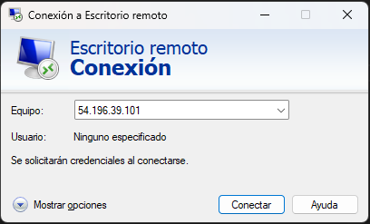

- Per a la pràctica, no tindrem en compta l'advertencias de seguretat.

- Introducimos les nostres credencials en la passarel·la (servidor Xrdp).

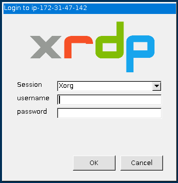

- Un vegada iniciada la sessió estarem en l'escriptori gràfic típic de XFCE.

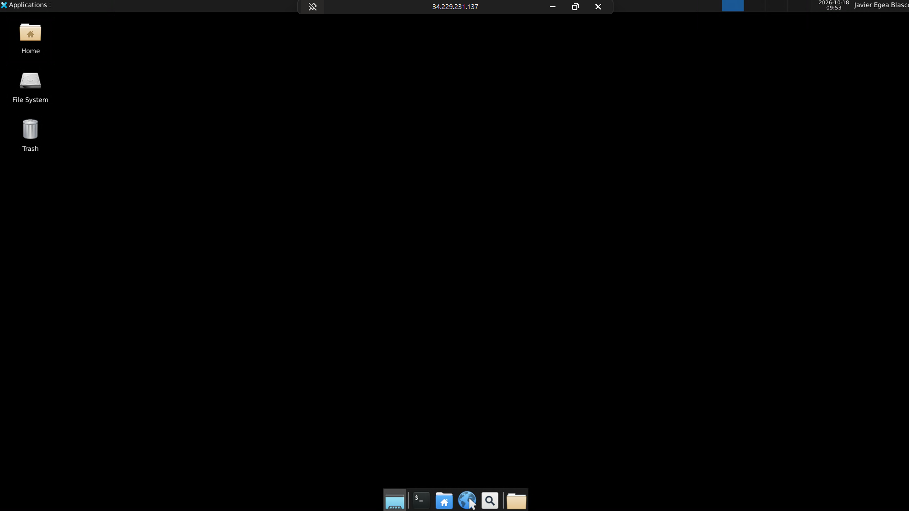

### 6.5 Activar la virtualizació de la CPU per la consola de AWS

> **📌 Activar la virtualizació de la CPU per la consola de AWS**
> 

> - Abrimos el cloudshell de AWS i escrivim els següents comandes:  

> **📌 Canviar la id per la id de la vostra instància**
> 

```bash
# 1. Parar la instancia. También se puede hacer desde la consola de AWS. 
aws ec2 stop-instances --instance-ids i-069fe851e6325d765

# 2. Esperar a que quede realmente parada
aws ec2 wait instance-stopped --instance-ids i-069fe851e6325d765

# 3. Activar nested virtualization con el comando correcto
aws ec2 modify-instance-cpu-options \
  --instance-id i-069fe851e6325d765 \
  --nested-virtualization enabled

# 4. Arrancarla de nuevo
aws ec2 start-instances --instance-ids i-069fe851e6325d765
```

> **📌 Comprovar la virtualizació de la instància**
> 

> - Des de la consola de AWS executem el comanda

```bash
aws ec2 describe-instances --instance-ids i-069fe851e6325d765 \
--query "Reservations[].Instances[].CpuOptions"
```

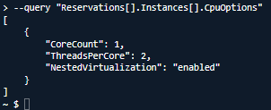

- També el podem comprovar des de la pròpia instància amb:

```bash
egrep -c '(vmx|svm)' /proc/cpuinfo
```

Si ens retorna un valor major que 0, significa que la CPU expone les extensions de virtualizació (Intel VT-x/ AMD AMD-V).  

Realitzar captura de pantalla  

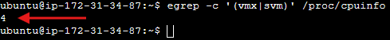

- Una altra manera seria usant l'aplicació **cpu-checker**

```bash
sudo apt update
sudo apt install -y cpu-checker
sudo kvm-ok
```

Realitzar captura de pantalla

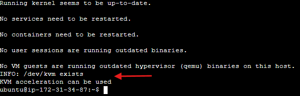

### 6.6 Instal·lació de KVM i eines relacionades

- 

Instalarem KVM i les eines relacionades amb:

```bash
sudo apt install -y qemu-system-x86 qemu-utils libvirt-daemon-system libvirt-clients bridge-utils virtinst virt-manager
```

> **📌 Explicació de les aplicacions instalades**
> 

>   - **qemu-system-x86** → emulador QEMU per a x86, que usa KVM com aceleració porhardware.

>   - **libvirt-daemon-system / libvirt-clients** → capa de gestió (permet usar `virsh`,`virt-install`, etc.).

>   - **qemu-utils** → utilitats per a manejar discs virtuals (`qemu-img`).

>   - **bridge-utils** → eines per a crear xarxes puente entre les VMs.

>   - **virtinst** → eines per a crear VMs des de línia de comandes (`virt-install`).

>   - **virt-manager** → interfície gràfica de gestió (només si disposem d'entorn gràfic).

### 6.7 Afegir usuaris als grups necessaris

- 

Per a poder utilitzar les opcions de virtualizació haurem d'afegir el nostre usuari **als grups `libvirt` i `kvm`**:

```bash
sudo usermod -aG libvirt,kvm $USER
```

> **📌 Tancar sessió per a aplicar els canvis**
> 

> És necessari tancar sessió i tornar a iniciar-la (o reiniciar) perquè els nous grups surtan efecte.

### 6.8 Comprovar que el servei libvirt està activo

- 

El comprobarem amb:
    

```bash
sudo systemctl status libvirtd
```

    

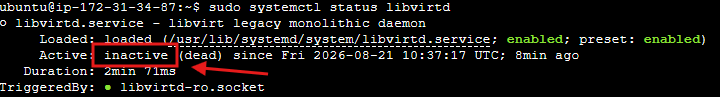

- 

Si, com en el cas de la imatge, ens mostra `inactive`, els activarem amb:

```bash
sudo systemctl start libvirtd
sudo systemctl status libvirtd
```

Realitzar captura de pantalla

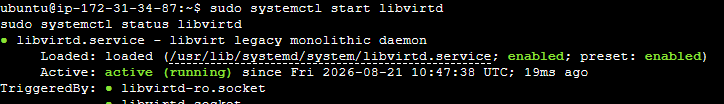

### 6.9 Verificar que /dev/kvm existeix i comprovar els permisos d'usuari del directori

- 

El verificarem amb:
    

```bash
ls -l /dev/kvm
```

    

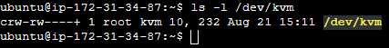

> **📌 Nota**
> 

>   - **rw-rw----+** → El propietari **root** i el grup **kvm** tenen permisos de lectura i escriptura (rw-).

>   - El símbol + indica que té Llistes de Control de Accés (ACL) addicionals aplicades.

### 6.10 Llistar l'hipervisor detectado

- 

Listarem els serveis de virtualizació amb:

```bash
virsh list --all
```

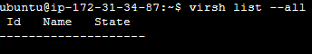

> **📌 Nota**
> 

> A aquesta alçària de la pràctica, que la llista estiga buida no és motiu de preocupació. Encara no hem creat cap màquina virtual.

> **📌 De no retornar un error tipus *failed to connect to the hypervisor* confirma que:**
> 

>   - **libvirtd** es està executant correctament.

>   - El nostre usuari té permisos **per a comunicar-se amb l'hipervisor**.

>   - **KVM/QEMU** estan listos per a usar-se.

### 6.11 Aplicació Virt-Manager

- Si ens conectamos per escriptori remoto, també podrem veure que l'assistent (gràfic) de virtualizació (virt-manager) està instal·lat.

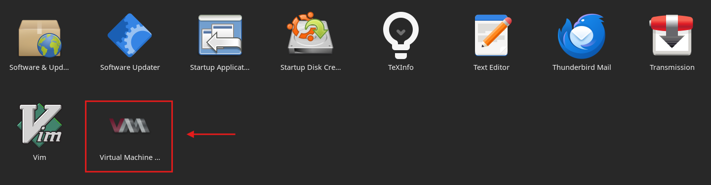

- Escriptori de Virt-Manager

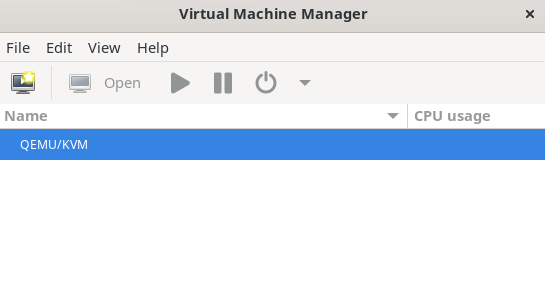

### 6.12 Crear la xarxa aïllada i el switch virtual sense accés a l'exterior

- 

Com el la pràctica anterior, crearem una xarxa privada per a evitar conflictos amb AWS a l'hora d'assignar IPs.

```bash
cat > /home/ubuntu/Documents/RedPrivada.xml << 'EOF'
<network>
    <name>RedPrivada-DHCP</name>
    <bridge name='Switch-Virtual' stp='on' delay='0'/>
</network>
EOF

sudo virsh net-define /home/ubuntu/Documents/RedPrivada.xml
sudo virsh net-start RedPrivada-DHCP
sudo virsh net-autostart RedPrivada-DHCP
```

> **📌 Important: Xarxa en mode aislado**
> 

>   - Al **no** incloure cap bloc `<forward>` ni `<ip>`, aquesta xarxa queda en mode *isolated*.

>   - Libvirt no li assigna el seu propi servidor DHCP intern ni la connecta a internet.

>   - Les VMs connectades **no recibirán IP automàticament**: D'això es encaragará el servidor DHCP que implementarem més avant.

- 

Verificarem que es ha creat switch virtual correctament:  

```bash
ip link show Switch-Virtual
virsh net-list --all
```

Realitzar captura de pantalla

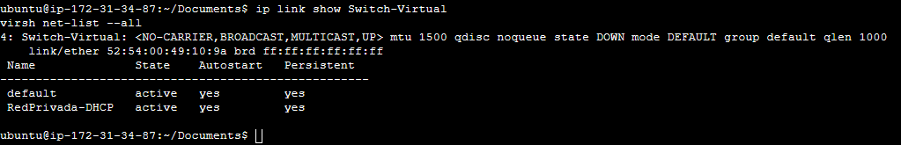

### 6.13 Configurar el switch virtual

- 

A diferència de la pràctica de Windows Server, ací sí que podem / hem d'assignar un IP al switch virtual.

```bash
sudo ip addr add 192.168.50.1/24 dev Switch-Virtual
sudo ip link set Switch-Virtual up
```

> **📌 En aquestes condicions, el switch virtual no és persistente. Això vol dir que l'haurem d'iniciar cada vegada que retomemos la pràctica.**
> 

> Per exemple si executem el comanda:

```bash
ip -br -4 addr show Switch-Virtual
```

Obtindrem:  

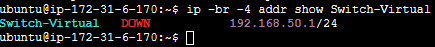

  

> **📌 El DOWN no significa un problema amb la nostra xarxa. Només ens indica que, de moment, no hi ha cap màquina virtual connectada a la xarxa**
> 

Si reiniciamos la màquina o el servei veurem:

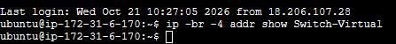

> **📌 Què podem interpretar sobre el servei del switch virtual?**
> 

- 

Per a evitar de tindre que tornar a assignar la IP al switch virtual i el posterior reinicio del servei farem el següent:

> **📌 Editar el fitxer `RedPrivada.xml`**
> 

> Dins del fitxer creat justo abans añadirem una línia que especificará la IP i la mascara de xarxa del switch virtual.

```bash
<network>
  <name>RedPrivada-DHCP</name>
  <bridge name='Switch-Virtual' stp='on' delay='0'/>
  <ip address='192.168.50.1' netmask='255.255.255.0'/>
</network>
```

> **📌 Aplicar els canvis**
> 

```bash
sudo virsh net-destroy RedPrivada-DHCP
sudo virsh net-undefine RedPrivada-DHCP
sudo virsh net-define /home/ubuntu/Documents/RedPrivada.xml
sudo virsh net-start RedPrivada-DHCP
sudo virsh net-autostart RedPrivada-DHCP
```

  - Després del reinicio, comprovar l'estat del servei del switch virtual.

```bash
ip addr show Switch-Virtual
```

> **📌 Comandes útils**
> 

>   1. ip -br link # Resum de totes les interfícies

>   1. ip -br addr # Interfícies amb els seus IPs

>   1. ip link show type bridge # Només bridges

>   1. ip -d link show `<interfaz>` # Detalls d'una interfície

>   1. bridge link # Interfícies connectades a bridges

>   1. bridge fdb show # Taula d'adreces MAC

>   1. ip route # Taula de rutes

### 6.14 Configurar la màquina anfitriona com servidor DHCP

- 

Instalamos el servei DHCP

```bash
sudo apt install -y isc-dhcp-server
```

- 

Definirem què interfície ha d'escoltar el servidor DHCP editant el fitxer `/etc/default/isc-dhcp-server`

```bash
sudo nano /etc/default/isc-dhcp-server
```

- 

Bajamos fins a la línia INTERFACESv4="" i posem el valor `Switch-Virtual`.

```bash
INTERFACESv4="Switch-Virtual"
```

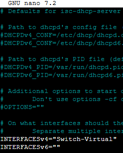

### 6.15 Configurar l'àmbit del nostre servidor DHCP

- 

Per a configurar l'àmbit editarem el fitxer `/etc/dhcp/dhcpd.conf`

```bash
sudo nano /etc/dhcp/dhcpd.conf
```

- 

Añadirem al final:

```bash
subnet 192.168.50.0 netmask 255.255.255.0 {
  range 192.168.50.100 192.168.50.200;
  option routers 192.168.50.1;
  option domain-name-servers 8.8.8.8;
  option subnet-mask 255.255.255.0;
  default-lease-time 600;
  max-lease-time 7200;
}
```

Realitzar captura de pantalla  

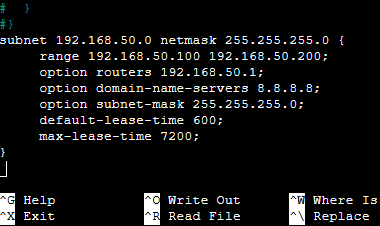

### 6.16 Arrancar el servei DHCP

- 

Per a arrancar el servei i comprovar que el servei es ha levantado correctament usarem:

```bash
sudo systemctl enable isc-dhcp-server
sudo systemctl restart isc-dhcp-server
sudo systemctl status isc-dhcp-server
```

Realitzar captura de pantalla  

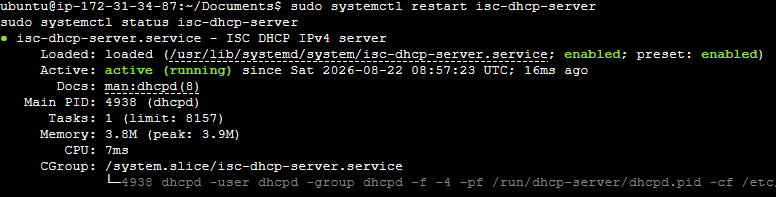

> **📌 Si falla a l'arrancar**
> 

> - Revisar si `INTERFACESv4` apunta a una interfície que no existeix encara o el fitxer `dhcpd.conf` conté un error de sintaxi.

> - Si hi ha un error de sintaxi usar:
    

```bash
sudo dhcpd -t -cf /etc/dhcp/dhcpd.conf
```

### 6.17 Habilitar el servei DHCP i ordenar-lo després de libvirt

- Per defecte, el servei DHCP no s'inicia només: cada vegada que arranquemos la instància hi hauria que lanzar-lo manualment.

- 

Si l'habilitamos per a l'arrencada, hem d'asegurarnos de que es inicie **després** de que libvirtd haja creat el switch virtual. si no, fallará perquè la interfície encara no existeix.

- 

Primer habilitamos el servei:

```bash
sudo systemctl enable isc-dhcp-server
```

- 

Després creem un *override* de la unitat de systemd:

```bash
sudo systemctl edit isc-dhcp-server
```

- 

Dins de l'editor escribirem:

```bash
[Unit]
After=libvirtd.service
Wants=libvirtd.service

[Service]
Restart=on-failure
RestartSec=5
```

> **📌 Nota**
> 

>   - `After=` → isc-dhcp-server arranca després de libvirtd.

>   - `Wants=` → a l'arrancar el DHCP, systemd intenta iniciar també libvirtd, però si aquest falla o es reinicia, el DHCP no es detiene. (Amb `Requires=` sí es detendría.)

>   - `Restart=on-failure` → si el servei acaba amb error, systemd el reinicia automàticament.

>   - `RestartSec=5` → espera 5 segons entre reintentos.

- 

Guardamos, recargamos systemd i reiniciamos el servei:

```bash
sudo systemctl daemon-reload
sudo systemctl restart isc-dhcp-server
sudo systemctl status isc-dhcp-server
```

> **📌 La xarxa de libvirt ha de tindre IP a l'arrancar**
> 

> - `After=libvirtd.service` no garanteix que el switch virtual tinga ja el seu IP.

> - Per a això, la xarxa ha d'estar en autostart (`sudo virsh net-autostart RedPrivada-DHCP`) i el seu XML ha d'incloure el bloc `<ip address='192.168.50.1' netmask='255.255.255.0'/>`.

### 6.18 Descarregar la imatge de les màquines virtuals client

Igual que en la pràctica de Windows Server, usarem **Alpine Linux** per la seua ligereza (256–512 MB per VM).

- 

Podem usar l'escriptori gràfic per a descarregar la iso del SO de Alpine Linux però, el farem per línia de comanda.

```bash
sudo mkdir -p /var/lib/libvirt/images
sudo mkdir -p /var/lib/libvirt/vm
sudo wget -O /var/lib/libvirt/images/alpine.iso https://dl-cdn.alpinelinux.org/alpine/v3.24/releases/x86/alpine-virt-3.24.1-x86.iso
sudo ls -lh /var/lib/libvirt/images/alpine.iso
```

Realitzar captura de pantalla  

Mostrar el contingut de la carpeta `/var/lib/libvirt/images/`.

> **📌 Per què `/lib/libvirt` i no qualsevol una altra carpeta?**
> 

> - El procés QEMU que executa la VM es llança amb l'usuari libvirt-qemu (per aïllament/seguretat). Eixe usuari no té permís per a atravesar el directori /home/ubuntu. 

> - Per eixe motiu usarem el directori `/var/lib/libvirt/`. 

### 6.19 Crear la VM amb virt-install (consola de text, sense necessitat de GUI)

- 

Per a crear la nostra primera VM usarem el script:

```bash
sudo virt-install \
  --name Cliente-1 \
  --memory 256 \
  --vcpus 1 \
  --disk path=/var/lib/libvirt/vm/Cliente-1.qcow2,size=2 \
  --disk path=/var/lib/libvirt/images/alpine.iso,device=cdrom \
  --boot cdrom,hd \
  --import \
  --network network=RedPrivada-DHCP \
  --graphics none \
  --console pty,target_type=serial \
  --os-variant alpinelinux3.19
```

> **📌 Notes**
> 

> - **L'opció** `--console pty,target_type=serial` ens conectará automàticament a la **consola sèrie** de la VM en la mateixa terminal SSH.

> - En el prompt `localhost login:` entrarem com `root` amb la contrasenya **root**.

> - Per a eixir de la consola sèrie sense apagar la VM, cerrarem la finestra amb la que estem loggeado.

> - Per a apagar la VM des de la consola sèrie, teclearem `poweroff` i pulsarem **Enter**.

### 6.20 Connectar-se per consola sèrie a la VM i comprovar la interfície de xarxa

- 

Per a connectar-nos de nou a la VM i configurar la interfície de xarxa usarem:

```bash
sudo virsh start Cliente-1
virsh console Cliente-1
```

> **📌 Nota**
> 

> El comanda `sudo virsh start Cliente-1`només és necessari si la VM està apagada.

- 

Comprobarem l'estat de la interfície amb:

```bash
ip link show
```

Realitzar captura de pantalla  

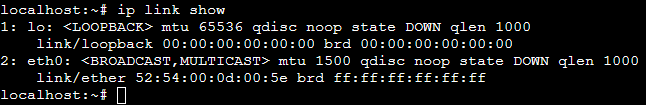

- 

Si tenim el `eth0` en DOWN, el levantarem amb:
    

```bash
ip link set eth0 up
ip link show eth0
```

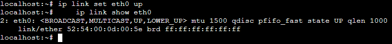

### 6.21 Solicitar la IP per DHCP

- 

Solicitarem un IP al DHCP amb:
    

```bash
udhcpc -i eth0
```

Realitzar captura de pantalla

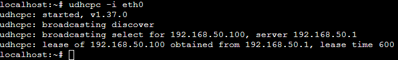

### 6.22 Gestió de les màquines virtuals per consola

- 

Per a accedir a l'ajuda de virsh teclar:

```bash
virsh
```

- 

Comandes més habituals

| Comanda | Què fa |
| --- | --- |
| **Xarxes** |  |
| virsh start `<Cliente-1>` | Inicia la VM |
| virsh destroy `<Cliente-1>` | Apagado forzoso i immediat |
| virsh shutdown `<Cliente-1>` | Apagado ordenat (envia senyal ACPI, espera a que el SO es apague només) |
| virsh reboot `<Cliente-1>` | Reinicio ordenat (equivalent ACPI) |
| virsh undefine `<Cliente-1>` | Elimina la definició de la VM (metadades) |
| virsh undefine `<Cliente-1>` --remove-all-storage | Elimina la definició de la VM i del disc |
| virsh list --all | Llista totes les màquines i la seua estat |
| virsh console `<Cliente-1>` | Connexió per consola a la MV |
| **Xarxes** |  |
| virsh net-list --all | Llista totes les xarxes virtuals i la seua estat |
| virsh net-defineix `<nombre-de-la-red>` | Definir una xarxa virtual |
| virsh net-destroy `<nombre-de-la-red>` | Detener una xarxa virtual |
| virsh net-autostart --disable `<nombre-de-la-red>` | Desactivar l'inici automàtic |
| virsh net-undefine `<nombre-de-la-red>` | Elimina la definició de la xarxa |
| **Switch** |  |
| ip -br link | Resum de totes les interfícies |
| ip -br addr | Interfícies amb els seus IPs |
| ip link show type bridge | Només bridges |
| ip -d link show `<interfaz>` | Detalls d'una interfície |
| bridge link | Interfícies connectades a bridges |
| bridge fdb show | Taula d'adreces MAC |
| ip route | Taula de rutes |

### 6.23 Segon client

Realitzar captura de pantalla  

- Repetir els passos anteriors i crear una segona VM amb nom `Cliente-2`.

### 6.24 Veure el procés de broadcast i assignació DORA

En aquest cas no usarem wireshark sinó el propi log del servei DHCP.

- 

Ens conectamos a la nostra instància anfitrión i lanzamos el log.
    

```bash
sudo journalctl -u isc-dhcp-server -f
```

**No cerrarem la finestra, el dejamos corrent.**

- 

Abrimos una altra connexió amb la nostra instància i la usarem per a connectar-nos a la nostra(s) MV.
        - Levantamos la interfície de xarxa amb:
    

```bash
ip link set eth0 up
```

  - Iniciamos el procés DORA:

```bash
udhcpc -i eth0
```

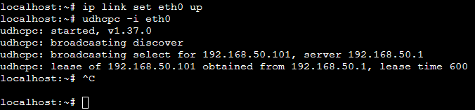

- 

Tornem al log on podrem veure el DORA.  

Realitzar captura de pantalla  

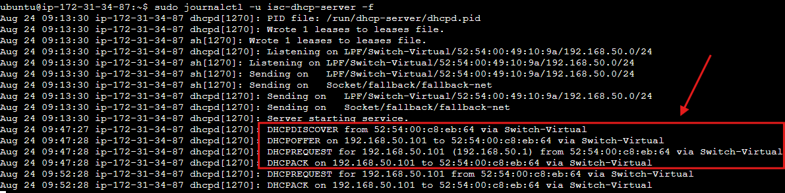

### 6.25 Leases concedits

- 

Amb el següent comanda podem consultar el registre de concessions (leases) del servidor DHCP, on es mostra què adreça IP té assignada cada client, la duració de la concessió i la seua data d'inici i expiració.

```bash
cat /var/lib/dhcp/dhcpd.leases
```

Realitzar captura de pantalla

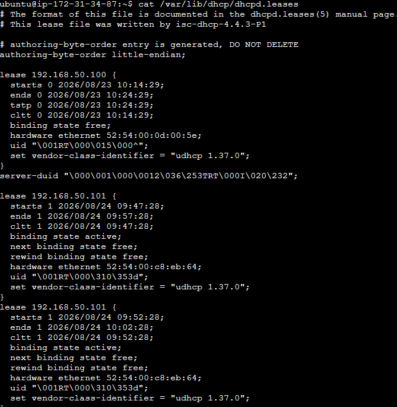


---

## 🎮 Reptes Interactius d'Autoavaluació (+100 XP)

Comprova el teu domini sobre **2.6 - Tasca RA1-CEcd-2 - Instal·lació i configuració d'un DHCP amb Ubuntu Server en AWS** superant aquests 4 reptes gamificats (+25 puntos cadascun):

<div class="interactive-mcq" data-answer="A" data-hint="Revisa els conceptes teòrics i pràctics d'aquesta secció.">
  <div class="mcq-question">🎯 <strong>Repte 1 (+25 pts):</strong> Quins són els quatre missatges que componen el procés d'assignació dinàmica d'IP en DHCP (acrònim DORA)?</div>
  <div class="mcq-options">
    <button type="button" class="btn-mcq-opt" data-opt="A">A) DHCPDISCOVER, DHCPOFFER, DHCPREQUEST i DHCPACK</button>
    <button type="button" class="btn-mcq-opt" data-opt="B">B) DNSQUERY, DNSOFFER, DNSREQUEST i DNSACK</button>
    <button type="button" class="btn-mcq-opt" data-opt="C">C) SYN, SYN-ACK, ACK i FIN</button>
    <button type="button" class="btn-mcq-opt" data-opt="D">D) Cap de les anteriors és correcta.</button>
  </div>
  <div class="quiz-feedback"></div>
</div>

<div class="interactive-mcq" data-answer="D" data-hint="Comprova l'apartat corresponent de la unitat.">
  <div class="mcq-question">🎯 <strong>Repte 2 (+25 pts):</strong> Per què en un laboratori d'AWS EC2 hem de crear una xarxa virtual aïllada (amb Hyper-V o KVM/libvirt) dins de la instància amfitriona per a provar el nostre propi servidor DHCP?</div>
  <div class="mcq-options">
    <button type="button" class="btn-mcq-opt" data-opt="A">A) Perquè el protocol DHCP no funciona sobre sistemes operatius de 64 bits.</button>
    <button type="button" class="btn-mcq-opt" data-opt="B">B) Perquè Windows Server i Ubuntu Server no tenen cap rol o paquet de servidor DHCP.</button>
    <button type="button" class="btn-mcq-opt" data-opt="C">C) Cap de les anteriors és correcta.</button>
    <button type="button" class="btn-mcq-opt" data-opt="D">D) Perquè la xarxa VPC d'AWS ja té el seu propi servidor DHCP gestionat i bloqueja el trànsit de broadcast DHCP entre instàncies EC2.</button>
  </div>
  <div class="quiz-feedback"></div>
</div>

<div class="interactive-vf" data-answer="V" data-hint="Verifica l'afirmació amb els apuntos de la unitat.">
  <div class="vf-statement">✅ <strong>Repte 3 (Vertader o Fals · +25 pts):</strong> Una reserva DHCP permet assignar sempre la mateixa adreça IP a un equip concret vinculant-la a la seua adreça física MAC.</div>
  <div class="vf-buttons">
    <button type="button" class="btn-vf" data-opt="V">Vertader (V)</button>
    <button type="button" class="btn-vf" data-opt="F">Fals (F)</button>
  </div>
  <div class="quiz-feedback" style="width: 100%;"></div>
</div>

<div class="interactive-quiz" data-answer="67" data-hint="El servidor escolta al port UDP 67 i el client al 68.">
  <div class="quiz-question">⌨️ <strong>Repte 4 (+25 pts):</strong> Quins ports UDP utilitza el protocol DHCP (escriu el port del servidor, p. ex. 67)?</div>
  <div class="quiz-controls">
    <input type="text" class="quiz-input" placeholder="Escriu la resposta..." />
    <button type="button" class="btn-quiz-check">Comprovar</button>
  </div>
  <div class="quiz-feedback"></div>
</div>

### 📋 Llista de Comprovació i Rúbrica d'Assoliment

Marca cada criteri a mesura que completes l'estudi o la resolució pràctica d'aquesta pàgina (**2.6 - Tasca RA1-CEcd-2 - Instal·lació i configuració d'un DHCP amb Ubuntu Server en AWS**):

- [ ] He llegit detingudament la teoria o l'enunciat d'aquesta secció i he anotat els conceptes clau.
- [ ] He revisat els esquemes, taules o blocs de codi i he verificat que sé aplicar-los a l'entorn de treball.
- [ ] He resolt correctament els **4 reptes interactius** superiors obtenint els **100 puntos XP**.
- [ ] He descarregat el comprovant oficial en PDF per a adjuntar-lo a la tasca d'**Aules**.

<div class="aules-delivery-card">
  <h3>📤 Comprovant de Lliurament per a Aules</h3>
  <p>Quan hages completat els reptes interactius i la llista d'autoavaluació d'aquesta pàgina, introdueix el teu nom i descarrega el teu certificat oficial en PDF per a adjuntar-lo a la tasca d'<strong>Aules</strong>.</p>
  <div class="aules-student-field">
    <label for="aules-student-name">👤 Nom i Cognoms de l'Alumne/a:</label>
    <input type="text" id="aules-student-name" class="aules-student-name" placeholder="Ex: Joan Garcia Pérez" />
  </div>
  <div class="aules-score-badge">
    <span class="aules-score-count">0/4 reptes completats (0%) · 0 puntos · 0/4 criteris d'autoavaluació</span>
  </div>
  <div class="aules-actions">
    <button type="button" class="btn-aules-dl" data-module="SEX" data-unit="UD02" data-activity="ut0206">📥 Descarregar Comprovant PDF</button>
    <button type="button" class="btn-aules-copy">📋 Copiar Resum al Porta-retalls</button>
  </div>
  <div class="aules-toast"></div>
</div>

