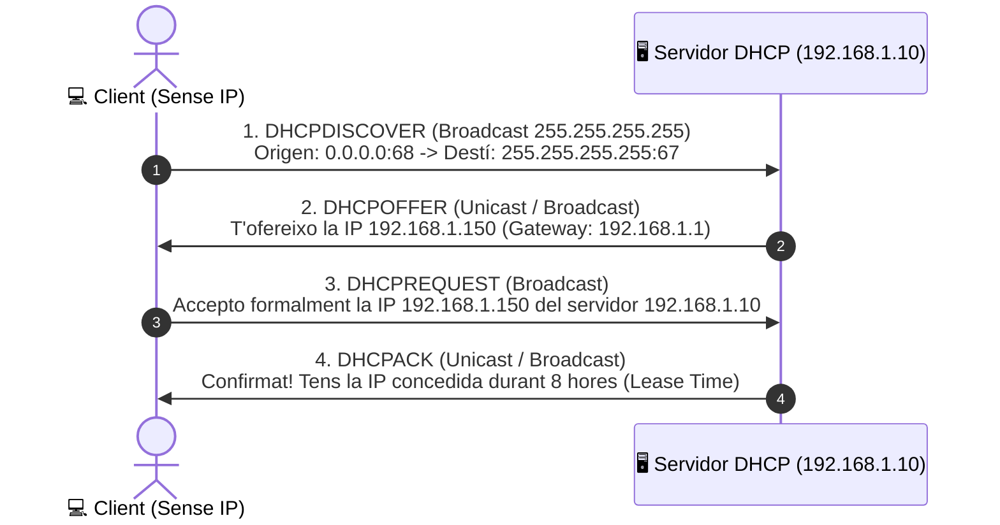

# UT03 — Servei d'Assignació Dinàmica d'Adreces (DHCP)

El protocol **DHCP** (*Dynamic Host Configuration Protocol*) permet assignar automàticament paràmetres de xarxa (adreça IP, màscara, porta d'enllaç i servidors DNS) als dispositius que es connecten a una xarxa local, eliminant la necessitat de configuracions manuals propenses a errors i conflictes d'IPs duplicades.

---

## 📌 1. El Procés d'Encaixada DORA

Quan un client s'encén o es connecta per cable o Wi-Fi, no disposa de cap adreça IP configurada. Per a obtindre'n una, s'executa el protocol de **4 passos conegut com a DORA**:



### Detall dels 4 missatges:
1. **DHCPDISCOVER:** El client envia un paquet UDP d'origen `0.0.0.0:68` i destí `255.255.255.255:67` en difusió (*broadcast*) a tota la xarxa local preguntant si hi ha algun servidor DHCP disponible.
2. **DHCPOFFER:** Els servidors DHCP que han rebut la petició reserven temporalment una adreça lliure del seu rang (*pool*) i li proposen al client la IP juntament amb les opcions de xarxa.
3. **DHCPREQUEST:** El client tria una de les ofertes rebudes (habitualment la primera que arriba) i envia un missatge en difusió confirmant quina oferta ha acceptat. En ser un broadcast, els altres servidors DHCP saben que les seues ofertes han sigut rebutjades i poden alliberar les seues IPs.
4. **DHCPACK (*Acknowledgment*):** El servidor seleccionat envia la confirmació definitiva amb tots els paràmetres i arrenca el comptador de concessió (*Lease Time*).

---

## 📌 2. El Cicle de Vida del Préstec (*Lease Time*)

L'adreça IP no es regala al client, sinó que se li **cedeix en règim de préstec temporal**:

```mermaid
flowchart TD
    A["Inici del Préstec (Temps = 0)<br/>IP concedida per T hores"] --> B["Temps T1 (50% del Lease)<br/>Envia DHCPREQUEST Unicast al servidor original"]
    B -->|Respon DHCPACK| A
    B -->|No Respon (Servidor caigut)| C["Temps T2 (87.5% del Lease)<br/>Envia DHCPREQUEST Broadcast a qualsevol servidor"]
    C -->|Respon qualsevol servidor| A
    C -->|Arriba al 100% sense resposta| D["Expiració (100%)<br/>El client perd la IP i genera IP APIPA 169.254.x.x"]
```

- **Renovació al $50\%$ ($T_1$):** Si el préstec és de 8 hores, quan passen 4 hores el client intenta renovar silenciosament per comunicació directa *unicast*.
- **Reenganxament al $87{,}5\%$ ($T_2$):** A les 7 hores, si el servidor principal no ha contestat, el client demana auxili per difusió (*broadcast*) a qualsevol altre servidor de la xarxa.
- **Fallada total i APIPA:** Si el préstec expira completament, el client perd la configuració i els sistemes operatius assignen una adreça de l'espai **APIPA (*Automatic Private IP Addressing*): `169.254.0.0/16`**, que només serveix per a comunicar-se amb màquines del mateix switch sense sortida a Internet.

---

## 📌 3. Reserves d'IP per MAC i Agent de Retransmissió (*Relay*)

### Reserves Estàtiques:
Quan volem que un dispositiu tinga sempre la mateixa IP fixa (com una impressora de xarxa o una càmera IP) però sense configurar-la a mà a la seua pantalla, el servidor DHCP associa permanentment l'**adreça física MAC** de la targeta de xarxa a una IP reservada fora del rang dinàmic general.

### L'Agent de Retransmissió DHCP (*DHCP Relay Agent*):
Com que els paquets *Broadcast* no poden travessar un router, si tenim diverses VLANs o subxarxes caldria instal·lar un servidor DHCP físic a cadascuna. Per a estalviar costos:
- S'activa un **Agent Relay** al router (a Cisco s'utilitza la comanda `ip helper-address <IP_Servidor_DHCP>`).
- L'agent rep el broadcast del client a la VLAN d'origen i el reenvia com a paquet *Unicast* directe cap al servidor DHCP corporatiu.

---

## 📌 4. Configuració Pràctica en Ubuntu Server (`isc-dhcp-server`)

```bash
# 1. Instal·lar el servei en Ubuntu Server
sudo apt update && sudo apt install isc-dhcp-server -y

# 2. Especificar la interfície de xarxa d'escolta a /etc/default/isc-dhcp-server
# INTERFACESv4="enp0s3"
```

### Configuració del fitxer principal `/etc/dhcp/dhcpd.conf`:
```text
# Paràmetres globals
default-lease-time 28800;    # 8 hores (en segons)
max-lease-time 86400;        # 24 hores

# Definició de la subxarxa
subnet 192.168.1.0 netmask 255.255.255.0 {
    range 192.168.1.100 192.168.1.200;                # Rang dinàmic
    option routers 192.168.1.1;                         # Porta d'enllaç
    option domain-name-servers 192.168.1.10, 8.8.8.8;  # Servidors DNS
    option domain-name "iesrafel.internal";             # Sufix DNS
}

# Reserva d'adreça estàtica per a la impressora d'administració
host impressora-secretaria {
    hardware ethernet 00:11:22:33:44:55;
    fixed-address 192.168.1.25;
}
```

```bash
# Comprovar la sintaxi del fitxer
sudo dhcpd -t -cf /etc/dhcp/dhcpd.conf

# Iniciar el servei i comprovar l'estat
sudo systemctl restart isc-dhcp-server
sudo systemctl status isc-dhcp-server

# Visualitzar les concessions de préstec actives
cat /var/lib/dhcp/dhcpd.leases
```
