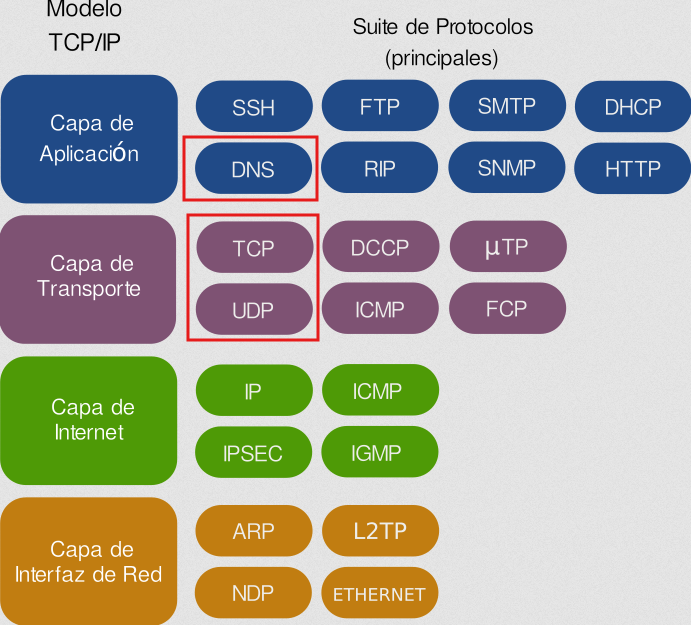
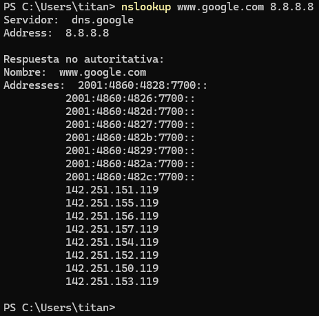

  

    🏆 <strong>Progrés d'aquesta secció:</strong> 0 de 4 superats (0%)
    ⭐ <strong>0 punts</strong>
  

  

    

  

# 3.2 - Protocol DNS

- **El servei de noms de domini utilitza el protocol DNS per a realitzar les consultes i les respostes**.

- Es tracta d'un protocol de **capa d'aplicació** que pot utilitzar tant UDP com TCP en la capa de transport.

- **El servidor DNS utilitza el port 53** per a realitzar les consultes i rebre les respostes.

- Habitualment, tant les consultes del client com les respostes del servidor caben en un datagrama (512 bytes) i s'utilitza UDP (de fet, generalment es diu que el DNS usa UDP).

- Si la informació a transmetre és àmplia (per exemple, una resposta amb una llista amb molta informació), la comunicació passa a TCP automàticament.

- Un altre cas en el que la comunicació és per TCP és quan es realitza la transferència d'informació d'una zona entre **servidors primaris i secundarios**.

> **📌 Resum dels que hem vist**
> 

> - El protocol DNS és habitualment UDP, però pot ser TCP i UDP.

> - Es tracta d'un protocol de capa d'aplicació i utilitza el port 53.

> - 

> Els datagramas DNS es componen de diversos apartats, tal com es pot veure en la següent consulta amb host:

> **📌 Exemple de consulta DNS**
> 

> 

    

> **📌 Explicació del comanda**
> 

>   - **nslookup**: Eina utilitzada per a consultar a **els servidors de noms DNS** i obtindre informació sobre adreces IP o registres de domini.

>   - **www.google.és**: Domini objectiu de la qual adreça IP (o registres associats) deseamos consultar.

>   - **8.8.8.8**: Adreça IP del servidor DNS específic **al que hem realitzat la consulta**.        

> **📌 Què significa 'Resposta no autoritativa'**
>

---

## 🎮 Reptes Interactius d'Autoavaluació (+100 XP)

Comprova el teu domini sobre **3.2 - Protocol DNS** superant aquests 4 reptes gamificats (+25 punts cadascun):

  
🎯 <strong>Repte 1 (+25 pts):</strong> Quin tipus de registre DNS permet crear un àlies que apunta un nom cap a un altre nom canònic?

  

    <button type="button" class="btn-mcq-opt" data-opt="A">A) SOA</button>
    <button type="button" class="btn-mcq-opt" data-opt="B">B) NS</button>
    <button type="button" class="btn-mcq-opt" data-opt="C">C) Cap de les anteriors és correcta.</button>
    <button type="button" class="btn-mcq-opt" data-opt="D">D) CNAME</button>
  

  

  
🎯 <strong>Repte 2 (+25 pts):</strong> En la tasca de resolució manual d'un domini (com aules.edu.gva.es) amb nslookup o dig, quin és el primer servidor al qual s'ha de consultar si no tenim memòria cau?

  

    <button type="button" class="btn-mcq-opt" data-opt="A">A) El servidor de correu MX del domini.</button>
    <button type="button" class="btn-mcq-opt" data-opt="B">B) Cap de les anteriors és correcta.</button>
    <button type="button" class="btn-mcq-opt" data-opt="C">C) Un dels servidors arrel (Root Servers, de a.root-servers.net a m.root-servers.net).</button>
    <button type="button" class="btn-mcq-opt" data-opt="D">D) El servidor DHCP de l'encaminador domèstic.</button>
  

  

  
✅ <strong>Repte 3 (Vertader o Fals · +25 pts):</strong> Un nom de domini totalment qualificat (FQDN) especifica la ubicació exacta de l'equip dins de la jerarquia DNS fins al punt arrel final.

  

    <button type="button" class="btn-vf" data-opt="V">Vertader (V)</button>
    <button type="button" class="btn-vf" data-opt="F">Fals (F)</button>
  

  

  
⌨️ <strong>Repte 4 (+25 pts):</strong> Quin número de port UDP i TCP utilitza per defecte el servei DNS estàndard?

  

    <input type="text" class="quiz-input" placeholder="Escriu la resposta..." />
    <button type="button" class="btn-quiz-check">Comprovar</button>
  

  

### 📋 Llista de Comprovació i Rúbrica d'Assoliment

Marca cada criteri a mesura que completes l'estudi o la resolució pràctica d'aquesta pàgina (**3.2 - Protocol DNS**):

- [ ] He llegit detingudament la teoria o l'enunciat d'aquesta secció i he anotat els conceptes clau.
- [ ] He revisat els esquemes, taules o blocs de codi i he verificat que sé aplicar-los a l'entorn de treball.
- [ ] He resolt correctament els **4 reptes interactius** superiors obtenint els **100 punts XP**.
- [ ] He descarregat el comprovant oficial en PDF per a adjuntar-lo a la tasca d'**Aules**.

  <h3>📤 Comprovant de Lliurament per a Aules</h3>
  
Quan hages completat els reptes interactius i la llista d'autoavaluació d'aquesta pàgina, introdueix el teu nom i descarrega el teu certificat oficial en PDF per a adjuntar-lo a la tasca d'<strong>Aules</strong>.

  

    <label for="aules-student-name">👤 Nom i Cognoms de l'Alumne/a:</label>
    <input type="text" id="aules-student-name" class="aules-student-name" placeholder="Ex: Joan Garcia Pérez" />
  

  

    0/4 reptes completats (0%) · 0 punts · 0/4 criteris d'autoavaluació
  

  

    <button type="button" class="btn-aules-dl" data-module="SEX" data-unit="UD03" data-activity="ut0302">📥 Descarregar Comprovant PDF</button>
    <button type="button" class="btn-aules-copy">📋 Copiar Resum al Porta-retalls</button>
  

  

