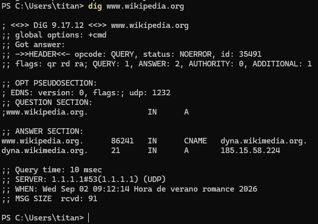

<div class="interactive-progress-tracker">
  <div class="tracker-header">
    <span>🏆 <strong>Progrés d'aquesta secció:</strong> <span class="tracker-count">0 de 4 superats (0%)</span></span>
    <span class="tracker-pts">⭐ <strong>0 punts</strong></span>
  </div>
  <div class="tracker-bar">
    <div class="tracker-fill" style="width: 0%;"></div>
  </div>
</div>

# 3.3 - Mecanismes de comunicació DNS

- La comunicació DNS és un mecanisme de consulta/resposta de tipus **client / servidor**.

- Els datagramas, per tant, seran de query (consulta) o d'answer (resposta).

> **📌 Els apartats que componen un missatge DNS són:**
> 

> - **HEADER**. Capçalera del missatge que indica si es tracta d'una consulta o d'una resposta. Conté l'id (identificador) del   missatge, flags i un resum de què seccions del missatge porten informació i quanta.

> - **QUESTION**. Aquesta secció conté la consulta que es ha efectuado, és a dir, què dada es ha comanda al servidor. Pot ser la   resolució d'un nom de domini a una adreça IP, demanar la llista de servidors d'impressió, etc.

> - **ANSWER**. Secció que conté la resposta obtenida del servidor. Aquesta resposta serà autoritativa o no en funció de si el   servidor que respon és autoritativo per a eixa zona: quan la resposta procede d'un servidor caché/resoldre (no autoritativo), algunes utilitats de consulta la mostren com non-authoritative answer.

> - **AUTHORITY**. Aquesta secció conté les respostes que són autoritativas per a la consulta efectuada (pot estar buida).

> - **ADDITIONAL**. Conté informació addicional per a completar la resposta. En l'exemple es observa que completa la resolució dels noms de màquina que apareixen en la secció ANSWER, indicant la seua adreça IP corresponent.

> **📌 Exemple de comunicació DNS**
> 

> 



> **📌 Explicació del comanda**
> 

> - **dig**: Domain Information Groper (explorador d'informació de dominis) és una utilitat habitualment utilitzada per a consultar servidors DNS de manera detallada.

> - A diferència de **nslookup**, **dig** mostra informació molt més tècnica, limpia i sense interpretacions automátiques que a vegades confunden el diagnóstic.

> - **www.wikipedia.org**: És el domini a consultar.

> **📌 Explicació del resultat retornat**
> 

> **📌 HEADER / capçalera**
> 

```bash
;; ->>HEADER<<- opcode: QUERY, status: NOERROR, id: 7395
;; flags: qr rd ra; QUERY: 1, ANSWER: 2, AUTHORITY: 0, ADDITIONAL: 1
```

- **És la capçalera del missatge DNS**.

- Indica que es tracta d'una resposta a una consulta (opcode: QUERY) completada amb èxit (status: NOERROR).

- Mostra l'identificador del missatge (id: 7395), les flags de control activas (qr per a resposta, rd de recursió deseada i ra de recursió disponible) i el resum de les seccions que contenen informació: 1 pregunta (QUERY), 2 respostes (ANSWER), *0 autoritats (AUTHORITY) i 1 registre addicional (ADDITIONAL).

> **📌 QUESTION / pregunta (consulta)**
> 

```bash
;; QUESTION SECTION:
;www.wikipedia.org.             IN      A
```

- Consulta que es ha efectuado.

- En aquest cas, es ha comanda al servidor que resolga el nom de domini www.wikipedia.org solicitant un registre de tipus A (és a dir, l'adreça IP IPv4 associada). 

> **📌 ANSWER / resposta**
> 

```bash
;; ANSWER SECTION:
www.wikipedia.org.      86252   IN      CNAME   dyna.wikimedia.org.
dyna.wikimedia.org.     32      IN      A       185.15.58.224
```

- www.wikipedia.org és un àlies (CNAME) que apunta a dyna.wikimedia.org.

- El servidor cerca l'adreça d'eixe àlies i retorna el seu registre A amb la IP final 185.15.58.224.

> **📌 AUTHORITY / autoritat**
> 

> - La secció d'autoritat no apareix listada (o està buida).

> - No és una sorpresa ja que la **capçalera** marca **AUTHORITY: 0**.

> - Aquesta secció contendría la informació sobre els servidors que són autoritativos per a la consulta efectuada. 

> **📌 ADDITIONAL / addicional**
> 

```bash
;; OPT PSEUDOSECTION:
; EDNS: version: 0, flags:; udp: 1232
```

- Informació addicional per a completar la gestió de la resposta tècnica. 

- En aquest cas s'inclou la pseudosecció EDNS (Extension Mechanisms for DNS), que indica que es suporta la versió 0 del protocol estès i estableix un mida màxim de búfer UDP de 1232 bytes per a evitar la fragmentació de paquets en la xarxa.


---

## 🎮 Reptes Interactius d'Autoavaluació (+100 XP)

Comprova el teu domini sobre **3.3 - Mecanismes de comunicació DNS** superant aquests 4 reptes gamificats (+25 punts cadascun):

<div class="interactive-mcq" data-answer="D" data-hint="Revisa els conceptes teòrics i pràctics d'aquesta secció.">
  <div class="mcq-question">🎯 <strong>Repte 1 (+25 pts):</strong> Quin tipus de registre DNS permet crear un àlies que apunta un nom cap a un altre nom canònic?</div>
  <div class="mcq-options">
    <button type="button" class="btn-mcq-opt" data-opt="A">A) SOA</button>
    <button type="button" class="btn-mcq-opt" data-opt="B">B) NS</button>
    <button type="button" class="btn-mcq-opt" data-opt="C">C) Cap de les anteriors és correcta.</button>
    <button type="button" class="btn-mcq-opt" data-opt="D">D) CNAME</button>
  </div>
  <div class="quiz-feedback"></div>
</div>

<div class="interactive-mcq" data-answer="C" data-hint="Comprova l'apartat corresponent de la unitat.">
  <div class="mcq-question">🎯 <strong>Repte 2 (+25 pts):</strong> En la tasca de resolució manual d'un domini (com aules.edu.gva.es) amb nslookup o dig, quin és el primer servidor al qual s'ha de consultar si no tenim memòria cau?</div>
  <div class="mcq-options">
    <button type="button" class="btn-mcq-opt" data-opt="A">A) El servidor de correu MX del domini.</button>
    <button type="button" class="btn-mcq-opt" data-opt="B">B) Cap de les anteriors és correcta.</button>
    <button type="button" class="btn-mcq-opt" data-opt="C">C) Un dels servidors arrel (Root Servers, de a.root-servers.net a m.root-servers.net).</button>
    <button type="button" class="btn-mcq-opt" data-opt="D">D) El servidor DHCP de l'encaminador domèstic.</button>
  </div>
  <div class="quiz-feedback"></div>
</div>

<div class="interactive-vf" data-answer="V" data-hint="Verifica l'afirmació amb els apunts de la unitat.">
  <div class="vf-statement">✅ <strong>Repte 3 (Vertader o Fals · +25 pts):</strong> Un nom de domini totalment qualificat (FQDN) especifica la ubicació exacta de l'equip dins de la jerarquia DNS fins al punt arrel final.</div>
  <div class="vf-buttons">
    <button type="button" class="btn-vf" data-opt="V">Vertader (V)</button>
    <button type="button" class="btn-vf" data-opt="F">Fals (F)</button>
  </div>
  <div class="quiz-feedback" style="width: 100%;"></div>
</div>

<div class="interactive-quiz" data-answer="53" data-hint="És un número entre 50 i 55.">
  <div class="quiz-question">⌨️ <strong>Repte 4 (+25 pts):</strong> Quin número de port UDP i TCP utilitza per defecte el servei DNS estàndard?</div>
  <div class="quiz-controls">
    <input type="text" class="quiz-input" placeholder="Escriu la resposta..." />
    <button type="button" class="btn-quiz-check">Comprovar</button>
  </div>
  <div class="quiz-feedback"></div>
</div>

### 📋 Llista de Comprovació i Rúbrica d'Assoliment

Marca cada criteri a mesura que completes l'estudi o la resolució pràctica d'aquesta pàgina (**3.3 - Mecanismes de comunicació DNS**):

- [ ] He llegit detingudament la teoria o l'enunciat d'aquesta secció i he anotat els conceptes clau.
- [ ] He revisat els esquemes, taules o blocs de codi i he verificat que sé aplicar-los a l'entorn de treball.
- [ ] He resolt correctament els **4 reptes interactius** superiors obtenint els **100 punts XP**.
- [ ] He descarregat el comprovant oficial en PDF per a adjuntar-lo a la tasca d'**Aules**.

<div class="aules-delivery-card">
  <h3>📤 Comprovant de Lliurament per a Aules</h3>
  <p>Quan hages completat els reptes interactius i la llista d'autoavaluació d'aquesta pàgina, introdueix el teu nom i descarrega el teu certificat oficial en PDF per a adjuntar-lo a la tasca d'<strong>Aules</strong>.</p>
  <div class="aules-student-field">
    <label for="aules-student-name">👤 Nom i Cognoms de l'Alumne/a:</label>
    <input type="text" id="aules-student-name" class="aules-student-name" placeholder="Ex: Joan Garcia Pérez" />
  </div>
  <div class="aules-score-badge">
    <span class="aules-score-count">0/4 reptes completats (0%) · 0 punts · 0/4 criteris d'autoavaluació</span>
  </div>
  <div class="aules-actions">
    <button type="button" class="btn-aules-dl" data-module="SEX" data-unit="UD03" data-activity="ut0303">📥 Descarregar Comprovant PDF</button>
    <button type="button" class="btn-aules-copy">📋 Copiar Resum al Porta-retalls</button>
  </div>
  <div class="aules-toast"></div>
</div>

