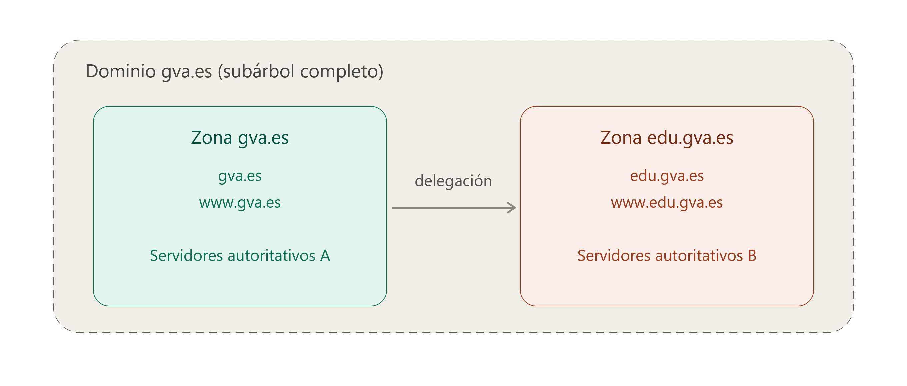

  

    🏆 <strong>Progrés d'aquesta secció:</strong> 0 de 4 superats (0%)
    ⭐ <strong>0 punts</strong>
  

  

    

  

# 3.4 - Servidors DNS

- **Un servidor DNS és l'element de la infraestructura de xarxa que allotja la informació d'un o més espais de noms de domini i que respon a les consultes (queries) que li arriben, ja siga resolviéndolas directament (si té autoritat sobre les dades) o remitent al client cap a altres servidors que sí la tenen**.

- Un mateix servidor pot ser autoritativo per a unes zones i actuar només com intermediario (resolutor) per a altres, i pot allotjar simultàniament diverses zones amb rols distints.

💡 Què és un servidor autoritativo?

- Un **servidor autoritativo** és aquell que té autoritat sobre una zona concreta i pot respondre a les consultes amb informació oficial i actualitzada d'eixa zona.

- Per exemple, el servidor autoritativo per a la zona `edu.gva.es` pot respondre a consultes sobre noms com `www.edu.gva.es` o `correo.edu.gva.es`, proporcionant les adreces IP corresponents.

### 4.1 Zones DNS

- **Una zona DNS és la porció de l'espai de noms de la qual administració correspon a un (o diversos) servidors autoritativos, que mantenen els seus registres i responden les consultes sobre ella**.

- Una zona no té per què coincidir amb un domini complet: si un subdominio es delega a altres servidors, deixa de formar part de la zona pare.

- Per exemple, dins del domini `gva.es`, si `edu.gva.es` està delegado, `www.edu.gva.es` pertany a la zona `edu.gva.es` i no a `gva.es`.

- La informació d'una zona (els seus registres de recursos) es pot emmagatzemar en un fitxer de text en el propi servidor o en un directori centralitzat (com AD DS en entorns Windows). En aquest últim cas es parla de *zones integrades*, que permeten que diversos servidors compartan i escriban sobre la mateixa còpia de dades.

💡 Què és un AD DS

- AD DS (Active Directory Domain Services o Serveis de domini de Active Directory) és el servei de directori principal de Microsoft per a Windows Server.

- Funciona com una base de dades centralitzada i jeràrquica que emmagatzema, organitza i gestiona els recursos d'una xarxa informàtica.

### 4.2 Tipus de zones

- **Zona primària.** És l'origen editable de la zona. Totes les altas, bajas i modificacions de registres es fan ací. El servidor que l'allotja es anomena **servidor primari** d'eixa zona.

- **Zona secundària.** És una còpia de només lectura d'una zona primària, obtenida per xarxa des d'un altre servidor DNS. No es pot editar directament ni almacenar-se com zona integrada, ja que sempre depèn de la font primària.

- **Zona de rutes internes (*stub*).** Conté únicament els registres NS (i les seues adreces) necessaris per a identificar què servidors són autoritativos per a una zona concreta, sense el resta de dades. S'usa per a mantindre actualitzada la llista de servidors d'una zona delegada i per a millorar la resolució evitant consultes innecesarias als servidors arrel.

- **Zona de cerca inversa.** Permet la consulta contraria a l'habitual: a partir d'una adreça IP, obtindre el nom de l'equip (en compte de nom → IP).

> **📌 Zona de cerca inversa**
> 

> - Per a dur a terme la resolució de nom inversa, el DNS utilitza un domini especial anomenat **in-addr.arpa** (per a IPv4) o **ip6.arpa** (per a IPv6). 

> - 

> L'adreça IP es transforma i insereix dins d'aquest domini en ordre invers a com es escriu normalment.  

> **📌 Exemple**
> 

>   - Per a averiguar el nom associat a la IP `192.168.10.20`, el *resoldre* consulta el domini:
> 
`20.10.168.192.in-addr.arpa`  

>   - El registre que respon a aquest tipus de consulta es anomena **registre PTR** (*pointer record*), i és l'encarregat d'indicar què nom de domini correspon a eixa adreça IP.  

- 

**Usos habituals de la resolució inversa:**

  1. Verificació de correu electrònic: molts servidors de correu comproven que la IP del remitente tinga un PTR vàlid abans d'acceptar el missatge, com mesura contra el *spam*.

  1. Diagnóstic i registre (*logging*): en eines com `traceroute`, `ping` o en els logs d'un servidor, és més llegible veure el nom d'una màquina que la seua adreça IP.

  1. Auditoría i seguretat: permet identificar què equip hi ha darrere d'una IP concreta durant l'anàlisi de trànsit o incidentes.

> **📌 A diferència de la resolució directa, la resolució inversa requereix que l'administrador de la xarxa configure explícitament aquesta zona i els seus registres PTR, ja que no es genera de forma automàtica a partir dels registres A o AAAA.**
> 

> **📌 Important**
> 

> Un mateix servidor no pot allotjar alhora una zona primària i una secundària o *stub* per al mateix nom de domini.

### 4.3 Transferència de zona

Es coneix com **transferència de zona** el procés de replicar el contingut d'una zona des del servidor que la genera (primari) cap als servidors que tenen còpia d'ella (secundarios). Es pot iniciar de dos maneres:

1. Per **notificació**: el servidor primari avisa als secundarios quan ha habido un canvi (mecanisme definit en el RFC 1996).

1. Per **intervalo de refresco**: a l'arrancar el servei o al caducar aquest intervalo (per defecte, 15 minuts, definit en el registre SOA de la zona), el servidor secundari consulta al primari per a comprovar si hi ha canvis.

Hi ha dos tipus de transferència:

1. **AXFR (transferència completa):** replica tot el fitxer de zona.

1. **IXFR (transferència incremental):** replica només els registres modificats des de la última sincronizació, reduint el trànsit de xarxa.

Per motivos de seguretat, és recomanable restringir què servidors poden solicitar una transferència de zona (habitualment, només els indicats en els registres NS de la zona), ja que una transferència oberta a qualsevol host expondría tota l'estructura de la xarxa interna.

### 4.4 Delegació de zones

- L'espai de noms es pot dividir en diverses zones per a delegar la seua administració a altres departaments o organitzacions (per exemple, delegar `edu.gva.es` des de la zona `gva.es`).

- Per a cada delegació és necessari crear registres NS en la zona pare que apunten als servidors autoritativos de la nova subzona, de mode que altres servidors i clients puguen encontrar-los correctament.

### 4.5 Control d'accés

- L'accés d'escriptura a una zona i als seus registres es pot restringir mitjançant llistes de control d'accés (ACL), que determinan què usuaris o grups poden crear o modificar registres concrets.

- Açò permet, per exemple, reservar certs noms perquè només determinats usuaris els puguen registrar, protegent la zona de modificacions no autoritzades sense deixar de permetre el seu ús general.

---

## 🎮 Reptes Interactius d'Autoavaluació (+100 XP)

Comprova el teu domini sobre **3.4 - Servidors DNS** superant aquests 4 reptes gamificats (+25 punts cadascun):

  
🎯 <strong>Repte 1 (+25 pts):</strong> Quin tipus de registre DNS permet crear un àlies que apunta un nom cap a un altre nom canònic?

  

    <button type="button" class="btn-mcq-opt" data-opt="A">A) SOA</button>
    <button type="button" class="btn-mcq-opt" data-opt="B">B) NS</button>
    <button type="button" class="btn-mcq-opt" data-opt="C">C) Cap de les anteriors és correcta.</button>
    <button type="button" class="btn-mcq-opt" data-opt="D">D) CNAME</button>
  

  

  
🎯 <strong>Repte 2 (+25 pts):</strong> En la tasca de resolució manual d'un domini (com aules.edu.gva.es) amb nslookup o dig, quin és el primer servidor al qual s'ha de consultar si no tenim memòria cau?

  

    <button type="button" class="btn-mcq-opt" data-opt="A">A) El servidor de correu MX del domini.</button>
    <button type="button" class="btn-mcq-opt" data-opt="B">B) Cap de les anteriors és correcta.</button>
    <button type="button" class="btn-mcq-opt" data-opt="C">C) Un dels servidors arrel (Root Servers, de a.root-servers.net a m.root-servers.net).</button>
    <button type="button" class="btn-mcq-opt" data-opt="D">D) El servidor DHCP de l'encaminador domèstic.</button>
  

  

  
✅ <strong>Repte 3 (Vertader o Fals · +25 pts):</strong> Un nom de domini totalment qualificat (FQDN) especifica la ubicació exacta de l'equip dins de la jerarquia DNS fins al punt arrel final.

  

    <button type="button" class="btn-vf" data-opt="V">Vertader (V)</button>
    <button type="button" class="btn-vf" data-opt="F">Fals (F)</button>
  

  

  
⌨️ <strong>Repte 4 (+25 pts):</strong> Quin número de port UDP i TCP utilitza per defecte el servei DNS estàndard?

  

    <input type="text" class="quiz-input" placeholder="Escriu la resposta..." />
    <button type="button" class="btn-quiz-check">Comprovar</button>
  

  

### 📋 Llista de Comprovació i Rúbrica d'Assoliment

Marca cada criteri a mesura que completes l'estudi o la resolució pràctica d'aquesta pàgina (**3.4 - Servidors DNS**):

- [ ] He llegit detingudament la teoria o l'enunciat d'aquesta secció i he anotat els conceptes clau.
- [ ] He revisat els esquemes, taules o blocs de codi i he verificat que sé aplicar-los a l'entorn de treball.
- [ ] He resolt correctament els **4 reptes interactius** superiors obtenint els **100 punts XP**.
- [ ] He descarregat el comprovant oficial en PDF per a adjuntar-lo a la tasca d'**Aules**.

  <h3>📤 Comprovant de Lliurament per a Aules</h3>
  
Quan hages completat els reptes interactius i la llista d'autoavaluació d'aquesta pàgina, introdueix el teu nom i descarrega el teu certificat oficial en PDF per a adjuntar-lo a la tasca d'<strong>Aules</strong>.

  

    <label for="aules-student-name">👤 Nom i Cognoms de l'Alumne/a:</label>
    <input type="text" id="aules-student-name" class="aules-student-name" placeholder="Ex: Joan Garcia Pérez" />
  

  

    0/4 reptes completats (0%) · 0 punts · 0/4 criteris d'autoavaluació
  

  

    <button type="button" class="btn-aules-dl" data-module="SEX" data-unit="UD03" data-activity="ut0304">📥 Descarregar Comprovant PDF</button>
    <button type="button" class="btn-aules-copy">📋 Copiar Resum al Porta-retalls</button>
  

  

