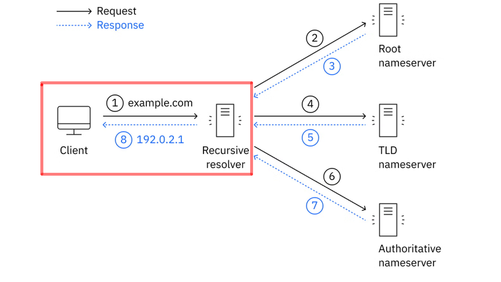
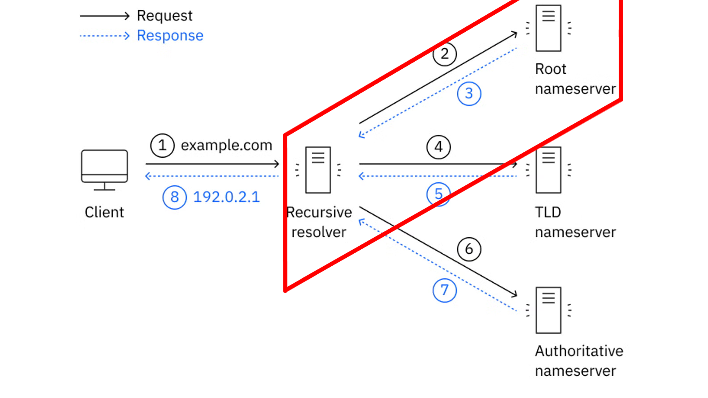
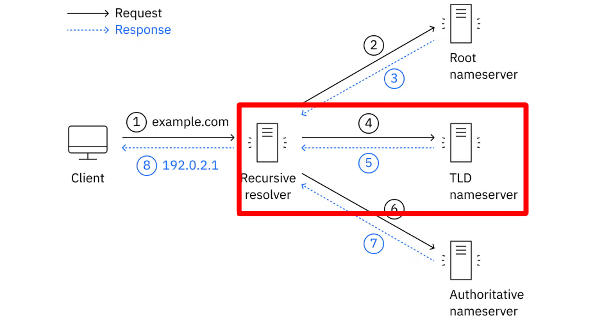
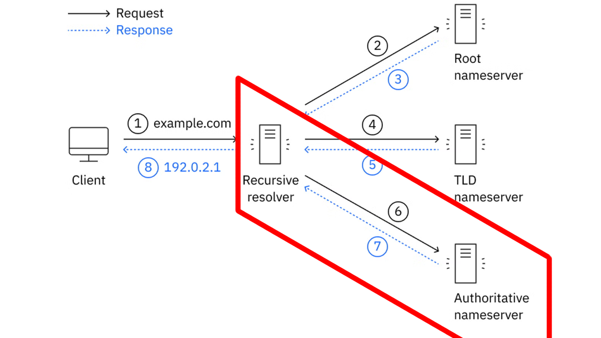
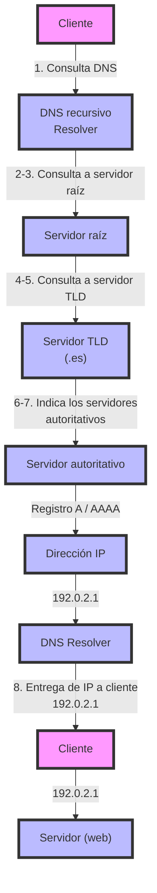

<div class="interactive-progress-tracker">
  <div class="tracker-header">
    <span>🏆 <strong>Progrés d'aquesta secció:</strong> <span class="tracker-count">0 de 4 superats (0%)</span></span>
    <span class="tracker-pts">⭐ <strong>0 punts</strong></span>
  </div>
  <div class="tracker-bar">
    <div class="tracker-fill" style="width: 0%;"></div>
  </div>
</div>

# 3.6 - Funcionament del servei DNS

- 

El funcionament del DNS es basa en un sistema **jeràrquic i distribuït**.

- 

Com hem vist, la resolució d'un nom pot implicar diferents servidors DNS.

- 

De forma simplificada, el procés és el següent:

### 6.1 Inici de la consulta i comprovació de la caché

- 

El dispositiu realitza una consulta a un **servidor DNS recursiu**, també denominat **DNS resoldre**.

- 

Habitualment, aquest servidor és proporcionat pel proveïdor d'accés a Internet, encara que també pot pertànyer a una organització, una empresa o ser **configurado manualment**.



- 

Abans de realitzar noves consultes, poden comprobar-se diferents **cachés DNS**.

- 

Per exemple, poden existir cachés en:

  1. El navegador.

  1. El sistema operatiu.

  1. El servidor DNS recursiu.

- 

Si algun d'aquests components disposa d'una resposta vàlida emmagatzemada en caché, no serà necessari realitzar (repetir) tot el procés de resolució.

- 

La informació emmagatzemada en caché té un temps de validesa denominat **TTL (*Time To Live*)** passat el qual caducará i es haurà de tornar a consultar els servidors DNS corresponents.

### 6.2 Consulta al servidor arrel (*Root Server*)

- 

Si el resoldre recursiu no disposa de la resposta en el seu caché, comença la cerca consultant la jerarquia DNS.

- 

El primer nivell correspon als **servidors arrel**.



- 

Existeixen **13 servidors arrel lògics**, identificats mitjançant les lletres de la **A a la M**. Cada un d'ells està replicado mitjançant numerosas instàncies distribuïdes geográficament per diferents llocs del món.

- 

Els servidors arrel **no coneixen directament l'adreça IP** del domini que estem cercant. La seua funció és indicar què servidors són responsables del **domini de nivell superior (TLD Top-Level Domain)** corresponent.

- 

Per exemple, si estem cercant:

```bash
www.aules.edu.gva.es.
```

el [**servidor arrel**](https://root-servers.org/) pot indicar què servidors es encargan del TLD `.es`.

### 6.3 Consulta al servidor de nivell superior (TLD)

- 

El resoldre recursiu consulta llavors a un [**servidor TLD**](https://www.iana.org/domains/root/db) (*Top-Level Domain*).



- 

Un TLD és la part final d'un nom de domini, com:

```bash
.com
.es
.org
.net
```

- 

El servidor TLD no proporciona necessàriament l'adreça IP de l'equip que cerquem. La seua funció és indicar quins són els **servidors DNS autoritativos** encarregats del domini corresponent.

- 

Per exemple, els servidors TLD `.es` poden indicar què servidors DNS són autoritativos per a:

```bash
aules.edu.gva.es
```

<details markdown="1">

<summary>💡 A què servidors el TLD de .és. delega els seues consultes?</summary>

- NS a.nic.és 194.69.254.1, 2001:67c:21cc:2000:0:0:64:41

- NS c.nic.és 194.0.34.53, 2001:678:44:0:0:0:0:53

- NS g.nic.és 204.61.217.1, 2001:500:14:7001:ad:0:0:1

- NS h.nic.és 194.0.33.53, 2001:678:40:0:0:0:0:53

</details>

### 6.4 Consulta al servidor de noms autoritativo

- 

El resoldre recursiu consulta finalment a un dels **servidors DNS autoritativos** responsables de la zona corresponent.



- 

Un servidor autoritativo disposa de la **informació oficial de la zona DNS que administra**. Aquesta informació conté diferents registres DNS que permeten conèixer els serveis associats als noms del domini.

- 

Per exemple, un registre **A** pot associar un nom amb una adreça IPv4:

```bash
www.aules.edu.gva.es  →  195.77.20.168
```

- 

Per a IPv6 s'utilitza normalment un registre **AAAA**.

- 

Un domini pot disposar de **diversos servidors autoritativos**, proporcionant redundància i disponibilitat.

### 6.5 Resolució final i emmagatzematge en caché

- 

El resoldre recursiu rep la resposta del servidor autoritativo i es la proporciona al dispositiu que va realitzar la consulta.


- 

El navegador ja pot utilitzar l'adreça IP obtenida per a establir una connexió amb el servei corresponent.

- 

A més, el resoldre pot emmagatzemar la resposta en el seu **caché DNS** durant el temps indicat pel **TTL** del registre.

- 

D'aquesta forma, si un altre dispositiu realitza posteriorment la mateixa consulta, el resoldre pot respondre utilitzant la informació emmagatzemada en caché sense tindre que tornar a consultar als servidors arrel, TLD i autoritativos.

### 6.6 Resum del procés

- 

De forma simplificada, podem representar la resolució d'un nom de domini de la següent manera:



> **📌 Resum dels que hem vist**
> 

> 1. El **client no sol consultar directament als servidors arrel, TLD i autoritativos**. 

> 1. Normalment realitza una consulta a un **resoldre DNS recursiu**, que s'encarrega de realitzar les consultes necessàries i retornar finalment la resposta al client.

> 1. 

> Per tant, hem de distingir entre:

| Servidor DNS | Funció principal |
| --- | --- |
| **DNS recursiu (Resoldre)** | Realitza la cerca en nom del client i retorna la resposta |
| **Servidor arrel (Root)** | Indica què servidors gestionen el TLD solicitado |
| **Servidor TLD** | Indica què servidors són autoritativos per al domini |
| **Servidor autoritativo** | Proporciona la informació oficial de la zona DNS |

> 1. 

> Aquesta jerarquia permet que el DNS siga un sistema **distribuït, escalable i resistente**, capaç de gestionar una enorme quantitat de  noms de domini sense dependre d'un únic servidor central.


---

## 🎮 Reptes Interactius d'Autoavaluació (+100 XP)

Comprova el teu domini sobre **3.6 - Funcionament del servei DNS** superant aquests 4 reptes gamificats (+25 punts cadascun):

<div class="interactive-mcq" data-answer="A" data-hint="Revisa els conceptes teòrics i pràctics d'aquesta secció.">
  <div class="mcq-question">🎯 <strong>Repte 1 (+25 pts):</strong> Quina diferència hi ha entre una consulta DNS recursiva i una consulta DNS iterativa?</div>
  <div class="mcq-options">
    <button type="button" class="btn-mcq-opt" data-opt="A">A) En la recursiva el client demana al servidor DNS local la resposta completa; en la iterativa el servidor consultat respon amb la millor referència (p. ex. servidor TLD o autoritatiu) que coneix.</button>
    <button type="button" class="btn-mcq-opt" data-opt="B">B) La consulta iterativa només funciona amb adreces IPv6 i la recursiva només amb IPv4.</button>
    <button type="button" class="btn-mcq-opt" data-opt="C">C) La consulta recursiva utilitza el port 80 i la iterativa el port 21.</button>
    <button type="button" class="btn-mcq-opt" data-opt="D">D) Cap de les anteriors és correcta.</button>
  </div>
  <div class="quiz-feedback"></div>
</div>

<div class="interactive-mcq" data-answer="D" data-hint="Comprova l'apartat corresponent de la unitat.">
  <div class="mcq-question">🎯 <strong>Repte 2 (+25 pts):</strong> Quin tipus de registre DNS s'utilitza per a la resolució inversa (traduir una adreça IP a un nom de domini FQDN)?</div>
  <div class="mcq-options">
    <button type="button" class="btn-mcq-opt" data-opt="A">A) CNAME</button>
    <button type="button" class="btn-mcq-opt" data-opt="B">B) MX</button>
    <button type="button" class="btn-mcq-opt" data-opt="C">C) Cap de les anteriors és correcta.</button>
    <button type="button" class="btn-mcq-opt" data-opt="D">D) PTR</button>
  </div>
  <div class="quiz-feedback"></div>
</div>

<div class="interactive-vf" data-answer="V" data-hint="Verifica l'afirmació amb els apunts de la unitat.">
  <div class="vf-statement">✅ <strong>Repte 3 (Vertader o Fals · +25 pts):</strong> L'extensió DNSSEC afegeix signatures criptogràfiques als registres DNS per a protegir contra atacs d'enverinament de memòria cau (DNS Cache Poisoning).</div>
  <div class="vf-buttons">
    <button type="button" class="btn-vf" data-opt="V">Vertader (V)</button>
    <button type="button" class="btn-vf" data-opt="F">Fals (F)</button>
  </div>
  <div class="quiz-feedback" style="width: 100%;"></div>
</div>

<div class="interactive-quiz" data-answer="a" data-hint="És la primera lletra de l'abecedari (Address).">
  <div class="quiz-question">⌨️ <strong>Repte 4 (+25 pts):</strong> Quin tipus de registre DNS associa un nom de domini amb una adreça IPv4 de 32 bits? (Escriu la lletra del registre)</div>
  <div class="quiz-controls">
    <input type="text" class="quiz-input" placeholder="Escriu la resposta..." />
    <button type="button" class="btn-quiz-check">Comprovar</button>
  </div>
  <div class="quiz-feedback"></div>
</div>

### 📋 Llista de Comprovació i Rúbrica d'Assoliment

Marca cada criteri a mesura que completes l'estudi o la resolució pràctica d'aquesta pàgina (**3.6 - Funcionament del servei DNS**):

- [ ] He llegit detingudament la teoria o l'enunciat d'aquesta secció i he anotat els conceptes clau.
- [ ] He revisat els esquemes, taules o blocs de codi i he verificat que sé aplicar-los a l'entorn de treball.
- [ ] He resolt correctament els **4 reptes interactius** superiors obtenint els **100 punts XP**.
- [ ] He descarregat el comprovant oficial en PDF per a adjuntar-lo a la tasca d'**Aules**.

<div class="aules-delivery-card">
  <h3>📤 Comprovant de Lliurament per a Aules</h3>
  <p>Quan hages completat els reptes interactius i la llista d'autoavaluació d'aquesta pàgina, introdueix el teu nom i descarrega el teu certificat oficial en PDF per a adjuntar-lo a la tasca d'<strong>Aules</strong>.</p>
  <div class="aules-student-field">
    <label for="aules-student-name">👤 Nom i Cognoms de l'Alumne/a:</label>
    <input type="text" id="aules-student-name" class="aules-student-name" placeholder="Ex: Joan Garcia Pérez" />
  </div>
  <div class="aules-score-badge">
    <span class="aules-score-count">0/4 reptes completats (0%) · 0 punts · 0/4 criteris d'autoavaluació</span>
  </div>
  <div class="aules-actions">
    <button type="button" class="btn-aules-dl" data-module="SEX" data-unit="UD03" data-activity="ut0306">📥 Descarregar Comprovant PDF</button>
    <button type="button" class="btn-aules-copy">📋 Copiar Resum al Porta-retalls</button>
  </div>
  <div class="aules-toast"></div>
</div>

