## 6 Tarea RA6-CEbcd-1 - Instalación y conexión remota a Windows Server 2025 en AWS

!!! warning "Obligatorio seguir las normas para la presentación de trabajos escritos."

### 6.1 Instalación de Windows Server 2025 en AWS

- AWS (Amazon Web Services) es una plataforma de servicios en la nube que permite a los usuarios crear y gestionar servidores virtuales, conocidos como instancias EC2 (Elastic Compute Cloud).
- Para instalar Windows Server 2025 en AWS, se deben seguir los siguientes pasos:

#### 6.1.1 Primer acceso a AWS

- Revisad vuestros correos electrónicos, ya que habréis recibido un correo de AWS con un enlace para crear vuestra cuenta.
- Para la creación de la cuenta, debéis seguir los pasos indicados en el siguiente [enlace](https://javieregeablasco.github.io/Apuntes/DAW/DAW_2/AWS/UT.%203-AWS%20Academy/#2-learner-lab).
- Una vez creada la cuenta accederemos al laboratorio de AWS (learner lab).

#### 6.1.2 Acceder al curso

- Para acceder al curso, debéis seguir los pasos indicados en el siguiente [enlace](https://javieregeablasco.github.io/Apuntes/DAW/DAW_2/AWS/UT.%203-AWS%20Academy/#23-acceso-al-curso).

#### 6.1.3 Acceder al laboratorio

- Para acceder al laboratorio, debéis seguir los pasos indicados en el siguiente [enlace](https://javieregeablasco.github.io/Apuntes/DAW/DAW_2/AWS/UT.%203-AWS%20Academy/#24-acceder-al-laboratorio).

#### 6.1.4 Lanzar el laboratorio

- Para lanzar el laboratorio, debéis seguir los pasos indicados en el siguiente [enlace](https://javieregeablasco.github.io/Apuntes/DAW/DAW_2/AWS/UT.%203-AWS%20Academy/#25-lanzar-el-laboratorio).

#### 6.1.5 Acceder al panel del laboratorio

- Para acceder al panel del laboratorio, debéis seguir los pasos indicados en el siguiente [enlace](https://javieregeablasco.github.io/Apuntes/DAW/DAW_2/AWS/UT.%203-AWS%20Academy/#26-panel-de-aws).

#### 6.1.6 Creación de una instancia EC2

1. Una instancia EC2 es un servidor virtual que se ejecuta en la infraestructura de AWS.

1. Para crear una instancia EC2 con Windows Server 2025, haremos lo siguiente:

    - Ir al panel de control de AWS y seleccionar el servicio EC2.
    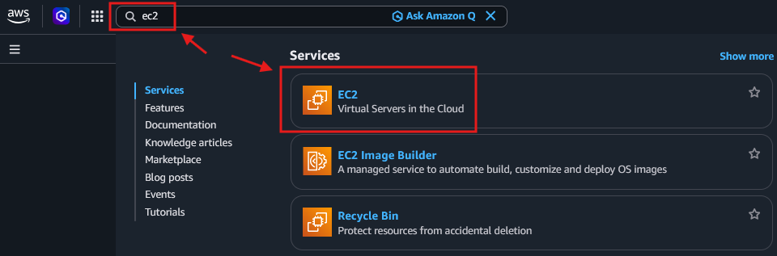
    - Una vez en el menú de EC2, seleccionar "Lanzar instancia".
    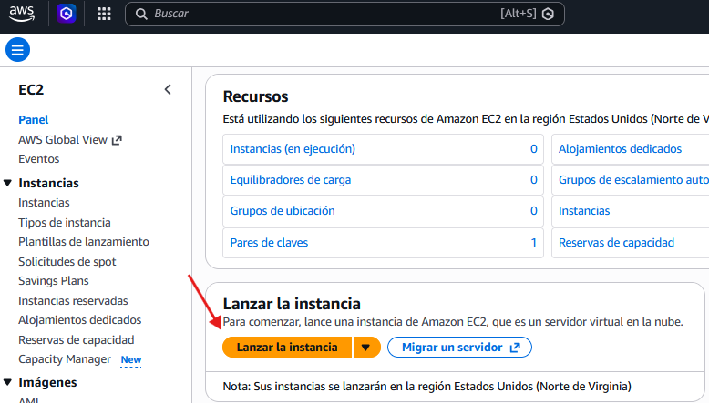
    - Seleccionar la imagen de Windows Server 2025.
    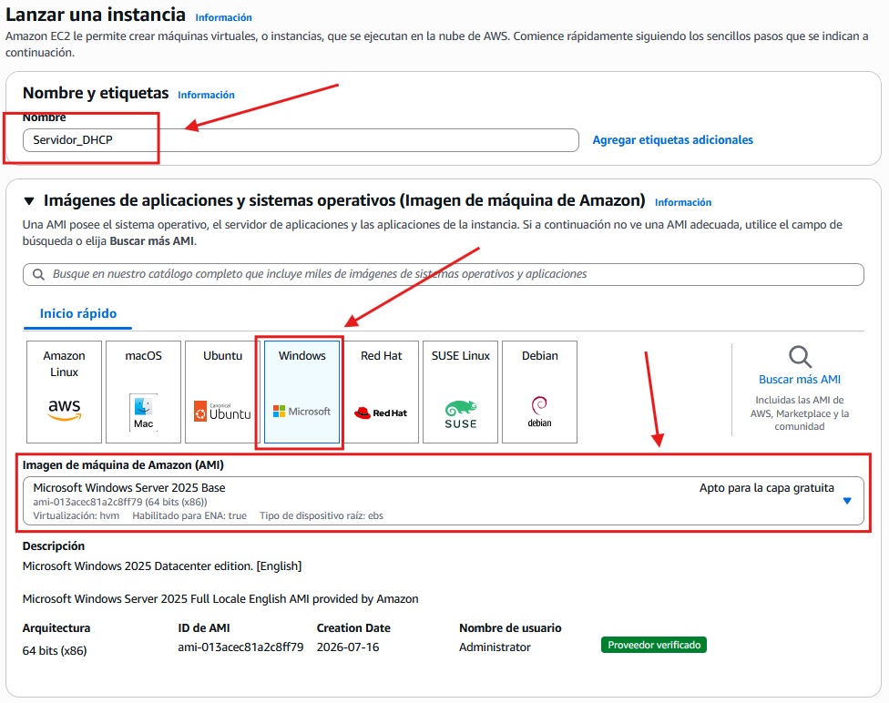
    > ⚠️ **Para el tipo de instancia seleccionar m7i.large**
>
>     - Configurar las opciones de la instancia (tipo, par de claves).
>     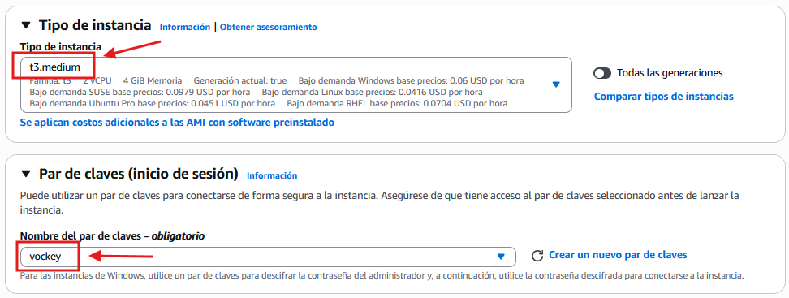
>     - Configurar las opciones de red.
>     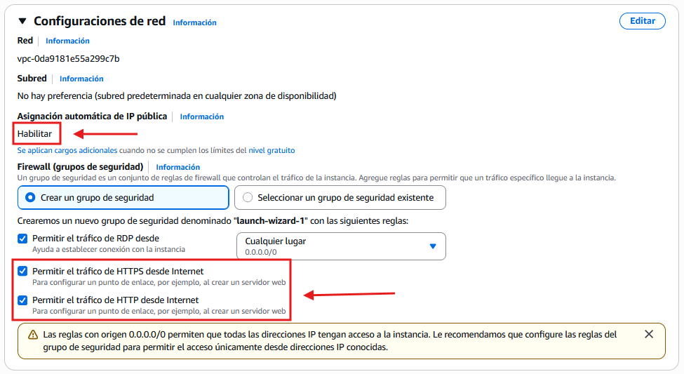
>     - Configurar el almacenamiento.
>     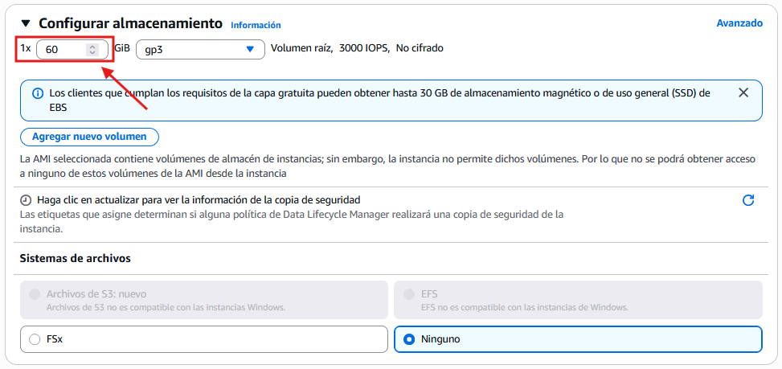
>     - Buscamos el botón de lanzar y lo pulsamos.
>     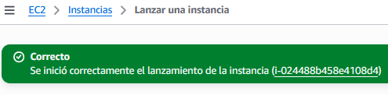
>     - Volvemos a la página de EC2 y supervisamos el estado de creación de nuestra instancia.  
>     ==Realizar captura de pantalla==
>     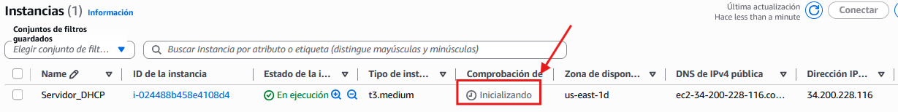
### 6.2 Conexión remota a la instancia de Windows Server 2025 desde windows 10-11

1. En este caso usaremos el protocolo RDP (Remote Desktop Protocol) para conectarnos a la instancia de Windows Server 2025. ese protocolo permite a los usuarios conectarse a otro ordenador a través de una interfaz gráfica, proporcionando acceso completo al escritorio del sistema remoto.

1. AWS facilita la conexión remota a través de RDP proporcionando un archivo de conexión que contiene la dirección IP pública de la instancia y las credenciales necesarias para acceder.

    - Seleccionamos la instancia a la que queremos acceder y accedemos al servicio de conexión remota en AWS.
    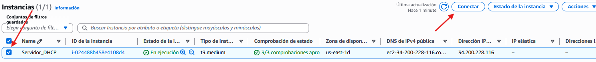
    - Seleccionamos RDP. Descargamos el archivo de conexión. De momento no lo abrimos ya que aún no tenemos las credenciales.
    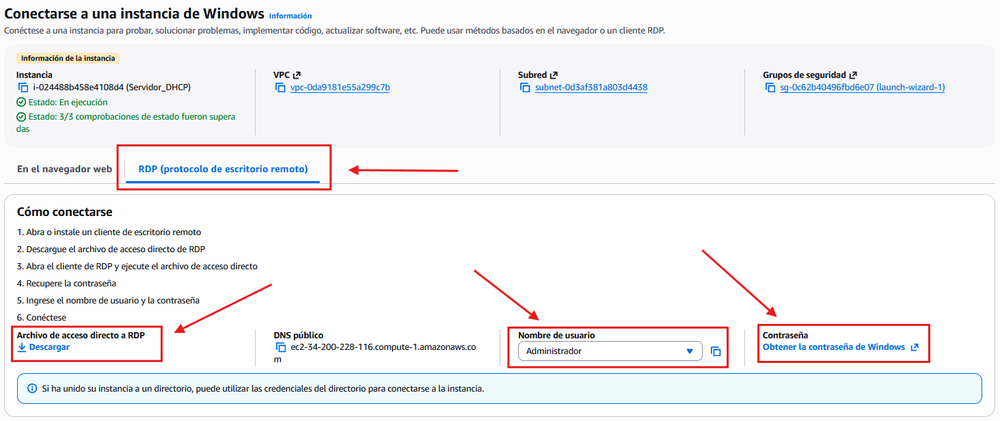
    - Volvemos al learner lab pinchamos en AWS details y descargamos el archivo de la clave privada **labuser.pem** y lo guardamos en nuestro equipo.
    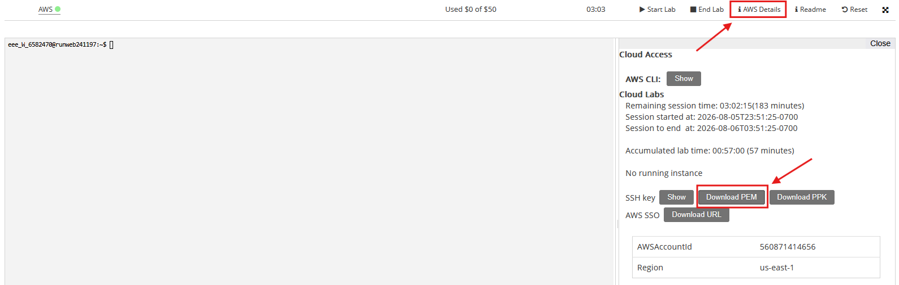
    - Volvemos a la página de EC2 y seleccionamos la instancia a la que queremos acceder. Pinchamos en **Conectar** y luego en **Obtener    contraseña**. Subimos el archivo **labuser.pem** y obtenemos la contraseña de acceso.
    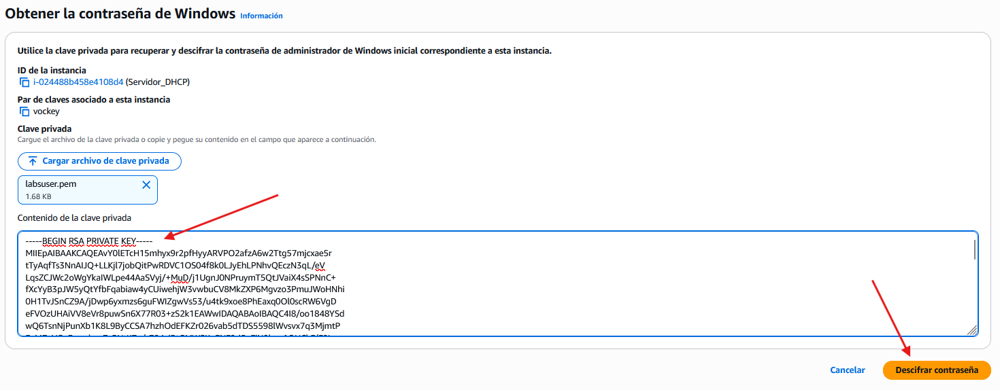
    - Contraseña de acceso:  
    ==Realizar captura de pantalla==
    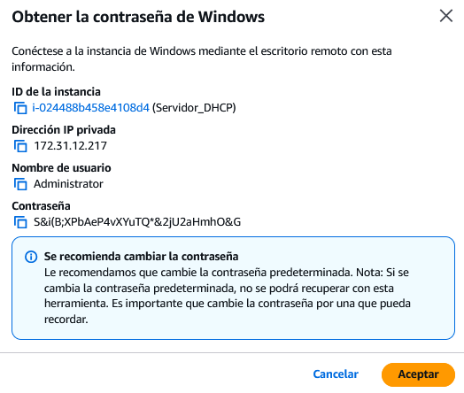
    - Abrimos el archivo de conexión RDP que hemos descargado anteriormente y pegamos la contraseña generada por AWS.  
    Acceso al escritorio remoto de Windows Server 2025.
    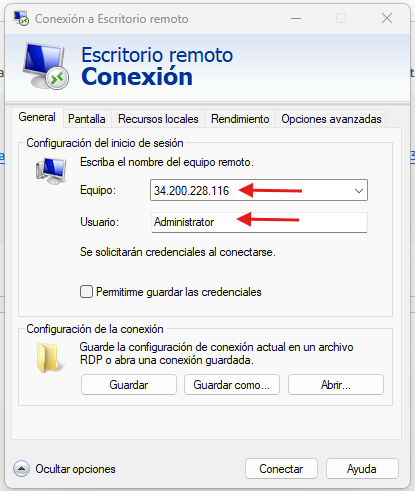  
    Pegamos la contraseña generada por AWS.
    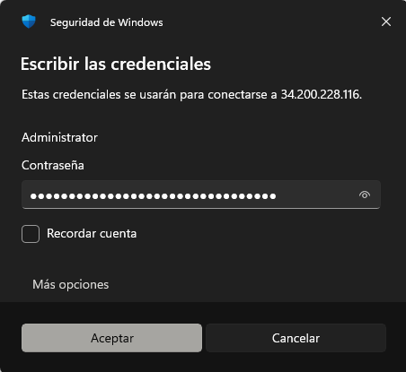
    > ⚠️ **Solo para usuarios con nombre de equipo vinculado a un Sistema de Información y Control Empresarial (SICE).**
>
>         - Ir a `Usar otra cuenta`:  
>         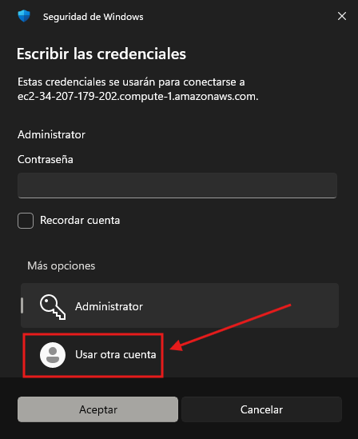
>         - Introducir `.\Administrator` en vez de solamente Administrator.
>         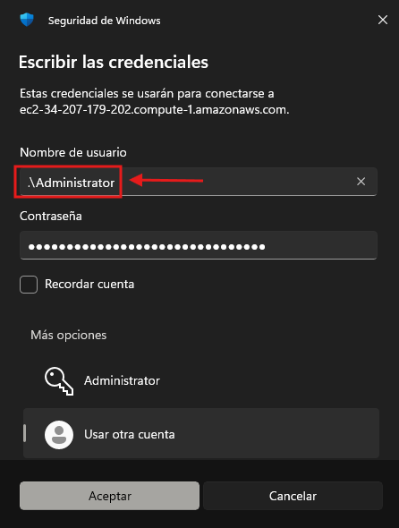
> 
>     - Aceptamos los riesgos de seguridad y nos conectamos al escritorio remoto de Windows Server 2025.  
>     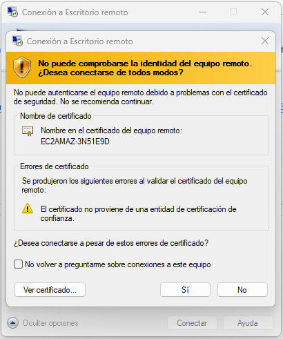
>     - Una vez conectdos, podemos trabajar con el escritorio remoto de Windows Server 2025 como si estuviéramos físicamente frente a él.  
>     ==Realizar captura de pantalla==
>     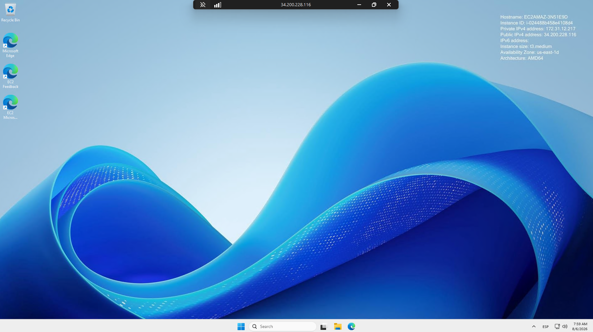
### 6.3 Configuraciones preliminares de Windows Server 2025

!!! warning "¡Obligatorio!"
Una vez conectados al escritorio remoto de Windows Server 2025, es recomendable realizar algunas configuraciones preliminares para asegurar el correcto funcionamiento del servidor y la seguridad del mismo.

- Cambiar el nombre del equipo.
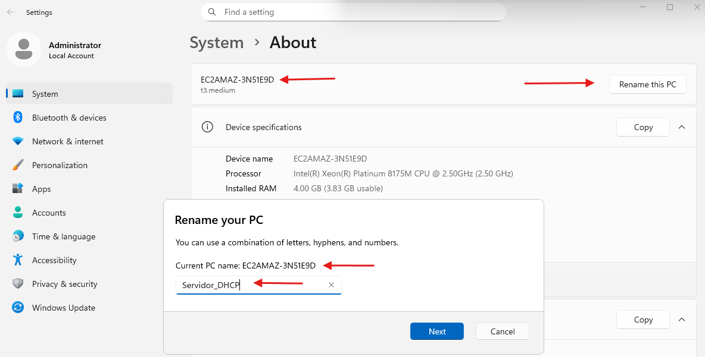
Si cambiamos el nombre del equipo, debemos reiniciar el servidor para que los cambios tengan efecto.
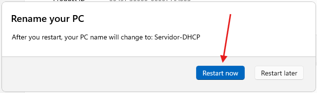
- Edición y versión del sistema operativo.
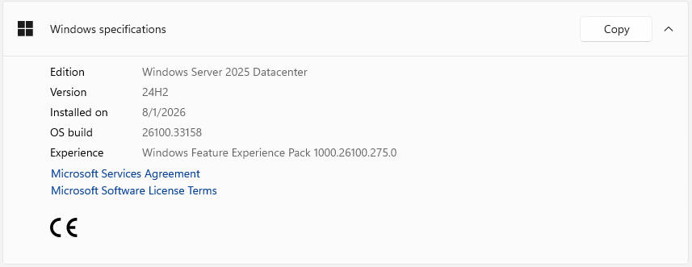
- Configurar el widget.
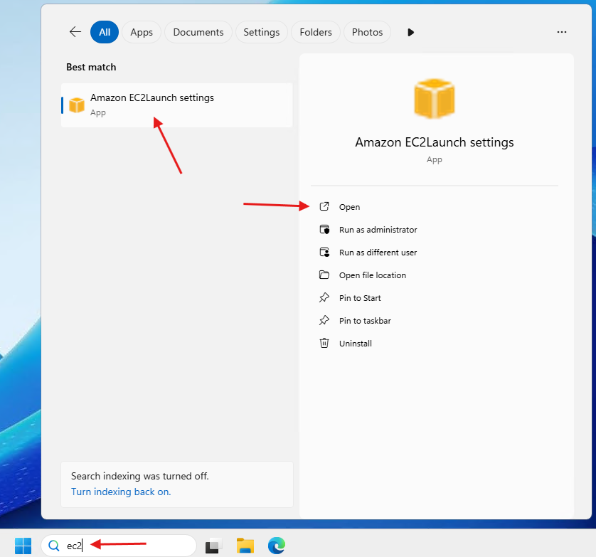
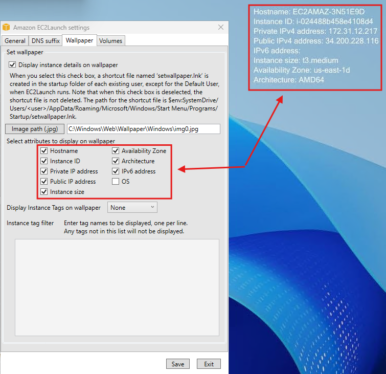
- ==Realizar captura de pantalla== del widget después de haber cambiado el nombre de la máquina.

### 6.4 Desconexión de la instancia a Windows Server 2025

Podemos hacerlo de varias formas:

- Cerrar la ventana de conexión remota.
- Cerrar sesión desde el menú de inicio de Windows Server 2025.
- Ejecutar la aplicación **Run** y escribir el comando **logoff** para cerrar la sesión de forma inmediata.
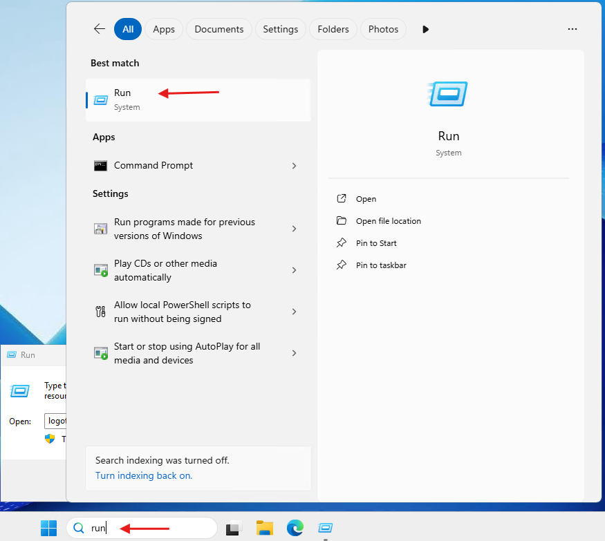
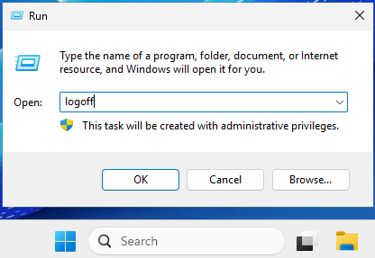

### 6.5 Cerrar el laboratorio

- Tenemos que cerrar el laboratorio de AWS para liberar los recursos y evitar cargos innecesarios.
- Para ello, simplemente finalizaremos el laboratorio, pinchando en **End Lab** en la consola del laboratory y esperaremos a que el testigo de AWS pase a **rojo**.  
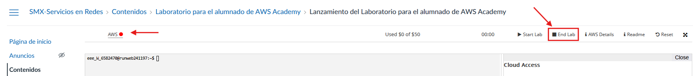
