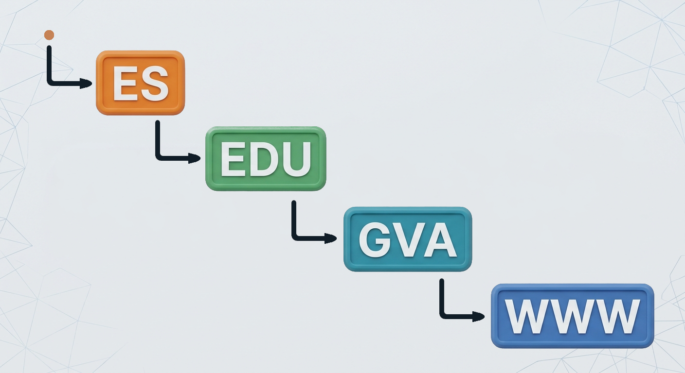
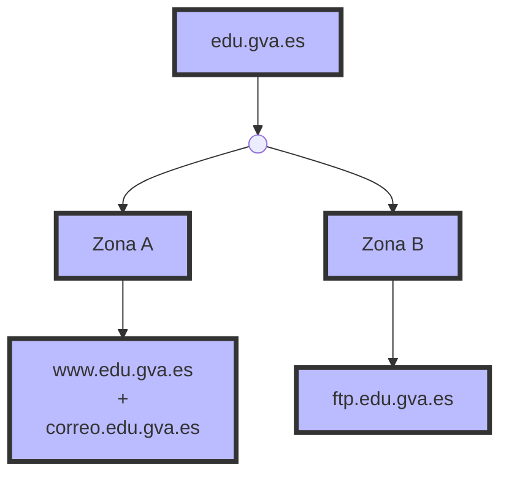

<div class="interactive-progress-tracker">
  <div class="tracker-header">
    <span>🏆 <strong>Progrés d'aquesta secció:</strong> <span class="tracker-count">0 de 4 superats (0%)</span></span>
    <span class="tracker-pts">⭐ <strong>0 punts</strong></span>
  </div>
  <div class="tracker-bar">
    <div class="tracker-fill" style="width: 0%;"></div>
  </div>
</div>

# 3.7 - Jerarquia de noms DNS

- 

El sistema DNS està organitzat mitjançant una **estructura jeràrquica**, similar a un arbre invertido. En la part superior es troba la **arrel (`.`)** i, a mesura que descendemos per la jerarquia, trobem els diferents dominis i subdominios.

- 

Si tenim el següent nom:


- 

La seua estructura jeràrquica seria:



- 

Cada nivell representa una part diferent de la jerarquia DNS.

### 7.1 L'arrel DNS

- 

En la part superior de la jerarquia es troba la **arrel DNS**, representada mitjançant un punt:

```bash
.
```

- 

L'arrel és el nivell superior de tot el sistema DNS.

- 

Un nom de domini completament cualificado (*FQDN, Fully Qualified Domain Name*) podria escriure's de la següent manera:


- 

Normalment aquest punt final no es escriu quan utilitzem un nom de domini en un navegador però forma part de l'estructura completa del nom.


### 7.2 Dominis de nivell superior (TLD)

- 

Per davall de l'arrel es troben els **dominis de nivell superior**, coneguts com **TLD (*Top-Level Domain*)**.

- 

Alguns exemples són:

```bash
.com
.org
.net
.es
.edu
```

- 

Existeixen diferents tipus de TLD. Per exemple:

  1. **gTLD (*generic Top-Level Domain*)**: `.com`, `.org`, `.net`, etc.

  1. **ccTLD (*country code Top-Level Domain*)**: `.es`, `.fr`, `.it`, `.de`, etc.

- 

En el cas de:

```bash
www.edu.gva.es
```

el **TLD** és:

```bash
.es
```

### 7.3 Domini

- 

A l'esquerra del TLD trobem altres nivells de la jerarquia.

- 

En el cas de:

```bash
www.edu.gva.es
```

**Un domini dins del TLD** `.es` seria.

```bash
gva.es
```

### 7.4 Subdominios

- 

Un **subdominio** és un domini que es troba per davall d'un altre domini dins de la jerarquia DNS.

- 

En el cas de:

```bash
gva.es
```

podria tindre diferents subdominios:

```bash
edu.gva.es
san.gva.es
just.gva.es
```

I, a la seua vegada, `edu.gva.es` podria tindre altres nivells:

```bash
www.edu.gva.es
aules.edu.gva.es
correo.edu.gva.es
```

- 

Els subdominios permeten organitzar diferents serveis, departaments o recursos dins d'una mateixa estructura de noms.

### 7.5 FQDN

- 

Un **FQDN (*Fully Qualified Domain Name*)**, o **nom de domini completament cualificado**, identifica de forma completa una posició dins de la jerarquia DNS.

- 

En el nostre cas tindríem el següent FQDN:

```bash
www.edu.gva.es.
```

> **📌 Important**
> 

> Els noms DNS es interpretan **de dreta a esquerra**.

### 7.6 Nom d'host

- 

En una xarxa, un **host** és un dispositiu o sistema que pot comunicar-se mitjançant una xarxa.

- 

En DNS, un nom com `www.edu.gva.es` pot utilitzar-se per a identificar un servei o un host.

- 

Per exemple, podríem tindre:

```bash
www.edu.gva.es
correo.edu.gva.es
ftp.edu.gva.es
```

- 

Cada nom podria estar associat mitjançant DNS a una adreça IP diferent:

```bash
www.edu.gva.es       → 192.168.1.10
correo.edu.gva.es    → 192.168.1.20
ftp.edu.gva.es       → 192.168.1.30
```

> **📌 Important**
> 

> - Cada nom DNS **no representa necessàriament un únic equip físic**.  

> - Un mateix servei pot estar distribuït entre diversos servidors i una mateixa adreça IP pot utilitzar-se per a diferents noms.

### 7.7 Zona DNS

- 

Una **zona DNS** és una part de la jerarquia DNS que està administrada per una organització o servidor DNS determinat.

- 

La zona conté els **registres DNS** que proporcionen informació sobre els noms i serveis que administra.

- 

Per exemple, una organització podria administrar la zona:

```bash
edu.gva.es
```

i dins d'ella tindre, en un primer escenario, tots els noms agrupats en una única zona:

```bash
www.edu.gva.es
correo.edu.gva.es
ftp.edu.gva.es
```

La zona podria contindre registres com:

```bash
www.edu.gva.es      → 192.168.10.10
correo.edu.gva.es   → 192.168.10.20
ftp.edu.gva.es      → 192.168.10.30
```

> **📌 Domini i zona no són exactament el mateix**
> 

> 1. Encara que en l'exemple anterior el domini `edu.gva.es` i la zona que l'administra coincideixen, **domini i zona són conceptes diferents**.

> 1. Un domini representa una part de la **jerarquia de noms DNS**, mentre que una zona representa una part d'eixa jerarquia que està **administrativament gestionada mitjançant servidors DNS autoritativos**.

> 1. Un domini pot contindre diferents subdominios i aquests poden estar delegats en altres zones.

> 1. Vegem un segon escenario, alternatiu a l'anterior, en el que l'organització decide **dividir** l'administració de `edu.gva.es` en dos zones distintes:



> 1. En aquest segon escenario, l'organització administra directament una zona amb `www.edu.gva.es` i `correo.edu.gva.es` (Zona A), mentre que `ftp.edu.gva.es` està delegado a altres servidors DNS que administran la Zona B. Totes dues zones segueixen pertenecent al mateix domini `edu.gva.es`, però estan gestionades de forma independent.

### 7.8 Resum de la jerarquia DNS

- 

Podem resumir els diferents conceptes mitjançant la següent imatge:


- 

D'aquesta forma, el DNS organitza els noms mitjançant una estructura jeràrquica en la que cada nivell pot ser administrado de forma independent.  

| Concepte | Significat | Exemple |
| --- | --- | --- |
| **Arrel** | Nivell superior de la jerarquia DNS | `.` |
| **TLD** | Domini de nivell superior | `.es` |
| **Domini** | Nom registrat dins d'un TLD | `gva.es` |
| **Subdominio** | Domini situat dins d'un altre domini | `edu.gva.es` |
| **FQDN** | Nom DNS completament cualificado (inclou el punt arrel final) | `www.edu.gva.es.` |
| **Host** | Equip o servei identificat mitjançant un nom | `www.edu.gva.es` |
| **Zona** | Part de la jerarquia administrada per uns servidors autoritativos concrets | `edu.gva.es` (zona delegada, amb els seus propis servidors autoritativos dins del domini `gva.es`) |


---

## 🎮 Reptes Interactius d'Autoavaluació (+100 XP)

Comprova el teu domini sobre **3.7 - Jerarquia de noms DNS** superant aquests 4 reptes gamificats (+25 punts cadascun):

<div class="interactive-mcq" data-answer="A" data-hint="Revisa els conceptes teòrics i pràctics d'aquesta secció.">
  <div class="mcq-question">🎯 <strong>Repte 1 (+25 pts):</strong> Quina diferència hi ha entre una consulta DNS recursiva i una consulta DNS iterativa?</div>
  <div class="mcq-options">
    <button type="button" class="btn-mcq-opt" data-opt="A">A) En la recursiva el client demana al servidor DNS local la resposta completa; en la iterativa el servidor consultat respon amb la millor referència (p. ex. servidor TLD o autoritatiu) que coneix.</button>
    <button type="button" class="btn-mcq-opt" data-opt="B">B) La consulta iterativa només funciona amb adreces IPv6 i la recursiva només amb IPv4.</button>
    <button type="button" class="btn-mcq-opt" data-opt="C">C) La consulta recursiva utilitza el port 80 i la iterativa el port 21.</button>
    <button type="button" class="btn-mcq-opt" data-opt="D">D) Cap de les anteriors és correcta.</button>
  </div>
  <div class="quiz-feedback"></div>
</div>

<div class="interactive-mcq" data-answer="D" data-hint="Comprova l'apartat corresponent de la unitat.">
  <div class="mcq-question">🎯 <strong>Repte 2 (+25 pts):</strong> Quin tipus de registre DNS s'utilitza per a la resolució inversa (traduir una adreça IP a un nom de domini FQDN)?</div>
  <div class="mcq-options">
    <button type="button" class="btn-mcq-opt" data-opt="A">A) CNAME</button>
    <button type="button" class="btn-mcq-opt" data-opt="B">B) MX</button>
    <button type="button" class="btn-mcq-opt" data-opt="C">C) Cap de les anteriors és correcta.</button>
    <button type="button" class="btn-mcq-opt" data-opt="D">D) PTR</button>
  </div>
  <div class="quiz-feedback"></div>
</div>

<div class="interactive-vf" data-answer="V" data-hint="Verifica l'afirmació amb els apunts de la unitat.">
  <div class="vf-statement">✅ <strong>Repte 3 (Vertader o Fals · +25 pts):</strong> L'extensió DNSSEC afegeix signatures criptogràfiques als registres DNS per a protegir contra atacs d'enverinament de memòria cau (DNS Cache Poisoning).</div>
  <div class="vf-buttons">
    <button type="button" class="btn-vf" data-opt="V">Vertader (V)</button>
    <button type="button" class="btn-vf" data-opt="F">Fals (F)</button>
  </div>
  <div class="quiz-feedback" style="width: 100%;"></div>
</div>

<div class="interactive-quiz" data-answer="a" data-hint="És la primera lletra de l'abecedari (Address).">
  <div class="quiz-question">⌨️ <strong>Repte 4 (+25 pts):</strong> Quin tipus de registre DNS associa un nom de domini amb una adreça IPv4 de 32 bits? (Escriu la lletra del registre)</div>
  <div class="quiz-controls">
    <input type="text" class="quiz-input" placeholder="Escriu la resposta..." />
    <button type="button" class="btn-quiz-check">Comprovar</button>
  </div>
  <div class="quiz-feedback"></div>
</div>

### 📋 Llista de Comprovació i Rúbrica d'Assoliment

Marca cada criteri a mesura que completes l'estudi o la resolució pràctica d'aquesta pàgina (**3.7 - Jerarquia de noms DNS**):

- [ ] He llegit detingudament la teoria o l'enunciat d'aquesta secció i he anotat els conceptes clau.
- [ ] He revisat els esquemes, taules o blocs de codi i he verificat que sé aplicar-los a l'entorn de treball.
- [ ] He resolt correctament els **4 reptes interactius** superiors obtenint els **100 punts XP**.
- [ ] He descarregat el comprovant oficial en PDF per a adjuntar-lo a la tasca d'**Aules**.

<div class="aules-delivery-card">
  <h3>📤 Comprovant de Lliurament per a Aules</h3>
  <p>Quan hages completat els reptes interactius i la llista d'autoavaluació d'aquesta pàgina, introdueix el teu nom i descarrega el teu certificat oficial en PDF per a adjuntar-lo a la tasca d'<strong>Aules</strong>.</p>
  <div class="aules-student-field">
    <label for="aules-student-name">👤 Nom i Cognoms de l'Alumne/a:</label>
    <input type="text" id="aules-student-name" class="aules-student-name" placeholder="Ex: Joan Garcia Pérez" />
  </div>
  <div class="aules-score-badge">
    <span class="aules-score-count">0/4 reptes completats (0%) · 0 punts · 0/4 criteris d'autoavaluació</span>
  </div>
  <div class="aules-actions">
    <button type="button" class="btn-aules-dl" data-module="SEX" data-unit="UD03" data-activity="ut0307">📥 Descarregar Comprovant PDF</button>
    <button type="button" class="btn-aules-copy">📋 Copiar Resum al Porta-retalls</button>
  </div>
  <div class="aules-toast"></div>
</div>

