## 7 Tarea RA6-CEbcd-2 - Instalación y conexión remota a Ubuntu Server 24.04 LTS en AWS

!!! warning "Obligatorio seguir las normas para la presentación de trabajos escritos."

### 7.1 Instalación de Ubuntu Server 24.04 LTS en AWS

Repetiremos los pasos anteriores para crear una instancia EC2, pero esta vez seleccionaremos la imagen de Ubuntu Server 24.04 LTS.

- Seleccionamos la imagen de Ubuntu Server 24.04 LTS.
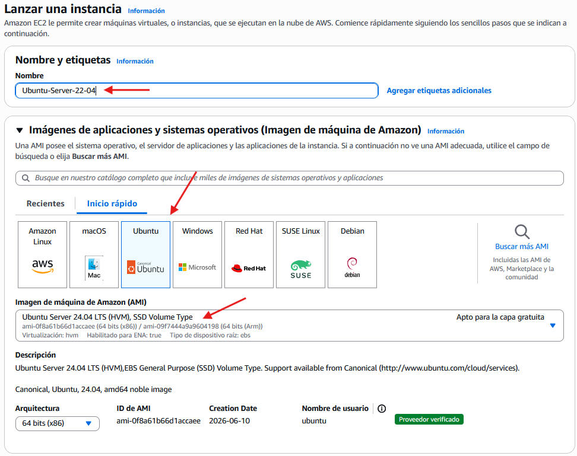
- Seleccionamos el tipo de instancia y el par de claves.
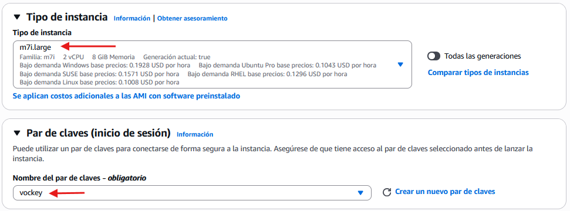
- Configuramos la red donde se desplegará la instancia.
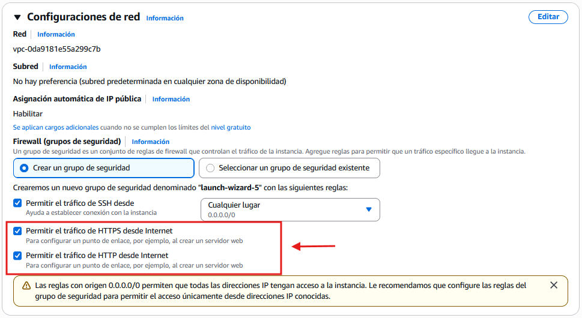
!!! warning "Para el almacenamiento seleccionar 50GiB"
- Configuramos el almacenamiento de la instancia.
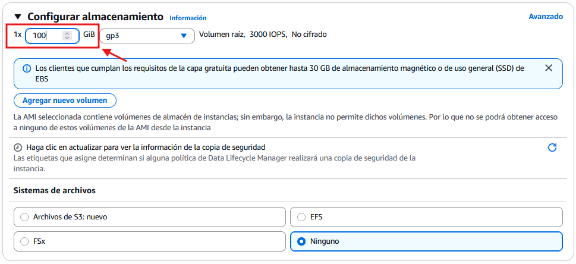

### 7.2 Conexión remota CLI a través del panel de control de AWS

- Al igual que en el caso de Windows Server 2025, seleccionaremos la instancia en la consola de AWS y pulsaremos conectar.
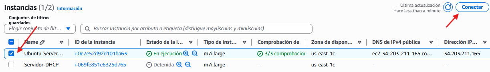
- AWS facilita la conexión remota a través de SSH de manera fácil e intuitiva.
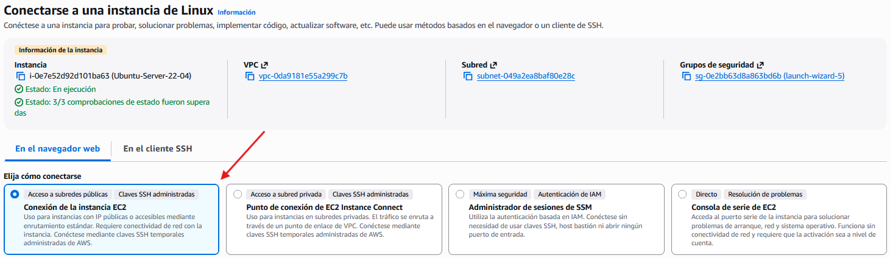
- Una vez establecida la conexión, se nos abrirá una ventana de terminal con la conexión SSH a la instancia de Ubuntu Server 24.04 LTS.  
==Realizar captura de pantalla==
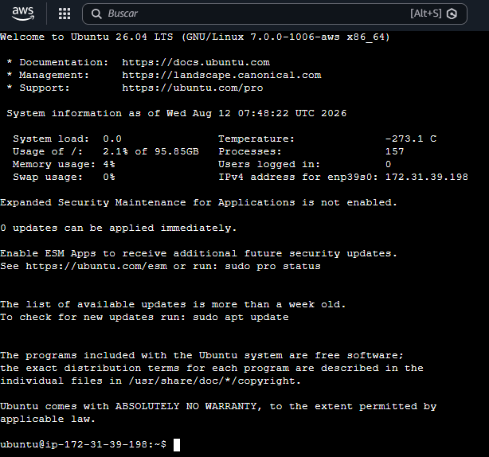

### 7.3 Conexión remota desde SO Windows

- Para conectarnos a la instancia de Ubuntu Server 24.04 LTS desde un sistema operativo Windows, podemos utilizar la aplicación de conexión a escritorio remoto **MSTSC**.
- No obstante, tendremos que preparar la instancia para permitir conexiones así como instalar un cliente RDP y un entorno gráfico ligero en la instancia de Ubuntu Server 24.04 LTS.

#### 7.3.1 Apertura de puertos en la instancia

1. Al abrir los puertos necesarios en el firewall de la instancia de Ubuntu Server 24.04 LTS, podremos permitir conexiones remotas a través de RDP.

1. Aunque no sea una buena práctica, para fines educativos, no solo abriremos el puerto 3389 para los protocolos **TCP** y **UDP** sino que abriremos todos los puertos.

    - Vamos a la consola de AWS y seleccionamos la instancia de Ubuntu Server 24.04 LTS.
    - En la sección de **Seguridad**, seleccionamos el grupo de seguridad asociado a la instancia.
    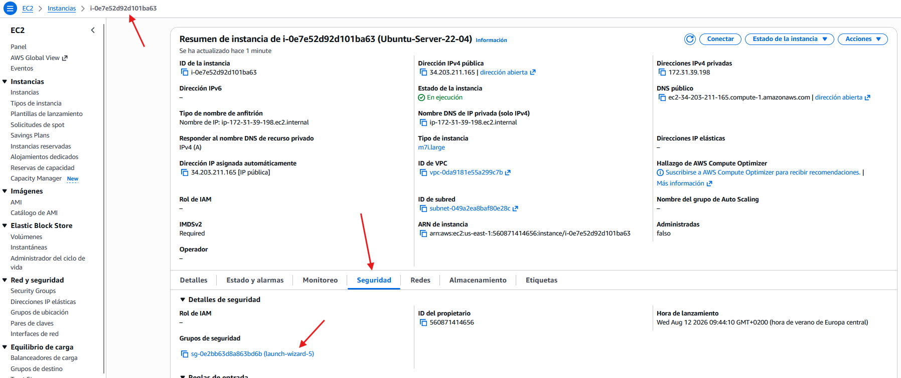
    - Editamos las reglas de entrada.
    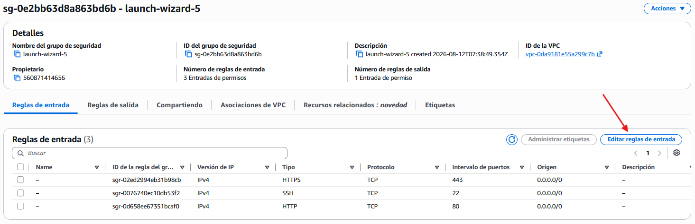
    - Agregamos una regla de entrada para permitir **el tráfico entrante desde internet sobre cualquier puerto**.
    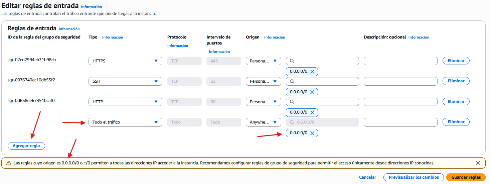  
    - Al final, obtendremos el siguiente resultado:  
    ==Realizar captura de pantalla==
    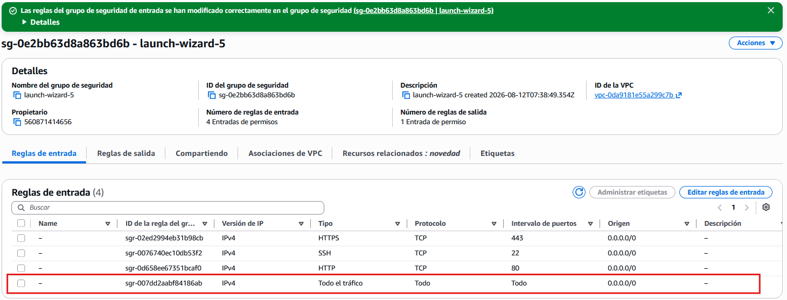

#### 7.3.2 Preparación de la instancia de Ubuntu Server 24.04 LTS

En la instancia de Ubuntu Server 24.04 LTS, instalaremos un servidor RDP para permitir conexiones remotas desde sistemas Windows.

Para ello, primero nos conectaremos a la instancia a través de SSH y luego instalaremos el servidor RDP.

- Actualizamos los repositorios y actualizamos el sistema operativo.

    ```bash
    sudo apt update && sudo apt upgrade -y
    ```

- De momento no disponemos de interfaz gráfica en la instancia de Ubuntu Server 24.04 LTS, por lo que instalaremos un entorno de escritorio ligero como **XFCE**.

    ```bash
    sudo apt install xfce4 xfce4-goodies -y
    ```

- Instalamos el servidor RDP **XRDP**.

    ```bash
    sudo apt install xrdp -y    
    ```

- Habilitamos el servicio xrdp para que se inicie automáticamente al arrancar el sistema.

    ```bash
    sudo systemctl enable xrdp
    ```

- Iniciamos el servicio xrdp.

    ```bash
    sudo systemctl start xrdp
    ```

- Verificamos que el servicio xrdp esté activo y en ejecución.

    ```bash
    sudo systemctl status xrdp
    ```

- Obtendremos un resultado similar al siguiente.  
==Realizar captura de pantalla==
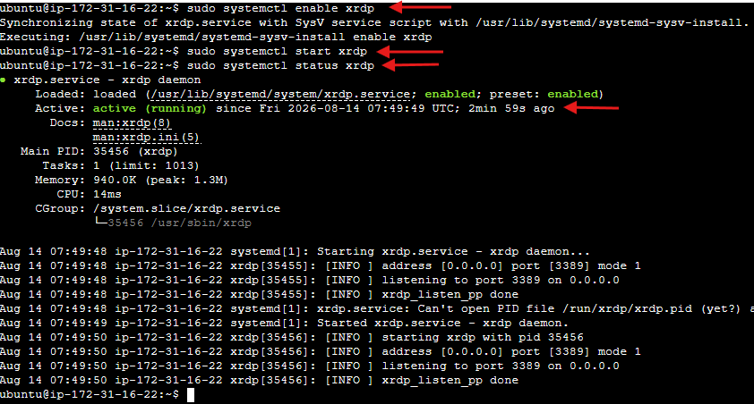

- Cambiamos la contraseña del usuario para que pueda iniciar sesión a través de RDP.

    ```bash
    sudo passwd <nombre_de_usuario>
    ```

    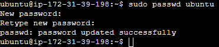

- Para evitar conflictos con la elección de la interfaz gráfica por parte de XFCE, figuramos el archivo de sesion.

    ```bash
    echo "startxfce4" > ~/.xsession
    chmod +x ~/.xsession
    ```

- Nos aseguramos que la interfaz se aplica al servicio globalmente.

    ```bash
    sudo sed -i.bak 's/exec \/etc\/X11\/Xsession/exec startxfce4/' /etc/xrdp/startwm.sh
    ```

- Reiniciamos el servicio XFCE

    ```bash
    sudo systemctl restart xrdp
    sudo systemctl status xrdp
    ```

#### 7.3.3 Conexión remota desde SO windows

- Lanzamos la aplicación de conexión a escritorio remoto **MSTSC** en nuestro sistema operativo Windows.
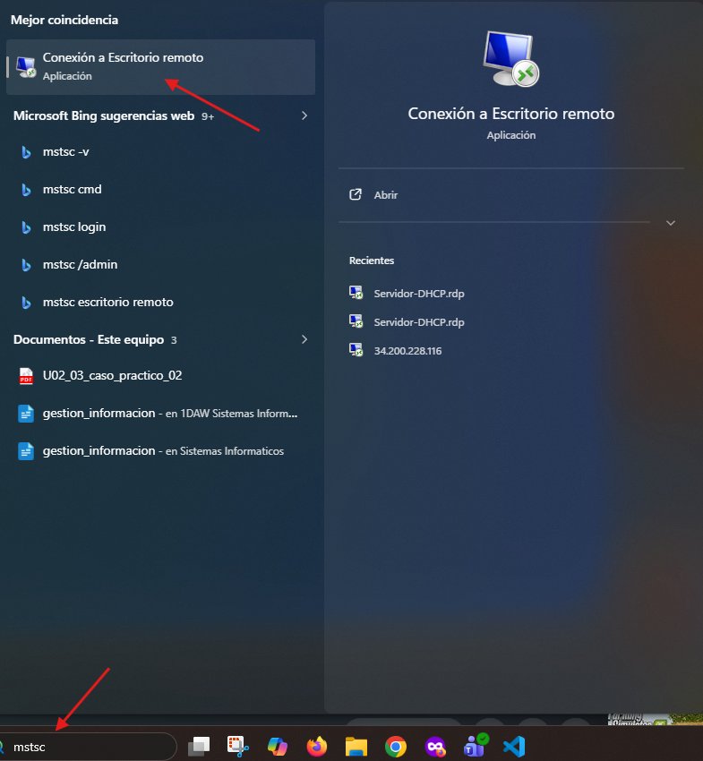

- Escribimos la **IP pública** de la instancia a la que no vamos a conectar.
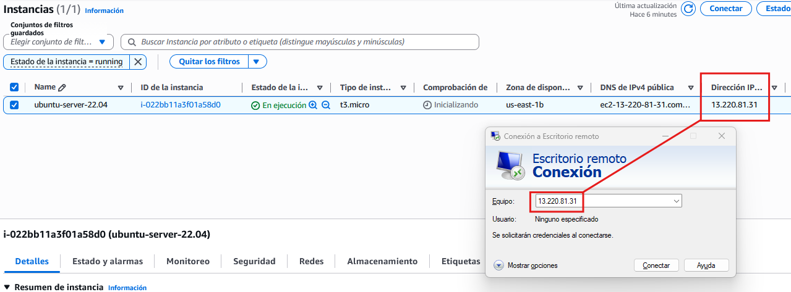

- Obviamos las advertencias de seguridad.
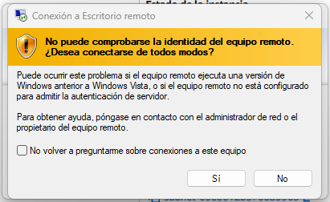

- Una vez conectados introducimos las credenciales.
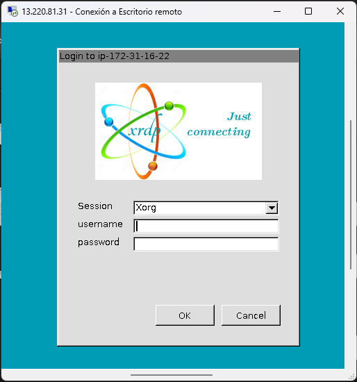

- Si todo ha ido bien obtendremos una interfaz similar a la siguiente imagen.  
==Realizar captura de pantalla==
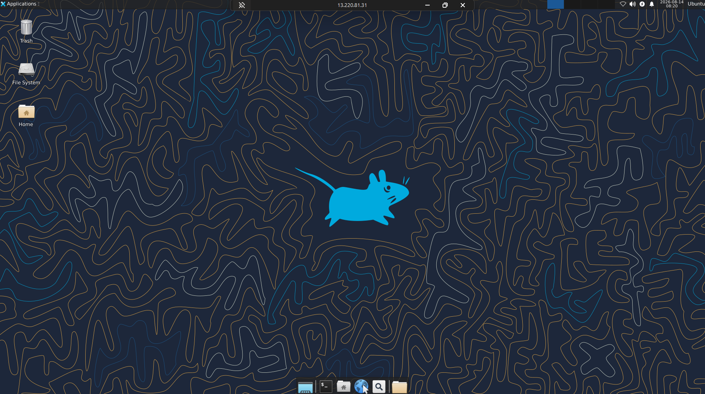
