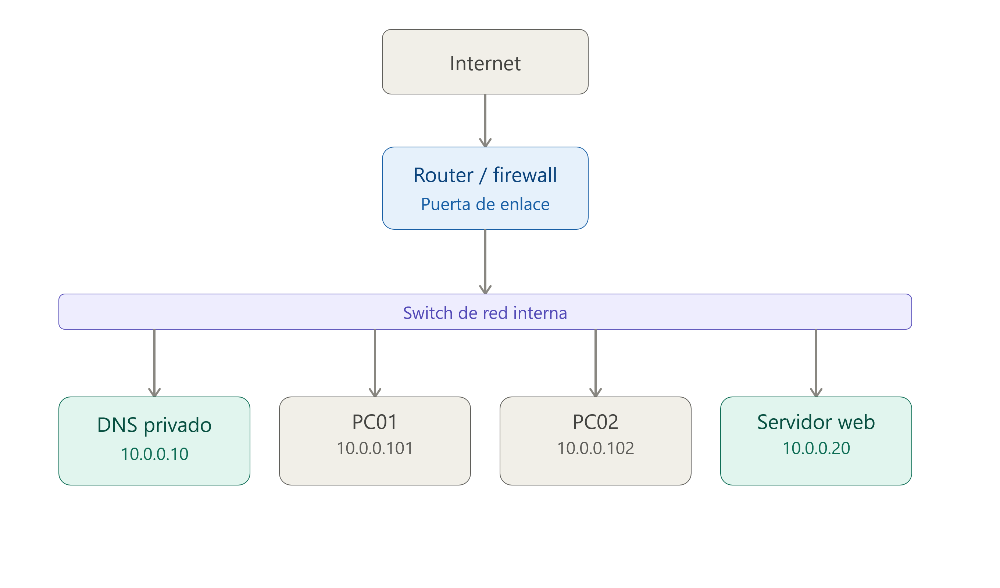
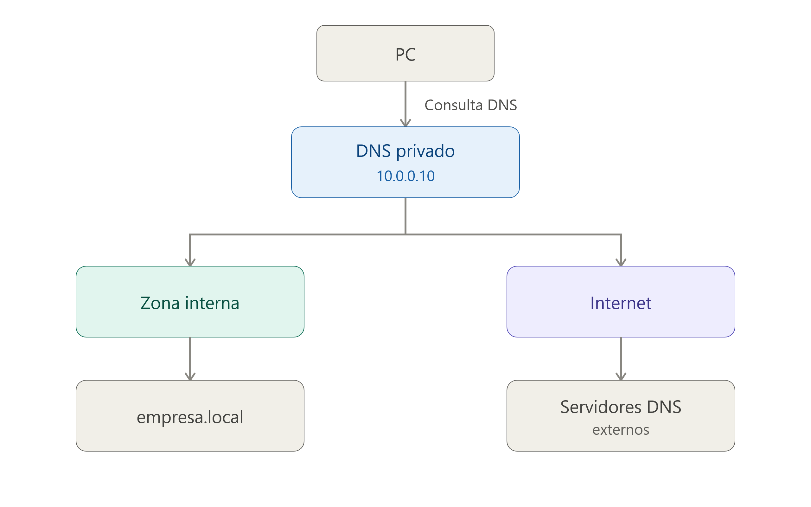
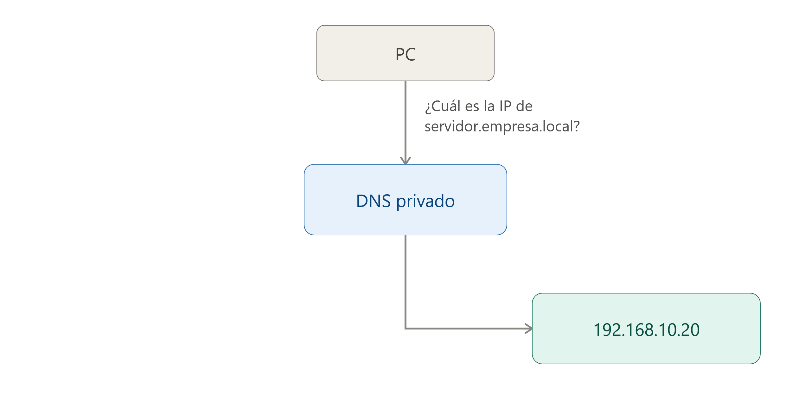
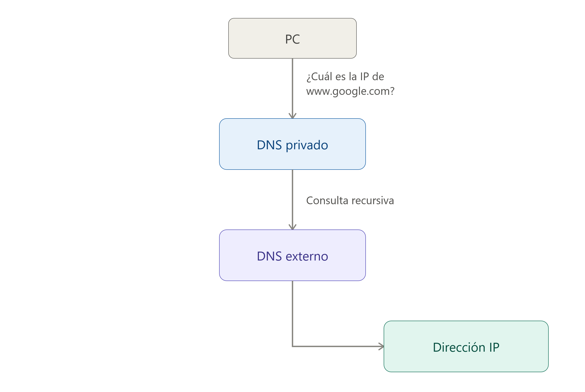

<div class="interactive-progress-tracker">
  <div class="tracker-header">
    <span>🏆 <strong>Progrés d'aquesta secció:</strong> <span class="tracker-count">0 de 4 superats (0%)</span></span>
    <span class="tracker-pts">⭐ <strong>0 punts</strong></span>
  </div>
  <div class="tracker-bar">
    <div class="tracker-fill" style="width: 0%;"></div>
  </div>
</div>

# 3.8 - Servidors DNS públics i privats

- 

No tots els servidors DNS tenen la mateixa funció ni estan disponibles per als mateixos usuaris.

- 

Depenent de qui puga utilitzar-los i d'on es troben, podem distingir entre **servidors DNS públics** i **servidors DNS privats**.

### 8.1 Servidors DNS públics

- 

Un **servidor DNS públic** és un servidor DNS que ofereix el seu servei de resolució de noms a usuaris i dispositius de Internet de forma pública.

- 

Aquests servidors solen estar gestionats per empreses, organitzacions o proveïdors de serveis de Internet i poden ser utilitzats per qualsevol usuari que tinga accés a Internet.

- 

Alguns exemples coneguts són:

| Servei DNS | Adreça IPv4 |
| --- | --- |
| **Google Public DNS** | `8.8.8.8` |
| **Google Public DNS** | `8.8.4.4` |
| **Cloudflare DNS** | `1.1.1.1` |
| **Cloudflare DNS** | `1.0.0.1` |
| **Quad9** | `9.9.9.9` |

- 

Per exemple, podem configurar un ordinador perquè utilitze:

```bash
Servidor DNS preferido: 1.1.1.1
Servidor DNS alternativo: 1.0.0.1
```

- 

A partir d'eixe moment, les consultes DNS realitzades pel dispositiu podran enviar-se als servidors de Cloudflare.

> **📌 Important**
> 

> - Un servidor DNS públic **no significa que siga un servidor arrel ni un servidor autoritativo**.

> - Per exemple, `1.1.1.1` és un **resoldre DNS recursiu públic**. Rep consultes dels clients i, quan és necessari, realitza les consultes corresponents a altres servidors DNS de la jerarquia.

### 8.2 Per què utilitzar un DNS públic?

- Existeixen diferents motivos per a utilitzar un servidor DNS públic en lloc del servidor DNS proporcionat automàticament pel nostre proveïdor de Internet:

#### 8.2.1 Rendiment

- 

Alguns proveïdors de DNS públic disposen d'una infraestructura distribuïda per diferents parts del món. Açò permet que les consultes puguen ser atendides des de servidors cercanos a l'usuari.

- 

El temps necessari per a obtindre una resposta DNS es denomina habitualment **latencia DNS**.

- 

Una menor latencia pot fer que la resolució de noms siga més ràpida.

#### 8.2.2 Disponibilitat i redundància

- 

Els grans proveïdors de DNS públic utilitzen infraestructuras distribuïdes i redundantes.

- 

Si un dels seus servidors o centres de dades deixa de funcionar, altres servidors poden continuar atenent les consultes.

- 

Açò proporciona una elevada **disponibilitat** del servei.

#### 8.2.3 Seguretat

- 

Alguns serveis DNS públics incorporen mecanismes de seguretat addicionals, com el bloqueig de determinats dominis associats a:

  1. Malware.

  1. Phishing.

  1. Botnets.

  1. Altres tipus d'amenazas.

- 

Per exemple, alguns resolvers públics estan dissenyats específicament per a proporcionar una capa addicional de protecció enfront de determinats dominis maliciosos.

> **📌 DNS i seguretat**
> 

> - L'ús d'un DNS públic **no garanteix per sí mateix que una connexió siga segura**.

> - DNS s'encarrega principalment de resoldre noms. La seguretat de la comunicació dependrà també d'altres mecanismes, com **HTTPS/TLS**, firewalls, sistemes de detecció d'intrusions i altres controls de seguretat.

### 8.3 Servidors DNS privats

- 

Un **servidor DNS privat** és un servidor DNS que està destinado a una organització, xarxa o conjunt limitat d'usuaris.

- 

A diferència d'un servidor DNS públic, no està pensat perquè qualsevol usuari de Internet puga realitzar consultes librement.

- 

Els servidors DNS privats són molt habituals en:

  1. Empreses.

  1. Centres educativos.

  1. Organismes públics.

  1. Xarxes doméstiques.

  1. Centres de dades.

  1. Xarxes virtuals en la núvol.

> **📌 Exemple de xarxa empresarial**
> 

> 



**On:**

> - `10.0.0.0/24` és la xarxa de l'empresa.

> - `10.0.0.10` és el servidor DNS intern.

> - `10.0.0.20` és el servidor Web de l'empresa.

> - `10.0.0.101` és un dispositiu connectat a la xarxa (p.e.: impressora) amb el nom DNS **impressora.empresa.local**

> - `10.0.0.102` un altre dispositiu connectat a la xarxa (p.e.: nas) amb el nom DNS **nas.empresa.local** 

> **📌 Aquests noms poden (solen) no existir en el DNS públic de Internet**
> 

### 8.4 DNS privat i accés a Internet

- 

Un servidor DNS privat no té per què limitar-se a resoldre noms interns.

- 

També pot actuar com **resoldre recursiu** per als dispositius de l'organització.

- 

Si miramos el següent esquema veurem que el servidor DNS pot resoldre tant `servidor.empresa.local` utilitzant els seus **zones internes** com `www.google.com`, `www.wikipedia.org` i `www.aules.edu.gva.es` realitzant consultes recursivas cap a altres servidors DNS.



### 8.5 Servidor DNS privat en una xarxa local

En una xarxa local, els equips solen obtindre automàticament l'adreça del servidor DNS mitjançant el protocol **DHCP**.

> **📌 Configurció dee xarxa devuelta pel servidor DHCP**
> 

```bash
Configuración recibida mediante DHCP

Dirección IP:       192.168.10.101
Máscara:            255.255.255.0
Puerta de enlace:   192.168.10.1
Servidor DNS:       192.168.10.10
```

**On:**

- L'ordinador client rep la IP `192.168.10.101`.

- L'ordinador client utilitzarà `192.168.10.10` per a realitzar consultes DNS.

- L'ordinador client utilitzarà `192.168.10.1` com porta d'enllaç és a dir per a accedir a internet.

- El servidor DNS privat podria resoldre tant noms interns com noms de Internet.

> **📌 Exemple de consulta DNS interna**
> 

> 



> **📌 Exemple de consulta DNS externa**
> 

> 



### 8.6 Comparativa DNS públic vs. DNS privat

- Podem comparar tots dos tipus de servidors:

| Característica | DNS públic | DNS privat |
| --- | --- | --- |
| Accés | Públic | Restringido |
| Usuaris | Qualsevol usuari | Usuaris d'una organització o xarxa |
| Ús habitual | Resoldre noms de Internet | Resoldre noms interns i externs |
| Exemple | `1.1.1.1` | `192.168.10.10` |
| Administració | Proveïdor extern | Organització |
| Noms interns | Normalment no | Sí |
| Ús en empreses | Possible | Molt habitual |
| Accesible des de Internet | Generalment sí | Normalment no |


---

## 🎮 Reptes Interactius d'Autoavaluació (+100 XP)

Comprova el teu domini sobre **3.8 - Servidors DNS públics i privats** superant aquests 4 reptes gamificats (+25 punts cadascun):

<div class="interactive-mcq" data-answer="D" data-hint="Revisa els conceptes teòrics i pràctics d'aquesta secció.">
  <div class="mcq-question">🎯 <strong>Repte 1 (+25 pts):</strong> Quin tipus de registre DNS permet crear un àlies que apunta un nom cap a un altre nom canònic?</div>
  <div class="mcq-options">
    <button type="button" class="btn-mcq-opt" data-opt="A">A) SOA</button>
    <button type="button" class="btn-mcq-opt" data-opt="B">B) NS</button>
    <button type="button" class="btn-mcq-opt" data-opt="C">C) Cap de les anteriors és correcta.</button>
    <button type="button" class="btn-mcq-opt" data-opt="D">D) CNAME</button>
  </div>
  <div class="quiz-feedback"></div>
</div>

<div class="interactive-mcq" data-answer="C" data-hint="Comprova l'apartat corresponent de la unitat.">
  <div class="mcq-question">🎯 <strong>Repte 2 (+25 pts):</strong> En la tasca de resolució manual d'un domini (com aules.edu.gva.es) amb nslookup o dig, quin és el primer servidor al qual s'ha de consultar si no tenim memòria cau?</div>
  <div class="mcq-options">
    <button type="button" class="btn-mcq-opt" data-opt="A">A) El servidor de correu MX del domini.</button>
    <button type="button" class="btn-mcq-opt" data-opt="B">B) Cap de les anteriors és correcta.</button>
    <button type="button" class="btn-mcq-opt" data-opt="C">C) Un dels servidors arrel (Root Servers, de a.root-servers.net a m.root-servers.net).</button>
    <button type="button" class="btn-mcq-opt" data-opt="D">D) El servidor DHCP de l'encaminador domèstic.</button>
  </div>
  <div class="quiz-feedback"></div>
</div>

<div class="interactive-vf" data-answer="V" data-hint="Verifica l'afirmació amb els apunts de la unitat.">
  <div class="vf-statement">✅ <strong>Repte 3 (Vertader o Fals · +25 pts):</strong> Un nom de domini totalment qualificat (FQDN) especifica la ubicació exacta de l'equip dins de la jerarquia DNS fins al punt arrel final.</div>
  <div class="vf-buttons">
    <button type="button" class="btn-vf" data-opt="V">Vertader (V)</button>
    <button type="button" class="btn-vf" data-opt="F">Fals (F)</button>
  </div>
  <div class="quiz-feedback" style="width: 100%;"></div>
</div>

<div class="interactive-quiz" data-answer="53" data-hint="És un número entre 50 i 55.">
  <div class="quiz-question">⌨️ <strong>Repte 4 (+25 pts):</strong> Quin número de port UDP i TCP utilitza per defecte el servei DNS estàndard?</div>
  <div class="quiz-controls">
    <input type="text" class="quiz-input" placeholder="Escriu la resposta..." />
    <button type="button" class="btn-quiz-check">Comprovar</button>
  </div>
  <div class="quiz-feedback"></div>
</div>

### 📋 Llista de Comprovació i Rúbrica d'Assoliment

Marca cada criteri a mesura que completes l'estudi o la resolució pràctica d'aquesta pàgina (**3.8 - Servidors DNS públics i privats**):

- [ ] He llegit detingudament la teoria o l'enunciat d'aquesta secció i he anotat els conceptes clau.
- [ ] He revisat els esquemes, taules o blocs de codi i he verificat que sé aplicar-los a l'entorn de treball.
- [ ] He resolt correctament els **4 reptes interactius** superiors obtenint els **100 punts XP**.
- [ ] He descarregat el comprovant oficial en PDF per a adjuntar-lo a la tasca d'**Aules**.

<div class="aules-delivery-card">
  <h3>📤 Comprovant de Lliurament per a Aules</h3>
  <p>Quan hages completat els reptes interactius i la llista d'autoavaluació d'aquesta pàgina, introdueix el teu nom i descarrega el teu certificat oficial en PDF per a adjuntar-lo a la tasca d'<strong>Aules</strong>.</p>
  <div class="aules-student-field">
    <label for="aules-student-name">👤 Nom i Cognoms de l'Alumne/a:</label>
    <input type="text" id="aules-student-name" class="aules-student-name" placeholder="Ex: Joan Garcia Pérez" />
  </div>
  <div class="aules-score-badge">
    <span class="aules-score-count">0/4 reptes completats (0%) · 0 punts · 0/4 criteris d'autoavaluació</span>
  </div>
  <div class="aules-actions">
    <button type="button" class="btn-aules-dl" data-module="SEX" data-unit="UD03" data-activity="ut0308">📥 Descarregar Comprovant PDF</button>
    <button type="button" class="btn-aules-copy">📋 Copiar Resum al Porta-retalls</button>
  </div>
  <div class="aules-toast"></div>
</div>

