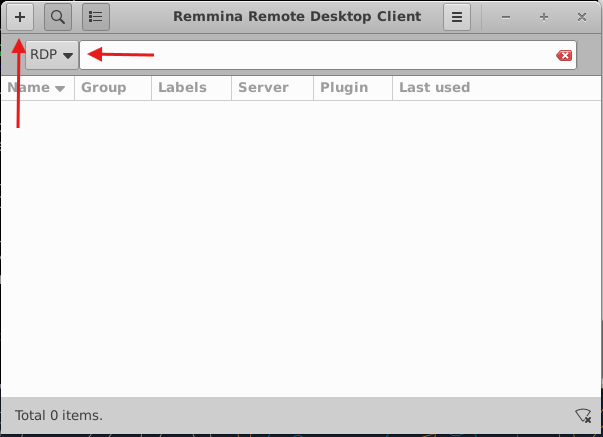
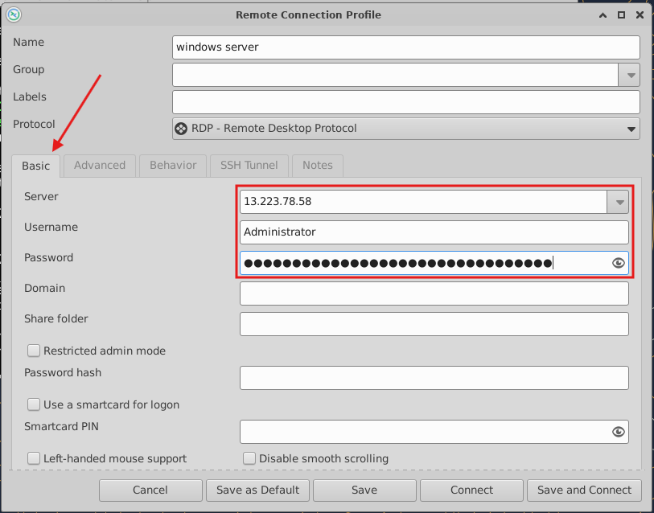
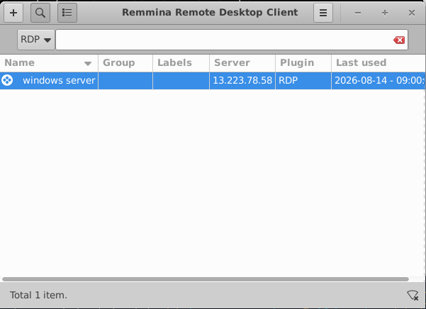
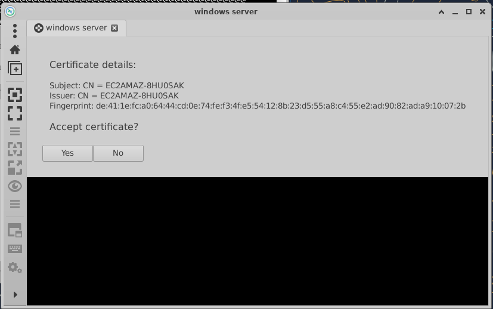
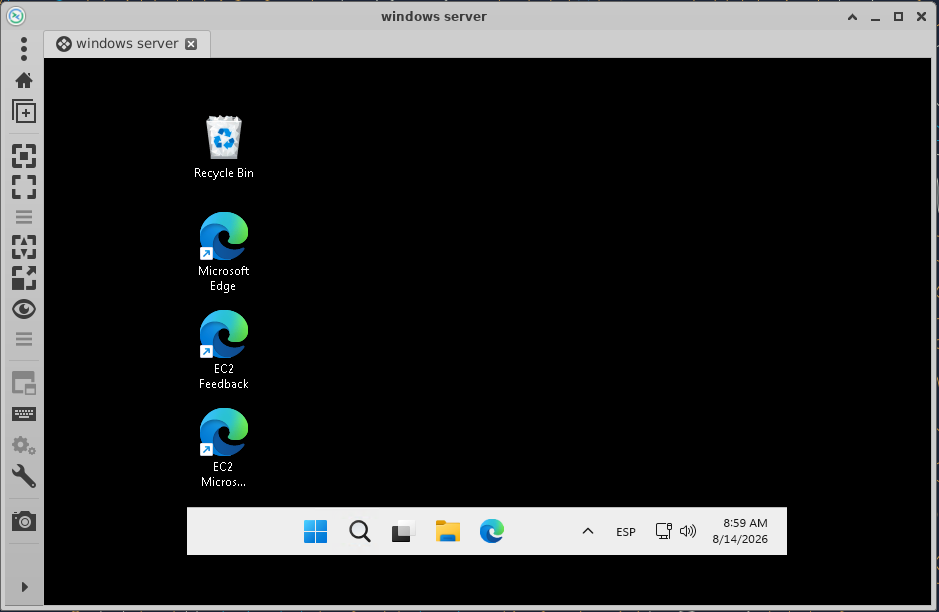
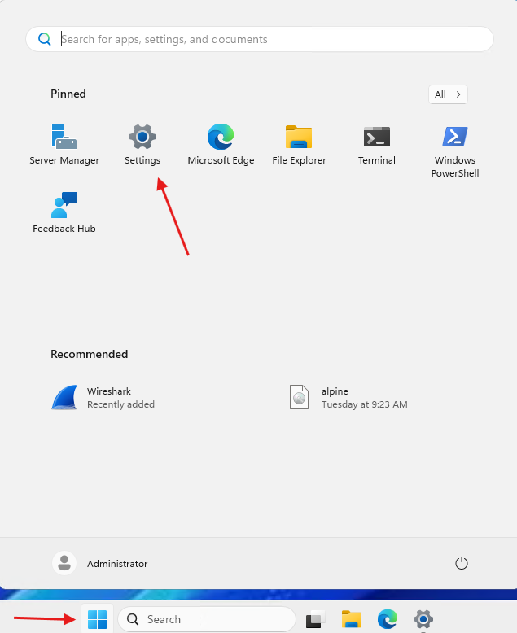
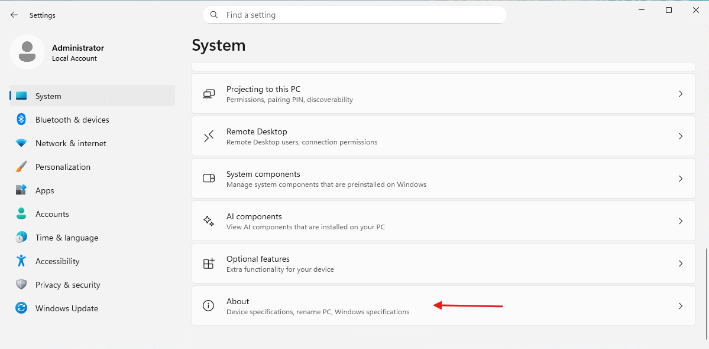
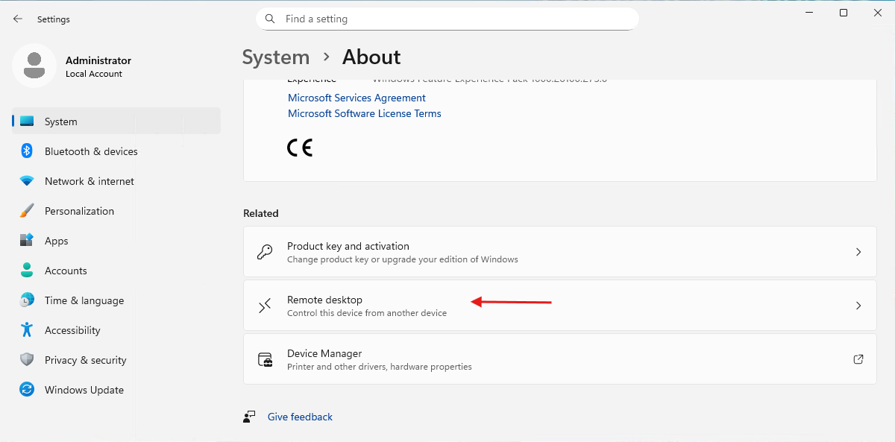
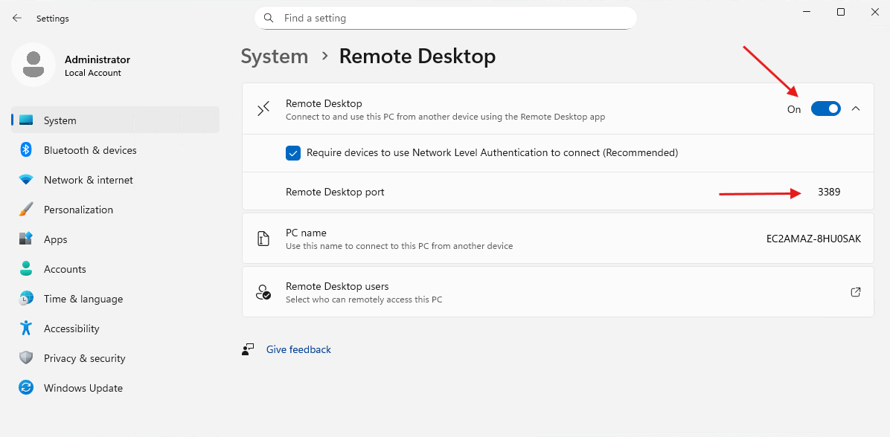

## 8 - Tarea RA6-CEf-1 - Conexión remota desde Ubuntu Server 24.04 LTS a SO Windows

!!! warning "Obligatorio seguir las normas para la presentación de trabajos escritos."

Para poder conectarnos desde una distribución de Linux a Windows necesitaremos una aplicación de acceso a escritorio como **Remmina**.

### 8.1 Comprobación e instalación de Remmina

- Remmina no viene instalada en todas las distribuciones de Linux así que comprobaremos si la tenemos instalada.

    ```bash
    remmina --version
    ```

- Si nos devuelve un mensaje de error, instalaremos la aplicación.

    ```bash
    sudo apt install remmina -y
    ```

### 8.2 Conexión a la instancia de Windows Server 2025

- Ejecutamos la aplicación

    ```bash
    remmina
    ```

    

- Introducimos los parámetros de la conexión


- Guardamos los parametros de la conexión y lanzamos la conexión


- Aceptamos el certificado.  
==Realizar captura de pantalla==


- Si todo ha ido bien, estaremos en el escritorio de nuestra máquina Windows Server.  
==Realizar captura de pantalla==


- ==Responder a la pregunta== Describir el flujo de conexiones remotas realizado anteriormente.

### 8.3 Posibles problemas de conexión a la instancia de Windows Server 2025

Como ya hemos visto ambas máquinas deben estar en condiciones de acceptar conexiones remotas por RDP.

Así pues, verificaremos si Windows Server está configurado para aceptar conexiones remotas.

- Vamos a **Settings**.


- Abajo del todo seleccionamos **About**.


- Buscamos Remote desktop.


- Comprobamos la configuración del **Remote Desktop**


!!! tip "Como podemos ver, la imagen de Windows Server usada en AWS acepta por defecto las conexiones RDP. De no ser así no podriamos habernos conectado a la instancia en una práctica anterior."
