## 9 - Administración remota segura con SSH (Secure Shell)

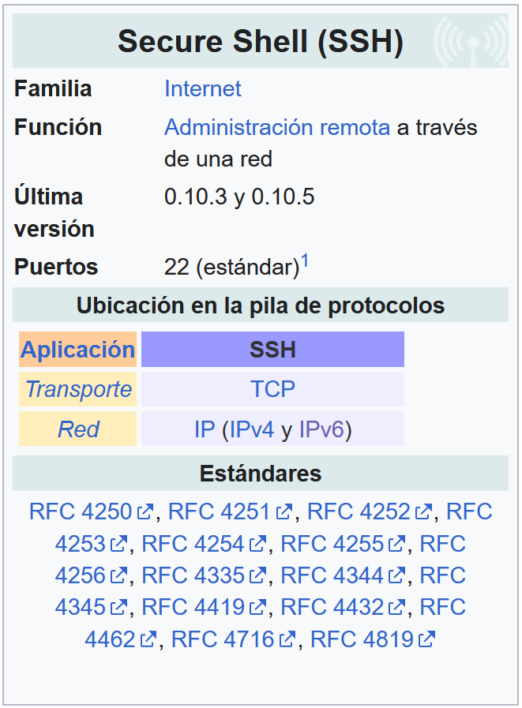

1. El protocolo SSH (Secure Shell) es **un protocolo de red** diseñado para acceder, administrar y controlar dispositivos de forma remota a través de una conexión totalmente cifrada.

1. Surgió como un reemplazo seguro para protocolos tradicionales como **Telnet** o **FTP**, que transmitían la información y las contraseñas en texto plano.

1. SSH opera en la capa de aplicación del modelo TCP/IP y funciona de la siguiente manera:
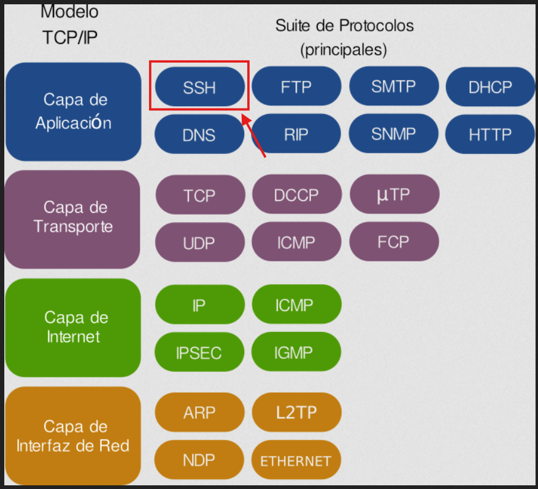

    - **Capa de Aplicación:** SSH proporciona servicios directos al usuario o administrador (como la ejecución remota de comandos, transferencia segura de archivos vía SFTP/SCP y túneles de puertos).
    - **Capa de Transporte:** Se apoya directamente en el protocolo TCP (generalmente a través del puerto 22) para garantizar que los datos se entreguen de forma fiable y ordenada antes de establecer el cifrado.

### 9.1 Uso básico de SSH

1. Para conectar dos equipos mediante SSH se utiliza un modelo **cliente-servidor**:

    - **Cliente:** La máquina local desde la que nos conectamos (CLI en Linux/macOS o GUI's como PuTTY/OpenSSH en Windows).  
    - **Servidor:** Equipo o servidor remoto que escucha peticiones de conexión (normalmente en el puerto TCP 22).

1. El comando básico en la terminal se compone de:  
    ```bash
    ssh usuario@direccion_ip_o_dominio
    ```
    - **ssh:** Indica al sistema que inicie una sesión cifrada Secure Shell.
    - **usuario:** Cuenta a la que deseamos acceder (p.e. root).
    - **direccion_ip_o_dominio:** Dirección del servidor al que nos conectamos (p.e. 192.168.1.1 o servidor.com).

### 9.2 Mecanismos de cifrado en SSH

SSH combina **3 métodos criptográficos distintos** para garantizar la privacidad, la autenticación y la integridad de los datos.

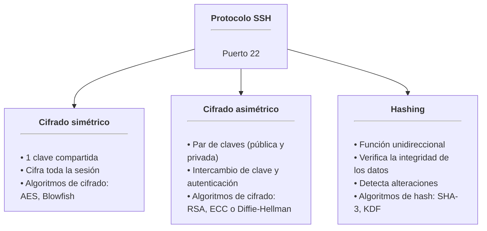

1. **Cifrado simétrico**  
    1. El cifrado simétrico utiliza **una única clave secreta** tanto para **cifrar como para descifrar** la información en ambos lados.  
    1. **Uso en SSH:** Cifra la totalidad del tráfico y los comandos enviados durante la sesión activa.
    1. **Seguridad:** La clave no se transmite por la red. El cliente y el servidor la generan de manera independiente durante el saludo inicial mediante un algoritmo de intercambio de claves.

1. **Cifrado Asimétrico**  
    1. El cifrado asimétrico emplea **un par de claves matemáticamente enlazadas**.
        - **Una clave pública** que se puede compartir libremente.
        - **Una clave privada** que debe mantenerse secreta.  
    1. Lo que se cifra con la clave pública solo puede descifrarse con la clave privada correspondiente.  
    1. **Uso en SSH:** No se utiliza para cifrar toda la sesión (por ser computacionalmente más lento), sino para:
        - **Autenticar** la identidad del cliente y del servidor.
        - **Negociar** de forma segura la clave simétrica que se usará en la sesión.

1. **Hashing (Verificación de Integridad)**  
    1. **El hashing** transforma cualquier entrada de datos en un valor único de longitud fija de forma unidireccional. No es posible de revertir es decir, con el hash no es posible obtener la información original.  
    1. **Uso en SSH:** SSH utiliza HMAC (Hash-based Message Authentication Codes) para asegurar que los comandos e información transmitidos no hayan sido interceptados o alterados por terceros en tránsito.

### 9.3 Establecimiento de una conexión SSH

En la siguiente imagen se muestran, de forma simplificada, las principales etapas que intervienen en el establecimiento de una conexión SSH.
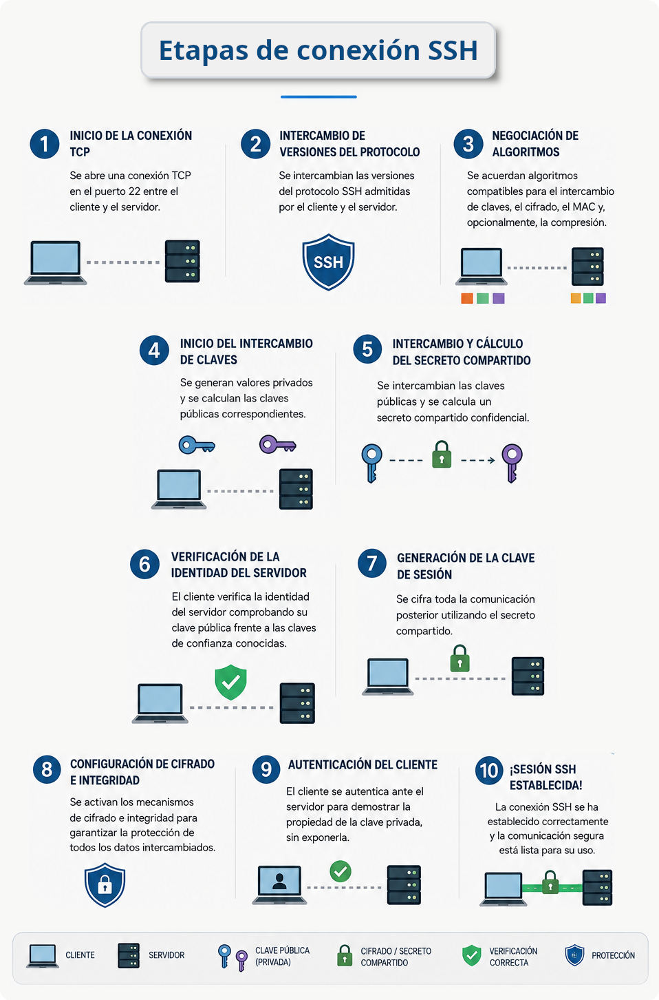

**1 - Inicio de la conexión TCP:**  

- El cliente establece una conexión TCP con el servidor, normalmente a través del puerto (de escucha) 22.  

**2 - Intercambio de versiones:**  

- Cliente y servidor intercambian información sobre las versiones del protocolo SSH que admiten.
- Negociación de algoritmos: Ambas partes acuerdan los algoritmos criptográficos que utilizarán para el intercambio de claves, el cifrado, la integridad (MAC) y, opcionalmente, la compresión de los datos.  

**3-4-5 - Intercambio de claves y generación del secreto compartido:**

- Mediante un protocolo de intercambio de claves, como Diffie-Hellman o ECDH, cliente y servidor generan un secreto compartido que permitirá establecer las claves de sesión utilizadas para cifrar la comunicación.

**6 - Verificación de la identidad del servidor:**

- El cliente verifica la identidad del servidor mediante su clave pública, que se compara con una clave previamente conocida o almacenada en el archivo known_hosts.  

**7-8 - Configuración del cifrado:**

- Una vez establecido el secreto compartido, se activan los mecanismos de cifrado e integridad para proteger las comunicaciones posteriores.  

**9 - Autenticación del usuario:**

- El cliente demuestra su identidad ante el servidor, normalmente mediante contraseña, clave pública/privada SSH u otros mecanismos de autenticación configurados en el servidor.  

**10 - Establecimiento de la sesión:**

- Una vez autenticado el usuario, se establece una sesión SSH y el cliente puede solicitar un shell remoto, ejecutar comandos o utilizar otros servicios proporcionados por SSH.  

### 9.4 Funcionamineto de SSH

Vamos a ver lo que ocurre cuando escribimos `ssh usuario@direccion_ip_o_dominio` y pulsamos Enter.

> ℹ️ **Fase 1: Conexión TCP**
>
>     !!! tip "SSH funciona sobre TCP, normalmente en el puerto 22"
>     !!! info "El cliente inicia el handshake TCP estándar:"
>         1. Cliente → Servidor: SYN
>         1. Servidor → Cliente: SYN-ACK
>         1. Cliente → Servidor: ACK
>     !!! success "Un vez que la conexión esta establecida, comienza el protocolo SSH.""
> ℹ️ **Fase 2: Intercambio de versión del protocolo**
>
>     !!! info "Ambos lados anuncian su versión de SSH:"
>         1. **Cliente:**  SSH-2.0-OpenSSH_8.9
>         1. **Servidor:** SSH-2.0-OpenSSH_8.4
>     !!! success "Acuerdan usar SSH-2.<br>Si alguno solo soporta SSH-1, los clientes modernos se negarán a conectar (y deben hacerlo)."
!!! abstract "Fase 3: Intercambio de claves"  
    1. Aquí empieza la criptografía.  
    1. **Objetivo:** crear una clave secreta compartida que ningún espía pueda conocer.
    1. El algoritmo más común es **Diffie-Hellman** de curva elíptica (ECDH):
    > ⚠️ **Intercambio de claves (versión simplificada)**
>
>         1. Cliente y servidor acuerdan los parámetros matemáticos (la curva)
>         1. El cliente genera:  valor privado (a), valor público (A)  
>         1. El servidor genera: valor privado (b), valor público (B)
>         1. Intercambian los valores públicos (A y B)
>         1. **Un atacante puede ver A y B pero no lo servidrá de nada al no dsponer de a y b**.
>         1. El cliente calcula:  secreto_compartido = a*B  
>         1. El servidor calcula: secreto_compartido = b*A  
>         1. **¡Ambos llegan al MISMO secreto!**.
>         1. Este secreto compartido sirve para derivar las claves de cifrado de la sesión
>     !!! warning "La clave de todo esto:"
>         - **El secreto compartido nunca se transmite**.  
>         - Un atacante que observe todos los paquetes sigue sin poder calcularlo.
> ℹ️ **Fase 4: Autenticación del servidor (claves de host)**
>
>     1. Algo que muchos pasan por alto: antes de que nos autentiquemos ante el servidor, el servidor se autentica ante nosotros.
>     1. Cuando nos conectemos a un servidor por primera vez, veremos esto:  
>     > The authenticity of host 'server.com (192.168.1.100)' can't be established.  
>     ED25519 key fingerprint is SHA256:AbCdEf1234567890...  
>     Are you sure you want to continue connecting (yes/no/[fingerprint])?  
>     1. Con esto, el servidor está demostrando su identidad mediante su clave de host.
>         - Si escribimos `yes`, la huella (fingerprint) se guarda en `~/.ssh/known_hosts`  
>         - En futuras conexiones se verifica que la clave del servidor coincida  
>         - Si no coincide, SSH dirá:
>         > @@@@@@@@@@@@@@@@@@@@@@@@@@@@@@@@  
>         > @    WARNING: REMOTE HOST IDENTIFICATION HAS CHANGED!     @  
>         > @@@@@@@@@@@@@@@@@@@@@@@@@@@@@@@@  
>         > IT IS POSSIBLE THAT SOMEONE IS DOING SOMETHING NASTY!  
>     1. Esto protege contra ataques de intermediario (man-in-the-middle). Si un atacante intercepta la conexión y presenta su propio servidor, la huella no coincidirá.
>         - **Consejo:** en la primera conexión, verificar la huella por un canal alternativo (proveedor de hosting, etc.).
!!! abstract "Fase 5: Autenticación del usuario.<br>     En esta fase demostraremos quienes somos.<br>     SSH admite varios métodos"  
    > 💡 **Método 1: Autenticación por contraseña**
>
>         ```bash
>         ssh `user@server.com`  
>         (luego se solicita la contraseña)
>         ```
>         Aunque simple, no se recomienda por varias razones:  
> 
>         - Las contraseñas pueden ser atacadas por fuerza bruta
>         - Son vulnerables a keyloggers
>         - Se debe escribir cada vez (sin automatización)
> 
>     !!! tip "Método 2: Autenticación por clave pública (preferido)"
>         Se utiliza criptografía asimétrica, es decir, un par de claves:
> 
>         | Clave | Ubicación | Propósito |
>         ||||
>         | Clave privada | Nuestro ordenador (`~/.ssh/id_ed25519`) | Nunca sale de tu máquina. Demuestra nuestra identidad. |
>         | Clave pública | Servidor (`~/.ssh/authorized_keys`) | Se puede compartir libremente. Verifica las firmas hechas con la clave privada. |
>         
>         La clave privada nunca sale de nuestra máquina. El servidor solo ve una prueba de que disponemos de ella.
>     
>     !!! tip "Método 3: Autenticación basada en certificados"  
>         - Se usa en entornos empresariales. 
>         - Una Autoridad de Certificación (CA) firma las claves de los usuarios, y los servidores confían en la CA en lugar de en claves individuales.
> 💡 **Fase 6: Sesión cifrada**
>
>     1. Una vez completado el intercambio de claves, todo el tráfico se cifra con **cifrado simétrico** (AES-256, ChaCha20, etc.), incluida la propia autenticación del usuario.
>     1. ¿Por qué pasar del cifrado asimétrico al simétrico?  
>     **Por velocidad:** el cifrado simétrico es aproximadamente 1000 veces más rápido.
>     1. Además, cada paquete incluye un MAC (Message Authentication Code, código de autenticación de mensaje): una suma de comprobación criptográfica que detecta cualquier manipulación. Con cifrados modernos como AES-GCM o ChaCha20-Poly1305, esta verificación va integrada en el propio cifrado (cifrado autenticado).
### 9.5 Tarea RA6-CEf-2 - Conexión SSH desde SO windows con PuTTy  

!!! warning "Obligatorio seguir las normas para la presentación de trabajos escritos."

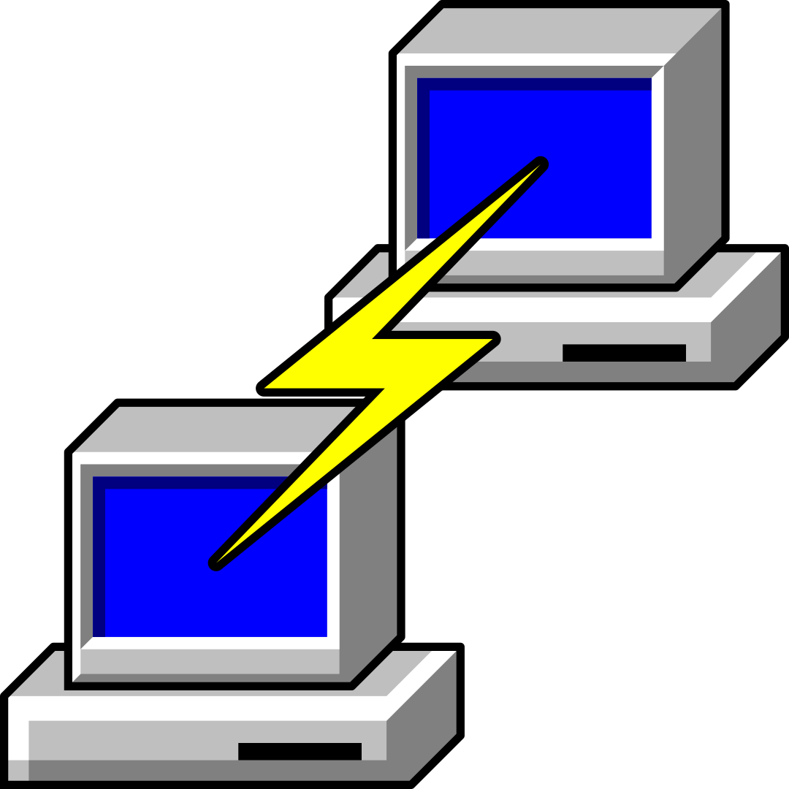

- En esta tarea instalaremos PuTTY en nuestra **instancia de Windows Server** y no conectaremos por **SSH** a la instancia de **Unbuntu Server**.

!!! warning "Antes de nada nos conectaremos a nuestra instancia de Windows Server"

- Descargamos la aplicación desde [la página oficial](https://www.chiark.greenend.org.uk/~sgtatham/putty/latest.html) y la instalaremos **en nuestra instancia de Windows Server**.

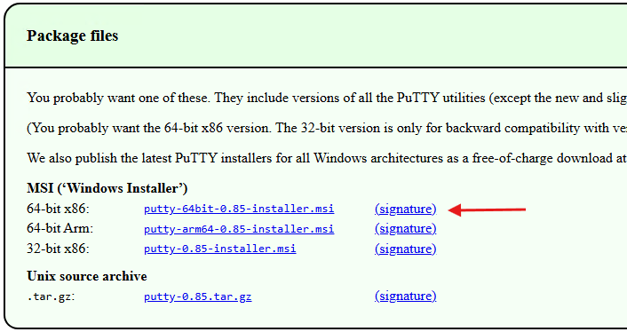

- Una vez instalado **PuTTy** consultaremos [la documentación de AWS](https://docs.aws.amazon.com/es_es/AWSEC2/latest/UserGuide/connect-linux-inst-from-windows.html) y la seguiremos paso a paso.

#### 9.5.1 Convertir la clave privada con PuTTYgen

- Ejecutamos PuTTYgen (instalado al mismo tiempo que PuTTy).  
- En **Type of key to generate**, elegimos RSA.  
- Si la versión de PuTTYGen no incluye esta opción, eligiremos SSH-2 RSA.
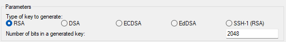

- Elegimos Load.  
- De forma predeterminada, PuTTYgen solo muestra archivos con **la extensión .ppk**.  
- Para localizar el archivo .pem, seleccionamos la opción de mostrar todos los tipos de archivo.  
- Seleccionamos **el archivo .pem** para el par de claves que se especificó cuando se lanzó la instancia y, a continuación, eligimos **Open (Abrir)**.
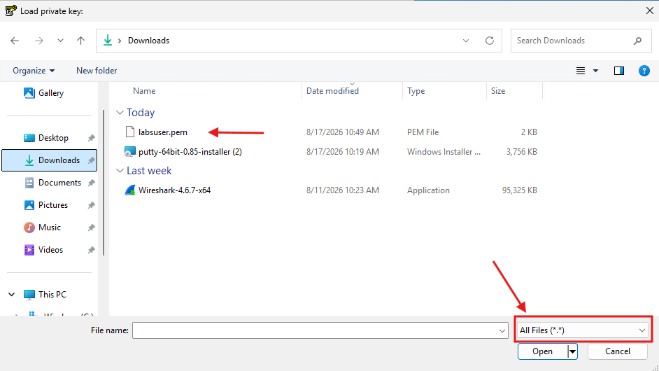

- Si la importación se ha hecho correctamente, no aparecerá un aviso similar a la siguiente imagen.  
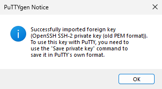  

- Luego elegimos **Save private key** para guardar la clave en un formato que PuTTY pueda utilizar.
!!! warning "Si no ponemos ninguna contraseña para el archivo de claves, PuTTYgen mostrará una advertencia (eligimos Yes si no queremos poner contraseña)."  
    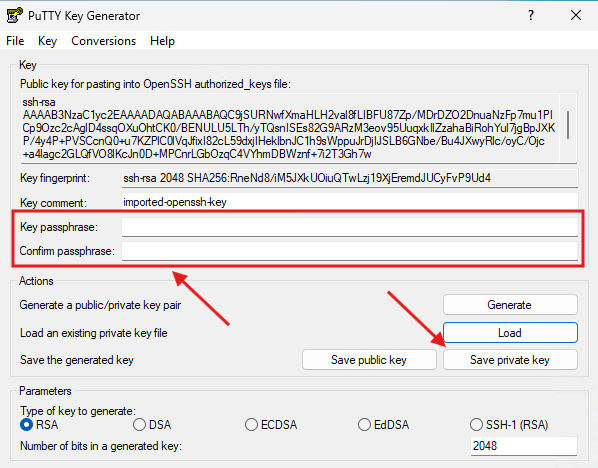

- Especificaremos un nombre para el archivo de claves.  
**PuTTY añadirá la extensión de archivo .ppk automáticamente**.
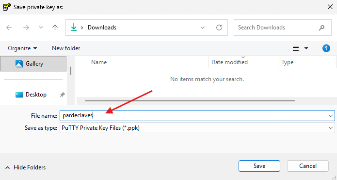

#### 9.5.2 Conexión con la instancia de Linux

- Ejecutamos PuTTY a vamos a **Connection** → **SSH** → **Auth** y en **Private key file** cargamos el archivo de claves que acabamos de crear.
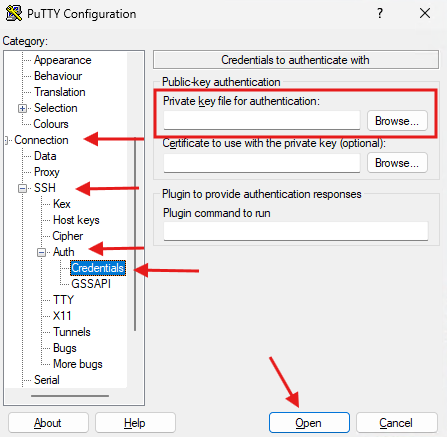

- En la pantalla principal, introducimos la IP de nuestra instancia de **Ubuntu Server** y lanzamos la conexión.  
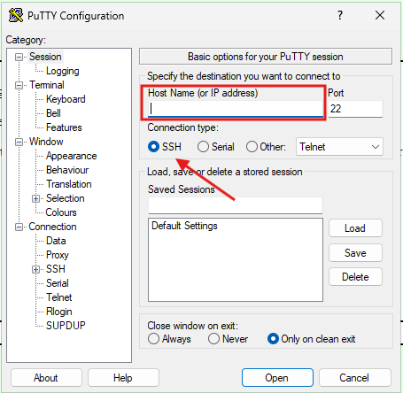

- Si hemos puesto contraseña a nuestro archivo de claves, lo introducimos.
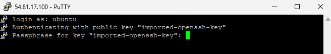

- Obviamos las advertencias de seguridad.  
==Realizar captura de pantalla==
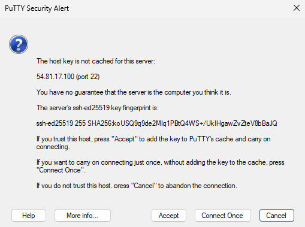

- Si todo ha ido bien, tendremos acceso a la terminal de nuestra instancia.  
==Realizar captura de pantalla==
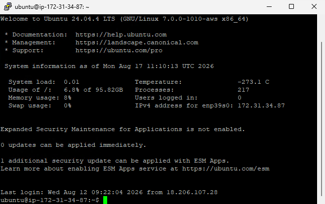

#### 9.5.3 Migración del archivo de claves

!!! warning "Preparación de la siguiente tarea"

- Para poder realizar la siguiente práctica, necesitaremos enviar el archivo con el par de claves de nuestras instancias (LabUser) a la intancia que usaremos de cliente para la conexión SSH.  

- Ese tipo de proceder no es **una buena práctica, desde el punto de vista de la seguridad informática** pero, lo haremos para facilitar la conexión SSH entre instancias con distribuciones Linux en AWS.

- Primero recuperaremos la IP pública de la instancia a la que enviaremos el archivo de claves.
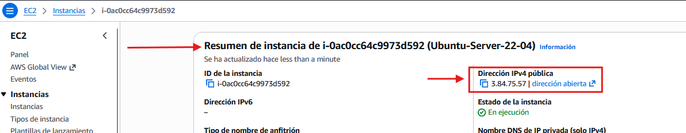

- Luego enviaremos el archivo de claves **archivo.pem** a la instancia cliente con la aplicación **pscp** del ecosistema PuTTy.  
Para ello, usaremos la siguiente sintaxis.  

    ```bash
    pscp -i archivo.ppk archivo.pem ubuntu@IP-publica directorio
    ```

    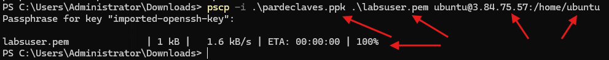

- Si nos conectamos por consola de AWS a la instancia cliente, podremos comprobar que el archivo se ha enviado correctamente.
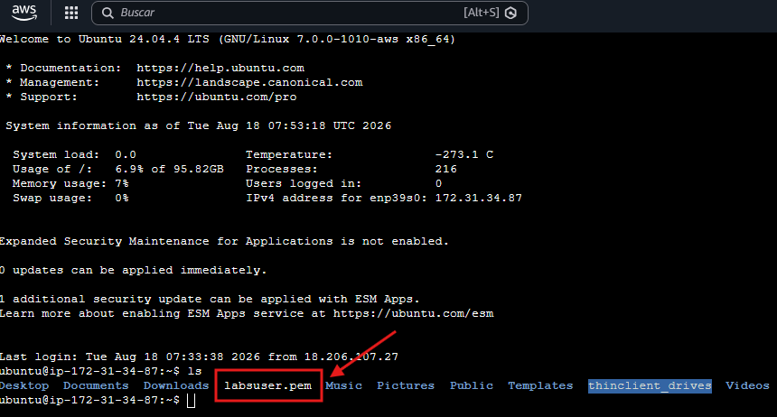

### 9.6 Tarea RA6-CEf-3 - Conexión SSH entre instancias Linux

!!! warning "Obligatorio seguir las normas para la presentación de trabajos escritos."

#### 9.6.1 Preparación del entorno

- Antes de nada, crearemos otra instancia de Ubuntu-server, dejando la configuración del tipo de instancia así como de la capacidad de almacenaje con los valores por defecto (t3.micro, 8GB).

- Nos conectamos a la instancia de Ubuntu-Server **dónde hemos enviado el archivo.pem con el par de claves** y comprobaremos que el cliente SSH está instalado.

    ```bash
    ssh -V
    ```

    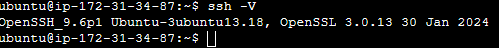

- También haremos lo mismo con el servidor SSH y comprobaremos que está funcionando.

    ```bash
    sshd -V 2<&1
    ```

    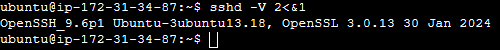

    ```bash
    systemctl status ssh
    ```

    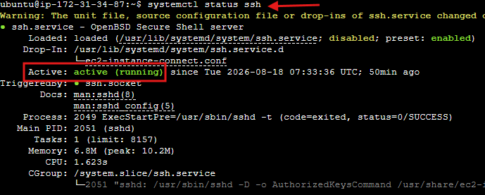

#### 9.4.2 Primera conexión SSH entre máquinas Linux

- Usaremos la sintáxis vista anteriormente pero, le añadiremos el archivo de claves:

    ```bash
    ssh -i archivo.pem usuario@direccion_ip_o_dominio
    ```

    Es probable que no salte un error al tener permisos de lectura del archivo demasiado permisivos.
    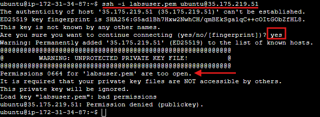

- Cambiamos los permisos a solo lectura por el propietario con:

    ```bash
    chmod 400 labsuser.pem
    ```

    Dónde:

    ```bash
         4         0      0
         │         │      │
         ▼         ▼      ▼
    propietario  grupo  otros
         │         │      │
         ▼         ▼      ▼
        leer      nada   nada
    ```

- Comprobamos los nuevos permisos del archivo de clave.

    ```bash
    ls -l labsuser.pem
    ```

    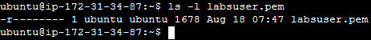

- Nos volvemos a conectar a la máquina Ubuntu-Server servidor y esta vez, accedemos sin problemas.  
==Realizar captura de pantalla==

    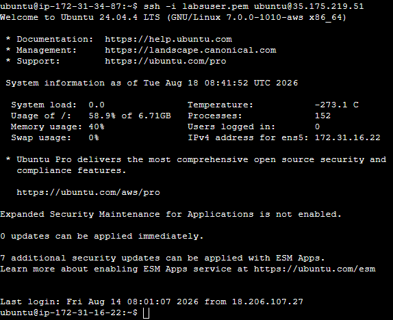
