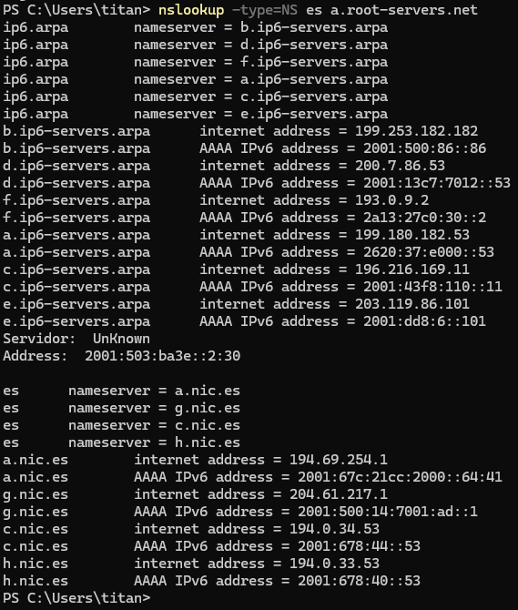
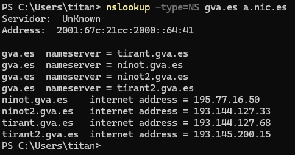
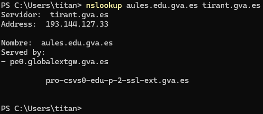
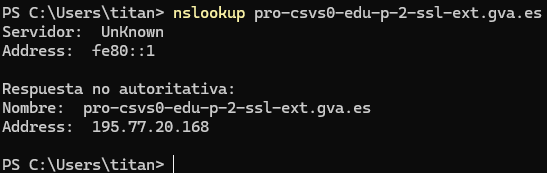
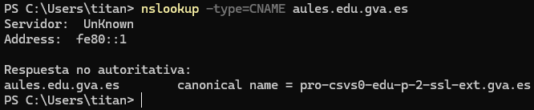
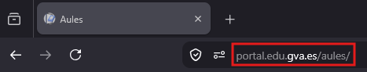

<div class="interactive-progress-tracker">
  <div class="tracker-header">
    <span>🏆 <strong>Progreso de esta sección:</strong> <span class="tracker-count">0 de 4 superados (0%)</span></span>
    <span class="tracker-pts">⭐ <strong>0 puntos</strong></span>
  </div>
  <div class="tracker-bar">
    <div class="tracker-fill" style="width: 0%;"></div>
  </div>
</div>

# 3.12 - Tarea RA2-CEb-1 - Resolución manual de un dominio

- El proposito d'aquesta tasca és que l'alumne comprenda com es resol un nom de domini en Internet i com s'obté l'adreça IP associada a eixe nom.

- Per a l'exemple usarem el domini `www.aules.edu.gva.es` i realizarem la resolució de forma manual, pas a pas, per a comprendre el procés complet.

### 12.1 Pas 1: Consulta al servidor arrel

- El primer pas en la resolució d'un nom de domini és consultar a un **servidor arrel**. Els servidors arrel són els encarregats de dirigir les consultes cap als servidors de nivell superior (TLD) corresponents.

> **📌 Enunciat pas 1**
> 

> Preguntes a respondre  

> - Qui realitza la consulta inicial al servidor arrel per a obtindre informació sobre el TLD?

> - Quin és el TLD (Top-Level Domain) del domini `www.aules.edu.gva.es`?

> - Consultar la base de dades de [iana.org](https://www.iana.org/domains/root/db) per a verificar si el TLD està registrat.

> - Consultar la base de dades de [iana.org](https://www.iana.org/domains/root/servers) per a obtindre la llista de servidors arrel i les seues adreces IP (també es pot realitzar la consulta a [root-servers.org](https://www.root-servers.org/)).

> - Quin és l'adreça IP del servidor arrel `Verisign, Inc.`?

> Realitzar captura de pantalla  

> - 

> Per a realitzar la consulta al servidor arrel, podem utilitzar eines com `nslookup` o `dig`. Per exemple, podem executar el següent comanda en la terminal:
    

```bash
nslookup -type=NS es a.root-servers.net
```

> **📌 Explicació de la línia de comanda**
> 

>   - `nslookup`: eina de línia de comandes per a consultar servidors DNS i resoldre noms de domini.

>   - `-type=NS`: indica que volem consultar els registres NS (Name Server), és a dir, quierem saber què servidors DNS són els autoritativos (els "oficials") per a eixe domini.

>   - `es`: el TLD que estem consultant.

>   - `a.root-servers.net`: el servidor arrel al que li estem preguntant directament (en lloc d'usar el servidor DNS configurado per defecte en el nostre equip).
    



### 12.2 Pas 2: Consulta del domini gva.és al servidor de domini (.és)

> **📌 Enunciat pas 2**
> 

> Preguntes a respondre  

> - Qui realitza la consulta al servidor autoritativo del TLD .és per a obtindre informació sobre el domini gva.és?

> Realitzar captura de pantalla  

> - Quin seria la línia de comanda per a consultar els servidors autoritativos de gva.és?
    



### 12.3 Pas 3: Consulta del subdominio aules.edu.gva.és al servidor de domini (gva.és)

> **📌 Enunciat pas 3**
> 

> Preguntes a respondre  

> - Qui realitza la consulta al servidor autoritativo per a obtindre informació sobre el domini aules.edu.gva.és?

> Realitzar captura de pantalla  

> - Quin seria la línia de comanda per a consultar els servidors autoritativos d'aules.edu.gva.és?
    



### 12.4 Pas 4: Consulta final del subdominio aules.edu.gva.és

> **📌 Enunciat pas 4**
> 

> Preguntes a respondre  

> - Qui realitza la consulta al servidor autoritativo per a obtindre informació sobre el domini aules.edu.gva.és?

> Realitzar captura de pantalla  

> - Quin seria la línia de comanda per a consultar els servidors autoritativos d'aules.edu.gva.és?
    



> - Quin és el nom canonic d'aules.edu.gva.és?
    



### 12.5 Pas 5: Confirmació de la IP

> **📌 Enunciat pas 5**
> 

> Preguntes a respondre
> 
Realitzar captura de pantalla  

> - Què ocorre si escrivim la IP en el navegador? S'obri la web d'aules.edu.gva.és?




---

## 🎮 Reptes Interactius d'Autoavaluació (+100 XP)

Comprova el teu domini sobre **3.12 - Tasca RA2-CEb-1 - Resolució manual d'un domini** superant aquests 4 reptes gamificats (+25 puntos cadascun):

<div class="interactive-mcq" data-answer="D" data-hint="Revisa els conceptes teòrics i pràctics d'aquesta secció.">
  <div class="mcq-question">🎯 <strong>Repte 1 (+25 pts):</strong> Quin tipus de registre DNS permet crear un àlies que apunta un nom cap a un altre nom canònic?</div>
  <div class="mcq-options">
    <button type="button" class="btn-mcq-opt" data-opt="A">A) SOA</button>
    <button type="button" class="btn-mcq-opt" data-opt="B">B) NS</button>
    <button type="button" class="btn-mcq-opt" data-opt="C">C) Cap de les anteriors és correcta.</button>
    <button type="button" class="btn-mcq-opt" data-opt="D">D) CNAME</button>
  </div>
  <div class="quiz-feedback"></div>
</div>

<div class="interactive-mcq" data-answer="C" data-hint="Comprova l'apartat corresponent de la unitat.">
  <div class="mcq-question">🎯 <strong>Repte 2 (+25 pts):</strong> En la tasca de resolució manual d'un domini (com aules.edu.gva.es) amb nslookup o dig, quin és el primer servidor al qual s'ha de consultar si no tenim memòria cau?</div>
  <div class="mcq-options">
    <button type="button" class="btn-mcq-opt" data-opt="A">A) El servidor de correu MX del domini.</button>
    <button type="button" class="btn-mcq-opt" data-opt="B">B) Cap de les anteriors és correcta.</button>
    <button type="button" class="btn-mcq-opt" data-opt="C">C) Un dels servidors arrel (Root Servers, de a.root-servers.net a m.root-servers.net).</button>
    <button type="button" class="btn-mcq-opt" data-opt="D">D) El servidor DHCP de l'encaminador domèstic.</button>
  </div>
  <div class="quiz-feedback"></div>
</div>

<div class="interactive-vf" data-answer="V" data-hint="Verifica l'afirmació amb els apuntos de la unitat.">
  <div class="vf-statement">✅ <strong>Repte 3 (Vertader o Fals · +25 pts):</strong> Un nom de domini totalment qualificat (FQDN) especifica la ubicació exacta de l'equip dins de la jerarquia DNS fins al punt arrel final.</div>
  <div class="vf-buttons">
    <button type="button" class="btn-vf" data-opt="V">Vertader (V)</button>
    <button type="button" class="btn-vf" data-opt="F">Fals (F)</button>
  </div>
  <div class="quiz-feedback" style="width: 100%;"></div>
</div>

<div class="interactive-quiz" data-answer="53" data-hint="És un número entre 50 i 55.">
  <div class="quiz-question">⌨️ <strong>Repte 4 (+25 pts):</strong> Quin número de port UDP i TCP utilitza per defecte el servei DNS estàndard?</div>
  <div class="quiz-controls">
    <input type="text" class="quiz-input" placeholder="Escriu la resposta..." />
    <button type="button" class="btn-quiz-check">Comprovar</button>
  </div>
  <div class="quiz-feedback"></div>
</div>

### 📋 Llista de Comprovació i Rúbrica d'Assoliment

Marca cada criteri a mesura que completes l'estudi o la resolució pràctica d'aquesta pàgina (**3.12 - Tasca RA2-CEb-1 - Resolució manual d'un domini**):

- [ ] He llegit detingudament la teoria o l'enunciat d'aquesta secció i he anotat els conceptes clau.
- [ ] He revisat els esquemes, taules o blocs de codi i he verificat que sé aplicar-los a l'entorn de treball.
- [ ] He resolt correctament els **4 reptes interactius** superiors obtenint els **100 puntos XP**.
- [ ] He descarregat el comprovant oficial en PDF per a adjuntar-lo a la tasca d'**Aules**.

<div class="aules-delivery-card">
  <h3>📤 Comprovant de Lliurament per a Aules</h3>
  <p>Quan hages completat els reptes interactius i la llista d'autoavaluació d'aquesta pàgina, introdueix el teu nom i descarrega el teu certificat oficial en PDF per a adjuntar-lo a la tasca d'<strong>Aules</strong>.</p>
  <div class="aules-student-field">
    <label for="aules-student-name">👤 Nom i Cognoms de l'Alumne/a:</label>
    <input type="text" id="aules-student-name" class="aules-student-name" placeholder="Ex: Joan Garcia Pérez" />
  </div>
  <div class="aules-score-badge">
    <span class="aules-score-count">0/4 reptes completats (0%) · 0 puntos · 0/4 criteris d'autoavaluació</span>
  </div>
  <div class="aules-actions">
    <button type="button" class="btn-aules-dl" data-module="SEX" data-unit="UD03" data-activity="ut0312">📥 Descarregar Comprovant PDF</button>
    <button type="button" class="btn-aules-copy">📋 Copiar Resum al Porta-retalls</button>
  </div>
  <div class="aules-toast"></div>
</div>

