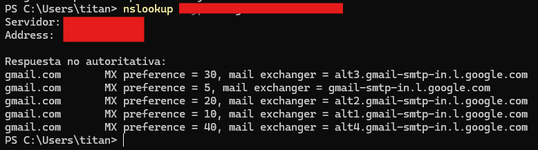
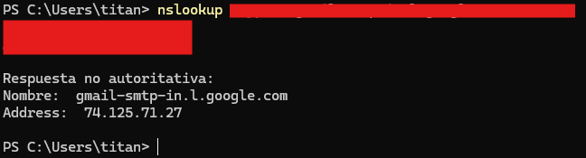

  

    🏆 <strong>Progreso de esta sección:</strong> 0 de 4 superados (0%)
    ⭐ <strong>0 puntos</strong>
  

  

    

  

# 3.13 - Tarea RA2-CEb-2 - Resolución manual de un dominio

> **📌 Pregunta**
> 

> Preguntes a respondre  

> - Redactar el comanda per a consultar el domini gmail.és i obtindre els servidors autoritativos de correu electrònic de gmail.és.

> Realitzar captura de pantalla  

> - Resultat esperat:
    

> Realitzar captura de pantalla  

> - Redactar el comanda per a consultar la IP d'un dels servidors.
    

---

## 🎮 Reptes Interactius d'Autoavaluació (+100 XP)

Comprova el teu domini sobre **3.13 - Tasca RA2-CEb-2 - Resolució manual d'un domini** superant aquests 4 reptes gamificats (+25 puntos cadascun):

  
🎯 <strong>Repte 1 (+25 pts):</strong> Quina diferència hi ha entre una consulta DNS recursiva i una consulta DNS iterativa?

  

    <button type="button" class="btn-mcq-opt" data-opt="A">A) En la recursiva el client demana al servidor DNS local la resposta completa; en la iterativa el servidor consultat respon amb la millor referència (p. ex. servidor TLD o autoritatiu) que coneix.</button>
    <button type="button" class="btn-mcq-opt" data-opt="B">B) La consulta iterativa només funciona amb adreces IPv6 i la recursiva només amb IPv4.</button>
    <button type="button" class="btn-mcq-opt" data-opt="C">C) La consulta recursiva utilitza el port 80 i la iterativa el port 21.</button>
    <button type="button" class="btn-mcq-opt" data-opt="D">D) Cap de les anteriors és correcta.</button>
  

  

  
🎯 <strong>Repte 2 (+25 pts):</strong> Quin tipus de registre DNS s'utilitza per a la resolució inversa (traduir una adreça IP a un nom de domini FQDN)?

  

    <button type="button" class="btn-mcq-opt" data-opt="A">A) CNAME</button>
    <button type="button" class="btn-mcq-opt" data-opt="B">B) MX</button>
    <button type="button" class="btn-mcq-opt" data-opt="C">C) Cap de les anteriors és correcta.</button>
    <button type="button" class="btn-mcq-opt" data-opt="D">D) PTR</button>
  

  

  
✅ <strong>Repte 3 (Vertader o Fals · +25 pts):</strong> L'extensió DNSSEC afegeix signatures criptogràfiques als registres DNS per a protegir contra atacs d'enverinament de memòria cau (DNS Cache Poisoning).

  

    <button type="button" class="btn-vf" data-opt="V">Vertader (V)</button>
    <button type="button" class="btn-vf" data-opt="F">Fals (F)</button>
  

  

  
⌨️ <strong>Repte 4 (+25 pts):</strong> Quin tipus de registre DNS associa un nom de domini amb una adreça IPv4 de 32 bits? (Escriu la lletra del registre)

  

    <input type="text" class="quiz-input" placeholder="Escriu la resposta..." />
    <button type="button" class="btn-quiz-check">Comprovar</button>
  

  

### 📋 Llista de Comprovació i Rúbrica d'Assoliment

Marca cada criteri a mesura que completes l'estudi o la resolució pràctica d'aquesta pàgina (**3.13 - Tasca RA2-CEb-2 - Resolució manual d'un domini**):

- [ ] He llegit detingudament la teoria o l'enunciat d'aquesta secció i he anotat els conceptes clau.
- [ ] He revisat els esquemes, taules o blocs de codi i he verificat que sé aplicar-los a l'entorn de treball.
- [ ] He resolt correctament els **4 reptes interactius** superiors obtenint els **100 puntos XP**.
- [ ] He descarregat el comprovant oficial en PDF per a adjuntar-lo a la tasca d'**Aules**.

  <h3>📤 Comprovant de Lliurament per a Aules</h3>
  
Quan hages completat els reptes interactius i la llista d'autoavaluació d'aquesta pàgina, introdueix el teu nom i descarrega el teu certificat oficial en PDF per a adjuntar-lo a la tasca d'<strong>Aules</strong>.

  

    <label for="aules-student-name">👤 Nom i Cognoms de l'Alumne/a:</label>
    <input type="text" id="aules-student-name" class="aules-student-name" placeholder="Ex: Joan Garcia Pérez" />
  

  

    0/4 reptes completats (0%) · 0 puntos · 0/4 criteris d'autoavaluació
  

  

    <button type="button" class="btn-aules-dl" data-module="SEX" data-unit="UD03" data-activity="ut0313">📥 Descarregar Comprovant PDF</button>
    <button type="button" class="btn-aules-copy">📋 Copiar Resum al Porta-retalls</button>
  

  

