

  

    🏆 <strong>Progrés d'aquesta secció:</strong> 0 de 4 superats (0%)
    ⭐ <strong>0 punts</strong>
  

  

    

  

# 3.14 - Tasca RA2-CEde-1 - Instal·lació i configuració d'un servidor DNS amb Windows Server 2025

> **📌 Instal·lar AD DS amb DNS**
> 

> - Abans d'instal·lar i configurar el rol de servidor DNS, instalarem el rol de Active Directory Domain Services (AD DS), ja que en aquest cas volem un DNS integrat en un domini de Active Directory (l'escenario més habitual en entorns empresarials).

> **📌 Motivos per a instal·lar AD DS amb DNS**
> 

> - Encara que el rol DNS de Windows Server no requereix AD DS per a funcionar, quan DNS dóna servei a un domini de AD convé que estiguen integrats.

> - Al promover el servidor a controlador de domini, si no existeix ja un servidor DNS accesible per al domini, Windows instal·la i configura automàticament el rol DNS, creant la zona corresponent amb els registres SRV necessaris per a la localització dels controladors de domini (LDAP, Kerberos, etc.).

> - Açò simplifica la pràctica: en compte d'instal·lar i configurar DNS manualment i després preparar la integració amb AD, dejamos que el propi procés de promoció a DC el resolga.

### 14.1 Active Directory Domain Services (AD DS)

> **📌 Xarxa domestica vs xarxa empresarial**
> 

> 1. **En una xarxa doméstica**, cada equip es administra de forma individual: l'usuari configura els seus propis permisos, contrasenyes, accessos a dispositius, etc.

> 1. **En una empresa empresarial** amb decenas o cientos d'equips, gestionar la seguretat equip per equip és inviable al resultar lent, costoso i, sobre tot, inconsistente.

> 1. Una part important dels incidentes de seguretat en les organitzacions no s'ha de a fallades de les eines de protecció (firewall, VPN, antivirus), sinó a errors de configuració en els equips i serveis de xarxa.

> 1. 

> Per això, és fonamental poder definir de **forma centralitzada** què pot o no pot fer l'usuari final en els equips de l'empresa, per exemple:

>   - Deshabilitar els ports USB dels equips de l'empresa.

>   - Limitar l'accés a certs llocs web.

>   - Restringir l'accés al disc duro local dels equips.

>   - Restringir l'ús de fitxers ejecutables descargats de Internet.

>   - Instal·lar programari només des de repositorios oficials de l'empresa.

>   - Forçar polítiques de contrasenyes seguras i definir la caducitat de les mateixes.

> **📌 AD DS**
> 

> 1. AD DS és el rol de Windows Server que permet centralitzar la gestió d'identitats (usuaris, equips, grups) de tota l'organització en un domini, i aplicar de forma automàtica i uniforme polítiques de seguretat i configuració mitjançant Directivas de Grup (GPO – Group Policy Objects).

> 1. Per aquest motiu, abans d'instal·lar i configurar el rol de servidor DNS, instalarem primer el rol de Active Directory Domain Services (AD DS).

> 1. **AD DS Serà la base** sobre la que es sustente la **gestió centralitzada** d'usuaris, equips i polítiques de seguretat de la nostra organització, i també perquè el propi procés d'instal·lació de AD DS s'encarrega de configurar el servei DNS necessari per al funcionament del domini.

### 14.2 Instal·lació del rol AD DS en AWS

Per a la instal·lació del rol AD DS en un servidor Windows Server 2025 en AWS, seguirem els següents passos:

> **📌 

 - Llançar una nova instància de Windows Server 2025 en AWS**
> 

> - En aquest cas definirem en què subred de la VPC es troba la instància EC2, ja que açò pot afectar a la conectivitat i al rendiment de la xarxa

> - Resum de la configuració de la instància (acordar-se de seleccionar el parell de clau `vockey` per a l'inici de sessió i seleccionar `50GiB` de capacitat per al volum de la instància).
> 

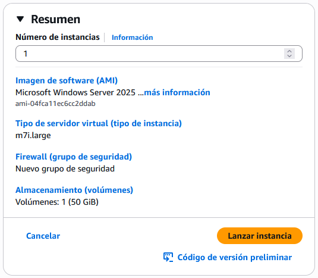

> - Captura de l'apartat de configuració de xarxa on eligirem la Subred en la qual desplegarem la nostra instància.
> 
Realitzar captura de pantalla

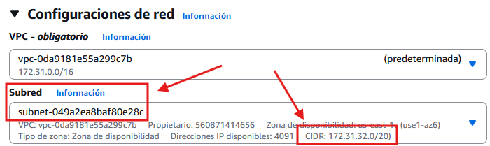

> - Esperarem a que la instància estiga disponible. A partir de llavors ens conectarem a la instància per `RDP`.
Realitzar captura de pantalla

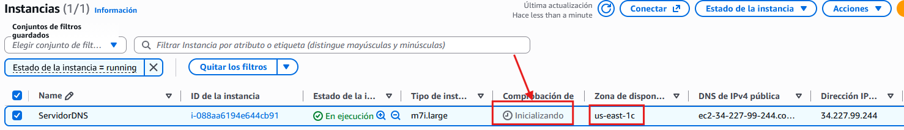

> **📌 

 - Reanomenar la màquina creada**
> 

> Realitzar captura de pantalla

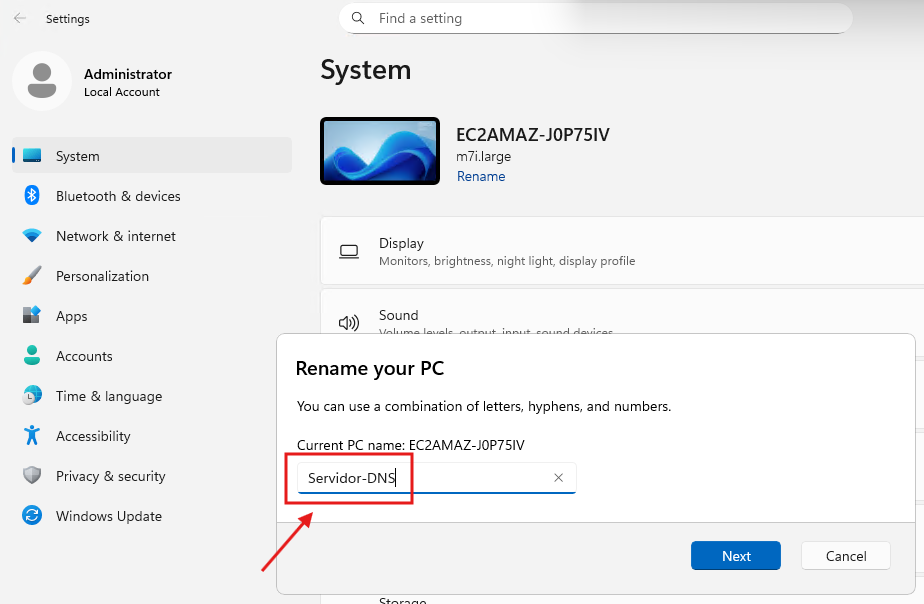

> **📌 

 - Afegir el rol Active Directory Domain Services (AD DS)**
> 

> Realitzar captura de pantalla

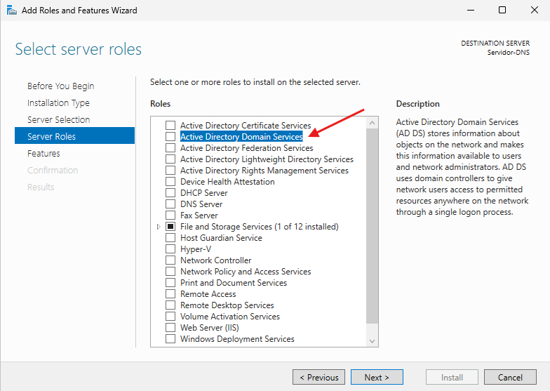

> - Dejamos el resta d'opcions amb els valors per defecte.

> - En la pàgina de `Confirmation` marcamos l'opció de `Restart if required`.

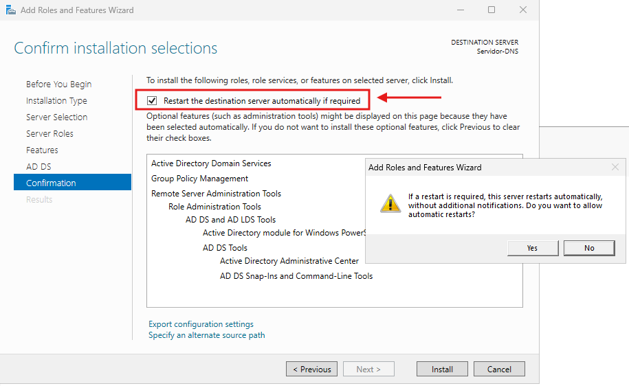

> **📌 

 - Promover el servidor a controlador de domini**
> 

> - Una vegada finalitzada la instal·lació del servei el sistema ens pedirá **promover el servidor a controlador de domini**.

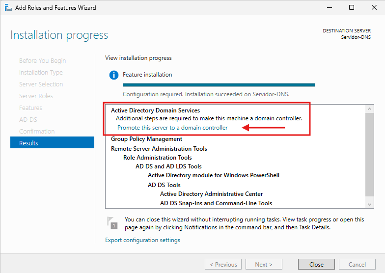

Realitzar captura de pantalla

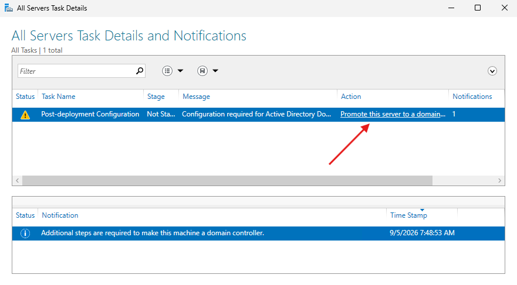

> **📌 

 - Creació dels bosques de AD DS**
> 

> **📌 - Un bosque de AD DS és una estructura que permet organitzar i administrar de forma centralitzada els usuaris, equips i recursos d'una organització.
> - Per a funcionar, utilitza la tecnologia DNS, la mateixa que s'empra en Internet per a traduir noms en adreces IP.
> - No obstant això, un bosque de Active Directory és independent dels dominis de Internet, ja que té la seua pròpia estructura i finalitat.**
> 

- En `Deployment Configuration` seleccionem `Add a new forest` i introducimos un nom de domini per al domini de AD intern.

- 

El codi de bones pràctiques de Microsoft recomana usar **el nom de domini de l'empresa (d'internet) + un subdominio (ad)**.  

Realitzar captura de pantalla

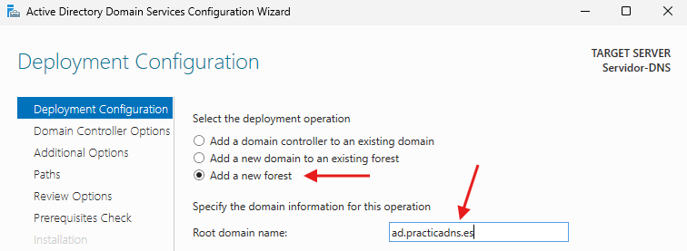

- 

Al ser un bosque nou, dejarem els valors per defecte dels nivells funcionals.  

- Com AD requereix d'un servidor DNS per a funcionar, ens ve l'opció DNS marcada per defecte.  

> **📌 

 - Opcions del servidor DNS**
> 

> - Introducirem la contrasenya de restauració de serveis de directori (**DSRM – Directory Services Restore Mode**), que s'utilitza per a iniciar el servidor en mode de recuperació de AD en cas de fallada grave. **No es recomana que aquesta contrasenya coincida amb la contrasenya d'administrador**.

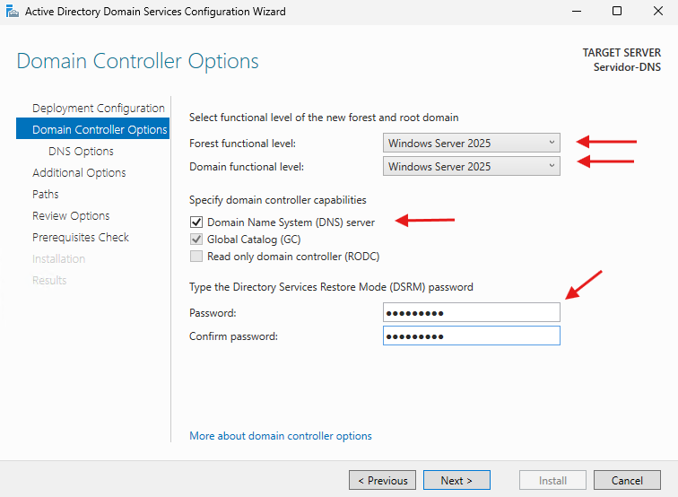

> - En `DNS Options` ens apareixerà un avís indicant que no es pot crear una delegació per a aquest servidor DNS, ja que no existeix una zona superior (pare) que l'administre.

> - És un avís esperat al crear un bosque nou (encara no existeix cap domini DNS previo al que delegar) i el podem ignorar.
> 
Realitzar captura de pantalla

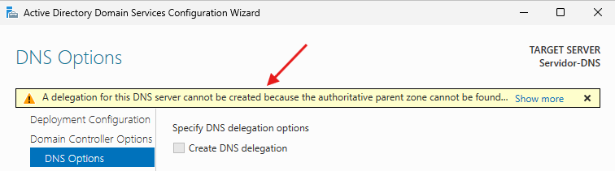

> **📌 

 - Opcions addicionals de AD DS**
> 

> - En `Additional Options` dejarem el nom per defecte de domini de NetBIOS (només per a compatibilitat amb equips antics / obsoletos).

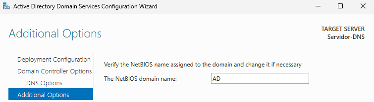

> **📌 

 - Comprovació de pre-requisits**
> 

> - Continuem per les finestres de `Paths` (on es defineix la ubicació de la base de dades de AD, els logs i el volum SYSVOL) i `Review Options` (resum de tota la configuració elegida).  

> - En `Prerequisites Check` apuntarem les advertencias per a gestionar-les més avant (entre elles, és habitual que aparega un avís relacionat amb la configuració de IP estàtica del servidor).

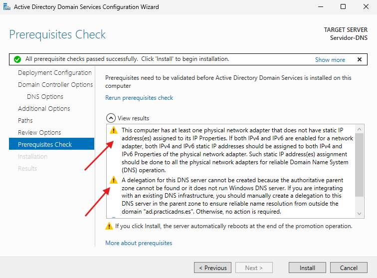

> **📌 

 - Nou inici de sessió sota AD DS**
> 

> - Una vegada reiniciada la màquina, veurem que encara que parezca que no ha ocurrido res, ara iniciamos sessió com **DOMINI\Administrador** (compta de domini) en lloc de com administrador local del servidor.

> - Podem comprobar-lo, per exemple, executant `whoami` en una consola.

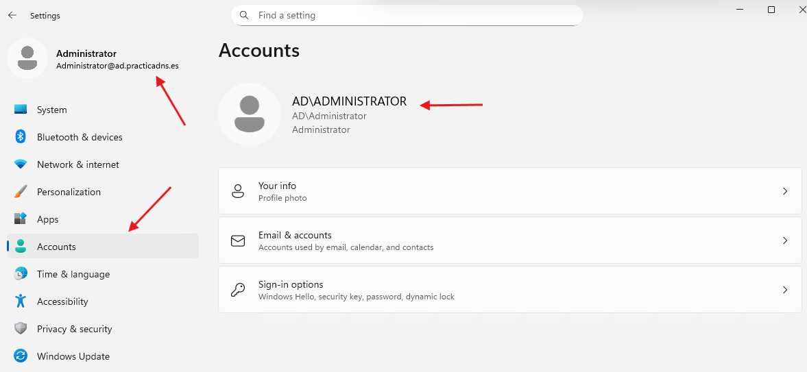

> **📌 

 - Consideracions sobre AD DS**
> 

> - Active Directory necessita que **la IP del controlador de domini no cambie**, ja que els registres DNS i SRV del domini es generen sobre eixa IP.

> - En AWS, la IP privada d'una instància EC2 és **estàtica per naturalesa** mentre no s'elimine la instància (sobrevive a stop/start, reinicios, etc.), per la qual cosa no és necessari realitzar cap canvi a nivell de AWS.

> - Encara així, és recomanable **fixar eixa mateixa IP privada com estàtica dins de la configuració de xarxa de Windows** (en lloc de dejar-l'en mode DHCP), per a evitar problemes si l'adaptador de xarxa es reinicia.

> - Per a això, buscarem en EC2 → Detalls la IP privada actual de la nostra instància (en aquest exemple, 172.31.39.10) i configurarem eixa **mateixa IP** com estàtica en les propietats de xarxa de Windows.

> **📌 Important**
> 

> Realitzar captura de pantalla  

> - La IP que configuremos manualment en Windows ha de **coincidir sempre** amb la IP privada que AWS ja té assignada a la instància.

> - Si configuramos una IP diferent, la instància perderá la conectivitat de xarxa, ja que AWS només enruta trànsit a les IPs associades a eixa interfície de xarxa (ENI).

- 

Si a més de la IP privada estàtica volem que el servidor tinga una **IP pública fixa** per a accés des de Internet, açò es resol mitjançant una **Elastic IP (EIP)**, que és un concepte independent de la IP privada usada per AD/DNS internament:

  1. Al crear una Elastic IP i asociar-la a la instància, aquesta IP pública no cambiará mentre estiga associada, ni siquiera si la instància es detiene i es torna a iniciar.

  1. Si en el futuro volem eliminar o reemplaçar la instància sense perdre la IP pública, podem mover la Elastic IP a una Elastic Network Interface (ENI) separada, que podrem desasociar i tornar a associar a una altra instància quan faça falta.

Pregunta a respondre  

> **📌 En un entorn no AWS (no virtual), com es configuraría la interfície de xarxa de la nostra màquina a IP estàtica?**
> 

> **📌 

 - Finalizació d'instal·lació del AD DS i del servidor DNS**
> 

> - Després d'un temps, apareixeran els serveis AD DS i DNS en la nostra màquina.

> - Servei AD DS

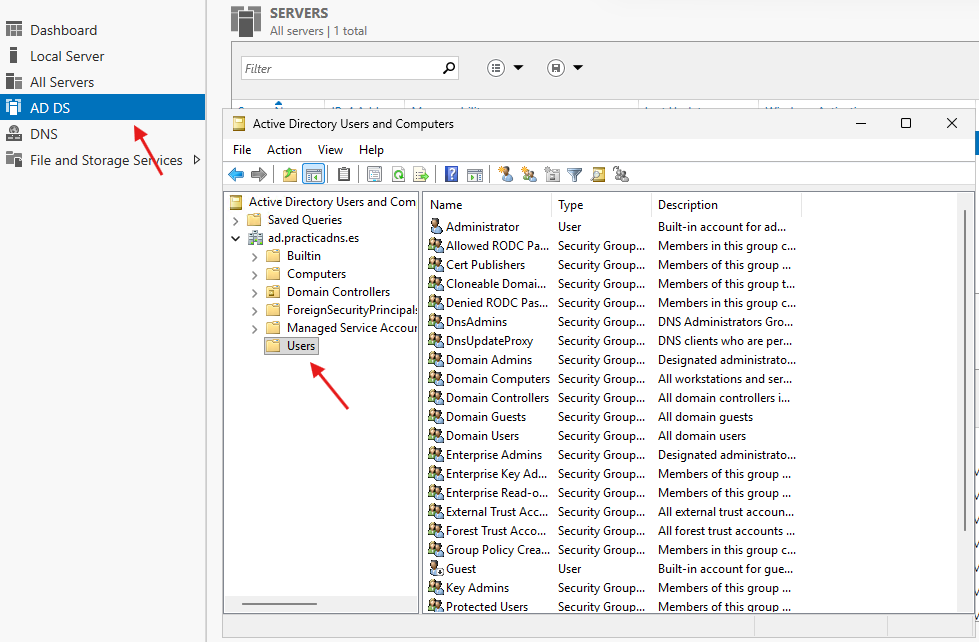

> - Servei DNS

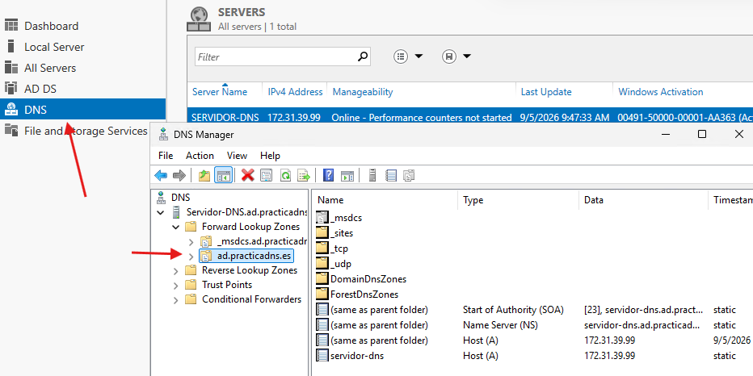

> **📌 

 - Verificació final**
> 

> Per a comprovar que el domini i el DNS han quedado correctament configurats, farem el següent:  

> - 

> Executar `dcdiag` en una consola per a diagnosticar l'estat del controlador de domini.
> 
Realitzar captura de pantalla  

> - 

> Executar `nslookup <nombre-del-dominio>` per a comprovar que el propi servidor resol correctament els registres del seu domini.
> 
Realitzar captura de pantalla  

> - 

> Obrir la consola "Usuaris i equips de Active Directory" per a confirmar que el domini es ha creat correctament.
> 
Realitzar captura de pantalla

---

## 🎮 Reptes Interactius d'Autoavaluació (+100 XP)

Comprova el teu domini sobre **3.14 - Tasca RA2-CEde-1 - Instal·lació i configuració d'un servidor DNS amb Windows Server 2025** superant aquests 4 reptes gamificats (+25 punts cadascun):

  
🎯 <strong>Repte 1 (+25 pts):</strong> Quina diferència hi ha entre una consulta DNS recursiva i una consulta DNS iterativa?

  

    <button type="button" class="btn-mcq-opt" data-opt="A">A) En la recursiva el client demana al servidor DNS local la resposta completa; en la iterativa el servidor consultat respon amb la millor referència (p. ex. servidor TLD o autoritatiu) que coneix.</button>
    <button type="button" class="btn-mcq-opt" data-opt="B">B) La consulta iterativa només funciona amb adreces IPv6 i la recursiva només amb IPv4.</button>
    <button type="button" class="btn-mcq-opt" data-opt="C">C) La consulta recursiva utilitza el port 80 i la iterativa el port 21.</button>
    <button type="button" class="btn-mcq-opt" data-opt="D">D) Cap de les anteriors és correcta.</button>
  

  

  
🎯 <strong>Repte 2 (+25 pts):</strong> Quin tipus de registre DNS s'utilitza per a la resolució inversa (traduir una adreça IP a un nom de domini FQDN)?

  

    <button type="button" class="btn-mcq-opt" data-opt="A">A) CNAME</button>
    <button type="button" class="btn-mcq-opt" data-opt="B">B) MX</button>
    <button type="button" class="btn-mcq-opt" data-opt="C">C) Cap de les anteriors és correcta.</button>
    <button type="button" class="btn-mcq-opt" data-opt="D">D) PTR</button>
  

  

  
✅ <strong>Repte 3 (Vertader o Fals · +25 pts):</strong> L'extensió DNSSEC afegeix signatures criptogràfiques als registres DNS per a protegir contra atacs d'enverinament de memòria cau (DNS Cache Poisoning).

  

    <button type="button" class="btn-vf" data-opt="V">Vertader (V)</button>
    <button type="button" class="btn-vf" data-opt="F">Fals (F)</button>
  

  

  
⌨️ <strong>Repte 4 (+25 pts):</strong> Quin tipus de registre DNS associa un nom de domini amb una adreça IPv4 de 32 bits? (Escriu la lletra del registre)

  

    <input type="text" class="quiz-input" placeholder="Escriu la resposta..." />
    <button type="button" class="btn-quiz-check">Comprovar</button>
  

  

### 📋 Llista de Comprovació i Rúbrica d'Assoliment

Marca cada criteri a mesura que completes l'estudi o la resolució pràctica d'aquesta pàgina (**3.14 - Tasca RA2-CEde-1 - Instal·lació i configuració d'un servidor DNS amb Windows Server 2025**):

- [ ] He llegit detingudament la teoria o l'enunciat d'aquesta secció i he anotat els conceptes clau.
- [ ] He revisat els esquemes, taules o blocs de codi i he verificat que sé aplicar-los a l'entorn de treball.
- [ ] He resolt correctament els **4 reptes interactius** superiors obtenint els **100 punts XP**.
- [ ] He descarregat el comprovant oficial en PDF per a adjuntar-lo a la tasca d'**Aules**.

  <h3>📤 Comprovant de Lliurament per a Aules</h3>
  
Quan hages completat els reptes interactius i la llista d'autoavaluació d'aquesta pàgina, introdueix el teu nom i descarrega el teu certificat oficial en PDF per a adjuntar-lo a la tasca d'<strong>Aules</strong>.

  

    <label for="aules-student-name">👤 Nom i Cognoms de l'Alumne/a:</label>
    <input type="text" id="aules-student-name" class="aules-student-name" placeholder="Ex: Joan Garcia Pérez" />
  

  

    0/4 reptes completats (0%) · 0 punts · 0/4 criteris d'autoavaluació
  

  

    <button type="button" class="btn-aules-dl" data-module="SEX" data-unit="UD03" data-activity="ut0314">📥 Descarregar Comprovant PDF</button>
    <button type="button" class="btn-aules-copy">📋 Copiar Resum al Porta-retalls</button>
  

  

