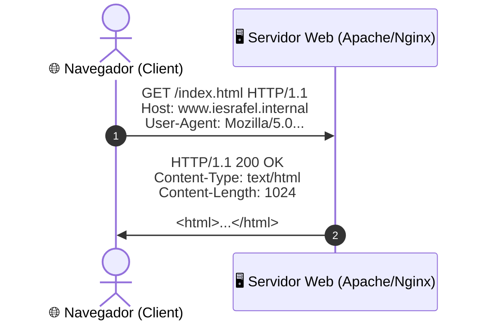
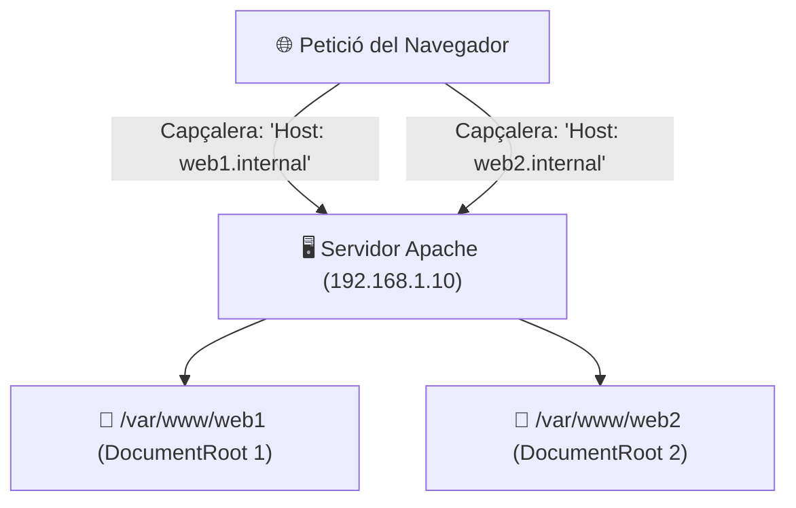
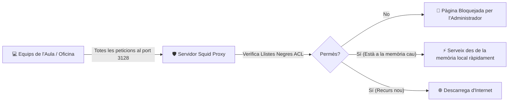

# UT04 — Servei Web (HTTP/HTTPS) i Servidors Intermediaris (Proxy)

El servei web és la porta d'accés pública a les aplicacions i continguts d'una organització. Comprèn la publicació de pàgines i aplicacions mitjançant els protocols **HTTP i HTTPS**, així com la gestió del tràfic d'eixida dels usuaris mitjançant servidors intermediaris **Proxy/Caché**.

---

## 📌 1. El Protocol HTTP i Codis d'Estat

HTTP (*Hypertext Transfer Protocol*) funciona segons el model petició-resposta sobre el port **TCP 80** (o **TCP 443** xifrat amb TLS en HTTPS):



### Codis de Resposta d'Estat Canònics:
- **2xx (Èxit):**
  - `200 OK`: La petició s'ha completat amb èxit i es retorna el recurs.
  - `204 No Content`: Peticions API correctes sense cos de resposta.
- **3xx (Redireccions):**
  - `301 Moved Permanently`: El recurs s'ha mogut definitivament (utilitzat per a redirigir de HTTP a HTTPS).
  - `304 Not Modified`: El fitxer no ha canviat des de l'última visita (s'utilitza la memòria cau local del navegador).
- **4xx (Errors del Client):**
  - `400 Bad Request`: Sintaxi de la sol·licitud malformada.
  - `401 Unauthorized` / `403 Forbidden`: Accés no autoritzat o prohibit per permisos del sistema de fitxers.
  - `404 Not Found`: El recurs demanat no existeix a l'arrel de documents.
- **5xx (Errors del Servidor):**
  - `500 Internal Server Error`: Fallada en el codi PHP o configuració interna.
  - `502 Bad Gateway`: El servidor proxy invers no rep resposta del servei d'aplicació posterior.
  - `503 Service Unavailable`: Servidor caigut per sobrecàrrega o manteniment.

---

## 📌 2. Llocs Virtuals (*Virtual Hosts*) en Apache2

El mecanisme de **Llocs Virtuals basats en noms** permet allotjar múltiples llocs web independents en un sol servidor físic que només té una adreça IP:



### Procediment de Desplegament:
```bash
# 1. Instal·lar el servidor Apache
sudo apt update && sudo apt install apache2 -y

# 2. Crear els directoris d'arrel per a cada lloc
sudo mkdir -p /var/www/empresa1 /var/www/empresa2
echo "<h1>Benvinguts a Empresa 1</h1>" | sudo tee /var/www/empresa1/index.html
echo "<h1>Benvinguts a Empresa 2</h1>" | sudo tee /var/www/empresa2/index.html
sudo chown -R www-data:www-data /var/www/
```

### Configuració del fitxer `/etc/apache2/sites-available/empresa1.conf`:
```apache
<VirtualHost *:80>
    ServerName www.empresa1.internal
    ServerAlias empresa1.internal
    ServerAdmin admin@empresa1.internal

    DocumentRoot /var/www/empresa1

    ErrorLog ${APACHE_LOG_DIR}/empresa1_error.log
    CustomLog ${APACHE_LOG_DIR}/empresa1_access.log combined
</VirtualHost>
```

```bash
# Habilitar el lloc virtual i recarregar la configuració d'Apache
sudo a2ensite empresa1.conf
sudo a2dissite 000-default.conf
sudo systemctl reload apache2
```

---

## 📌 3. Seguretat HTTPS i Xifratge TLS

> [!IMPORTANT]
> El tràfic HTTP clàssic viatja en clar per la xarxa. Qualsevol atacant amb un analitzador de paquets com Wireshark pot capturar contrasenyes i galetes de sessió. **HTTPS xifra tot el canal d'extrem a extrem** utilitzant criptografia simètrica AES negociada mitjançant certificats digitals TLS.

En entorns de producció amb nom de domini públic, s'utilitza l'eina **Certbot** per a obtindre certificats gratuïts i renovables automàticament de l'Autoritat de Certificació Let's Encrypt:
```bash
sudo apt install certbot python3-certbot-apache -y
sudo certbot --apache -d www.empresa1.com
```

---

## 📌 4. Servidors Intermediaris (Proxy / Cache) amb Squid

Un servidor **Proxy** s'instal·la a la frontera de la xarxa local per a gestionar les peticions web dels clients cap a l'exterior:



### Configuració bàsica d'un tall de xarxes socials a `/etc/squid/squid.conf`:
```text
# Port d'escolta per defecte
http_port 3128

# Definir la xarxa de l'aula com a origen vàlid
acl xarxa_aula src 192.168.1.0/24

# Llista negra de dominis prohibits
acl dominis_bloquejats dstdomain .facebook.com .instagram.com .tiktok.com

# Aplicar regles de filtrat (l'ordre importa!)
http_access deny dominis_bloquejats
http_access allow xarxa_aula
http_access deny all
```

```bash
# Validar la sintaxi i reiniciar Squid
sudo squid -k parse
sudo systemctl restart squid

# Monitoritzar els accessos dels usuaris en temps real
sudo tail -f /var/log/squid/access.log
```
