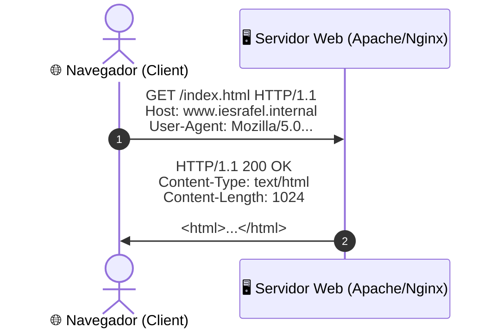
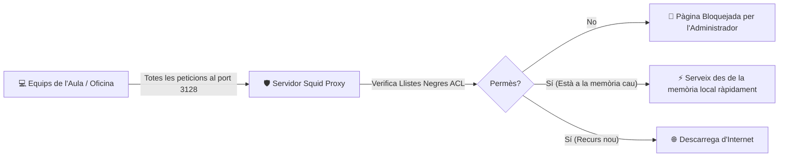

# UT04 — Servei Web (HTTP/HTTPS) i Servidors Intermediaris (Proxy)

El servei web és la porta d'accés pública a les aplicacions i continguts d'una organització. Comprèn la publicació de pàgines i aplicacions mitjançant els protocols **HTTP i HTTPS**, així com la gestió del tràfic d'eixida dels usuaris mitjançant servidors intermediaris **Proxy/Caché**.

---

## 📌 1. El Protocol HTTP i Codis d'Estat

HTTP (*Hypertext Transfer Protocol*) funciona segons el model petició-resposta sobre el port **TCP 80** (o **TCP 443** xifrat amb TLS en HTTPS):



### Codis de Resposta d'Estat Canònics:
- **2xx (Èxit):**
  - `200 OK`: La petició s'ha completat amb èxit i es retorna el recurs.
  - `204 No Content`: Peticions API correctes sense cos de resposta.
- **3xx (Redireccions):**
  - `301 Moved Permanently`: El recurs s'ha mogut definitivament (utilitzat per a redirigir de HTTP a HTTPS).
  - `304 Not Modified`: El fitxer no ha canviat des de l'última visita (s'utilitza la memòria cau local del navegador).
- **4xx (Errors del Client):**
  - `400 Bad Request`: Sintaxi de la sol·licitud malformada.
  - `401 Unauthorized` / `403 Forbidden`: Accés no autoritzat o prohibit per permisos del sistema de fitxers.
  - `404 Not Found`: El recurs demanat no existeix a l'arrel de documents.
- **5xx (Errors del Servidor):**
  - `500 Internal Server Error`: Fallada en el codi PHP o configuració interna.
  - `502 Bad Gateway`: El servidor proxy invers no rep resposta del servei d'aplicació posterior.
  - `503 Service Unavailable`: Servidor caigut per sobrecàrrega o manteniment.

---

## 📌 2. Llocs Virtuals (*Virtual Hosts*) en Apache2

El mecanisme de **Llocs Virtuals basats en noms** permet allotjar múltiples llocs web independents en un sol servidor físic que només té una adreça IP:

<div style="background: linear-gradient(135deg, #0f172a 0%, #1e293b 100%); border-radius: 12px; padding: 20px; margin: 25px 0; box-shadow: 0 10px 25px -5px rgba(0, 0, 0, 0.3); border: 1px solid #334155;">
  <div style="text-align: center; margin-bottom: 15px;">
    <span style="background: #38bdf8; color: #0f172a; font-weight: 700; font-size: 0.75rem; text-transform: uppercase; letter-spacing: 0.05em; padding: 4px 10px; border-radius: 9999px;">Infografia Tècnica</span>
    <h3 style="color: #f8fafc; margin: 10px 0 5px 0; font-size: 1.25rem;">VirtualHosts en Apache i Intermediació Proxy Squid</h3>
    <p style="color: #94a3b8; font-size: 0.85rem; margin: 0;">Resolució web per capçalera HTTP 'Host' i filtrat perimetral amb memòria cau local</p>
  </div>
  <svg viewBox="0 0 860 270" width="100%" height="100%" xmlns="http://www.w3.org/2000/svg" style="display: block; font-family: system-ui, -apple-system, sans-serif;">
    <defs>
      <linearGradient id="vhGrad" x1="0%" y1="0%" x2="100%" y2="100%">
        <stop offset="0%" stop-color="#0284c7" stop-opacity="0.3"/>
        <stop offset="100%" stop-color="#0369a1" stop-opacity="0.1"/>
      </linearGradient>
      <linearGradient id="sqGrad" x1="0%" y1="0%" x2="100%" y2="100%">
        <stop offset="0%" stop-color="#10b981" stop-opacity="0.3"/>
        <stop offset="100%" stop-color="#047857" stop-opacity="0.1"/>
      </linearGradient>
    </defs>

    <!-- Secció Esquerra: VirtualHosts -->
    <rect x="20" y="20" width="395" height="230" rx="8" fill="url(#vhGrad)" stroke="#38bdf8" stroke-width="1.5"/>
    <text x="217" y="48" fill="#38bdf8" font-size="13" font-weight="bold" text-anchor="middle">VIRTUALHOSTS BASATS EN NOM (APACHE)</text>
    <text x="217" y="65" fill="#94a3b8" font-size="10" text-anchor="middle">Una sola IP física (192.168.1.10) -&gt; Múltiples llocs</text>
    <line x1="35" y1="78" x2="400" y2="78" stroke="#334155"/>

    <rect x="35" y="90" width="365" height="45" rx="6" fill="#1e293b" stroke="#38bdf8" stroke-width="1"/>
    <text x="50" y="110" fill="#e2e8f0" font-size="10" font-weight="bold">Host: www.empresa1.internal</text>
    <text x="50" y="125" fill="#38bdf8" font-size="9">DocumentRoot: /var/www/empresa1</text>

    <rect x="35" y="145" width="365" height="45" rx="6" fill="#1e293b" stroke="#38bdf8" stroke-width="1"/>
    <text x="50" y="165" fill="#e2e8f0" font-size="10" font-weight="bold">Host: www.empresa2.internal</text>
    <text x="50" y="180" fill="#38bdf8" font-size="9">DocumentRoot: /var/www/empresa2</text>

    <text x="217" y="215" fill="#94a3b8" font-size="9.5" text-anchor="middle">Apache llegeix la capçalera <tspan fill="#f59e0b" font-weight="bold">Host:</tspan> per a triar el DocumentRoot</text>
    <text x="217" y="235" fill="#34d399" font-size="9.5" text-anchor="middle">Xifratge TLS independent per VirtualHost mitjançant SNI</text>

    <!-- Secció Dreta: Proxy Squid -->
    <rect x="445" y="20" width="395" height="230" rx="8" fill="url(#sqGrad)" stroke="#34d399" stroke-width="1.5"/>
    <text x="642" y="48" fill="#34d399" font-size="13" font-weight="bold" text-anchor="middle">SERVIDOR PROXY CACHÉ (SQUID)</text>
    <text x="642" y="65" fill="#94a3b8" font-size="10" text-anchor="middle">Control d'eixida, estalvi d'ample de banda i seguretat</text>
    <line x1="460" y1="78" x2="825" y2="78" stroke="#334155"/>

    <rect x="460" y="90" width="365" height="45" rx="6" fill="#1e293b" stroke="#34d399" stroke-width="1"/>
    <text x="475" y="110" fill="#e2e8f0" font-size="10" font-weight="bold">⚡ Cache Hit (Recurs a la memòria local)</text>
    <text x="475" y="125" fill="#34d399" font-size="9">Lliurament instantani sense consumir ample de banda</text>

    <rect x="460" y="145" width="365" height="45" rx="6" fill="#1e293b" stroke="#ef4444" stroke-width="1"/>
    <text x="475" y="165" fill="#e2e8f0" font-size="10" font-weight="bold">🚫 Filtrat de Continguts (Llistes Negres ACL)</text>
    <text x="475" y="180" fill="#f87171" font-size="9">Bloqueig de xarxes socials, jocs o dominis maliciosos</text>

    <text x="642" y="215" fill="#94a3b8" font-size="9.5" text-anchor="middle">Port estàndard: <tspan fill="#38bdf8" font-weight="bold">TCP 3128</tspan> | Registre: <tspan fill="#f59e0b">/var/log/squid/access.log</tspan></text>
    <text x="642" y="235" fill="#cbd5e1" font-size="9.5" text-anchor="middle">Possibilitat de Proxy Transparent redirigint port 80 amb iptables</text>
  </svg>
</div>

### Procediment de Desplegament:
```bash
# 1. Instal·lar el servidor Apache
sudo apt update && sudo apt install apache2 -y

# 2. Crear els directoris d'arrel per a cada lloc
sudo mkdir -p /var/www/empresa1 /var/www/empresa2
echo "<h1>Benvinguts a Empresa 1</h1>" | sudo tee /var/www/empresa1/index.html
echo "<h1>Benvinguts a Empresa 2</h1>" | sudo tee /var/www/empresa2/index.html
sudo chown -R www-data:www-data /var/www/
```

### Configuració del fitxer `/etc/apache2/sites-available/empresa1.conf`:
```apache
<VirtualHost *:80>
    ServerName www.empresa1.internal
    ServerAlias empresa1.internal
    ServerAdmin admin@empresa1.internal

    DocumentRoot /var/www/empresa1

    ErrorLog ${APACHE_LOG_DIR}/empresa1_error.log
    CustomLog ${APACHE_LOG_DIR}/empresa1_access.log combined
</VirtualHost>
```

```bash
# Habilitar el lloc virtual i recarregar la configuració d'Apache
sudo a2ensite empresa1.conf
sudo a2dissite 000-default.conf
sudo systemctl reload apache2
```

---

## 📌 3. Seguretat HTTPS i Xifratge TLS

> [!IMPORTANT]
> El tràfic HTTP clàssic viatja en clar per la xarxa. Qualsevol atacant amb un analitzador de paquets com Wireshark pot capturar contrasenyes i galetes de sessió. **HTTPS xifra tot el canal d'extrem a extrem** utilitzant criptografia simètrica AES negociada mitjançant certificats digitals TLS.

En entorns de producció amb nom de domini públic, s'utilitza l'eina **Certbot** per a obtindre certificats gratuïts i renovables automàticament de l'Autoritat de Certificació Let's Encrypt:
```bash
sudo apt install certbot python3-certbot-apache -y
sudo certbot --apache -d www.empresa1.com
```

---

## 📌 4. Servidors Intermediaris (Proxy / Cache) amb Squid

Un servidor **Proxy** s'instal·la a la frontera de la xarxa local per a gestionar les peticions web dels clients cap a l'exterior:



### Configuració bàsica d'un tall de xarxes socials a `/etc/squid/squid.conf`:
```text
# Port d'escolta per defecte
http_port 3128

# Definir la xarxa de l'aula com a origen vàlid
acl xarxa_aula src 192.168.1.0/24

# Llista negra de dominis prohibits
acl dominis_bloquejats dstdomain .facebook.com .instagram.com .tiktok.com

# Aplicar regles de filtrat (l'ordre importa!)
http_access deny dominis_bloquejats
http_access allow xarxa_aula
http_access deny all
```

```bash
# Validar la sintaxi i reiniciar Squid
sudo squid -k parse
sudo systemctl restart squid

# Monitoritzar els accessos dels usuaris en temps real
sudo tail -f /var/log/squid/access.log
```

---

## 📝 Quadern d'Activitats Pràctiques i Reptes de Laboratori

### 📋 Bloc A: Anàlisi de Capçaleres HTTP, SNI i Arquitectura Proxy
1. **L'Extensió SNI (*Server Name Indication*) en HTTPS:**
   - En HTTP clàssic (port 80), el servidor llegeix la capçalera de text en clar `Host: www.empresa1.internal` per a decidir quin VirtualHost activar.
   - En HTTPS clàssic, el xifratge TLS s'iniciava abans de transmetre qualsevol dada HTTP. Per què això suposava un problema greu si volíem allotjar deu dominis HTTPS diferents amb deu certificats diferents en una sola adreça IP?
   - Com resol l'extensió TLS SNI aquest problema permetent al client indicar el nom de domini desitjat en el missatge inicial `Client Hello`?
2. **Diferenciació d'Intermediaris: Proxy Forward vs Reverse Proxy:**
   - Elabora una taula comparativa explicant la diferència entre un **Proxy Directe (*Forward Proxy*)** (com Squid a l'eixida d'una oficina) i un **Proxy Invers (*Reverse Proxy*)** (com Nginx davant d'una granja de servidors d'aplicacions). Quina part de la comunicació oculta cadascun d'ells?

### 💻 Bloc B: Reptes Pràctics de Laboratori i Configuració

#### Repte 1: Desplegament de Dos VirtualHosts Basats en Nom a Apache
A la màquina Ubuntu Server de laboratori:
1. Crea els directoris d'arrel per a dos departaments:
   ```bash
   sudo mkdir -p /var/www/comptabilitat /var/www/recursos-humans
   echo "<h1>Portal de Comptabilitat - Accés Restringit</h1>" | sudo tee /var/www/comptabilitat/index.html
   echo "<h1>Portal de Recursos Humans - SMX Lab</h1>" | sudo tee /var/www/recursos-humans/index.html
   sudo chown -R www-data:www-data /var/www/
   ```
2. Crea el fitxer `/etc/apache2/sites-available/comptabilitat.conf`:
   ```apache
   <VirtualHost *:80>
       ServerName comptabilitat.smx.internal
       DocumentRoot /var/www/comptabilitat
       ErrorLog ${APACHE_LOG_DIR}/comptabilitat_error.log
       CustomLog ${APACHE_LOG_DIR}/comptabilitat_access.log combined
   </VirtualHost>
   ```
3. Crea de forma equivalent `/etc/apache2/sites-available/recursos-humans.conf` amb el seu `ServerName` i `DocumentRoot` respectius.
4. Habilita els dos llocs i recarrega el servei:
   ```bash
   sudo a2ensite comptabilitat.conf
   sudo a2ensite recursos-humans.conf
   sudo apache2ctl configtest
   sudo systemctl reload apache2
   ```
5. A la màquina client, afegeix temporalment al fitxer `/etc/hosts` (o `C:\Windows\System32\drivers\etc\hosts`):
   ```text
   192.168.1.10   comptabilitat.smx.internal
   192.168.1.10   recursos-humans.smx.internal
   ```
6. Obre el navegador i comprova que cadascun dels dos dominis carrega la seua pàgina corresponent de forma totalment aïllada.

#### Repte 2: Configuració de Regles ACL a Squid amb Control Horari
1. A la màquina amb Squid, edita `/etc/squid/squid.conf` per a crear una regla de control parental/laboral:
   ```text
   # Definició de xarxa d'origen
   acl xarxa_local src 192.168.1.0/24

   # Llista de dominis d'oci prohibits
   acl oci_prohibit dstdomain .youtube.com .netflix.com .twitch.tv

   # Franja horària de classe/feina (Dilluns a Divendres de 08:00 a 14:00)
   acl horari_feina time MTWHF 08:00-14:00

   # Aplicació: bloquejar oci NOMÉS en horari de feina
   http_access deny oci_prohibit horari_feina
   http_access allow xarxa_local
   http_access deny all
   ```
2. Valida la sintaxi amb `sudo squid -k parse` i reinicia amb `sudo systemctl restart squid`.
3. Configura el proxy al navegador del client apuntant a la IP del servidor i port 3128.
4. Intenta carregar un dels dominis d'oci i comprova que Squid retorna la pàgina d'error d'accés denegat (*Access Denied*).

### 🎯 Bloc C: Llista de Verificació i Rúbrica d'Avaluació

| Criteri d'Avaluació | Nivell Assolit (Excel·lent: 9-10) | Nivell Mitjà (Notable: 7-8) | Nivell Inicial (Aprovat: 5-6) |
| :--- | :--- | :--- | :--- |
| **Arquitectura web i codis HTTP** | Explica amb precisió el funcionament de la capçalera Host, SNI i els codis 2xx/3xx/4xx/5xx. | Comprèn els codis bàsics (200, 404) però no distingeix entre redireccions 301 i 302. | Desconeix com Apache diferencia múltiples llocs web en una sola adreça IP. |
| **Desplegament de VirtualHosts** | Configura els dos llocs virtuals amb logs separats, permisos www-data i resolució correcta. | Configura els llocs però no separa els registres de log o té problemes de permisos de lectura. | Errors de sintaxi al fitxer `.conf` o falla l'activació amb `a2ensite`. |
| **Filtrat i regles a Squid** | Defineix ACLs de domini i horari, interpreta `access.log` i comprova bloquejos. | Configura el filtrat de dominis però no sap afegir condicions de temps. | No aconsegueix canalitzar el tràfic del navegador a través del port 3128 de Squid. |
