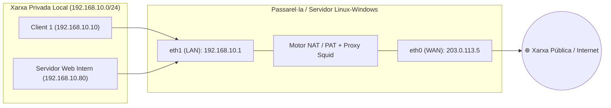

<div class="interactive-progress-tracker">
  <div class="tracker-header">
    <span>🏆 <strong>Progrés d'aquesta secció:</strong> <span class="tracker-count">0 de 4 superats (0%)</span></span>
    <span class="tracker-pts">⭐ <strong>0 punts</strong></span>
  </div>
  <div class="tracker-bar">
    <div class="tracker-fill" style="width: 0%;"></div>
  </div>
</div>

# 4.1 Arquitectura de Passarel·les, Encaminament IP (IP Forwarding) i NAT/PAT

## 1. Interconnexió entre Xarxa Privada Local (LAN) i Xarxa Pública (WAN)

En els entorns empresarials i educatius, els equips de la **xarxa privada local (LAN)** utilitzen rangs d'adreçament IPv4 privat (RFC 1918: `10.0.0.0/8`, `172.16.0.0/12`, `192.168.0.0/16`) que no són encaminables directament a Internet. Per a connectar la LAN amb una **xarxa pública** cal un sistema amb dues o més interfícies de xarxa (*Dual-Homed Host* o Router/Firewall) que actue com a **passarel·la (Gateway)**.



---

## 2. Reenviament de Trànsit entre Interfícies (IP Forwarding) — RA8-CEh

Perquè un servidor Linux o Windows Server amb dues targetes de xarxa (`eth0` connectada a la xarxa pública i `eth1` connectada a la xarxa privada) puga transferir paquets d'una xarxa a una altra, cal activar l'**encaminament IP (IP Forwarding)** en el nucli del sistema operatiu:

### Activació en Ubuntu Server (Linux)

1. Comprovació de l'estat actual:
```bash
sysctl net.ipv4.ip_forward
```
2. Activació permanent editant `/etc/sysctl.conf` o `/etc/sysctl.d/99-ipforward.conf`:
```bash
net.ipv4.ip_forward = 1
```
3. Aplicació immediata dels canvis sense reiniciar:
```bash
sudo sysctl -p
```

---

## 3. Traducció d'Adreces de Xarxa: SNAT, Masquerading i DNAT (Port Forwarding) — RA8-CEi, CEj

- **SNAT / Masquerade (Sortida de LAN a Internet):** Substitueix l'adreça IP privada d'origen dels paquets que ixen per la interfície WAN per l'adreça IP pública de la passarel·la, portant el control dels ports amb **PAT (Port Address Translation)**.
- **DNAT / Port Forwarding (Accés des de la xarxa pública a un servei intern — RA8-CEj):** Permet publicar un servei allotjat en una màquina interna de la LAN (per exemple, un servidor web intern `192.168.10.80:80`) redirigint les connexions que arriben al port públic de la passarel·la (`203.0.113.5:8080`).

```bash
# Activar NAT (Masquerade) en la interfície WAN (eth0) amb iptables:
sudo iptables -t nat -A POSTROUTING -s 192.168.10.0/24 -o eth0 -j MASQUERADE

# Redirecció de ports (DNAT / Port Forwarding) del port 8080 públic al servidor intern 192.168.10.80:80:
sudo iptables -t nat -A PREROUTING -i eth0 -p tcp --dport 8080 -j DNAT --to-destination 192.168.10.80:80
sudo iptables -A FORWARD -p tcp -d 192.168.10.80 --dport 80 -j ACCEPT
```


---

## 🎮 Reptes Interactius d'Autoavaluació (+100 XP)

Comprova el teu domini sobre **4.1 Arquitectura de Passarel·les, Encaminament IP (IP Forwarding) i NAT/PAT** superant aquests 4 reptes gamificats (+25 punts cadascun):

<div class="interactive-mcq" data-answer="A" data-hint="Revisa els conceptes teòrics i pràctics d'aquesta secció.">
  <div class="mcq-question">🎯 <strong>Repte 1 (+25 pts):</strong> Quina és la funció principal d'un servidor Proxy web (com Squid) quan actua com a passarel·la a nivell d'aplicació entre la xarxa privada i la pública?</div>
  <div class="mcq-options">
    <button type="button" class="btn-mcq-opt" data-opt="A">A) Intermediar les peticions HTTP/HTTPS dels clients locals, aplicar llistes de control d'accés (ACLs) i emmagatzemar contingut en memòria cau.</button>
    <button type="button" class="btn-mcq-opt" data-opt="B">B) Assignar adreces MAC dinàmiques a les targetes Wi-Fi.</button>
    <button type="button" class="btn-mcq-opt" data-opt="C">C) Substituir el servidor d'impressió CUPS de la xarxa local.</button>
    <button type="button" class="btn-mcq-opt" data-opt="D">D) Cap de les anteriors és correcta.</button>
  </div>
  <div class="quiz-feedback"></div>
</div>

<div class="interactive-mcq" data-answer="D" data-hint="Comprova l'apartat corresponent de la unitat.">
  <div class="mcq-question">🎯 <strong>Repte 2 (+25 pts):</strong> Quin mecanisme de xarxa permet que múltiples equips d'una xarxa privada (p. ex. 192.168.1.0/24) accedisquen a Internet compartint una única adreça IP pública?</div>
  <div class="mcq-options">
    <button type="button" class="btn-mcq-opt" data-opt="A">A) Spanning Tree Protocol (STP).</button>
    <button type="button" class="btn-mcq-opt" data-opt="B">B) Transferència de zona AXFR.</button>
    <button type="button" class="btn-mcq-opt" data-opt="C">C) Cap de les anteriors és correcta.</button>
    <button type="button" class="btn-mcq-opt" data-opt="D">D) NAT / PAT (Network Address Translation / Masquerading).</button>
  </div>
  <div class="quiz-feedback"></div>
</div>

<div class="interactive-vf" data-answer="V" data-hint="Verifica l'afirmació amb els apunts de la unitat.">
  <div class="vf-statement">✅ <strong>Repte 3 (Vertader o Fals · +25 pts):</strong> Perquè un servidor Linux puga reenviar trànsit entre dues interfícies de xarxa com a encaminador, cal activar el paràmetre del nucli net.ipv4.ip_forward=1.</div>
  <div class="vf-buttons">
    <button type="button" class="btn-vf" data-opt="V">Vertader (V)</button>
    <button type="button" class="btn-vf" data-opt="F">Fals (F)</button>
  </div>
  <div class="quiz-feedback" style="width: 100%;"></div>
</div>

<div class="interactive-quiz" data-answer="3128" data-hint="Comença per 31 i acaba en 28.">
  <div class="quiz-question">⌨️ <strong>Repte 4 (+25 pts):</strong> Quin és el port TCP tradicional per defecte que utilitza el servidor proxy Squid?</div>
  <div class="quiz-controls">
    <input type="text" class="quiz-input" placeholder="Escriu la resposta..." />
    <button type="button" class="btn-quiz-check">Comprovar</button>
  </div>
  <div class="quiz-feedback"></div>
</div>

### 📋 Llista de Comprovació i Rúbrica d'Assoliment

Marca cada criteri a mesura que completes l'estudi o la resolució pràctica d'aquesta pàgina (**4.1 Arquitectura de Passarel·les, Encaminament IP (IP Forwarding) i NAT/PAT**):

- [ ] He llegit detingudament la teoria o l'enunciat d'aquesta secció i he anotat els conceptes clau.
- [ ] He revisat els esquemes, taules o blocs de codi i he verificat que sé aplicar-los a l'entorn de treball.
- [ ] He resolt correctament els **4 reptes interactius** superiors obtenint els **100 punts XP**.
- [ ] He descarregat el comprovant oficial en PDF per a adjuntar-lo a la tasca d'**Aules**.

<div class="aules-delivery-card">
  <h3>📤 Comprovant de Lliurament per a Aules</h3>
  <p>Quan hages completat els reptes interactius i la llista d'autoavaluació d'aquesta pàgina, introdueix el teu nom i descarrega el teu certificat oficial en PDF per a adjuntar-lo a la tasca d'<strong>Aules</strong>.</p>
  <div class="aules-student-field">
    <label for="aules-student-name">👤 Nom i Cognoms de l'Alumne/a:</label>
    <input type="text" id="aules-student-name" class="aules-student-name" placeholder="Ex: Joan Garcia Pérez" />
  </div>
  <div class="aules-score-badge">
    <span class="aules-score-count">0/4 reptes completats (0%) · 0 punts · 0/4 criteris d'autoavaluació</span>
  </div>
  <div class="aules-actions">
    <button type="button" class="btn-aules-dl" data-module="SEX" data-unit="UD04" data-activity="ut0401">📥 Descarregar Comprovant PDF</button>
    <button type="button" class="btn-aules-copy">📋 Copiar Resum al Porta-retalls</button>
  </div>
  <div class="aules-toast"></div>
</div>

