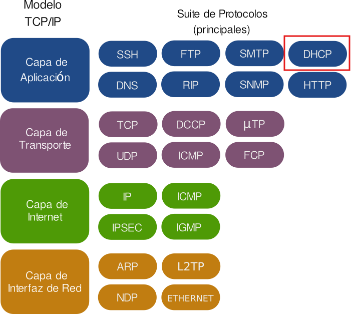
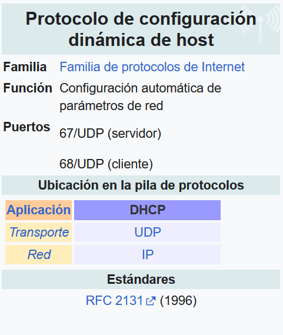
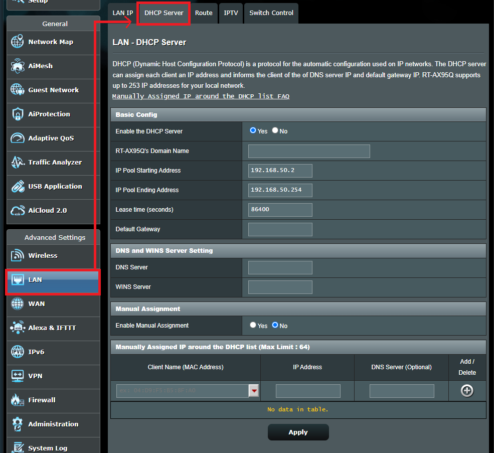
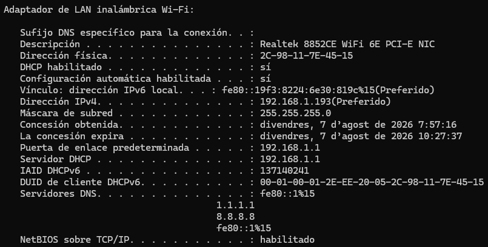
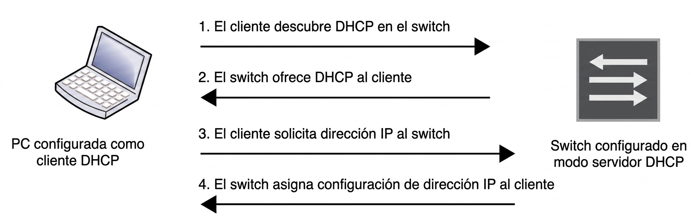

## 2 - DHCP (Dynamic Host Configuration Protocol)

1. El DHCP (Dynamic Host Configuration Protocol) es un protocolo de red que permite a los dispositivos obtener automáticamente una dirección IP y otros parámetros necesarios para conectarse a la red, como la **máscara de subred**, la **puerta de enlace predeterminada** y los **servidores DNS**.
1. Esto elimina la necesidad de **configurar manualmente cada dispositivo**, facilitando enormemente la administración de redes grandes.
1. Antes del DHCP, las redes dependían del protocolo BOOTP (Bootstrap Protocol), que proporcionaba configuraciones básicas, como la asignación de direcciones IP. Sin embargo, BOOTP presentaba varias limitaciones:
    - **Configuración manual:** Los administradores debían asignar manualmente una IP a cada dispositivo, lo que era tedioso y poco práctico en redes grandes.
    - **Asignación estática:** Las direcciones IP eran fijas, lo que significaba que cada dispositivo mantenía la misma dirección aunque se desconectara, lo que no permitía un uso eficiente de las direcciones disponibles.
    - **Falta de flexibilidad:** No estaba diseñado para gestionar redes dinámicas o móviles, como dispositivos que se mueven entre diferentes áreas de cobertura o redes.

### 2.1 Características principales de DHCP

1. **Asignación automática de IPs:**  
DHCP permite la asignación dinámica de direcciones IP a los dispositivos cuando se conectan a la red. Esto asegura que no haya conflictos de direcciones IP duplicadas.

1. **Escalabilidad:**  
Ideal para redes grandes, donde administrar direcciones IP de manera manual sería inviable. Con DHCP, se pueden gestionar cientos o miles de dispositivos de manera eficiente.

1. **Facilidad de configuración:**  
Al automatizar la asignación de IPs y otros parámetros de red, los administradores pueden reducir significativamente el tiempo y esfuerzo que implicaría configurar manualmente cada dispositivo.

1. **Compatibilidad con diferentes tipos de asignación:**  
    - **Asignación manual:** El administrador asigna una IP específica a un dispositivo, aunque este se conecte de manera dinámica.
    - **Asignación automática:** El servidor DHCP asigna una IP de forma permanente a un dispositivo desde el momento de su primera conexión.
    - **Asignación dinámica:** El servidor DHCP asigna una IP por un tiempo limitado (lease time), tras lo cual la IP puede ser reasignada si no se renueva el arrendamiento.

1. **Administración centralizada:**  
Con un servidor DHCP centralizado, los administradores pueden gestionar y actualizar las configuraciones de red desde un solo lugar, en lugar de acceder a cada dispositivo de manera individual.

### 2.2 Componentes del funcionamiento de DHCP

1. La arquitectura de DHCP está formada por tres elementos principales:
    - **Los servidores DHCP**
    - **Los clientes DHCP**
    - **Los agentes de retransmisión DHCP (también llamados relés DHCP)**
1. La comunicación entre cliente y servidor se realiza a través de un intercambio de mensajes DHCP, mediante el cual el cliente obtiene y renueva tanto la concesión de su dirección IP como el resto de parámetros de configuración de red.

??? question "¿Qué parámetros de red puede asignar un servidor DHCP a un cliente?"
    - Dirección IP
    - Máscara de subred
    - Puerta de enlace predeterminada
    ??? tip "Y además..."
        - Servidor DNS
        - Dominio de búsqueda (search domain)
        - Tiempo de concesión (lease time)
        - Identificador de clase de proveedor (Vendor Class Identifier)
        - Número de intentos de retransmisión
        - Intervalo entre reintentos

#### 2.2.1 Servidor DHCP

1. El servidor DHCP constituye la pieza central de todo el protocolo. Su cometido es entregar direcciones IP y demás parámetros de red a los equipos que las solicitan. Para ello, mantiene un conjunto de direcciones disponibles (conocido como pool) y controla las concesiones que se van otorgando a cada cliente.

1. Entre los parámetros que el servidor puede asignar a los clientes se encuentran:
    - **Direcciones IP dinámicas** y temporales tomadas de un pool, asignadas a cualquier cliente dentro de una subred determinada (concesión dinámica).
    - **Direcciones IP fijas** asociadas a un cliente concreto según su dirección MAC (concesión estática).
    - **Máscara de subred**
    - **Puerta de enlace predeterminada**
    - **Servidor DNS**

1. Asimismo, el servidor DHCP guarda de forma persistente la información de red entregada a los clientes. Puesto que DHCP nació como una evolución de BOOTP, los servidores DHCP también son capaces de atender solicitudes procedentes de este protocolo anterior.

!!! tip "Ejemplo de configuración de un servidor DHCP de un router Asus rt-ax58u""
    

#### 2.2.2 Cliente DHCP

1. Se considera cliente DHCP a cualquier dispositivo IP de la red configurado para comportarse como host y solicitar a un servidor DHCP los parámetros necesarios para funcionar, entre ellos su dirección IP.

1. Cuando un equipo actúa como cliente DHCP, obtiene su configuración TCP/IP (incluida la dirección IP) desde un servidor DHCP externo a través de cualquiera de sus interfaces físicas.

1. Para habilitar este comportamiento es necesario configurar una interfaz lógica del dispositivo, de modo que solicite la dirección al servidor DHCP correspondiente. Además, deben definirse los siguientes parámetros:
    - **El identificador de clase de proveedor** (Vendor Class Identifier, DHCP opción 60). Indica qué tipo de dispositivo, fabricante o modelo es.
    - **El tiempo de concesión** (lease time). Es el periodo durante el cual el cliente puede usar la dirección IP que le asignó el servidor. Al acercarse el vencimiento (normalmente el 50%), el cliente intentará renovarla.
    - **La dirección del servidor DHCP**. Es la IP del servidor al que el cliente dirigirá sus solicitudes. Normalmente el cliente descubre al servidor mediante un DISCOVER en broadcast, pero en algunos dispositivos se puede fijar la dirección concreta para enviar las peticiones en unicast.
    - **El número de intentos de retransmisión**. DHCP funciona sobre UDP, que no garantiza la entrega, así que si el cliente no recibe respuesta a su DISCOVER o REQUEST, debe reenviarlo. Este parámetro define cuántas veces lo reintentará antes de darse por vencido. Si se agota sin éxito, el cliente considera que no hay servidor disponible y, según el equipo, puede dejar la interfaz sin dirección o usar una dirección link-local (169.254.x.x).
    - **El intervalo entre reintentos**. Es el tiempo de espera entre un intento y el siguiente. Junto con el número de reintentos determina cuánto tarda el dispositivo en rendirse.

1. Las concesiones obtenidas como cliente pueden renovarse posteriormente.

> 💡 **En la siguiente imagen se muestra un fragmento del resultado de la ejecución del comando `ipconfig /all` en un equipo con Windows 11, donde se puede observar que la dirección IP ha sido asignada por un servidor DHCP**
>
> 
>     
#### 2.2.3 Relé DHCP (DHCP relay agent)

- El agente de retransmisión DHCP es un host TCP/IP cuya función consiste en **hacer de puente entre clientes y servidores DHCP** cuando ambos se encuentran en subredes distintas, reenviando los mensajes correspondientes entre ellos.
- Gracias a este mecanismo, en redes de gran tamaño con múltiples subredes, basta con un único servidor DHCP para atender a todos los clientes, siempre que existan agentes de retransmisión situados en los routers que interconectan dichas subredes.
- Un mismo dispositivo puede combinar ambos roles si gestiona distintas interfaces o subredes, pero no puede actuar simultáneamente como servidor DHCP y como agente de retransmisión DHCP para una misma interfaz o subred.
- La diferencia entre ambos roles es clara: el servidor responde directamente al cliente entregándole una dirección IP de su propio rango, mientras que el agente de retransmisión se limita a reenviar los mensajes DHCP entre el cliente y el servidor configurado, incluso cuando ambos pertenecen a redes IP distintas.

### 2.3 Modelo cliente servidor DHCP

- Ya lo hemos mencionado varias veces. El protocolo **DHCP** sigue un modelo cliente-servidor, donde el servidor DHCP es responsable de asignar direcciones IP y otros parámetros de red a los clientes que lo solicitan.
- El proceso de comunicación entre cliente y servidor se realiza mediante un intercambio de mensajes, que permite al cliente obtener su configuración de red de manera automática.

El proceso de asignación de direcciones IP mediante DHCP sigue un ciclo de cuatro pasos, conocido como DORA:

1. **Discover (Descubrimiento):**  
Cuando un dispositivo (cliente) se conecta a la red, envía un mensaje de broadcast llamado "DHCP Discover" para encontrar servidores DHCP disponibles.
1. **Offer (Oferta):**  
Los servidores DHCP responden con un mensaje "DHCP Offer", que contiene una dirección IP disponible y otros parámetros de red.
1. **Request (Solicitud):**  
El cliente selecciona una oferta y responde con un "DHCP Request" para aceptar la IP ofrecida.
1. **Acknowledge (Confirmación):**  
El servidor DHCP responde con un mensaje "DHCP Acknowledge", confirmando que la IP ha sido asignada y que el dispositivo puede usarla.

### 2.4 Ventajas y desventajas de DHCP

> ✅ **Ventajas de DHCP**
>
>     - **Reducción de errores humanos:** Al automatizar el proceso, se minimizan los errores que pueden ocurrir durante la configuración manual de direcciones IP.
>     - **Optimización de recursos:** La capacidad de reutilizar direcciones IP gracias al tiempo de arrendamiento ayuda a optimizar el uso del espacio de direcciones IP en la red.
>     - **Configuración remota:** Los administradores pueden realizar cambios en la configuración de red sin necesidad de acceso físico a los dispositivos.
> ℹ️ **Desventajas de DHCP**
>
>     - **Falta de control sobre la asignación de IPs:** Al usar DHCP, puede haber menos control directo sobre qué dispositivos reciben qué IPs, a menos que se configure la asignación manual.
>     - **Punto único de fallo:** Si el servidor DHCP falla, los dispositivos nuevos o que necesitan renovar su dirección IP no podrán conectarse a la red correctamente.
