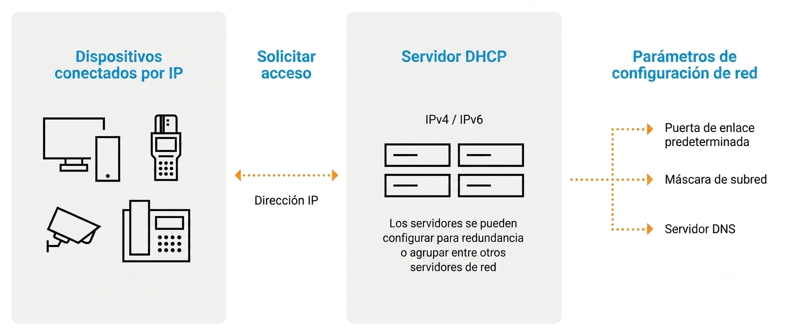

## 3 - Configuración de DHCP

### 3.1 Configuración de un equipo a la red informática

- Cualquier equipo que pertenece a una red requiere que se configure con unos parámetros mínimos, que son **la dirección IP, la máscara y la puerta de enlace por defecto**.  

- La dirección IP identifica al equipo de manera única, y la máscara permite determinar la red o subred en la que se encuentra el equipo.

- Con estos dos parámetros es suficiente para tener conectividad en la red. Si se quiere disponer de acceso fuera de la red propia (por ejemplo, a Internet o al resto de la red corporativa), es necesario definir también **la puerta de enlace predeterminada**.

- Aparte de la configuración básica, los equipos pueden necesitar (y de hecho lo necesitan) más parámetros de configuración como, por ejemplo: el nombre del host, el servidor DNS, el archivo de inicio a descargar, etc.

### 3.2 Asignación de IP

- Todo equipo de red necesita disponer de una dirección IP que lo identifique de manera única en la red.

- Ejemplo: La mayoría de los usuarios disponen en casa de un equipo (o más) conectados a un router que proporciona el acceso a Internet. Este equipo está configurado como cliente DHCP y, al iniciarse, recibe la configuración de red del router.

#### 3.2.1 Dirección IP estática

- Una dirección **IP estática** es una dirección que se asigna manualmente a un dispositivo y permanece fija a lo largo del tiempo.
- A diferencia de una **IP dinámica** (asignada por DHCP), la dirección estática no cambia, lo que es útil en casos donde se necesita una IP constante, como en servidores o dispositivos críticos.

> 💡 **Características de las direcciones IP estáticas:**
>
>     - **Permanencia:** La dirección no cambia, a menos que el administrador lo decida.
>     - **Configuración manual:** Las direcciones deben asignarse manualmente en el dispositivo o servidor de red.
>     - **Uso en dispositivos críticos:** Suelen asignarse a servidores, impresoras, routers, cámaras de seguridad y otros equipos que requieren estabilidad.
> ✅ **Ventajas de las IP estáticas:**
>
>     - **Acceso remoto constante:** Es más sencillo acceder a dispositivos de forma remota sin preocuparse por cambios de IP.
>     - **Estabilidad en servicios de red:** Es ideal para servicios que requieren una dirección IP fija, como servidores de correo, web o bases de datos.
>     - **Configuración de reglas de red:** Facilita la creación de reglas para firewalls o VPN, ya que la dirección es predecible.
!!! failure "Desventajas de las IP estáticas:"  
    - **Conflictos de IP:** Si no se gestiona adecuadamente, puede haber conflictos cuando dos dispositivos intentan usar la misma dirección.
    - **Mayor carga administrativa:** Requiere mayor trabajo manual, lo que aumenta la posibilidad de errores en redes grandes.
    - **Menor flexibilidad:** En redes con muchos dispositivos que se conectan y desconectan, las direcciones estáticas son menos prácticas.

#### 3.2.2 Dirección IP dinámica

- Una dirección **IP dinámica** es una dirección que se asigna automáticamente a un dispositivo por un servidor DHCP y puede cambiar con el tiempo.
- Esto permite una gestión más eficiente de las direcciones IP, especialmente en redes grandes o con muchos dispositivos que se conectan y desconectan.

> 💡 **Características de las direcciones IP dinámicas:**
>
>     - **Asignación automática:** El servidor DHCP asigna la dirección IP sin intervención manual.
>     - **Temporalidad:** La dirección puede cambiar después de un período de tiempo (lease time) o cuando el dispositivo se reconecta a la red.
>     - **Uso eficiente del espacio de direcciones:** Permite reutilizar direcciones IP, optimizando su uso en redes con muchos dispositivos.
> ✅ **Ventajas de las IP dinámicas:**
>
>     - **Facilidad de administración:** Reduce la carga administrativa al eliminar la necesidad de asignar direcciones manualmente.
>     - **Flexibilidad:** Ideal para redes con dispositivos que se conectan y desconectan frecuentemente, como laptops, smartphones y tablets.
>     - **Prevención de conflictos de IP:** El servidor DHCP gestiona las direcciones, minimizando el riesgo de conflictos.
> ℹ️ **Desventajas de las IP dinámicas:**
>
>     - **Cambio de dirección:** La dirección IP puede cambiar, lo que puede ser problemático para servicios que requieren una IP constante.
>     - **Dependencia del servidor DHCP:** Si el servidor falla, los dispositivos pueden no obtener una dirección IP válida.
>     - **Menor control sobre la asignación:** Puede ser más difícil rastrear qué dispositivo tiene qué dirección IP en un momento dado.
