## 5 - Tarea RA1-CEcd-1 - Instalación y configuración de un DHCP con Windows Server en AWS

!!! warning "Obligatorio seguir las normas para la presentación de trabajos escritos."

### 5.1 Objetivo de la práctica

- Desplegar un servidor DHCP en Windows Server sobre AWS con virtualización anidada.
- En este primer paso instalaremos y configuraremos el rol **DHCP Server** en Windows Server, y observaremos en tiempo real cómo varios equipos cliente obtienen su configuración IP (DHCPDISCOVER → OFFER → REQUEST → ACK), reservas, exclusiones, ámbitos (scopes), opciones de ámbito (DNS, puerta de enlace, etc.).

### 5.2 Limitaciones de AWS para el despliegue de un servicio DHCP

- Dentro de **una VPC** (virtual private cloud) de AWS, **el tráfico broadcast/multicast no se propaga entre instancias**.

- DHCP depende de broadcasts (`255.255.255.255`), así que un cliente en una instancia EC2 **nunca "verá" un DHCPOFFER** de otra instancia EC2 en la misma subred.  
- Cada tarjeta de red ENI (Elastic Network Interface) recibe su IP exclusivamente **del DHCP interno de AWS, que no se puede sustituir**.

- **Solución:** Montar toda la práctica **dentro** de una sola instancia EC2, usando un hipervisor anidado (Hyper-V) donde sí existe broadcast real entre las VMs virtuales.

> ℹ️ **Novedad Feb 2026**
>
> 
>     - Desde el **16 de febrero de 2026**, AWS soporta oficialmente virtualización anidada en instancias EC2 **normales** (no metal).  
>     - Familias soportadas actualmente: `C8i`, `M8i`, `R8i`, `C8id`, `R8id`, `M8id`, `C8i-flex`, `R8i-flex`, `M8i-flex`, `X8i`, `C7i`, `R7i`, `M7i`, `C7id`, `R7id`, `M7id`, `C7i-flex`, `R7i-flex`, `M7i-flex`, `I7i`. 
>     - Solo procesadores Intel (no Graviton). Hipervisores L1 soportados: **Hyper-V** y **KVM**.
### 5.3 Arquitectura del laboratorio

> ℹ️ **Diagrama de la infraestructura de red**
>
>     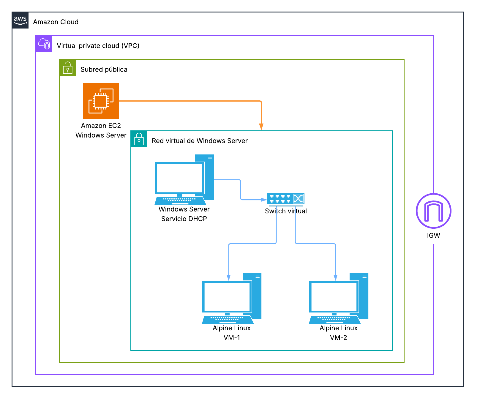


- Dispondremos de una instancia EC2 con Windows Server 2025 Base (ver apuntes de `Acceso y control remoto`), sobre la que instalaremos el rol **DHCP Server**.
- Configuraremos un **switch virtual interno** en Hyper-V, de modo que el tráfico broadcast/multicast quede confinado dentro del hipervisor.
- Lanzaremos 2 clientes Linux Alpine, que obtendrán su configuración IP del servidor DHCP de Windows Server.
- Observaremos en tiempo real cómo se produce el proceso de asignación de direcciones IP mediante DHCP (DORA: Discover → Offer → Request → Acknowledge) con el analizador de redes **Wireshark**.

#### 5.3.1 Activar la virtualización de EC2 en AWS

> ✅ **Activar la virtualización de la CPU por la consola de AWS**
>
> 
>     - Abrimos el **cloudshell de AWS**.  
>     
> 
>     - Escribimos los siguientes comandos:  
>     **Nota IMPORTANTE:** Cambiar la id del ejemplo por la **id de vuestra instancia**.
>     ```powershell
>     # 1. Parar la instancia (aunque la acabes de arrancar)
>     aws ec2 stop-instances --instance-ids i-069fe851e6325d765
> 
>     # 2. Esperar a que quede realmente parada
>     aws ec2 wait instance-stopped --instance-ids i-069fe851e6325d765
> 
>     # 3. Activar nested virtualization con el comando correcto
>     aws ec2 modify-instance-cpu-options \
>       --instance-id i-069fe851e6325d765 \
>       --nested-virtualization enabled
> 
>     # 4. Arrancarla de nuevo
>     aws ec2 start-instances --instance-ids i-069fe851e6325d765
>     ```
> 
>     - Powershell de AWS una vez abierto.
>     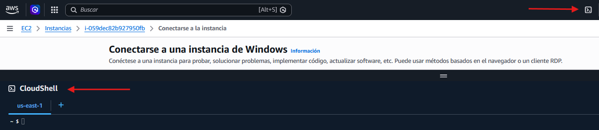
>     - Comandos en ejecución.  
>     ==Realizar captura de pantalla==  
>     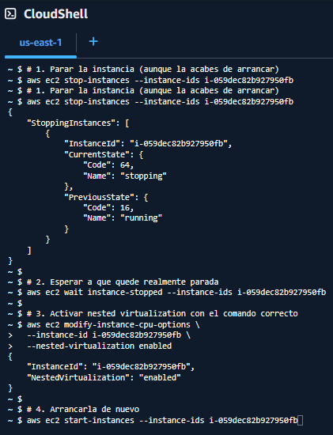
#### 5.3.2 Comprobar el nested virtualization en una instancia

Para ello, nos conectaremos a la instancia de Windows Server creada en prácticas anteriores.
> ℹ️ **Comprobación del Nested Virtualization**
>
> 
>     - Abrimos el Windows Powershell y escribimos el siguiente comando
>     ```powershell
>     Get-WindowsFeature -Name Hyper-V
>     ```
> 
>     - Si Obtenemos el siguiente resultado ([ ] vacío + Available), significa que está **disponible por no instalado**.
>     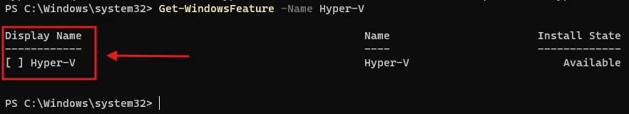
> ✅ **Activación del Nested Vitualization**
>
> 
>     - Activaremos la virtualización anidada con el siguiente comando.
>     ```powershell
>     Install-WindowsFeature -Name Hyper-V -IncludeManagementTools -Restart
>     ```
>     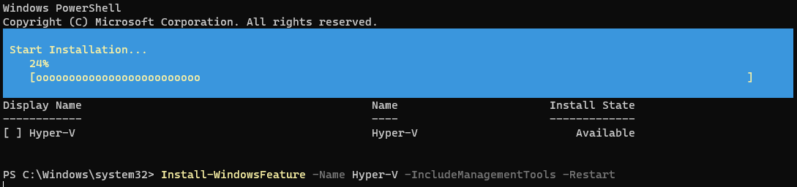
>     - Como hemos incluido la opción de reinicio del sistema (-Restart), perderemos la conexión con la instancia...
>     > ℹ️ **Comprobación del Nested Virtualization por CLI**
>
> 
>     - Nos conectamos de nuevo a la instancia.
>     Abrimos el Windows Powershell y escribimos el siguiente comando
>     ```powershell
>     Get-WindowsFeature -Name Hyper-V
>     ```
>     - Si nos aparece [X] Hyper-V, significa que el servicio se ha instalado correctamente.  
>     ==Realizar captura de pantalla==    
>     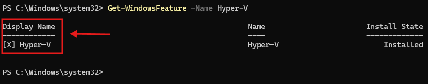
> ℹ️ **Comprobación del Nested Virtualization en la consola de Windows Server**
>
> 
>     - Abrimos el **Server Manager**.
>     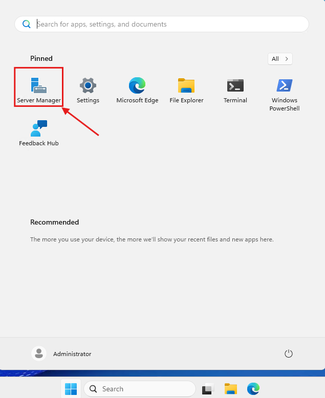
>     - Seleccionamos Local Server → Services → buscamos hyper-V  
>     ==Realizar captura de pantalla==    
>     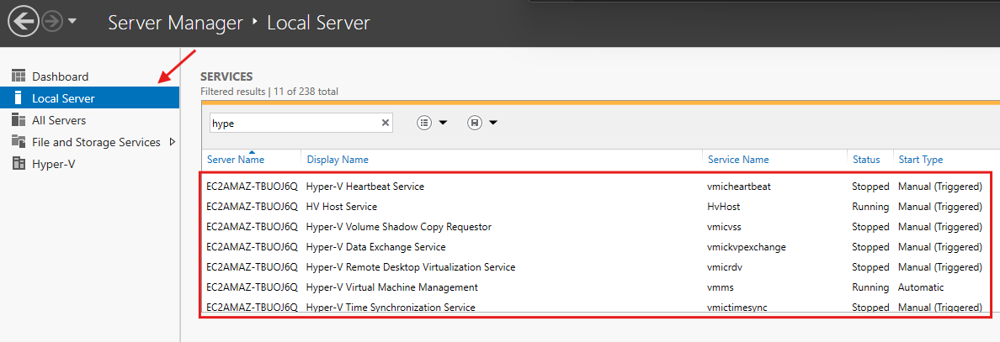
#### 5.3.3 Crear el switch virtual interno

- Vamos a **Hyper-V Manager** → **Virtual Switch Manager**:
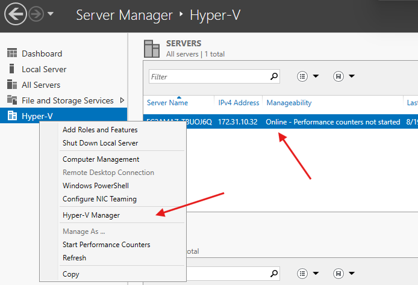

- Luego seleccionamos → **New virtual network switch**
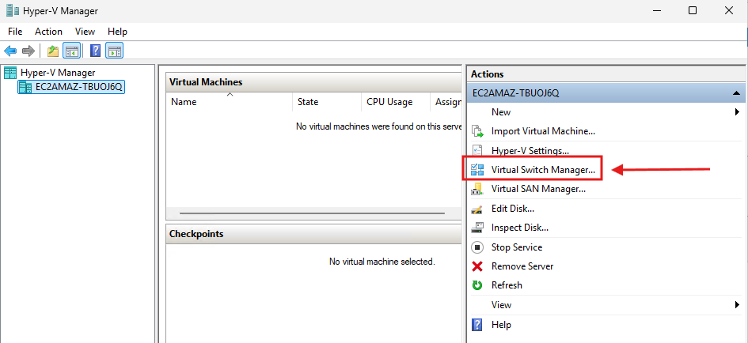

- Tipo: **Internal**. Esto asegura que el tráfico DHCP nunca saldrá hacia la red de AWS ni a otras instancias de la VPC/subred.
- También seleccionaremos **Enable virtual LAN id...**. De ese modo el adaptador de red virtual aparecerá como cualquier otro adaptador físico.  
==Realizar captura de pantalla==
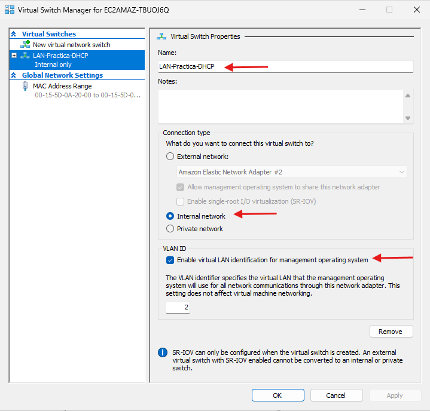
Después de **ipconfig**
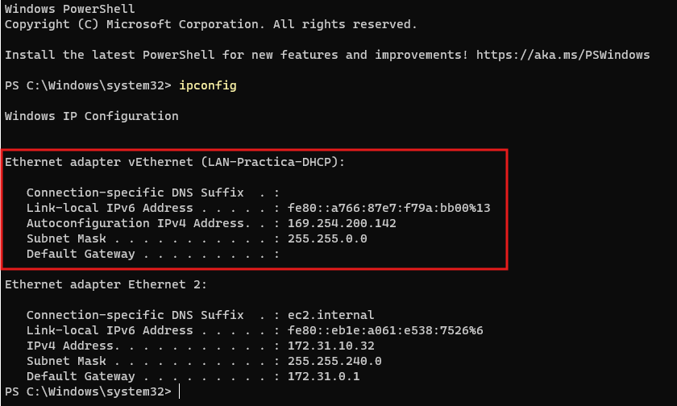

- Si volvemos a **Hyper-V** → **SERVERS** → Refrescamos el estado del servidor veremos que tenemos una IP interna del servidor en nuestra red virtual privada, siendo la otra IP, la IP de la instancia dentro de **la VPC de AWS**.  
==Realizar captura de pantalla==
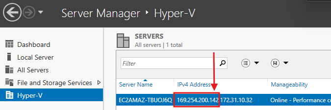

#### 5.3.4 Configurar los parámetros de red

- Como podemos ver en las capturas anteriores, el servidor tiene asignada la IP 169.254.200.142.
- Esto se debe a la falta de un servidor DHCP en la red virtual, lo que provoca la activación automática de una dirección APIPA (Automatic Private IP Addressing).
- Hasta que no despleguemos el servidor DHCP, la asignación de IPs en la red privada no podrá realizarse de forma automática, por lo que configuraremos manualmente la IP del servidor que más adelante hará el ROL de servidor DHCP.

- Nos dirigimos a **Local Server** → **Properties** → **vEthernet**
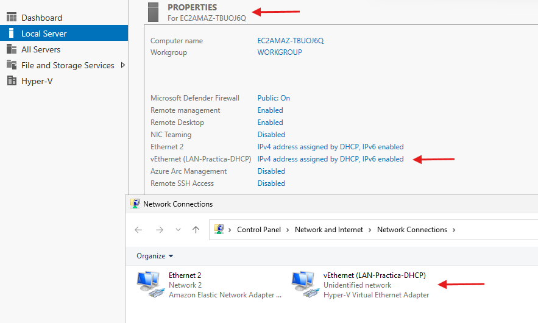

- Una vez encontrado el adaptador, configuraremos **el protocolo TCP/IPv4**.
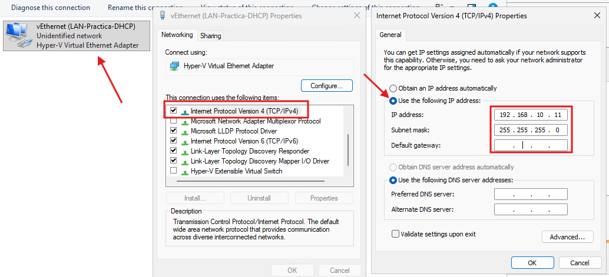

- Refrescamos la información y ya tendremos la IP esperada para nuestro servidor.  
==Realizar captura de pantalla==  
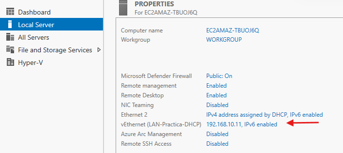

- Con esto ya tendremos montada la red virtual de Windows Server. El siguiente paso será montar el servicio DHCP sobre el servidor de Windows Server.
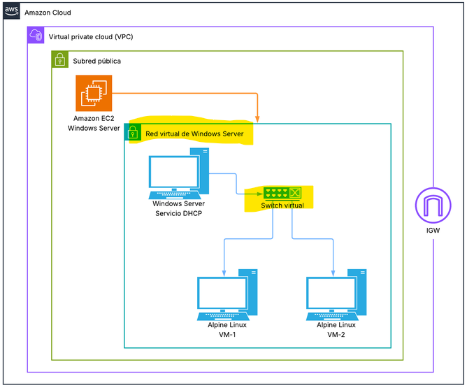

### 5.4 Instalación y configuración del rol DHCP en el host (Windows Server anfitrión)

#### 5.4.1 Instalar el rol DHCP

- Nos dirigimos a la consola de Windows Server y seleccionamos **Add roles and features**.
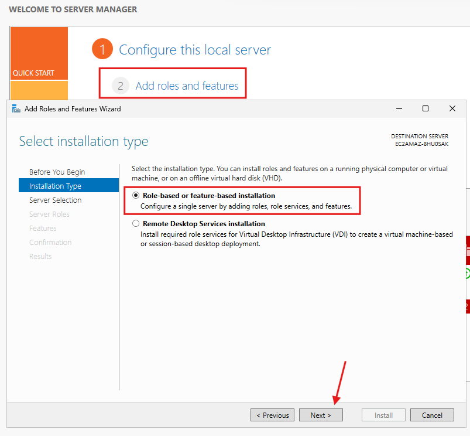
- En server roles seleccionamos el servicio que queremos implementar.  
==Realizar captura de pantalla==
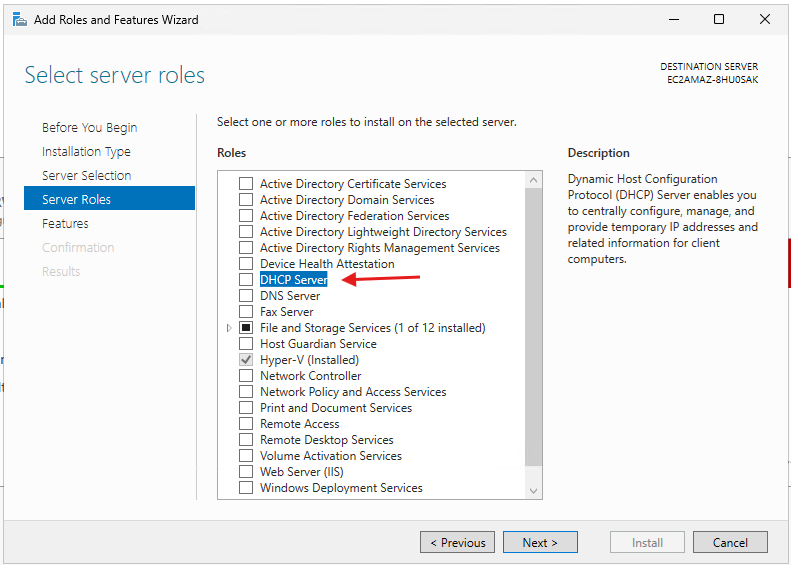
- Confirmamos las caracteristicas necesarias para el servivio DHCP.
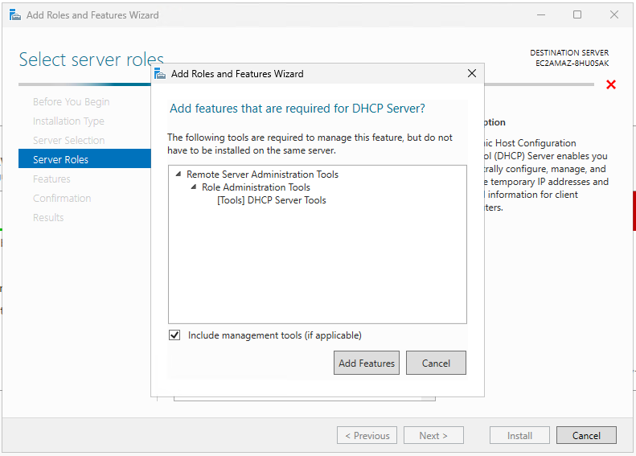
- Recordatorios: De nada sirve lanzar un servicio sin un planteamiento previo.
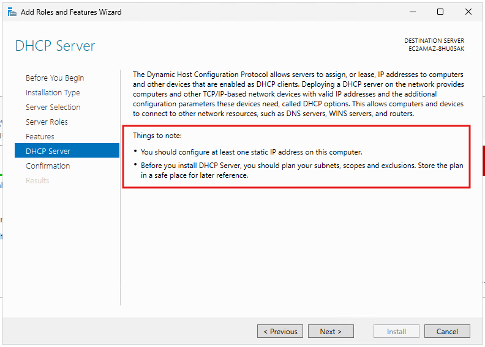
- La instalación del servicio DHCP **no requiere reinicio** pero, seleccionaremos la opción de todos modos.
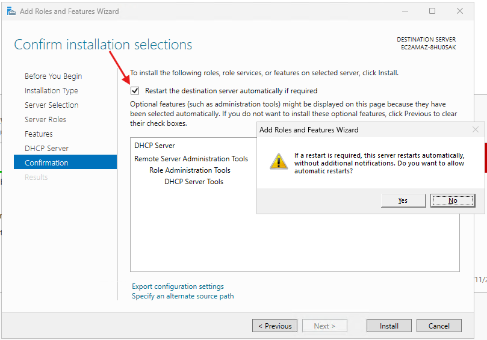
- Se inicia la instalación.
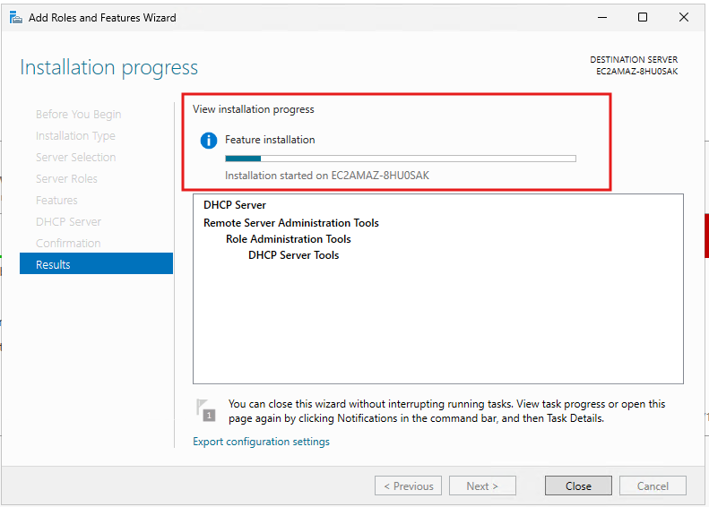
- Al final el instalador dirá que el DHCP requiere configuración. Lo haremos en el siguiente paso. De momento cerramos el asistente.
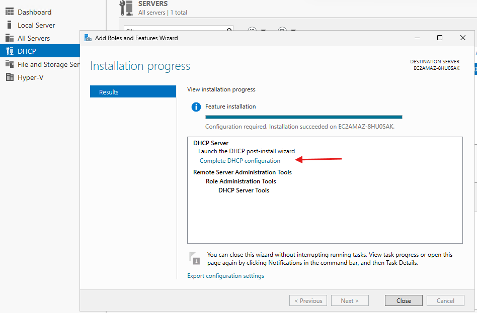

#### 5.4.2 Configurar el rol DHCP

- Volvemos al panel de control dónde veremos que tenemos el servicio DHCP disponible.
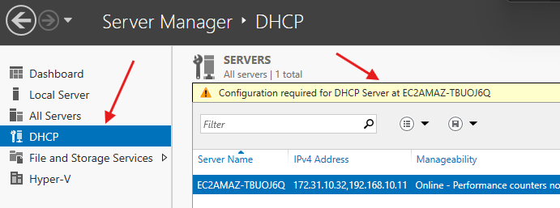
- Completamos la configuración del DHCP.
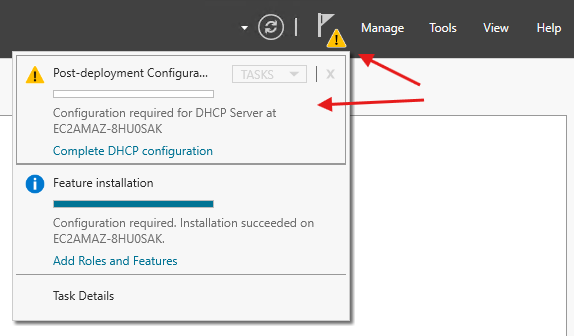
- Hacemos un commit.
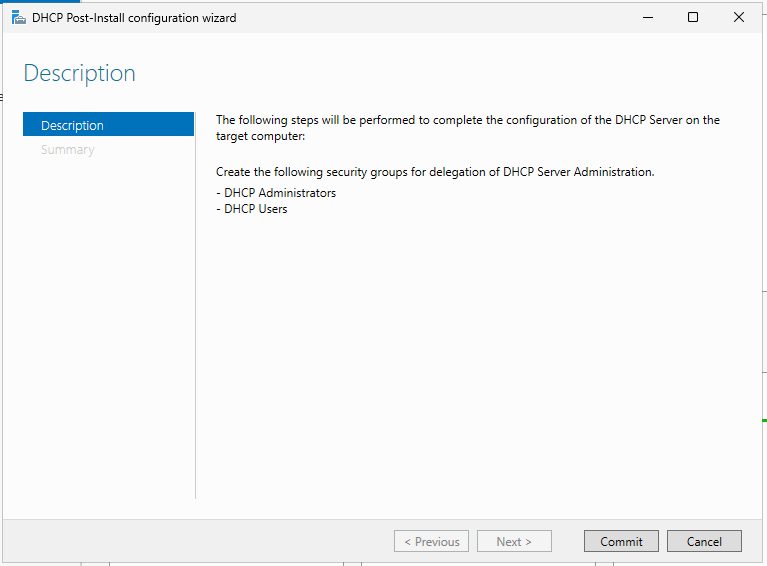
- Vamos al panel de control del DHCP y comprobamos que el servicio sobre IPv4 y IPv6 está implementado.
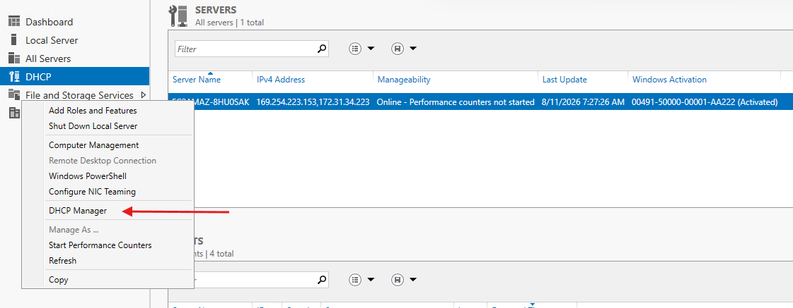  
==Realizar captura de pantalla==
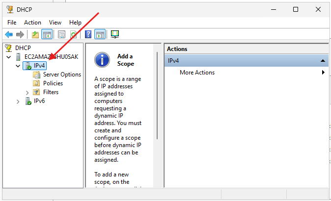

#### 5.4.3 Crear el ámbito (scope)

Una vez instalado el rol de servidor DHCP, el siguiente paso es crear un ámbito (scope), es decir, el rango de direcciones IP que el servidor podrá asignar automáticamente a los equipos de la red.

En este apartado configuraremos dicho rango junto con los parámetros básicos necesarios (máscara de subred, puerta de enlace, duración de la concesión, etc.) para que los clientes de la red privada puedan obtener su configuración de red de forma automática.

- Vamos a la consola de configuración de DHCP.
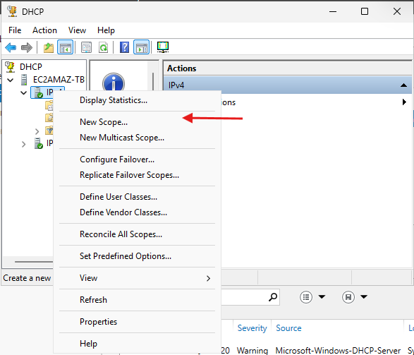
- Seleccionamos **new scope** y damos un nombre al ámbito.
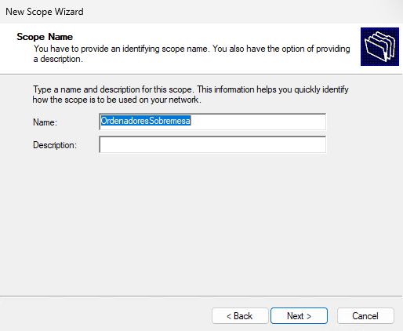
- Estableceremos un rango de direcciones en función de nuestras necesidades. También tendremos en cuenta dejar fuera del rango DHCP las direcciones IP reservadas para los sistemas que requieren **IP estática** (switches, servidores de dominio, servidores DHCP, impresoras o sistemas de almacenamiento en red).
- Por último, deberemos reservar otro rango de direcciones IP para los dispositivos no anclados a la red, como tabletas, ordenadores portátiles o teléfonos móviles.

    > ⚠️ **¡Cuidado!**
>
>         Dejar fuera del rango DHCP al servidor DHCP y a la puerta de enlace predeterminada, ya que si no lo hacemos, el servidor DHCP podría asignar estas direcciones a otros clientes, provocando conflictos de IP y problemas de conectividad en la red.  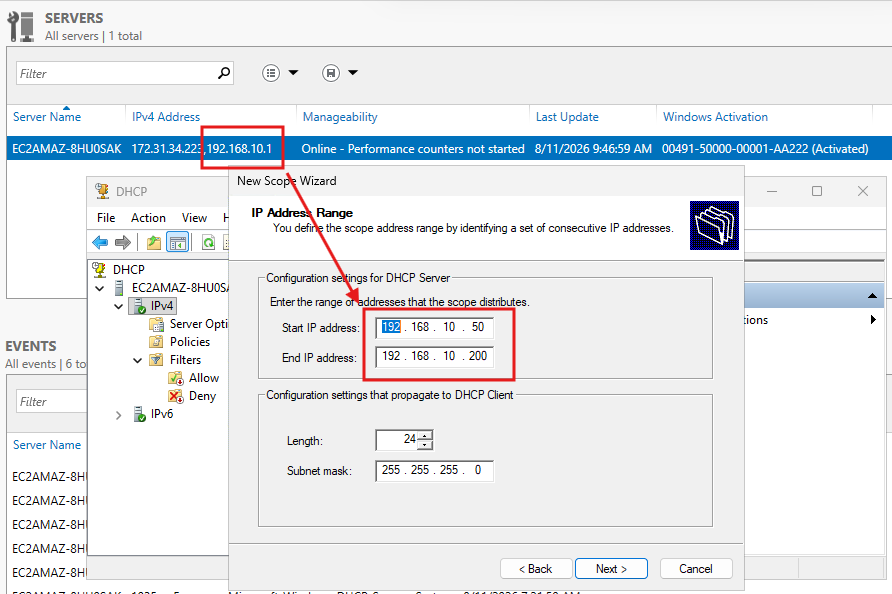

- Dejamos en blanco la pantalla de **Add Exclusions and Delay**.
- Configurar la duración del lease (lease duration) es decir, el tiempo durante el cual un cliente mantendrá asignada una dirección IP antes de tener que renovarla. Este valor debe ajustarse según el tipo de red y de dispositivos que la componen: en redes estables con equipos fijos conviene establecer una duración larga (varios días), mientras que en redes con gran cantidad de dispositivos móviles o temporales resulta más adecuado un lease corto, ya que permite liberar y reutilizar las direcciones IP con mayor frecuencia.
En nuestro caso, estableceremos una duración de lease de 8 días (valor por defecto).
- En **Configure DHCP Options** seleccionamos la opción **No** para configurarlo más adelante.
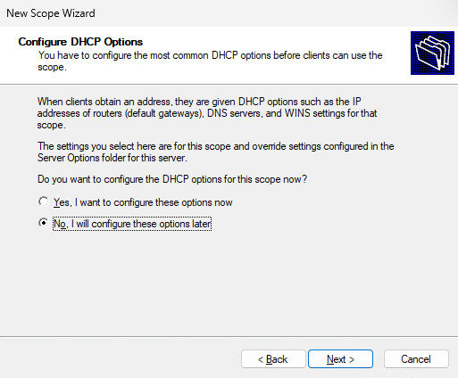
- En post installation no saldrá un aviso de reiniciar el servicio.
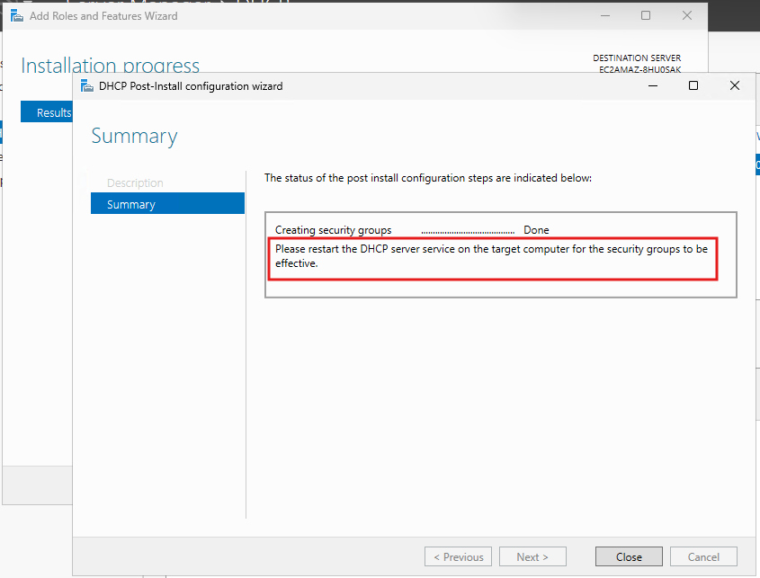
- Reiniciamos el servicio.
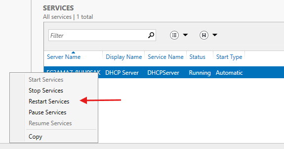

#### 5.4.4 Activar el scope

- Vamos a la consola de DHCP y veremos nuestro scope en rojo (desactivado).
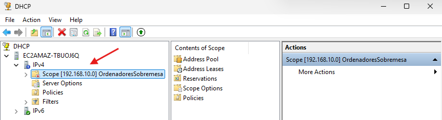
- Haremos clic derecho y lo activaremos.  
==Realizar captura de pantalla==
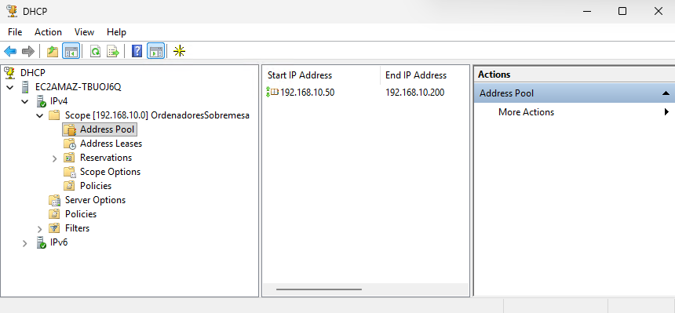

#### 5.4.5 Configurar opciones del ámbito

Las opciones de ámbito son parámetros de configuración adicionales que el servidor DHCP puede asignar a los clientes DHCP por ejemplo el DNS y la puerta de enlace (enrutador).

- Vamos a scope y seleccionamos **Configure Options...**
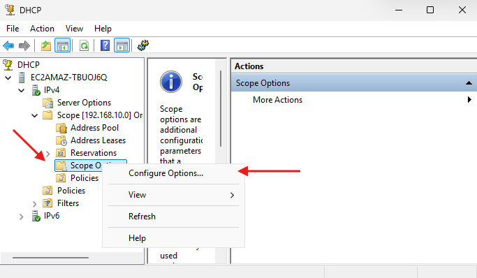
- Buscamos la opción **003 Enrutador**, que permitirá, **en un escenario real**, a las máquinas conectadas a la red acceder a Internet. **No configuraremos el DNS**, ya que lo veremos en otra unidad, ni definiremos un controlador de dominio, puesto que la implementación de **Active Directory** se tratará más adelante.  
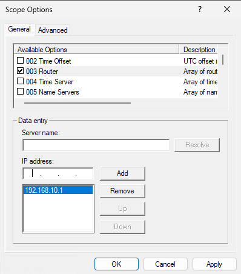
- Comprobamos que la opción se ha guardado correctamente.  
==Realizar captura de pantalla==  
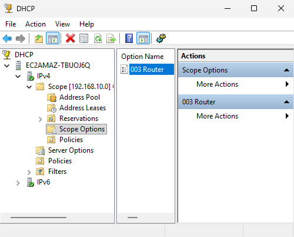

#### 5.4.6 Best Practices analyzer

No es una herramienta especifica del servicio DHCP sino de todo el ecosistema de Windows Server.

- Vamos a BPA → **TASKS** → Start BPA Scan
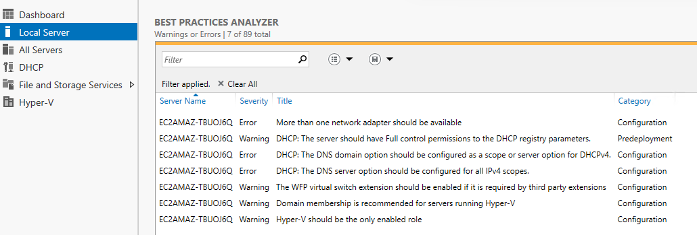

!!! note "Nota"  
    Algunos de los errores o advertencias que aparecen se deben a las limitaciones de nuestra infraestructura. No los tendremos en cuenta.

#### 5.4.7 Comprobar el servicio por CLI

```powershell
Get-DhcpServerV4Scope
Get-DhcpServerV4OptionValue -ScopeId 192.168.10.0
```

==Realizar captura de pantalla==  
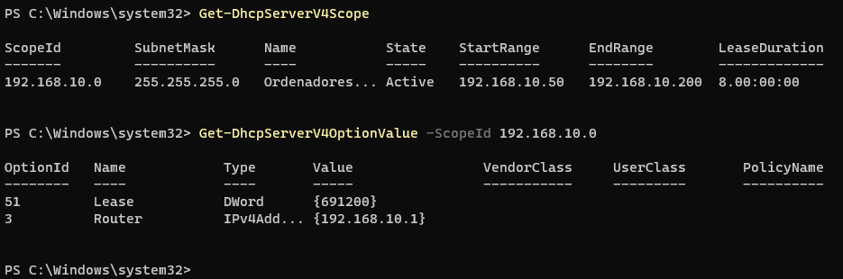

```powershell
ipconfig
```

==Realizar captura de pantalla==  
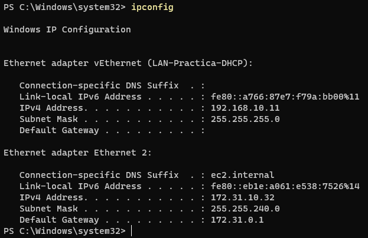

- Con esto ya tendremos montada la red virtual de Windows Server y el servidor DHCP. El siguiente paso será montar clientes con Alpine Linux y comprobar si las asignaciones de IP y el acceso a internet se hace correctamente.
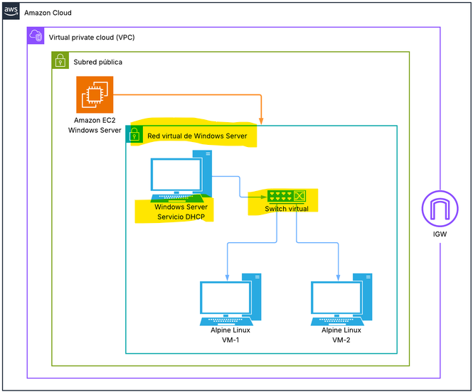

### 5.5 Creación de las máquinas virtuales cliente

- Con RAM limitada (`m7i.large` con 8 GiB), lo más eficiente es que **el propio host Windows Server actúe como servidor DHCP** y usar Hyper-V solo para las VMs cliente.  
- Como cliente, **Alpine Linux** es la opción más ligera (256–512 MB por VM) y perfectamente válida para ver el proceso DHCP completo.

#### 5.5.1 Creación de las carpetas de trabajo

Crearemos dos carpetas de trabajo: **ISOs** y **VMs**.

- **ISO** contendrá los archivos .iso de los sistemas operativos que descargaremos.
- **VM** contendrá los discos duros de las máquinas virtuales que lanzaremos.

La creación de las carpetas se puede realizar tanto desde el explorador de archivos como en línea de comandos:

```powershell
New-Item -Path "C:\ISO" -ItemType Directory -Force
New-Item -Path "C:\VM" -ItemType Directory -Force
```

#### 5.5.2 Descargar el ISO

- Como ya hemos comentado, descargaremos [Alpine Linux](https://alpinelinux.org/downloads/) al ser una versión muy ligera de linux.
- La versión elegida para nuestras prácticas será la versión optimizada para virtualización y arquitectura de 32 bits (Virtual + x86).
- Al igual que para la creación de las carpetas, la imagen se puede descargar con la ayuda del navegador o por línea de comandos.

```powershell
Invoke-WebRequest -Uri "https://dl-cdn.alpinelinux.org/alpine/v3.24/releases/x86/alpine-virt-3.24.1-x86.iso" -OutFile "C:\ISO\alpine.iso"
```

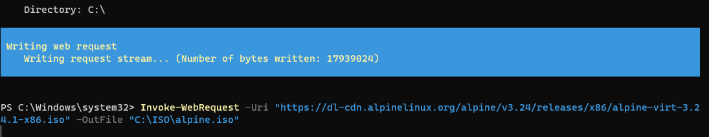

- Comprobamos que la descarga es correcta (debe rondar los 45-50 MB):

```powershell
Get-Item "C:\ISO\alpine.iso" | Select-Object Name, Length
```

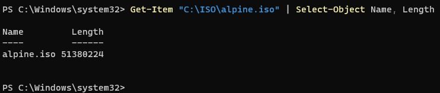

#### 5.5.3 Crear la VM

> 💡 **Podemos usar el asistente para la creación de la máquina virtual.**
>
> 
>     - Para ello iremos a **Hyper-V Manager** → **New** → **Virtual Machine**"
>     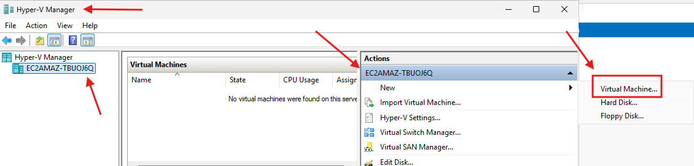
>     - Damos un nombre a la máquina.
>     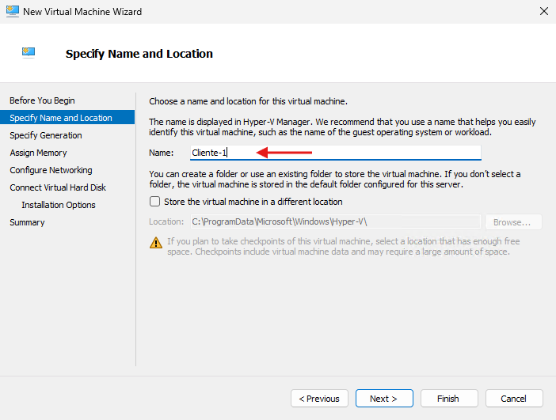
>     - Seleccionamos **Generation 1**.
>     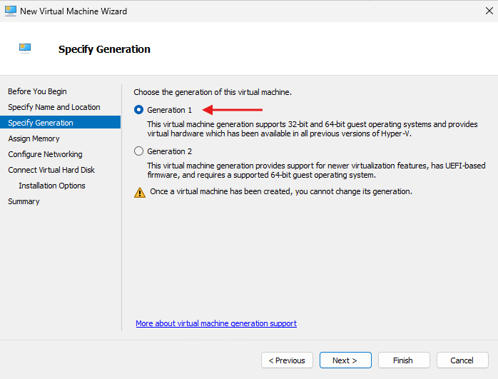
>     - Asignamos 512MB de memoria RAM para la máquina.
>     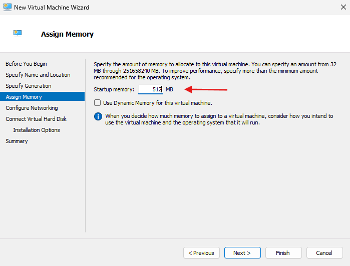
>     - Conectamos la máquina a nuestro switch virtual.
>     
>     - Disco duro virtual. Ubicaremos el disco duro en la carpeta **VM* creada anteriormente.
>     
>     - Opciones de instalación del SO. En **Image file** ponemos la ubicación de nuestra imagen.iso.
>     
>     - Finalizamos la creación de la máquina virtual.
>     
> 💡 **Creación de la máquina virtual por línea de comando.**
>
> 
>     - Declarar la máquina:
>     ```powershell
>     New-VM -Name "Cliente-1" `
>     -MemoryStartupBytes 256MB `
>     -Generation 1 `
>     -NewVHDPath "C:\VM\Cliente-1.vhdx" `
>     -NewVHDSizeBytes 4GB `
>     -SwitchName "LAN-Práctica-DHCP"
>     ```
> 
>     - Declarar la unidad de DVD  y montar el **ISO**.
>     
>         !!! warning "Las VMs Generation 1 traen una unidad de DVD por defecto (a diferencia de Generation 2, donde hay que añadirla explícitamente con Add-VMDvdDrive).<br>Por tanto, basta con usar Set-VMDvdDrive para montar la ISO en la unidad ya existente."
> 
>             ```powershell
>             Set-VMDvdDrive -VMName "CLIENTE-1" -Path "C:\ISOs\alpine.iso"
>             Get-VMDvdDrive -VMName "CLIENTE-1"   # debe mostrar el Path del ISO
>             ```
> 
>     - Definir el orden de arranque (DVD antes que red)
>     ```powershell
>     Stop-VM -Name "Cliente-1" -TurnOff -Force
>     Set-VMFirmware -VMName "Cliente-1" -FirstBootDevice (Get-VMDvdDrive -VMName "Cliente-1")
>     Start-VM -Name "Cliente-1"
>     ```
#### 5.5.4 Arrancar la VM

- Arrancamos la máquina virtual desde el **Hyper-V Manager**

- Esperamos a que se cargue el SO.

- La contraseña del login es **root**.  
==Realizar captura de pantalla==  


#### 5.5.5 Verificar la conexión a la red a la asignación de la IP por parte del DHCP

- Dentro de la consola de la VM confirmaremos el nombre real de la interfaz (eth0, enp0s3...):  
    ``` shell
    ip link show           
    ```

    ==Realizar captura de pantalla==
    

- Si aparece "state DOWN", levantaremos la interfaz.
    ```shell
    ip link set eth0 up    
    ```  

    

- Solicitamos una dirección IP con:
    ```shell
    udhcpc -i eth0
    ```

    ==Realizar captura de pantalla==  
    

- Como podemos ver, la solicitud no se realiza. Eso se puede deber a, al menos 2 causas.  
:one: No hemos asociado el **Switch Virtual** a nuestra **máquina anfitrión**.

:two: Cuando hemos creado el switch virtual hemos autorizado el VLAN ID → Lo deseleccionaremos.


- Solicitamos de nuevo una dirección IP:
    ```shell
    udhcpc -i eth0
    ```

    ==Realizar captura de pantalla==  
    

### 5.6 Supervisión del proceso de broadcast y asignación (DORA) con Wireshark

- En esta parte supervisaremos la activida de red con **Wireshark** para ver el proceso DORA: DHCPDISCOVER → DHCPOFFER → DHCPREQUEST → DHCPACK.
- Wireshark es un popular analizador de protocolos de red de código abierto.  
- Permite capturar y examinar **en tiempo real** el tráfico de datos que pasa por una red de comunicaciones, mostrando los paquetes individuales de información.

#### 5.6.1 Descargar e instalar Wireshark

> 💡 **Por línea de comandos**
>
>     ```powershell
>     Invoke-WebRequest -Uri "https://2.na.dl.wireshark.org/win64/Wireshark-latest-x64.exe" -OutFile "C:\Wireshark-installer.exe"
>     Start-Process "C:\Wireshark-installer.exe"
>     ```
> 💡 **Descargar desde la página oficial**
>
>     
#### 5.6.2 Primeras capturas con Wireshark

- Una vez en ejecución la aplicación nos mostrará todos los adaptadores de red disponibles.  
==Realizar captura de pantalla==  

- Si no se detecta ninguna actividad de red, ponemos forzar tráfico haciendo ping desde la máquina virtual con Alpine Linux a otros dispositvos de la red (en nuestro caso, a la instancia de `Windows Server`).  
De esa manera también nos aseguraremos que todo funciona correctamente.  
- Si no conseguimos hacer ping pero si podemos hacer ping desde nuestro servidor DHCP, es posible que se deba a la configuración del **firewall de windows**.  
Para ello ejecutaremos `wf.msc` y comprobaremos si tenemos restricciones sobre el tráfico `ICMP` de entrada a nuestra máquina `Windows-server`.

- después de solucionar posibles problemas, generaremos tráfico de red para familiarizarnos con la interfaz de `Wireshark`.  
==Realizar captura de pantalla==  


#### 5.6.3 Capturas del DORA entre MV y DHCP

- Wireshark solo captura el tráfico a partir del momento en el cual se está ejecutando. Por ese motivo deberemos forzar el DORA entre MV y DHCP. Para ello forzaremos a la MV a devolver la IP asignada y negociaremos otra.
- Primero comprobaremos que la MV está conectada a la red. Si no lo está levantaremos el servicio.  
==Realizar captura de pantalla==  

- Si la MV estaba conectada, devolveremos la IP asignada.

- Forzamos la negociación de una nueva IP con el servidor DHCP.  
==Realizar captura de pantalla==  

- Aplicando filtros o simplemente ordenando los protocolos en orden alfabetico podremos ver las 4 fases del procesa DORA.  
==Realizar captura de pantalla==  


### 5.7 Tarea RA1-CEfgh-1 - Creación de otra máquina virtual

Para comprobar que los conocimientos han sido asimilados correctamente.

1. Lanzar otra máquina virtual y comprobar con Wireshark el proceso DORA.  
==Realizar captura de pantalla==  
1. La máquina virtual podrá ser del mismo tipo que la MV anterior o estar montada con un SO de **Windows**.  
==Realizar captura de pantalla==  
1. Si elegís esta última opción, podreís descargar un SO de uso limitado desde [el centro de evaluación de Microsoft](https://www.microsoft.com/es-es/evalcenter/).

> 💡 **Comandos para devolver IP y solicitarla de nuevo**
>
>     ```cmd
>     ipconfig /release
>     ipconfig /renew
>     ipconfig /all
>     ```
