## 6 - Tarea RA1-CEcd-2 - Instalación y configuración de un DHCP con Ubuntu Server en AWS

### 6.1 Objetivo de la práctica

- Desplegar un servidor DHCP en Ubuntu Server 26.04 LTS sobre AWS con virtualización anidada.
- En este primer paso instalaremos y configuraremos el rol **DHCP Server** en Ubuntu Server, y observaremos en tiempo real cómo varios equipos cliente obtienen su configuración IP (DHCPDISCOVER → OFFER → REQUEST → ACK), reservas, exclusiones, ámbitos (scopes), opciones de ámbito (DNS, puerta de enlace, etc.).

### 6.2 Arquitectura del laboratorio

- Instancia EC2 (m7i.large, 60GB, Unbuntu Server 26.04 LTS
- Virtualización KVM + QEMU + libvirt)

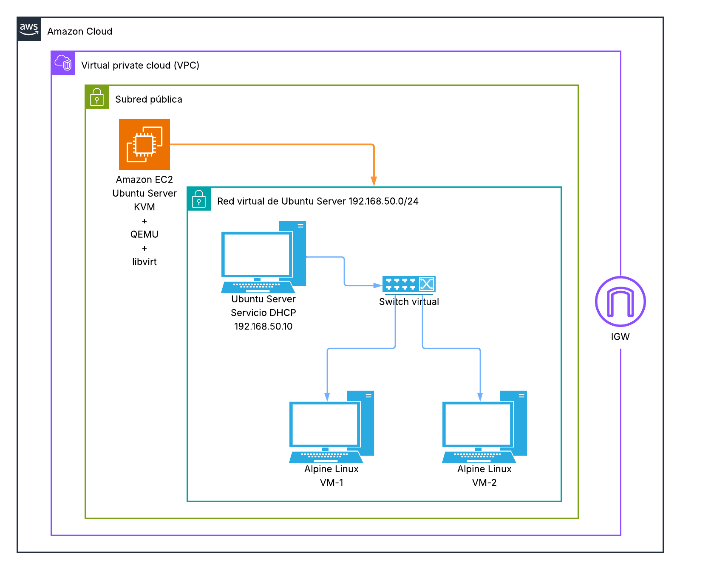

> ℹ️ **Explicación de los elementos de la arquitectura**
>
> 
>     - **KVM + QEMU + libvirt** es la pila de virtualización nativa de Linux y está pensada para virtualización de servidores. 
>         - **KVM** → proporciona la virtualización mediante el kernel.
>         - **QEMU** → ejecuta/emula el hardware de las máquinas virtuales.
>         - **libvirt** → capa de administración de KVM/QEMU.
>     - **virt-manager** → interfaz gráfica para administrar libvirt.
!!! tip "Equivalencia con Windows Server"  
    | Windows Server                    | Ubuntu Server                            |
    | --------------------------------- | ---------------------------------------- |
    | **Hyper-V**                       | **KVM + QEMU**                           |
    | Hyper-V Manager                   | **virt-manager**                         |
    | PowerShell / herramientas Hyper-V | **virsh / virt-install**                 |
    | Virtual Switch                    | **Redes virtuales de libvirt / bridges** |
    | VM                                | VM KVM/QEMU                              |
    | VHDX                              | qcow2 / raw                              |
    | Hyper-V NAT / switches            | NAT / bridge de libvirt                  |

### 6.3 Instalación de escritorios en Ubuntu Server 26.04

- Para facilitar algunas etapas de la configuración de esta práctica, instalaremos una interfaz gráfica sobre la instancia de Ubuntu Server que hemos creado anteriormente.
- Instalar un escritorio gráfico no se suele recomendar en entornos de producción, por rendimiento y seguridad pero, dentro de un contexto de prácticas, puede estar plenamente justificado.
- A continuación se dan los procedimientos de instalación de 2 escritorios: **Xfce Desktop Environment** y el muy conocido **GNOME**.

> 💡 **Instalación de XFCE + Xrdp**
>
> 
>     1. Nos conectamos a nuestra instancia desde la consola de AWS.
> 
>     1. Instalamos las actualizaciones disponibles en los repositorios.
>     ```bash
>     sudo apt update && sudo apt upgrade -y
>     ```
> 
>     1. Instalamos XFCE y Xrdp
>     ```bash
>     # Instalamos el entorno gráfico, el servidor de escritorio remoto y el componente que permite a Xrdp utilizar Xorg.
>     sudo apt install -y xfce4 xfce4-goodies xrdp xorgxrdp
>     ```
> 
>     1. Configurar la sesión gráfica.
>     ```bash
>     echo "startxfce4" > ~/.xsession
>     ```
> 
>     1. Crear un nuevo usuario
>     ```bash
>     sudo adduser NuevoUsuario
>     ```
> 
>     1. Dar al nuevo usuario los mismos privilegios que los que tenemos con el usuario `ubuntu`
>     ```bash
>     sudo usermod -aG $(id -nG ubuntu | sed 's/ /,/g') NuevoUsuario
>     echo 'NuevoUsuario ALL=(ALL) NOPASSWD:ALL' | sudo tee /etc/sudoers.d/90-NuevoUsuario
>     sudo chmod 440 /etc/sudoers.d/90-NuevoUsuario
>     ```
> 
>     1. Comprobar que funciona:
>     ```bash
>     sudo visudo -c
>     su - NuevoUsuario
>     sudo whoami
>     ```
> 
>     1. Configurar el servicio Xrdp
>     ```bash
>     sudo adduser xrdp ssl-cert
>     sudo systemctl enable --now xrdp
>     sudo systemctl restart xrdp
>     ```
> 💡 **Instalación de GNOME desde 0 sobre una máquina Ubuntu Server 26.04 recién lanzada**
>
> 
>     1. Actualizar
>     ```bash
>     sudo apt update && sudo apt upgrade -y
>     # Comprobar si es necesario hacer reboot
>     ```
> 
>     1. Crear un nuevo usuario
>     ```bash
>     sudo adduser NuevoUsuario
>     ```
> 
>     1. Dar al nuevo usuario los mismos privilegios que los que tenemos con el usuario `ubuntu`
>     ```bash
>     sudo usermod -aG $(id -nG ubuntu | sed 's/ /,/g') NuevoUsuario
>     echo 'NuevoUsuario ALL=(ALL) NOPASSWD:ALL' | sudo tee /etc/sudoers.d/90-NuevoUsuario
>     sudo chmod 440 /etc/sudoers.d/90-NuevoUsuario
>     ```
> 
>     1. Comprobar que funciona:
>     ```bash
>     sudo visudo -c
>     su - NuevoUsuario
>     sudo whoami
>     ```
>     
>     1. Instalar GNOME y RDP (kdump-tools: elegir "No")
>     ```bash
>     # Escritorio completo
>     sudo apt install ubuntu-desktop gnome-remote-desktop pkexec openssl -y
>     # Escritorio minimo (instalar este)
>     sudo apt install ubuntu-desktop-minimal gnome-remote-desktop pkexec openssl -y
>     ```
>     Si durante la instalación aparece la pantalla siguiente, eligiremos **No** como opción.  
>     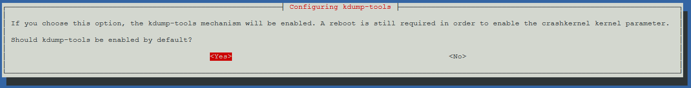
>         
>         !!! note "¿Qué es kdump-tools"
>             - **kdump-tools** es un mecanismo que, cuando el kernel sufre un fallo grave (kernel panic), arranca un segundo kernel pequeño para guardar un volcado de memoria (crash dump). Ese volcado sirve para que un desarrollador o administrador analice después por qué falló el sistema.
>             - Es una herramienta de diagnóstico avanzado, pensada sobre todo para servidores en producción o depuración del kernel.
>             - Reserva una parte de la RAM de forma permanente (el parámetro crashkernel), que no podrá usarse para otra cosa. En equipos con poca memoria, eso se nota.
>             - Para un uso normal o de pruebas, no aporta nada.
> 
>     1. Generar un certificado TLS directamente en su ubicación final
>     ```bash
>     sudo mkdir -p /etc/gnome-remote-desktop
>     sudo openssl req -new -newkey rsa:4096 -days 365 -nodes -x509 \
>       -subj "/CN=ubuntu-server" \
>       -out /etc/gnome-remote-desktop/rdp.crt \
>       -keyout /etc/gnome-remote-desktop/rdp.key
>     ```
> 
>     1. Cambiar permisos (antes de grdctl)
>     ```bash
>     sudo chown gnome-remote-desktop:gnome-remote-desktop /etc/gnome-remote-desktop/rdp.crt /etc/gnome-remote-desktop/rdp.key
>     sudo chmod 644 /etc/gnome-remote-desktop/rdp.crt
>     sudo chmod 600 /etc/gnome-remote-desktop/rdp.key
>     ```
> 
>     1. Configurar RDP con grdctl (herramienta para configurar GNOME Remote desktop)
>     ```bash
>     sudo grdctl --system rdp set-tls-cert /etc/gnome-remote-desktop/rdp.crt
>     sudo grdctl --system rdp set-tls-key /etc/gnome-remote-desktop/rdp.key
>     sudo grdctl --system rdp set-credentials NuevoUsuario CONTRASEÑA
>     sudo grdctl --system rdp enable
>     ```
> 
>     1. Arranque gráfico y servicio 
>     ```bash
>     sudo systemctl set-default graphical.target
>     sudo systemctl enable --now gnome-remote-desktop.service
>     sudo grdctl --system status
>     ```
> 
>     1. Reiniciar
>     ```bash
>     sudo reboot now
>     ```
> 
>     1. Verificamos que el sistema arranca en modo gráfico con:
>     ```bash
>     systemctl get-default
>     systemctl status gdm3
>     systemctl status gnome-remote-desktop
>     ```
>     ### 6.4 Primera conexión por escritorio gráfico a Ubuntu Server (XFCE + Xrdp)

- Lanzamos desde Windows la aplicación de conexión a escritorio remoto e introducimos la contraseña de nuestra máquina.  
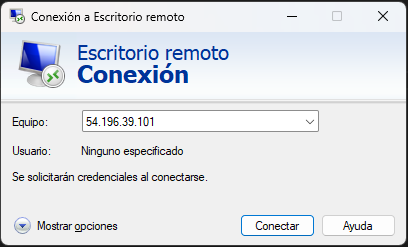
- Para la práctica, no tendremos en cuenta la advertencias de seguridad.
- Introducimos nuestras credenciales en la pasarela (servidor Xrdp).
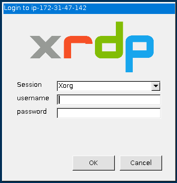


- Un vez iniciada la sesión estaremos en el escritorio gráfico típico de XFCE.
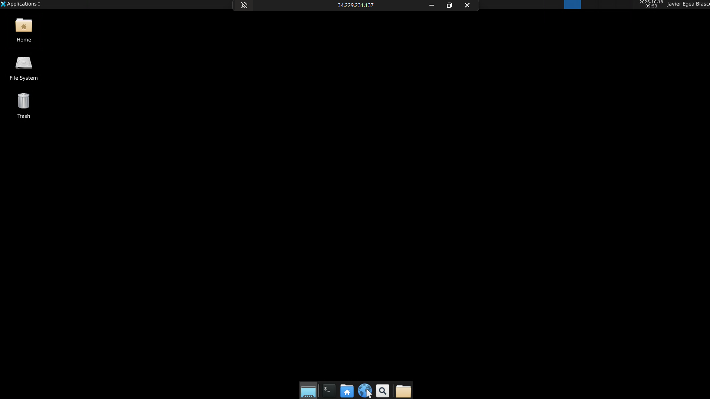

### 6.5 Activar la virtualización de la CPU por la consola de AWS

> ✅ **Activar la virtualización de la CPU por la consola de AWS**
>
> 
>     - Abrimos el cloudshell de AWS y escribimos los siguientes comandos:  
>     !!! warning "Cambiar la id por la id de vuestra instancia"
>     ```bash
>     # 1. Parar la instancia. También se puede hacer desde la consola de AWS. 
>     aws ec2 stop-instances --instance-ids i-069fe851e6325d765
> 
>     # 2. Esperar a que quede realmente parada
>     aws ec2 wait instance-stopped --instance-ids i-069fe851e6325d765
> 
>     # 3. Activar nested virtualization con el comando correcto
>     aws ec2 modify-instance-cpu-options \
>       --instance-id i-069fe851e6325d765 \
>       --nested-virtualization enabled
> 
>     # 4. Arrancarla de nuevo
>     aws ec2 start-instances --instance-ids i-069fe851e6325d765
>     ```
> 💡 **Comprobar la virtualización de la instancia**
>
> 
>     - Desde la consola de AWS ejecutamos el comando
>     ```bash
>     aws ec2 describe-instances --instance-ids i-069fe851e6325d765 \
>     --query "Reservations[].Instances[].CpuOptions"
>     ```
>     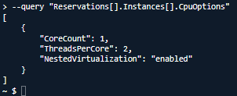
>     - También lo podemos comprobar desde la propia instancia con:
>     ```bash
>     egrep -c '(vmx|svm)' /proc/cpuinfo
>     ```
>     Si nos devuelve un valor mayor que 0, significa que la CPU expone las extensiones de virtualización (Intel VT-x/ AMD AMD-V).  
>     ==Realizar captura de pantalla==  
>     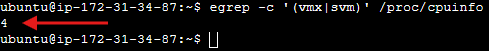
>     - Otra manera sería usando la aplicación **cpu-checker**
>     ```bash
>     sudo apt update
>     sudo apt install -y cpu-checker
>     sudo kvm-ok
>     ```
>     ==Realizar captura de pantalla==
>     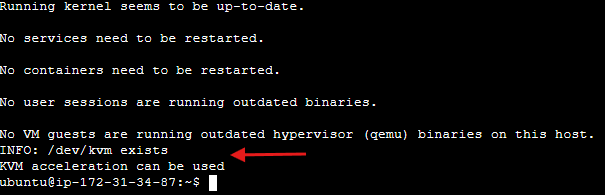
### 6.6 Instalación de KVM y herramientas relacionadas

- Instalaremos KVM y las herramientas relacionadas con:

    ```bash
    sudo apt install -y qemu-system-x86 qemu-utils libvirt-daemon-system libvirt-clients bridge-utils virtinst virt-manager
    ```

    > ℹ️ **Explicación de las aplicaciones instaladas**
>
>         - **qemu-system-x86** → emulador QEMU para x86, que usa KVM como aceleración porhardware.
>         - **libvirt-daemon-system / libvirt-clients** → capa de gestión (permite usar `virsh`,`virt-install`, etc.).
>         - **qemu-utils** → utilidades para manejar discos virtuales (`qemu-img`).
>         - **bridge-utils** → herramientas para crear redes puente entre las VMs.
>         - **virtinst** → herramientas para crear VMs desde línea de comandos (`virt-install`).
>         - **virt-manager** → interfaz gráfica de gestión (solo si disponemos de entorno gráfico).
### 6.7 Añadir usuarios a los grupos necesarios

- Para poder utilizar las opciones de virtualización deberemos añadir nuestro usuario **a los grupos `libvirt` y `kvm`**:

    ```bash
    sudo usermod -aG libvirt,kvm $USER
    ```

> ⚠️ **Cerrar sesión para aplicar los cambios**
>
>     Es necesario cerrar sesión y volver a iniciarla (o reiniciar) para que los nuevos grupos surtan efecto.
### 6.8 Comprobar que el servicio libvirt está activo

- Lo comprobaremos con:
    ```bash
    sudo systemctl status libvirtd
    ```
    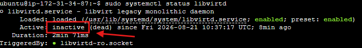

- Si, como en el caso de la imagen, nos muestra `inactive`, los activaremos con:

    ```bash
    sudo systemctl start libvirtd
    sudo systemctl status libvirtd
    ```
    ==Realizar captura de pantalla==
    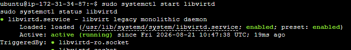

### 6.9 Verificar que /dev/kvm existe y comprobar los permisos de usuario del directorio

- Lo verificaremos con:
    ```bash
    ls -l /dev/kvm
    ```
    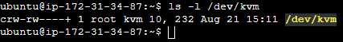

    > ℹ️ **Nota**
>
>         - **rw-rw----+** → El propietario **root** y el grupo **kvm** tienen permisos de lectura y escritura (rw-).
>         - El símbolo + indica que tiene Listas de Control de Acceso (ACL) adicionales aplicadas.
### 6.10 Listar el hipervisor detectado

- Listaremos los servicios de virtualización con:

    ```bash
    virsh list --all
    ```

    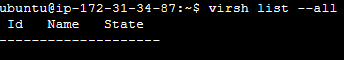

    > ℹ️ **Nota**
>
>         A esta altura de la práctica, que la lista esté vacía no es motivo de preocupación. Aún no hemos creado ninguna máquina virtual.
> 
>     !!! tip "De no devolver un error tipo *failed to connect to the hypervisor* confirma que:"
> 
>         - **libvirtd** se está ejecutando correctamente.
>         - Nuestro usuario tiene permisos **para comunicarse con el hipervisor**.
>         - **KVM/QEMU** están listos para usarse.
### 6.11 Aplicación Virt-Manager

- Si nos conectamos por escritorio remoto, también podremos ver que el asistente (gráfico) de virtualización (virt-manager) está instalado.
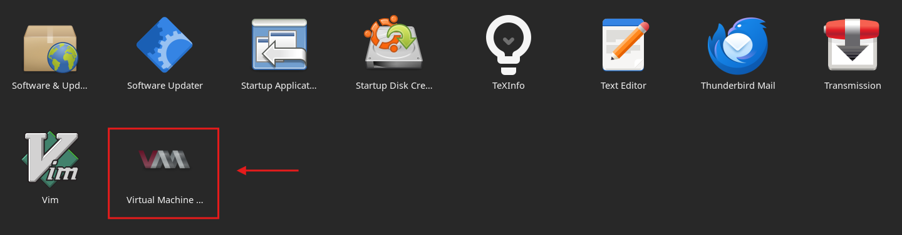
- Escritorio de Virt-Manager
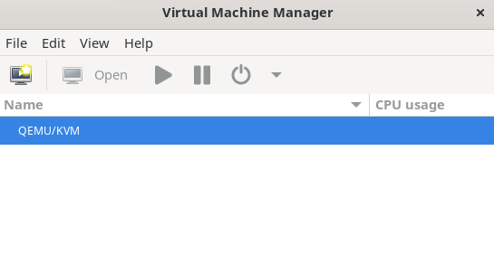

### 6.12 Crear la red aislada y el switch virtual sin acceso al exterior

- Como el la práctica anterior, crearemos una red privada para evitar conflictos con AWS a la hora de asignar IPs.

    ```bash
    cat > /home/ubuntu/Documents/RedPrivada.xml << 'EOF'
    <network>
        <name>RedPrivada-DHCP</name>
        <bridge name='Switch-Virtual' stp='on' delay='0'/>
    </network>
    EOF

    sudo virsh net-define /home/ubuntu/Documents/RedPrivada.xml
    sudo virsh net-start RedPrivada-DHCP
    sudo virsh net-autostart RedPrivada-DHCP
    ```

    > ⚠️ **Importante: Red en modo aislado**
>
>         - Al **no** incluir ningún bloque `<forward>` ni `<ip>`, esta red queda en modo *isolated*.
>         - Libvirt no le asigna su propio servidor DHCP interno ni la conecta a internet.
>         - Las VMs conectadas **no recibirán IP automáticamente**: De eso se encaragará el servidor DHCP que implementaremos más adelante.
- Verificaremos que se ha creado switch virtual correctamente:  

    ```bash
    ip link show Switch-Virtual
    virsh net-list --all
    ```  
    ==Realizar captura de pantalla==
    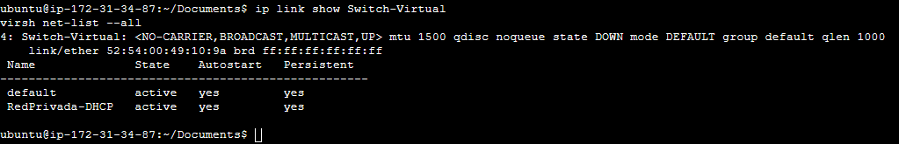

### 6.13 Configurar el switch virtual

- A diferencia de la práctica de Windows Server, aquí sí que podemos / debemos asignar un IP al switch virtual.

    ```bash
    sudo ip addr add 192.168.50.1/24 dev Switch-Virtual
    sudo ip link set Switch-Virtual up
    ```

    > ⚠️ **En estas condiciones, el switch virtual no es persistente. Eso quiere decir que lo tendremos que iniciar cada vez que retomemos la práctica.**
>
>         Por ejemplo si ejecutamos el comando:
>         ```bash
>         ip -br -4 addr show Switch-Virtual
>         ```
>         Obtendremos:  
>         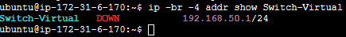  
> 
>         !!! warning "El <span style="color: red">DOWN</span> no significa un problema con nuestra red. Solo nos indica que, de momento, no hay ninguna máquina virtual conectada a la red"
> 
>         Si reiniciamos la máquina o el servicio veremos:
>         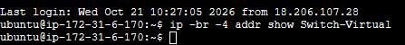
>         
>         !!! question "¿Qué podemos interpretar acerca del servicio del switch virtual?"
- Para evitar de tener que volver a asignar la IP al switch virtual y el posterior reinicio del servicio haremos lo siguiente:

    > 💡 **Editar el archivo `RedPrivada.xml`**
>
>         Dentro del archivo creado justo antes añadiremos una línea que especificará la IP y la mascara de red del switch virtual.
>         ```bash
>         <network>
>           <name>RedPrivada-DHCP</name>
>           <bridge name='Switch-Virtual' stp='on' delay='0'/>
>           <ip address='192.168.50.1' netmask='255.255.255.0'/>
>         </network>
>         ```
> 
>     !!! tip "Aplicar los cambios"
>         ```bash
>         sudo virsh net-destroy RedPrivada-DHCP
>         sudo virsh net-undefine RedPrivada-DHCP
>         sudo virsh net-define /home/ubuntu/Documents/RedPrivada.xml
>         sudo virsh net-start RedPrivada-DHCP
>         sudo virsh net-autostart RedPrivada-DHCP
>         ```
> 
>         - Tras el reinicio, comprobar el estado del servicio del switch virtual.
>         ```bash
>         ip addr show Switch-Virtual
>         
>         ```
> 
>     !!! tip "Comandos útiles"
>         1. ip -br link # Resumen de todas las interfaces
>         1. ip -br addr # Interfaces con sus IPs
>         1. ip link show type bridge # Solo bridges
>         1. ip -d link show `<interfaz>` # Detalles de una interfaz
>         1. bridge link # Interfaces conectadas a bridges
>         1. bridge fdb show # Tabla de direcciones MAC
>         1. ip route # Tabla de rutas


### 6.14 Configurar la máquina anfitriona como servidor DHCP

- Instalamos el servicio DHCP

    ```bash
    sudo apt install -y isc-dhcp-server
    ```

- Definiremos qué interfaz debe escuchar el servidor DHCP editando el archivo `/etc/default/isc-dhcp-server`

    ```bash
    sudo nano /etc/default/isc-dhcp-server
    ```

- Bajamos hasta la línea INTERFACESv4="" y ponemos el valor `Switch-Virtual`.

    ```
    INTERFACESv4="Switch-Virtual"
    ```

    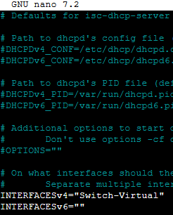

### 6.15 Configurar el ámbito de nuestro servidor DHCP

- Para configurar el ámbito editaremos el archivo `/etc/dhcp/dhcpd.conf`

    ```bash
    sudo nano /etc/dhcp/dhcpd.conf
    ```

- Añadiremos al final:

    ```
    subnet 192.168.50.0 netmask 255.255.255.0 {
      range 192.168.50.100 192.168.50.200;
      option routers 192.168.50.1;
      option domain-name-servers 8.8.8.8;
      option subnet-mask 255.255.255.0;
      default-lease-time 600;
      max-lease-time 7200;
    }
    ```

    ==Realizar captura de pantalla==  
    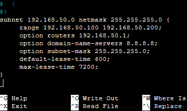

### 6.16 Arrancar el servicio DHCP

- Para arrancar el servicio y comprobar que el servicio se ha levantado correctamente usaremos:

    ```bash
    sudo systemctl enable isc-dhcp-server
    sudo systemctl restart isc-dhcp-server
    sudo systemctl status isc-dhcp-server
    ```

    ==Realizar captura de pantalla==  
    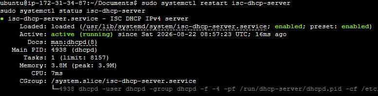

> ⚠️ **Si falla al arrancar**
>
> 
>     - Revisar si `INTERFACESv4` apunta a una interfaz que no existe todavía o el archivo `dhcpd.conf` contiene un error de sintaxis.
>     - Si hay un error de sintaxis usar:
>         ```bash
>         sudo dhcpd -t -cf /etc/dhcp/dhcpd.conf
>         ```
### 6.17 Habilitar el servicio DHCP y ordenarlo después de libvirt

- Por defecto, el servicio DHCP no se inicia solo: cada vez que arranquemos la instancia habría que lanzarlo manualmente.
- Si lo habilitamos para el arranque, debemos asegurarnos de que se inicie **después** de que libvirtd haya creado el switch virtual. si no, fallará porque la interfaz aún no existe.

- Primero habilitamos el servicio:

    ```bash
    sudo systemctl enable isc-dhcp-server
    ```

- Después creamos un *override* de la unidad de systemd:

    ```bash
    sudo systemctl edit isc-dhcp-server
    ```

- Dentro del editor escribiremos:

    ```ini
    [Unit]
    After=libvirtd.service
    Wants=libvirtd.service

    [Service]
    Restart=on-failure
    RestartSec=5
    ```

    > ℹ️ **Nota**
>
>         - `After=` → isc-dhcp-server arranca después de libvirtd.
>         - `Wants=` → al arrancar el DHCP, systemd intenta iniciar también libvirtd, pero si este falla o se reinicia, el DHCP no se detiene. (Con `Requires=` sí se detendría.)
>         - `Restart=on-failure` → si el servicio termina con error, systemd lo reinicia automáticamente.
>         - `RestartSec=5` → espera 5 segundos entre reintentos.
- Guardamos, recargamos systemd y reiniciamos el servicio:

    ```bash
    sudo systemctl daemon-reload
    sudo systemctl restart isc-dhcp-server
    sudo systemctl status isc-dhcp-server
    ```

> ⚠️ **La red de libvirt debe tener IP al arrancar**
>
>     - `After=libvirtd.service` no garantiza que el switch virtual tenga ya su IP.
>     - Para ello, la red debe estar en autostart (`sudo virsh net-autostart RedPrivada-DHCP`) y su XML debe incluir el bloque `<ip address='192.168.50.1' netmask='255.255.255.0'/>`.
### 6.18 Descargar la imagen de las máquinas virtuales cliente

Igual que en la práctica de Windows Server, usaremos **Alpine Linux** por su ligereza (256–512 MB por VM).

- Podemos usar el escritorio gráfico para descargar la iso del SO de Alpine Linux pero, lo haremos por línea de comando.

    ```bash
    sudo mkdir -p /var/lib/libvirt/images
    sudo mkdir -p /var/lib/libvirt/vm
    sudo wget -O /var/lib/libvirt/images/alpine.iso https://dl-cdn.alpinelinux.org/alpine/v3.24/releases/x86/alpine-virt-3.24.1-x86.iso
    sudo ls -lh /var/lib/libvirt/images/alpine.iso   
    ```

    ==Realizar captura de pantalla==  
    Mostrar el contenido de la carpeta `/var/lib/libvirt/images/`.
    

> ℹ️ **¿Por qué `/lib/libvirt` y no cualquier otra carpeta?**
>
> 
>     - El proceso QEMU que ejecuta la VM se lanza con el usuario libvirt-qemu (por aislamiento/seguridad). Ese usuario no tiene permiso para atravesar el directorio /home/ubuntu. 
>     - Por ese motivo usaremos el directorio `/var/lib/libvirt/`. 
### 6.19 Crear la VM con virt-install (consola de texto, sin necesidad de GUI)

- Para crear nuestra primera VM usaremos el script:

    ```bash
    sudo virt-install \
      --name Cliente-1 \
      --memory 256 \
      --vcpus 1 \
      --disk path=/var/lib/libvirt/vm/Cliente-1.qcow2,size=2 \
      --disk path=/var/lib/libvirt/images/alpine.iso,device=cdrom \
      --boot cdrom,hd \
      --import \
      --network network=RedPrivada-DHCP \
      --graphics none \
      --console pty,target_type=serial \
      --os-variant alpinelinux3.19
    ```

> ℹ️ **Notas**
>
>     - **La opción** `--console pty,target_type=serial` nos conectará automáticamente a la **consola serie** de la VM en la misma terminal SSH.
>     - En el prompt `localhost login:` entraremos como `root` con la contraseña **root**.
>     - Para salir de la consola serie sin apagar la VM, cerraremos la ventana con la que estamos loggeado.
>     - Para apagar la VM desde la consola serie, teclearemos `poweroff` y pulsaremos **Enter**.
### 6.20 Conectarse por consola serie a la VM y comprobar la interfaz de red

- Para conectarnos de nuevo a la VM y configurar la interfaz de red usaremos:

    ```bash
    sudo virsh start Cliente-1
    virsh console Cliente-1
    ```

    > ℹ️ **Nota**
>
>         El comando `sudo virsh start Cliente-1`solo es necesario si la VM está apagada.
- Comprobaremos el estado de la interfaz con:

    ```bash
    ip link show
    ```

    ==Realizar captura de pantalla==  
    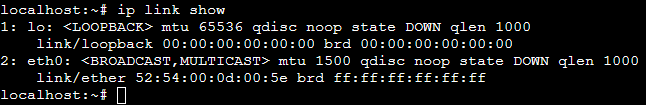

- Si tenemos el `eth0` en DOWN, lo levantaremos con:
    ```bash
    ip link set eth0 up
    ip link show eth0
    ```

    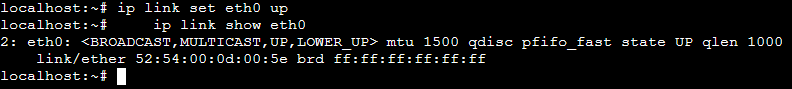

### 6.21 Solicitar la IP por DHCP

- Solicitaremos un IP al DHCP con:
    ```bash
    udhcpc -i eth0
    ```

    ==Realizar captura de pantalla==
    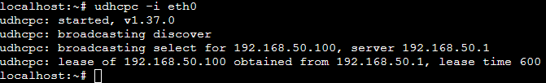

### 6.22 Gestión de las máquinas virtuales por consola

- Para acceder a la ayuda de virsh teclar:

    ```bash
    virsh
    ```

- Comandos más habituales

    | Comando | Qué hace |
    |||
    |**Redes**||
    |virsh start `<Cliente-1>` | Inicia la VM |
    |virsh destroy `<Cliente-1>` | Apagado forzoso e inmediato |
    |virsh shutdown `<Cliente-1>` | Apagado ordenado (envía señal ACPI, espera a que el SO se apague solo) |
    |virsh reboot `<Cliente-1>` |Reinicio ordenado (equivalente ACPI) |
    |virsh undefine `<Cliente-1>` | Elimina la definición de la VM (metadatos) |
    |virsh undefine `<Cliente-1>` --remove-all-storage| Elimina la definición de la VM y del disco|
    |virsh list --all| Lista todas las máquinas y su estado|
    |virsh console `<Cliente-1>`| Conexión por consola a la MV|
    |**Redes**||
    |virsh net-list --all| Lista todas las redes virtuales y su estado|
    |virsh net-define `<nombre-de-la-red>` | Definir una red virtual|
    |virsh net-destroy `<nombre-de-la-red>` | Detener una red virtual|
    |virsh net-autostart --disable `<nombre-de-la-red>` | Desactivar el inicio automático|
    |virsh net-undefine `<nombre-de-la-red>` | Elimina la definición de la red|
    |**Switch**||
    |ip -br link | Resumen de todas las interfaces|
    |ip -br addr | Interfaces con sus IPs|
    |ip link show type bridge | Solo bridges|
    |ip -d link show `<interfaz>` | Detalles de una interfaz|
    |bridge link | Interfaces conectadas a bridges|
    |bridge fdb show | Tabla de direcciones MAC|
    |ip route | Tabla de rutas|

### 6.23 Segundo cliente

==Realizar captura de pantalla==  

- Repetir los pasos anteriores y crear una segunda VM con nombre `Cliente-2`.

### 6.24 Ver el proceso de broadcast y asignación DORA

En este caso no usaremos wireshark sino el propio log del servicio DHCP.

- Nos conectamos a nuestra instancia anfitrión y lanzamos el log.
    ```bash
    sudo journalctl -u isc-dhcp-server -f
    ```

    **No cerraremos la ventana, lo dejamos corriendo.**

- Abrimos otra conexión con nuestra instancia y la usaremos para conectarnos a nuestra(s) MV.
        - Levantamos la interfaz de red con:
    ```bash
    ip link set eth0 up
    ```

    - Iniciamos el proceso DORA:
    ```
    udhcpc -i eth0
    ```
    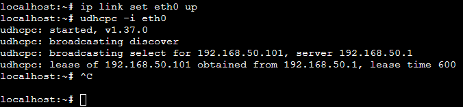

- Volvemos al log dónde podremos ver el DORA.  
==Realizar captura de pantalla==  
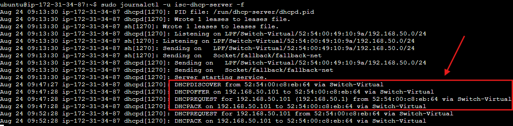

### 6.25 Leases concedidos

- Con el siguiente comando podemos consultar el registro de concesiones (leases) del servidor DHCP, donde se muestra qué dirección IP tiene asignada cada cliente, la duración de la concesión y su fecha de inicio y expiración.

    ```bash
    cat /var/lib/dhcp/dhcpd.leases
    ```

    ==Realizar captura de pantalla==
    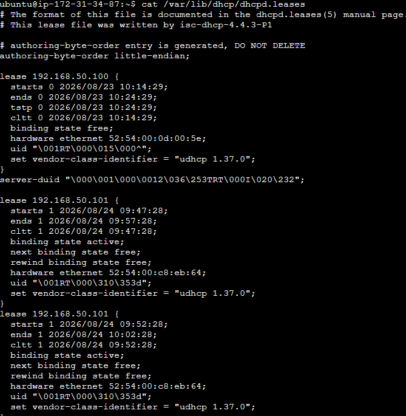
