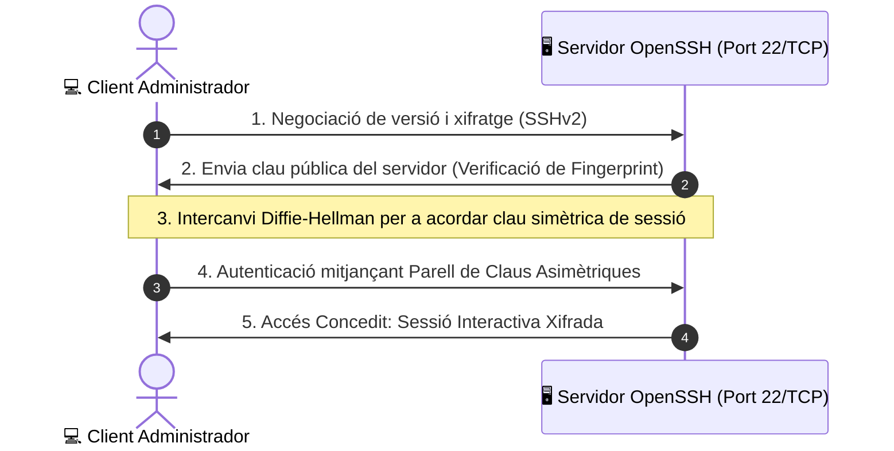
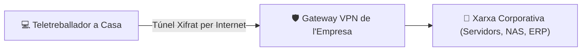

# UT05 — Mètodes d'Accés i Administració Remota (SSH, RDP, VPN)

L'administració remota permet gestionar servidors i dispositius de xarxa sense necessitat d'estar físicament davant de la pantalla o de la sala de màquines del CPD. Atès que aquestes sessions tenen privilegis màxims sobre els sistemes, el canal de comunicació ha d'estar estrictament xifrat i bastionat.

---

## 📌 1. Administració en Línia d'Ordres: OpenSSH

El protocol **SSH (*Secure Shell*)** és l'estàndard per excel·lència per a accés a terminals remotes en servidors Linux i equips de xarxa (switches, routers):



### Autenticació sense Contrasenya mitjançant Claus Ed25519:
L'ús de claus criptogràfiques és immensament superior a les contrasenyes tradicionals, ja que és immune a atacs de diccionari o força bruta:

```bash
# 1. Generar el parell de claus a l'equip de l'administrador (Client)
ssh-keygen -t ed25519 -C "admin@iesrafel.internal"

# 2. Copiar automàticament la clau pública cap al servidor remot
ssh-copy-id -i ~/.ssh/id_ed25519.pub usuari@192.168.1.10

# 3. Connectar sense que demane cap contrasenya interactiva
ssh usuari@192.168.1.10
```

---

## 📌 2. Bastionat (*Hardening*) del Servidor SSH

En instal·lacions per defecte, el dimoni OpenSSH és blanc de milers d'atacs de bots automatitzats cada dia. Per a assegurar-lo, s'edita el fitxer `/etc/ssh/sshd_config`:

```text
# Canviar el port estàndard per a evitar escanejos massius
Port 2222

# Prohibir expressament l'inici de sessió de l'administrador root
PermitRootLogin no

# Desactivar l'autenticació per contrasenya (obliga a tindre clau pública)
PasswordAuthentication no

# Límit d'intents d'autenticació abans de tallar la connexió
MaxAuthTries 3

# Llista blanca d'usuaris permesos
AllowUsers administrador alumne
```

```bash
# Validar sintaxi i reiniciar el servei
sudo sshd -t
sudo systemctl restart ssh
```

---

## 📌 3. Escriptori Remot en Entorns Gràfics: RDP i VNC

Quan cal gestionar sistemes amb interfície gràfica d'usuari (GUI):

- **RDP (*Remote Desktop Protocol*):** Desenvolupat per Microsoft, utilitza el port **TCP 3389**. És molt eficient perquè transmet instruccions gràfiques de dibuix en lloc de transmetre píxels purs. Incorpora **NLA (*Network Level Authentication*)**, que exigeix validar les credencials abans d'iniciar la sessió gràfica.
- **VNC (*Virtual Network Computing*):** Protocol independent de la plataforma sobre el port **TCP 5900**. Transmet rectangles de píxels; **per defecte no va xifrat**, per la qual cosa s'ha de canalitzar a través d'un túnel SSH:
  ```bash
  # Creació d'un túnel SSH per a xifrar la sessió VNC local
  ssh -L 5901:localhost:5900 usuari@192.168.1.10
  ```

---

## 📌 4. Xarxes Privades Virtuals (VPN): WireGuard

Una **VPN (*Virtual Private Network*)** crea un túnel xifrat sobre una xarxa pública no de confiança (Internet), connectant dispositius remots com si estigueren endollats al mateix commutador local:



### Arquitectura de WireGuard (RFC 51820):
WireGuard és la tecnologia VPN més moderna, ràpida i lleugera del nucli Linux. Utilitza claus públiques i privades en format corba el·líptica (Curve25519) i tràfic UDP:

```text
# Exemple de configuració del client WireGuard (/etc/wireguard/wg0.conf)
[Interface]
PrivateKey = aAAA...=
Address = 10.0.0.2/24
DNS = 10.0.0.1

[Peer]
PublicKey = bBBB...=
Endpoint = vpn.empresa.cat:51820
AllowedIPs = 192.168.1.0/24    # Tràfic corporatiu canalitzat pel túnel
PersistentKeepalive = 25
```
