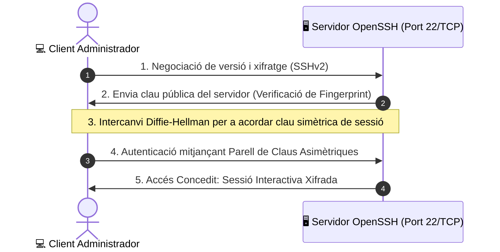
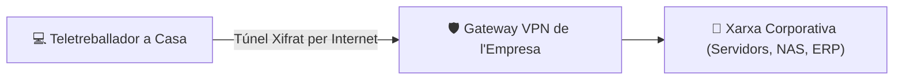

# UT05 — Mètodes d'Accés i Administració Remota (SSH, RDP, VPN)

L'administració remota permet gestionar servidors i dispositius de xarxa sense necessitat d'estar físicament davant de la pantalla o de la sala de màquines del CPD. Atès que aquestes sessions tenen privilegis màxims sobre els sistemes, el canal de comunicació ha d'estar estrictament xifrat i bastionat.

---

## 📌 1. Administració en Línia d'Ordres: OpenSSH

El protocol **SSH (*Secure Shell*)** és l'estàndard per excel·lència per a accés a terminals remotes en servidors Linux i equips de xarxa (switches, routers):



### Autenticació sense Contrasenya mitjançant Claus Ed25519:
L'ús de claus criptogràfiques és immensament superior a les contrasenyes tradicionals, ja que és immune a atacs de diccionari o força bruta:

```bash
# 1. Generar el parell de claus a l'equip de l'administrador (Client)
ssh-keygen -t ed25519 -C "admin@iesrafel.internal"

# 2. Copiar automàticament la clau pública cap al servidor remot
ssh-copy-id -i ~/.ssh/id_ed25519.pub usuari@192.168.1.10

# 3. Connectar sense que demane cap contrasenya interactiva
ssh usuari@192.168.1.10
```

---

## 📌 2. Bastionat (*Hardening*) del Servidor SSH

En instal·lacions per defecte, el dimoni OpenSSH és blanc de milers d'atacs de bots automatitzats cada dia. Per a assegurar-lo, s'edita el fitxer `/etc/ssh/sshd_config`:

```text
# Canviar el port estàndard per a evitar escanejos massius
Port 2222

# Prohibir expressament l'inici de sessió de l'administrador root
PermitRootLogin no

# Desactivar l'autenticació per contrasenya (obliga a tindre clau pública)
PasswordAuthentication no

# Límit d'intents d'autenticació abans de tallar la connexió
MaxAuthTries 3

# Llista blanca d'usuaris permesos
AllowUsers administrador alumne
```

```bash
# Validar sintaxi i reiniciar el servei
sudo sshd -t
sudo systemctl restart ssh
```

---

## 📌 3. Escriptori Remot en Entorns Gràfics: RDP i VNC

Quan cal gestionar sistemes amb interfície gràfica d'usuari (GUI):

- **RDP (*Remote Desktop Protocol*):** Desenvolupat per Microsoft, utilitza el port **TCP 3389**. És molt eficient perquè transmet instruccions gràfiques de dibuix en lloc de transmetre píxels purs. Incorpora **NLA (*Network Level Authentication*)**, que exigeix validar les credencials abans d'iniciar la sessió gràfica.
- **VNC (*Virtual Network Computing*):** Protocol independent de la plataforma sobre el port **TCP 5900**. Transmet rectangles de píxels; **per defecte no va xifrat**, per la qual cosa s'ha de canalitzar a través d'un túnel SSH:
  ```bash
  # Creació d'un túnel SSH per a xifrar la sessió VNC local
  ssh -L 5901:localhost:5900 usuari@192.168.1.10
  ```

---

## 📌 4. Xarxes Privades Virtuals (VPN): WireGuard

Una **VPN (*Virtual Private Network*)** crea un túnel xifrat sobre una xarxa pública no de confiança (Internet), connectant dispositius remots com si estigueren endollats al mateix commutador local:



### Arquitectura de WireGuard (RFC 51820):
WireGuard és la tecnologia VPN més moderna, ràpida i lleugera del nucli Linux. Utilitza claus públiques i privades en format corba el·líptica (Curve25519) i tràfic UDP:

<div style="background: linear-gradient(135deg, #0f172a 0%, #1e293b 100%); border-radius: 12px; padding: 20px; margin: 25px 0; box-shadow: 0 10px 25px -5px rgba(0, 0, 0, 0.3); border: 1px solid #334155;">
  <div style="text-align: center; margin-bottom: 15px;">
    <span style="background: #38bdf8; color: #0f172a; font-weight: 700; font-size: 0.75rem; text-transform: uppercase; letter-spacing: 0.05em; padding: 4px 10px; border-radius: 9999px;">Infografia Tècnica</span>
    <h3 style="color: #f8fafc; margin: 10px 0 5px 0; font-size: 1.25rem;">Túnels Segurs: Bastionat SSH vs VPN WireGuard</h3>
    <p style="color: #94a3b8; font-size: 0.85rem; margin: 0;">Mecanismes d'accés remot xifrat i encapsulament d'extrem a extrem</p>
  </div>
  <svg viewBox="0 0 860 270" width="100%" height="100%" xmlns="http://www.w3.org/2000/svg" style="display: block; font-family: system-ui, -apple-system, sans-serif;">
    <defs>
      <linearGradient id="sshGrad" x1="0%" y1="0%" x2="100%" y2="100%">
        <stop offset="0%" stop-color="#0284c7" stop-opacity="0.3"/>
        <stop offset="100%" stop-color="#0369a1" stop-opacity="0.1"/>
      </linearGradient>
      <linearGradient id="vpnGrad" x1="0%" y1="0%" x2="100%" y2="100%">
        <stop offset="0%" stop-color="#10b981" stop-opacity="0.3"/>
        <stop offset="100%" stop-color="#047857" stop-opacity="0.1"/>
      </linearGradient>
    </defs>

    <!-- Secció Esquerra: SSH -->
    <rect x="20" y="20" width="395" height="230" rx="8" fill="url(#sshGrad)" stroke="#38bdf8" stroke-width="1.5"/>
    <text x="217" y="48" fill="#38bdf8" font-size="13" font-weight="bold" text-anchor="middle">ADMINISTRACIÓ AMB OPENSSH (BASTIONAT)</text>
    <text x="217" y="65" fill="#94a3b8" font-size="10" text-anchor="middle">Canal xifrat per a sessions de terminal i transferència de fitxers</text>
    <line x1="35" y1="78" x2="400" y2="78" stroke="#334155"/>

    <text x="40" y="102" fill="#cbd5e1" font-size="10.5">• <tspan fill="#38bdf8" font-weight="bold">Claus Ed25519:</tspan> Autenticació asimètrica sense contrasenya</text>
    <text x="40" y="125" fill="#cbd5e1" font-size="10.5">• <tspan fill="#ef4444" font-weight="bold">PermitRootLogin no:</tspan> Prohibeix l'accés directe del superusuari</text>
    <text x="40" y="148" fill="#cbd5e1" font-size="10.5">• <tspan fill="#f59e0b" font-weight="bold">PasswordAuthentication no:</tspan> Immunitat a atacs de diccionari</text>
    <text x="40" y="171" fill="#cbd5e1" font-size="10.5">• <tspan fill="#34d399" font-weight="bold">Túnel Local (-L):</tspan> Redirigeix tràfic intern: ssh -L 8080:localhost:80</text>

    <rect x="35" y="195" width="365" height="40" rx="6" fill="#1e293b" stroke="#334155"/>
    <text x="217" y="220" fill="#38bdf8" font-size="10" text-anchor="middle" font-family="monospace">ssh -i ~/.ssh/id_ed25519 -p 2222 usuari@servidor</text>

    <!-- Secció Dreta: WireGuard VPN -->
    <rect x="445" y="20" width="395" height="230" rx="8" fill="url(#vpnGrad)" stroke="#34d399" stroke-width="1.5"/>
    <text x="642" y="48" fill="#34d399" font-size="13" font-weight="bold" text-anchor="middle">XARXA PRIVADA VIRTUAL (WIREGUARD VPN)</text>
    <text x="642" y="65" fill="#94a3b8" font-size="10" text-anchor="middle">Túnel perimetral al nucli de Linux (Kernel Module)</text>
    <line x1="460" y1="78" x2="825" y2="78" stroke="#334155"/>

    <text x="465" y="102" fill="#cbd5e1" font-size="10.5">• <tspan fill="#34d399" font-weight="bold">Corba El·líptica Curve25519:</tspan> Màxima velocitat criptogràfica</text>
    <text x="465" y="125" fill="#cbd5e1" font-size="10.5">• <tspan fill="#38bdf8" font-weight="bold">Tràfic UDP (Port 51820):</tspan> Connexió sense negociació pesada</text>
    <text x="465" y="148" fill="#cbd5e1" font-size="10.5">• <tspan fill="#f59e0b" font-weight="bold">Interfície virtual wg0:</tspan> El client rep IP de la LAN corporativa</text>
    <text x="465" y="171" fill="#cbd5e1" font-size="10.5">• <tspan fill="#a78bfa" font-weight="bold">PersistentKeepalive:</tspan> Manté la connexió a través de routers NAT</text>

    <rect x="460" y="195" width="365" height="40" rx="6" fill="#1e293b" stroke="#334155"/>
    <text x="642" y="220" fill="#34d399" font-size="10" text-anchor="middle" font-family="monospace">sudo wg-quick up wg0 &amp;&amp; sudo wg show</text>
  </svg>
</div>

```text
# Exemple de configuració del client WireGuard (/etc/wireguard/wg0.conf)
[Interface]
PrivateKey = aAAA...=
Address = 10.0.0.2/24
DNS = 10.0.0.1

[Peer]
PublicKey = bBBB...=
Endpoint = vpn.empresa.cat:51820
AllowedIPs = 192.168.1.0/24    # Tràfic corporatiu canalitzat pel túnel
PersistentKeepalive = 25
```

---

## 📝 Quadern d'Activitats Pràctiques i Reptes de Laboratori

### 📋 Bloc A: Anàlisi de Seguretat en Gestió Remota
1. **Perills del Protocol Telnet:** Per què el protocol clàssic Telnet (port 23) està completament prohibit en qualsevol entorn professional actual? Com pot un atacant amb un analitzador de xarxa (com Wireshark) capturar les contrasenyes d'administrador quan s'utilitza Telnet?
2. **Avantatges de les Claus Ed25519:** Quins avantatges ofereix l'algorisme de signatura Ed25519 enfront de les claus clàssiques RSA de 2048 bits pel que fa a mida de la clau, resistència a atacs i velocitat de negociació?
3. **El Rol dels Túnels SSH:** Si un servidor de base de dades MySQL només escolta a `127.0.0.1:3306` (per tant, inaccessible des de l'exterior), explica com podem utilitzar la comanda `ssh -L 3307:127.0.0.1:3306 usuari@servidor` per a gestionar la base de dades des del nostre equip local de forma completament xifrada.

### 💻 Bloc B: Reptes Pràctics de Laboratori i Bastionat

#### Repte 1: Generació de Claus i Autenticació sense Contrasenya
1. Al teu equip client (Linux o Windows PowerShell), genera un parell de claus Ed25519:
   ```bash
   ssh-keygen -t ed25519 -C "admin_smx@lab"
   ```
2. Inspecciona la carpeta `~/.ssh/` i identifica la clau privada (`id_ed25519`, amb permisos 600) i la clau pública (`id_ed25519.pub`).
3. Transfereix la clau pública cap al servidor de laboratori:
   ```bash
   ssh-copy-id -i ~/.ssh/id_ed25519.pub alumne@192.168.1.10
   ```
4. Connecta't per SSH i comprova que inicies sessió de forma instantània sense demanar cap contrasenya interactiva.

#### Repte 2: Bastionat (*Hardening*) del Servidor OpenSSH
Al servidor Ubuntu de laboratori:
1. Fes una còpia de seguretat del fitxer de configuració:
   ```bash
   sudo cp /etc/ssh/sshd_config /etc/ssh/sshd_config.bak
   ```
2. Edita `/etc/ssh/sshd_config` aplicant les següents mesures de seguretat:
   ```text
   Port 2222
   PermitRootLogin no
   PasswordAuthentication no
   MaxAuthTries 3
   LoginGraceTime 60
   ```
3. Comprova que la sintaxi és correcta abans de reiniciar el servei:
   ```bash
   sudo sshd -t
   ```
4. Reinicia el servei i obre el nou port al tallafocs:
   ```bash
   sudo systemctl restart ssh
   sudo ufw allow 2222/tcp
   ```
5. Des del client, intenta connectar sense indicar el port i comprova que la connexió és rebutjada: `ssh alumne@192.168.1.10`.
6. Connecta especificant el port correcte: `ssh -p 2222 alumne@192.168.1.10`.

### 🎯 Bloc C: Llista de Verificació i Rúbrica d'Avaluació

| Criteri d'Avaluació | Nivell Assolit (Excel·lent: 9-10) | Nivell Mitjà (Notable: 7-8) | Nivell Inicial (Aprovat: 5-6) |
| :--- | :--- | :--- | :--- |
| **Conceptes d'accés remot segur** | Explica detalladament Ed25519, túnels SSH, NLA a RDP i la topologia de WireGuard. | Coneix SSH bàsic però dubta en la creació de túnels de ports o paràmetres de VPN. | Confon la clau pública amb la privada o no comprèn els riscos de Telnet. |
| **Bastionat d'OpenSSH** | Aplica canvi de port, bloqueig de root, desactivació de contrasenya i valida amb `sshd -t`. | Canvia el port però oblida obrir-lo al tallafocs o no comprova la sintaxi. | Bloqueja l'accés complet al servidor per errors de configuració en `sshd_config`. |
| **Connexió per parell de claus** | Genera claus Ed25519, gestiona permisos `~/.ssh/authorized_keys` i connecta fluidament. | Utilitza `ssh-copy-id` però no sap configurar-ho manualment si l'ordre no existeix. | Requereix assistència per a moure fitxers entre màquines o establir permisos POSIX. |
