# UD 5 — Servicio DNS: Resolución de Nombres de Dominio

Bienvenido/a a la **UD 5 — Servicio DNS: Resolución de Nombres de Dominio** del módulo profesional de **Servicios en Red** (2º curso de Técnico en Sistemas Microinformáticos y Redes).

Este temario contiene el desarrollo curricular completo, diagramas de arquitectura, capturas de pantalla de laboratorios reales y guías paso a paso desarrolladas por el profesor **Javier Egea Blasco** y el profesor **Pepe Cuenca**.

---

### 📑 Índice de Apartados de la Unidad

- [**Introducción y Conceptos**](./ut0501.html)
- [**1 - Introducción**](./ut0502.html)
- [**2 - Protocolo DNS**](./ut0503.html)
- [**3 - Mecanismos de comunicación DNS**](./ut0504.html)
- [**4 - Servidores DNS**](./ut0505.html)
- [**5 - Consultas al DNS**](./ut0506.html)
- [**6 - Funcionamiento del servicio DNS**](./ut0507.html)
- [**7 - Jerarquía de nombres DNS**](./ut0508.html)
- [**8 - Servidores DNS públicos y privados**](./ut0509.html)
- [**9 - Evolución del protocolo DNS y seguridad**](./ut0510.html)
- [**10 - Registros DNS**](./ut0511.html)
- [**11 - Herramientas de diagnóstico técnico de registros DNS**](./ut0512.html)
- [**12 - Tarea RA2-CEb-1 - Resolución manual de un dominio**](./ut0513.html)
- [**13 - Tarea RA2-CEb-2 - Resolución manual de un dominio**](./ut0514.html)
- [**14 - Tarea RA2-CEde-1 - Instalación y configuración de un servidor DNS con Windows Server 2025**](./ut0515.html)

---

# 📖 Temario Completo de la Unidad (Lectura Continua)


**Resultados de aprendizaje y criterios de evaluacion que se evaluarán en esta unidad.**  

| **Resultados de aprendizaje de la unidad didáctica:**|
||
| **RA. 2 Instala servicios de resolución de nombres, describiendo sus características y aplicaciones.**|

|**Criterios de evaluación de la unidad didáctica:**|
||
|**a) Se han identificado y descrito escenarios en los que surge la necesidad de un servicio de resolución de nombres.**|
|**b)** Se han clasificado los principales mecanismos de resolución de nombres.|
|**c) Se ha descrito la estructura, nomenclatura y funcionalidad de los sistemas de nombres jerárquicos.**|
|**d)** Se ha instalado un servicio jerárquico de resolución de nombres.|
|**e)** Se ha preparado el servicio para almacenar las respuestas procedentes de servidores de redes públicas y servirlas a los equipos de la red local.|
|**f)** Se han añadido registros de nombres correspondientes a una zona nueva, con opciones relativas a servidores de correo y alias.|
|**g)** Se ha trabajado en grupo para realizar transferencias de zona entre dos o más servidores.|
|**h)** Se ha comprobado el funcionamiento correcto del servidor.|

> ⚠️ **Nota:**
>
>     Los criterios de evaluación en negrita será evaluados durante la FCT.


## 1 - Introducción

> ℹ️ **¿Qué es el DNS?**
>
>     
> 
>     - El **DNS** (*Domain Name System* o **Sistema de Nombres de Dominio**) es un sistema **distribuido y jerárquico** que permite asociar **nombres de dominio** legibles para las personas (`www.aules.edu.gva.es`), con **direcciones IP** (`195.77.20.168`).
> ℹ️ **¿Para qué sirve?**
>
>     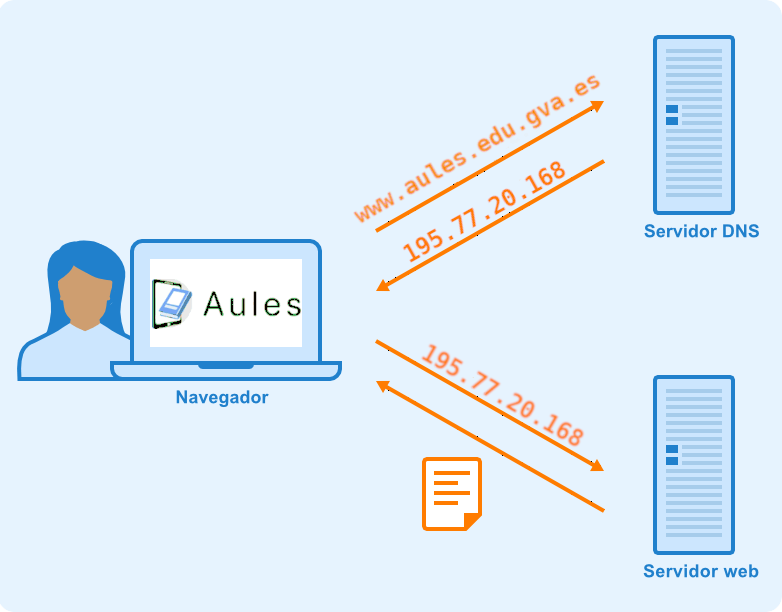
> 
>     - El servicio de nombre de dominio DNS es fundamental para el funcionamiento de Internet y de **muchas redes privadas**. 
>     
>     - Entre sus principales funciones encontramos:
> 
>         1. **Simplificar el acceso a los servicios de red:** Permite utilizar nombres fáciles de recordar (en lugar de direcciones IP).
> 
>         1. **Aportar flexibilidad:** Si un servicio cambia de servidor o de dirección IP, es posible **modificar la información DNS manteniendo el mismo nombre de dominio**. De esta forma, los usuarios pueden continuar utilizando el mismo nombre para acceder al servicio.
>         
>         1. **Permitir localizar servicios de red:** Los dispositivos pueden consultar el DNS para obtener información sobre la ubicación de diferentes servicios, como servidores web, servidores de correo electrónico, redes de distribución de contenidos (CDN, Content Delivery Network)...
> 
>     - **Facilita la administración de redes locales** donde también es posible asociar nombres a equipos y servicios locales.
## 2 - Protocolo DNS

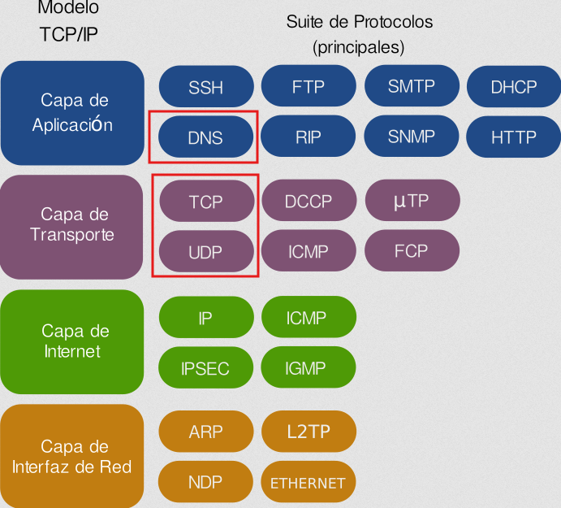

- **El servicio de nombres de dominio utiliza el protocolo DNS para realizar las consultas y las respuestas**.
- Se trata de un protocolo de **capa de aplicación** que puede utilizar tanto UDP como TCP en la capa de transporte.
- **El servidor DNS utiliza el puerto 53** para realizar las consultas y recibir las respuestas.
- Habitualmente, tanto las consultas del cliente como las respuestas del servidor caben en un datagrama (512 bytes) y se utiliza UDP (de hecho, generalmente se dice que el DNS usa UDP).
- Si la información a transmitir es amplia (por ejemplo, una respuesta con una lista con mucha información), la comunicación pasa a TCP automáticamente.
- Otro caso en el que la comunicación es por TCP es cuando se realiza la transferencia de información de una zona entre **servidores primarios y secundarios**.

> 💡 **Resumen de los que hemos visto**
>
>     - El protocolo DNS es habitualmente UDP, pero puede ser TCP y UDP.
>     - Se trata de un protocolo de capa de aplicación y utiliza el puerto 53.
>     - Los datagramas DNS se componen de varios apartados, tal como se puede ver en la siguiente consulta con host:
> 
>         !!! example "Ejemplo de consulta DNS"
>             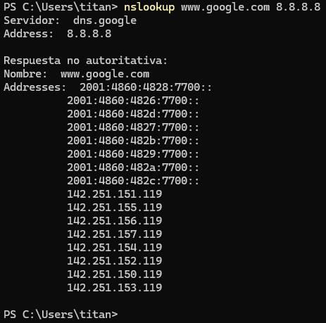    
> 
>             !!! abstract "Explicación del comando" 
>                 - **nslookup**: Herramienta utilizada para consultar a **los servidores de nombres DNS** y obtener información sobre direcciones IP o registros de dominio.
>                 - **www.google.es**: Dominio objetivo cuya dirección IP (o registros asociados) deseamos consultar.
>                 - **8.8.8.8**: Dirección IP del servidor DNS específico **al que hemos realizado la consulta**.        
>     
>             !!! question "¿Qué significa 'Respuesta no autoritativa'"
## 3 - Mecanismos de comunicación DNS

- La comunicación DNS es un mecanismo de consulta/respuesta de tipo **cliente / servidor**.
- Los datagramas, por tanto, serán de query (consulta) o de answer (respuesta).

> 💡 **Los apartados que componen un mensaje DNS son:**
>
> 
>      - **HEADER**. Cabecera del mensaje que indica si se trata de una consulta o de una respuesta. Contiene el id (identificador) del   mensaje, flags y un resumen de qué secciones del mensaje llevan información y cuánta.
>      - **QUESTION**. Esta sección contiene la consulta que se ha efectuado, es decir, qué dato se ha pedido al servidor. Puede ser la   resolución de un nombre de dominio a una dirección IP, pedir la lista de servidores de impresión, etc.
>      - **ANSWER**. Sección que contiene la respuesta obtenida del servidor. Esta respuesta será autoritativa o no en función de si el   servidor que responde es autoritativo para esa zona: cuando la respuesta procede de un servidor caché/resolver (no autoritativo), algunas utilidades de consulta la muestran como non-authoritative answer.
>      - **AUTHORITY**. Esta sección contiene las respuestas que son autoritativas para la consulta efectuada (puede estar vacía).
>      - **ADDITIONAL**. Contiene información adicional para completar la respuesta. En el ejemplo se observa que completa la resolución de los nombres de máquina que aparecen en la sección ANSWER, indicando su dirección IP correspondiente.
> ℹ️ **Ejemplo de comunicación DNS**
>
>     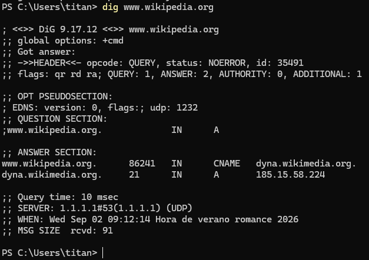
> 
>     !!! abstract "Explicación del comando" 
>         - **dig**: Domain Information Groper (explorador de información de dominios) es una utilidad habitualmente utilizada para consultar servidores DNS de manera detallada.
>         - A diferencia de **nslookup**, **dig** muestra información mucho más técnica, limpia y sin interpretaciones automáticas que a veces confunden el diagnóstico.
>         - **www.wikipedia.org**: Es el dominio a consultar.
> 
>     !!! abstract "Explicación del resultado devuelto"
>         !!! success "HEADER / cabecera" 
>             ```bash
>             ;; ->>HEADER<<- opcode: QUERY, status: NOERROR, id: 7395
>             ;; flags: qr rd ra; QUERY: 1, ANSWER: 2, AUTHORITY: 0, ADDITIONAL: 1
>             ```
>             
>             - **Es la cabecera del mensaje DNS**.
>             - Indica que se trata de una respuesta a una consulta (opcode: QUERY) completada con éxito (status: NOERROR).
>             - Muestra el identificador del mensaje (id: 7395), las flags de control activas (qr para respuesta, rd de recursión deseada y ra de recursión disponible) y el resumen de las secciones que contienen información: 1 pregunta (QUERY), 2 respuestas (ANSWER), *0 autoridades (AUTHORITY) y 1 registro adicional (ADDITIONAL).
> 
>         !!! success "QUESTION / pregunta (consulta)" 
>             ```bash
>             ;; QUESTION SECTION:
>             ;www.wikipedia.org.             IN      A
>             ```
> 
>             - Consulta que se ha efectuado.
>             - En este caso, se ha pedido al servidor que resuelva el nombre de dominio www.wikipedia.org solicitando un registro de tipo A (es decir, la dirección IP IPv4 asociada). 
> 
>         !!! success "ANSWER / respuesta" 
>             ```bash
>             ;; ANSWER SECTION:
>             www.wikipedia.org.      86252   IN      CNAME   dyna.wikimedia.org.
>             dyna.wikimedia.org.     32      IN      A       185.15.58.224
>             ```
> 
>             - www.wikipedia.org es un alias (CNAME) que apunta a dyna.wikimedia.org.
>             - El servidor busca la dirección de ese alias y devuelve su registro A con la IP final 185.15.58.224.
>             
>         !!! success "AUTHORITY / autoridad"
>             - La sección de autoridad no aparece listada (o está vacía).
>             - No es una sorpresa ya que la **cabecera** marca **AUTHORITY: 0**.
>             - Esta sección contendría la información sobre los servidores que son autoritativos para la consulta efectuada. 
> 
>         !!! success "ADDITIONAL / adicional"
>             ```bash
>             ;; OPT PSEUDOSECTION:
>             ; EDNS: version: 0, flags:; udp: 1232
>             ```
> 
>             - Información adicional para completar la gestión de la respuesta técnica. 
>             - En este caso se incluye la pseudosección EDNS (Extension Mechanisms for DNS), que indica que se soporta la versión 0 del protocolo extendido y establece un tamaño máximo de búfer UDP de 1232 bytes para evitar la fragmentación de paquetes en la red.
## 4 - Servidores DNS

- **Un servidor DNS es el elemento de la infraestructura de red que aloja la información de uno o más espacios de nombres de dominio y que responde a las consultas (queries) que le llegan, ya sea resolviéndolas directamente (si tiene autoridad sobre los datos) o remitiendo al cliente hacia otros servidores que sí la tienen**.
- Un mismo servidor puede ser autoritativo para unas zonas y actuar solo como intermediario (resolutor) para otras, y puede alojar simultáneamente varias zonas con roles distintos.

??? question "¿Qué es un servidor autoritativo?"
    - Un **servidor autoritativo** es aquel que tiene autoridad sobre una zona concreta y puede responder a las consultas con información oficial y actualizada de esa zona.
    - Por ejemplo, el servidor autoritativo para la zona `edu.gva.es` puede responder a consultas sobre nombres como `www.edu.gva.es` o `correo.edu.gva.es`, proporcionando las direcciones IP correspondientes.

### 4.1 Zonas DNS

- **Una zona DNS es la porción del espacio de nombres cuya administración corresponde a uno (o varios) servidores autoritativos, que mantienen sus registros y responden las consultas sobre ella**.
- Una zona no tiene por qué coincidir con un dominio completo: si un subdominio se delega a otros servidores, deja de formar parte de la zona padre.
- Por ejemplo, dentro del dominio `gva.es`, si `edu.gva.es` está delegado, `www.edu.gva.es` pertenece a la zona `edu.gva.es` y no a `gva.es`.
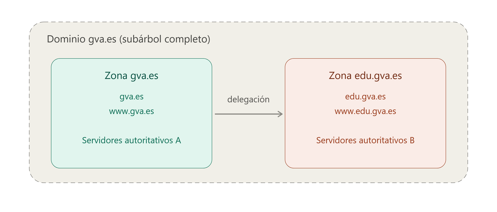
- La información de una zona (sus registros de recursos) se puede almacenar en un archivo de texto en el propio servidor o en un directorio centralizado (como AD DS en entornos Windows). En este último caso se habla de *zonas integradas*, que permiten que varios servidores compartan y escriban sobre la misma copia de datos.

??? question "¿Qué es un AD DS"
    - AD DS (Active Directory Domain Services o Servicios de dominio de Active Directory) es el servicio de directorio principal de Microsoft para Windows Server.
    - Funciona como una base de datos centralizada y jerárquica que almacena, organiza y gestiona los recursos de una red informática.

### 4.2 Tipos de zonas

- **Zona primaria.** Es el origen editable de la zona. Todas las altas, bajas y modificaciones de registros se hacen aquí. El servidor que la aloja se llama **servidor primario** de esa zona.
- **Zona secundaria.** Es una copia de solo lectura de una zona primaria, obtenida por red desde otro servidor DNS. No se puede editar directamente ni almacenarse como zona integrada, ya que siempre depende de la fuente primaria.
- **Zona de rutas internas (*stub*).** Contiene únicamente los registros NS (y sus direcciones) necesarios para identificar qué servidores son autoritativos para una zona concreta, sin el resto de datos. Se usa para mantener actualizada la lista de servidores de una zona delegada y para mejorar la resolución evitando consultas innecesarias a los servidores raíz.
- **Zona de búsqueda inversa.** Permite la consulta contraria a la habitual: a partir de una dirección IP, obtener el nombre del equipo (en vez de nombre → IP).

> ⚠️ **Zona de búsqueda inversa**
>
> 
>     - Para llevar a cabo la resolución de nombre inversa, el DNS utiliza un dominio especial llamado **in-addr.arpa** (para IPv4) o **ip6.arpa** (para IPv6). 
>     - La dirección IP se transforma e inserta dentro de este dominio en orden inverso a como se escribe normalmente.  
> 
>         !!! example "Ejemplo"
>             
>             - Para averiguar el nombre asociado a la IP `192.168.10.20`, el *resolver* consulta el dominio:  
>             `20.10.168.192.in-addr.arpa`  
>             - El registro que responde a este tipo de consulta se llama **registro PTR** (*pointer record*), y es el encargado de indicar qué nombre de dominio corresponde a esa dirección IP.  
>     
>     - **Usos habituales de la resolución inversa:**
>         1. Verificación de correo electrónico: muchos servidores de correo comprueban que la IP del remitente tenga un PTR válido antes de aceptar el mensaje, como medida contra el *spam*.
>         1. Diagnóstico y registro (*logging*): en herramientas como `traceroute`, `ping` o en los logs de un servidor, es más legible ver el nombre de una máquina que su dirección IP.
>         1. Auditoría y seguridad: permite identificar qué equipo hay detrás de una IP concreta durante el análisis de tráfico o incidentes.
>     
>         !!! failure "A diferencia de la resolución directa, la resolución inversa requiere que el administrador de la red configure explícitamente esta zona y sus registros PTR, ya que no se genera de forma automática a partir de los registros A o AAAA."
> ⚠️ **Importante**
>
>     Un mismo servidor no puede alojar a la vez una zona primaria y una secundaria o *stub* para el mismo nombre de dominio.
### 4.3 Transferencia de zona

Se conoce como **transferencia de zona** el proceso de replicar el contenido de una zona desde el servidor que la genera (primario) hacia los servidores que tienen copia de ella (secundarios). Se puede iniciar de dos maneras:

1. Por **notificación**: el servidor primario avisa a los secundarios cuando ha habido un cambio (mecanismo definido en el RFC 1996).
1. Por **intervalo de refresco**: al arrancar el servicio o al caducar dicho intervalo (por defecto, 15 minutos, definido en el registro SOA de la zona), el servidor secundario consulta al primario para comprobar si hay cambios.

Hay dos tipos de transferencia:

1. **AXFR (transferencia completa):** replica todo el archivo de zona.
1. **IXFR (transferencia incremental):** replica solo los registros modificados desde la última sincronización, reduciendo el tráfico de red.

Por motivos de seguridad, es recomendable restringir qué servidores pueden solicitar una transferencia de zona (habitualmente, solo los indicados en los registros NS de la zona), ya que una transferencia abierta a cualquier host expondría toda la estructura de la red interna.

### 4.4 Delegación de zonas

- El espacio de nombres se puede dividir en varias zonas para delegar su administración a otros departamentos u organizaciones (por ejemplo, delegar `edu.gva.es` desde la zona `gva.es`).
- Para cada delegación es necesario crear registros NS en la zona padre que apunten a los servidores autoritativos de la nueva subzona, de modo que otros servidores y clientes puedan encontrarlos correctamente.

### 4.5 Control de acceso

- El acceso de escritura a una zona y a sus registros se puede restringir mediante listas de control de acceso (ACL), que determinan qué usuarios o grupos pueden crear o modificar registros concretos.
- Esto permite, por ejemplo, reservar ciertos nombres para que solo determinados usuarios los puedan registrar, protegiendo la zona de modificaciones no autorizadas sin dejar de permitir su uso general.

## 5 - Consultas al DNS

En una búsqueda de DNS se pueden producir **tres tipos de consultas**.

> 💡 **1. Consulta recursiva:**
>
>     - El cliente (dispositivo que pide la información) solicita al servidor **una respuesta final completa** (por ejemplo, la dirección IP de un sitio web)
>     - En una consulta recursiva, un cliente DNS requiere que un servidor DNS (generalmente un resolver DNS recursivo) responda al cliente con el registro del recurso solicitado o un mensaje de error si el resolver no puede encontrar el registro.
> 💡 **2. Consulta iterativa:**
>
>     - El servidor consultado no busca la respuesta completa en nombre del cliente; simplemente aporta la mejor información que tiene en ese momento.
>     - Si el servidor DNS consultado no cuenta con un nombre que corresponda con el de la consulta, devolverá una referencia a un servidor DNS autoritativo para un nivel inferior del espacio de nombres de dominio.
>     - El cliente DNS hará a continuación una consulta a la dirección de referencia.
>     - Este proceso continúa con servidores DNS adicionales que siguen en la cadena de consulta hasta conseguir la información requerida, se produzca un error o se supere el tiempo de espera.
> 💡 **3. Consulta no recursiva:**
>
>     - Es aquella en la que el servidor ya posee la respuesta de manera directa (por ejemplo, porque está almacenada en su propia caché local o porque él mismo administra esa zona de nombres).
>     - Generalmente se produce cuando un cliente resolver DNS consulta a un servidor DNS por un registro al que tiene acceso porque o bien es autoritativo para el registro o el registro existe dentro de su caché.
>     - Generalmente, el servidor DNS almacenará en caché registros DNS para prevenir el consumo de ancho de banda adicional y la carga en los servidores que preceden en la cadena.
??? question "¿En qué se diferencia una conulta recursiva de una consulta no recursiva?"
    **La diferencia principal** entre una consulta recursiva y una no recursiva radica en quién realiza **el esfuerzo de buscar la información** y cómo responde el servidor DNS.

    |Característica |Consulta recursiva | Consulta no recursiva (iterativa) |
    ||||
    |Responsabilidad|El servidor hace todo el trabajo de búsqueda si no lo sabe.|El servidor solo responde con lo que ya sabe o indica a dónde ir.|
    |Uso típico|Entre un cliente (usuario/dispositivo) y su servidor DNS local (resolver).|Entre servidores DNS (por ejemplo, un servidor de Google preguntándole a un servidor raíz).
    |Carga de trabajo|Alta para el servidor DNS (gestiona múltiples peticiones externas).|Baja para el servidor consultado (responde rápido y se desentiende).|

> ℹ️ **Nota:**
>
>     - Al usar una combinación de estas consultas, un proceso optimizado para la resolución de DNS puede conllevar una reducción de la distancia recorrida.  
>     - En una situación ideal, los datos de registro almacenados en la memoria caché estarán disponibles, lo cual permitirá que un servidor de nombres DNS devuelva una consulta no recursiva.
## 6 - Funcionamiento del servicio DNS

- El funcionamiento del DNS se basa en un sistema **jerárquico y distribuido**.

- Como hemos visto, la resolución de un nombre puede implicar diferentes servidores DNS.

- De forma simplificada, el proceso es el siguiente:

### 6.1 Inicio de la consulta y comprobación de la caché

- El dispositivo realiza una consulta a un **servidor DNS recursivo**, también denominado **DNS resolver**.

- Habitualmente, este servidor es proporcionado por el proveedor de acceso a Internet, aunque también puede pertenecer a una organización, una empresa o ser **configurado manualmente**.
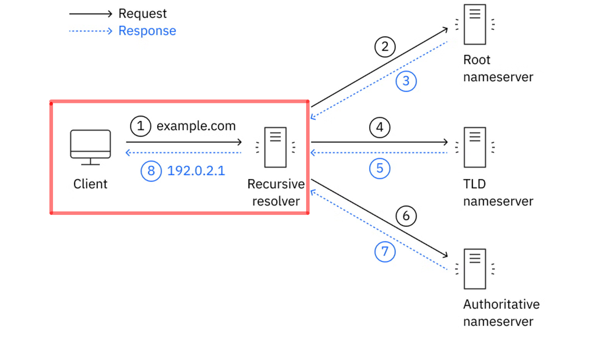

- Antes de realizar nuevas consultas, pueden comprobarse diferentes **cachés DNS**.

- Por ejemplo, pueden existir cachés en:

    1. El navegador.
    1. El sistema operativo.
    1. El servidor DNS recursivo.

- Si alguno de estos componentes dispone de una respuesta válida almacenada en caché, no será necesario realizar (repetir) todo el proceso de resolución.

- La información almacenada en caché tiene un tiempo de validez denominado **TTL (*Time To Live*)** pasado el cual caducará y se deberá volver a consultar los servidores DNS correspondientes.

### 6.2 Consulta al servidor raíz (*Root Server*)

- Si el resolver recursivo no dispone de la respuesta en su caché, comienza la búsqueda consultando la jerarquía DNS.

- El primer nivel corresponde a los **servidores raíz**.
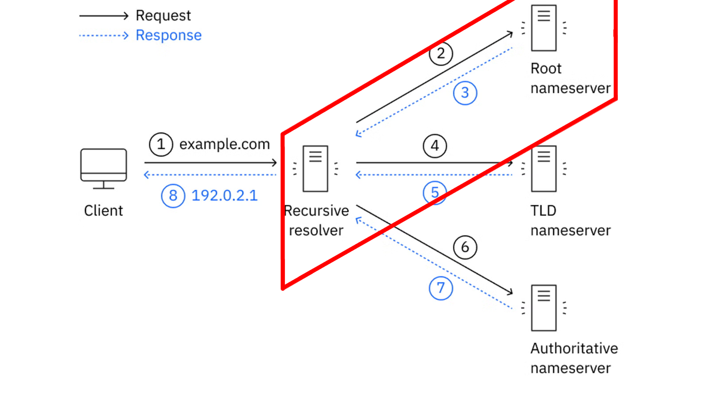

- Existen **13 servidores raíz lógicos**, identificados mediante las letras de la **A a la M**. Cada uno de ellos está replicado mediante numerosas instancias distribuidas geográficamente por diferentes lugares del mundo.

- Los servidores raíz **no conocen directamente la dirección IP** del dominio que estamos buscando. Su función es indicar qué servidores son responsables del **dominio de nivel superior (TLD Top-Level Domain)** correspondiente.

- Por ejemplo, si estamos buscando:

      ```text
      www.aules.edu.gva.es.
      ```

    el [**servidor raíz**](https://root-servers.org/) puede indicar qué servidores se encargan del TLD `.es`.

### 6.3 Consulta al servidor de nivel superior (TLD)

- El resolver recursivo consulta entonces a un [**servidor TLD**](https://www.iana.org/domains/root/db) (*Top-Level Domain*).
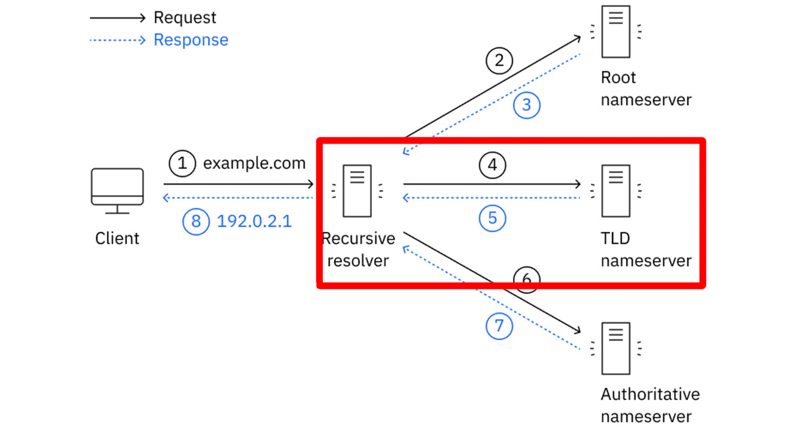

- Un TLD es la parte final de un nombre de dominio, como:

      ```text
      .com
      .es
      .org
      .net
      ```

- El servidor TLD no proporciona necesariamente la dirección IP del equipo que buscamos. Su función es indicar cuáles son los **servidores DNS autoritativos** encargados del dominio correspondiente.

- Por ejemplo, los servidores TLD `.es` pueden indicar qué servidores DNS son autoritativos para:

      ```text
      aules.edu.gva.es
      ```

??? question "¿A qué servidores el TLD de .es. delega sus consultas?"
    - NS a.nic.es 194.69.254.1, 2001:67c:21cc:2000:0:0:64:41
    - NS c.nic.es 194.0.34.53, 2001:678:44:0:0:0:0:53
    - NS g.nic.es 204.61.217.1, 2001:500:14:7001:ad:0:0:1
    - NS h.nic.es 194.0.33.53, 2001:678:40:0:0:0:0:53

### 6.4 Consulta al servidor de nombres autoritativo

- El resolver recursivo consulta finalmente a uno de los **servidores DNS autoritativos** responsables de la zona correspondiente.
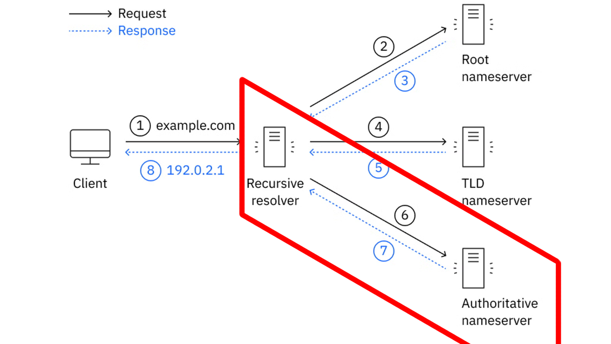

- Un servidor autoritativo dispone de la **información oficial de la zona DNS que administra**. Esta información contiene diferentes registros DNS que permiten conocer los servicios asociados a los nombres del dominio.

- Por ejemplo, un registro **A** puede asociar un nombre con una dirección IPv4:

      ```text
      www.aules.edu.gva.es  →  195.77.20.168
      ```

- Para IPv6 se utiliza normalmente un registro **AAAA**.

- Un dominio puede disponer de **varios servidores autoritativos**, proporcionando redundancia y disponibilidad.

### 6.5 Resolución final y almacenamiento en caché

- El resolver recursivo recibe la respuesta del servidor autoritativo y se la proporciona al dispositivo que realizó la consulta.


- El navegador ya puede utilizar la dirección IP obtenida para establecer una conexión con el servicio correspondiente.

- Además, el resolver puede almacenar la respuesta en su **caché DNS** durante el tiempo indicado por el **TTL** del registro.

- De esta forma, si otro dispositivo realiza posteriormente la misma consulta, el resolver puede responder utilizando la información almacenada en caché sin tener que volver a consultar a los servidores raíz, TLD y autoritativos.

### 6.6 Resumen del proceso

- De forma simplificada, podemos representar la resolución de un nombre de dominio de la siguiente manera:

      ```mermaid
      flowchart TD
          A[Cliente] -->|1. Consulta DNS| B[DNS recursivo<br/>Resolver]
          B -->|2-3. Consulta a servidor raíz | C[Servidor raíz]
          C -->|4-5. Consulta a servidor TLD| D["Servidor TLD<br/>(.es)"]
          D -->|6-7. Indica los servidores<br/>autoritativos| E[Servidor autoritativo]
          E -->|Registro A / AAAA| F[Dirección IP]
          F -->|192.0.2.1| G[DNS Resolver]
          G -->|8. Entrega de IP a cliente <br/>192.0.2.1| H[Cliente]
          H -->|192.0.2.1| I["Servidor (web)"]
      style A fill:#f9f,stroke:#333,stroke-width:4px
      style B fill:#bbf,stroke:#333,stroke-width:4px
      style C fill:#bbf,stroke:#333,stroke-width:4px
      style D fill:#bbf,stroke:#333,stroke-width:4px
      style E fill:#bbf,stroke:#333,stroke-width:4px
      style F fill:#bbf,stroke:#333,stroke-width:4px
      style G fill:#bbf,stroke:#333,stroke-width:4px
      style H fill:#f9f,stroke:#333,stroke-width:4px
      style I fill:#bbf,stroke:#333,stroke-width:4px
      ```

> 💡 **Resumen de los que hemos visto**
>
> 
>     1. El **cliente no suele consultar directamente a los servidores raíz, TLD y autoritativos**. 
>     1. Normalmente realiza una consulta a un **resolver DNS recursivo**, que se encarga de realizar las consultas necesarias y devolver finalmente la respuesta al cliente.
>     1. Por tanto, debemos distinguir entre:
> 
>           | Servidor DNS                 | Función principal                                                 |
>           | ---------------------------- | ----------------------------------------------------------------- |
>           | **DNS recursivo (Resolver)** | Realiza la búsqueda en nombre del cliente y devuelve la respuesta |
>           | **Servidor raíz (Root)**     | Indica qué servidores gestionan el TLD solicitado                 |
>           | **Servidor TLD**             | Indica qué servidores son autoritativos para el dominio           |
>           | **Servidor autoritativo**    | Proporciona la información oficial de la zona DNS                 |
> 
>     4. Esta jerarquía permite que el DNS sea un sistema **distribuido, escalable y resistente**, capaz de gestionar una enorme cantidad de  nombres de dominio sin depender de un único servidor central.
## 7 - Jerarquía de nombres DNS

- El sistema DNS está organizado mediante una **estructura jerárquica**, similar a un árbol invertido. En la parte superior se encuentra la **raíz (`.`)** y, a medida que descendemos por la jerarquía, encontramos los diferentes dominios y subdominios.

- Si tenemos el siguiente nombre:


- Su estructura jerárquica sería:
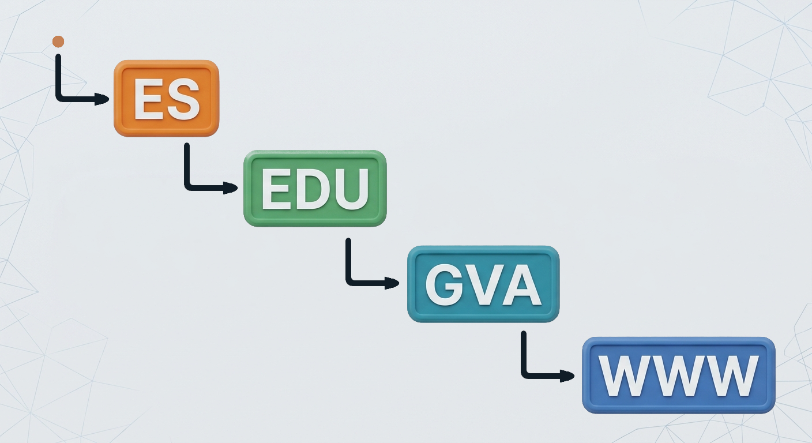

- Cada nivel representa una parte diferente de la jerarquía DNS.

### 7.1 La raíz DNS

- En la parte superior de la jerarquía se encuentra la **raíz DNS**, representada mediante un punto:

      ```text
      .
      ```

- La raíz es el nivel superior de todo el sistema DNS.

- Un nombre de dominio completamente cualificado (*FQDN, Fully Qualified Domain Name*) podría escribirse de la siguiente manera:


- Normalmente este punto final no se escribe cuando utilizamos un nombre de dominio en un navegador pero forma parte de la estructura completa del nombre.


### 7.2 Dominios de nivel superior (TLD)

- Por debajo de la raíz se encuentran los **dominios de nivel superior**, conocidos como **TLD (*Top-Level Domain*)**.

- Algunos ejemplos son:

      ```text
      .com
      .org
      .net
      .es
      .edu
      ```

- Existen diferentes tipos de TLD. Por ejemplo:

    1. **gTLD (*generic Top-Level Domain*)**: `.com`, `.org`, `.net`, etc.
    1. **ccTLD (*country code Top-Level Domain*)**: `.es`, `.fr`, `.it`, `.de`, etc.

- En el caso de:

      ```text
      www.edu.gva.es
      ```

    el **TLD** es:

      ```text
      .es
      ```

### 7.3 Dominio

- A la izquierda del TLD encontramos otros niveles de la jerarquía.

- En el caso de:

      ```text
      www.edu.gva.es
      ```

    **Un dominio dentro del TLD** `.es` sería.

      ```text
      gva.es
      ```

### 7.4 Subdominios

- Un **subdominio** es un dominio que se encuentra por debajo de otro dominio dentro de la jerarquía DNS.

- En el caso de:

      ```text
      gva.es
      ```

    podría tener diferentes subdominios:

      ```text
      edu.gva.es
      san.gva.es
      just.gva.es
      ```

    Y, a su vez, `edu.gva.es` podría tener otros niveles:

      ```text
      www.edu.gva.es
      aules.edu.gva.es
      correo.edu.gva.es
      ```

- Los subdominios permiten organizar diferentes servicios, departamentos o recursos dentro de una misma estructura de nombres.

### 7.5 FQDN

- Un **FQDN (*Fully Qualified Domain Name*)**, o **nombre de dominio completamente cualificado**, identifica de forma completa una posición dentro de la jerarquía DNS.

- En nuestro caso tendríamos el siguiente FQDN:

      ```text
      www.edu.gva.es.
      ```

> 💡 **Importante**
>
>     Los nombres DNS se interpretan **de derecha a izquierda**.
### 7.6 Nombre de host

- En una red, un **host** es un dispositivo o sistema que puede comunicarse mediante una red.

- En DNS, un nombre como `www.edu.gva.es` puede utilizarse para identificar un servicio o un host.

- Por ejemplo, podríamos tener:

      ```text
      www.edu.gva.es
      correo.edu.gva.es
      ftp.edu.gva.es
      ```

- Cada nombre podría estar asociado mediante DNS a una dirección IP diferente:

      ```text
      www.edu.gva.es       → 192.168.1.10
      correo.edu.gva.es    → 192.168.1.20
      ftp.edu.gva.es       → 192.168.1.30
      ```

> ⚠️ **Importante**
>
>     - Cada nombre DNS **no representa necesariamente un único equipo físico**.  
>     - Un mismo servicio puede estar distribuido entre varios servidores y una misma dirección IP puede utilizarse para diferentes nombres.
### 7.7 Zona DNS

- Una **zona DNS** es una parte de la jerarquía DNS que está administrada por una organización o servidor DNS determinado.

- La zona contiene los **registros DNS** que proporcionan información sobre los nombres y servicios que administra.

- Por ejemplo, una organización podría administrar la zona:

      ```text
      edu.gva.es
      ```

    y dentro de ella tener, en un primer escenario, todos los nombres agrupados en una única zona:

      ```text
      www.edu.gva.es
      correo.edu.gva.es
      ftp.edu.gva.es
      ```

    La zona podría contener registros como:

      ```text
      www.edu.gva.es      → 192.168.10.10
      correo.edu.gva.es   → 192.168.10.20
      ftp.edu.gva.es      → 192.168.10.30
      ```

> ⚠️ **Dominio y zona no son exactamente lo mismo**
>
>     1. Aunque en el ejemplo anterior el dominio `edu.gva.es` y la zona que lo administra coinciden, **dominio y zona son conceptos diferentes**.
>     1. Un dominio representa una parte de la **jerarquía de nombres DNS**, mientras que una zona representa una parte de esa jerarquía que está **administrativamente gestionada mediante servidores DNS autoritativos**.
>     1. Un dominio puede contener diferentes subdominios y estos pueden estar delegados en otras zonas.
>     - Veamos un segundo escenario, alternativo al anterior, en el que la organización decide **dividir** la administración de `edu.gva.es` en dos zonas distintas:
>     ```mermaid
> 
>     flowchart TD
>         A[edu.gva.es] --> X((　))
>         X --> B[Zona A]
>         X --> C[Zona B]
>         B --> D[www.edu.gva.es </br>+</br>correo.edu.gva.es]
>         C --> E[ftp.edu.gva.es]
>     style X fill:#
>     style A fill:#bbf,stroke:#333,stroke-width:4px
>     style B fill:#bbf,stroke:#333,stroke-width:4px
>     style C fill:#bbf,stroke:#333,stroke-width:4px
>     style D fill:#bbf,stroke:#333,stroke-width:4px
>     style E fill:#bbf,stroke:#333,stroke-width:4px
>     ```
>     - En este segundo escenario, la organización administra directamente una zona con `www.edu.gva.es` y `correo.edu.gva.es` (Zona A), mientras que `ftp.edu.gva.es` está delegado a otros servidores DNS que administran la Zona B. Ambas zonas siguen perteneciendo al mismo dominio `edu.gva.es`, pero están gestionadas de forma independiente.
### 7.8 Resumen de la jerarquía DNS

- Podemos resumir los diferentes conceptos mediante la siguiente imagen:
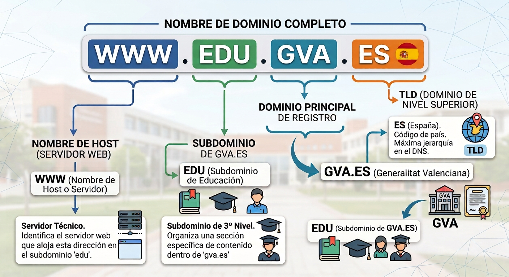

- De esta forma, el DNS organiza los nombres mediante una estructura jerárquica en la que cada nivel puede ser administrado de forma independiente.  

    | Concepto | Significado | Ejemplo |
    ||||
    | **Raíz** | Nivel superior de la jerarquía DNS | `.` |
    | **TLD** | Dominio de nivel superior | `.es` |
    | **Dominio** | Nombre registrado dentro de un TLD | `gva.es` |
    | **Subdominio** | Dominio situado dentro de otro dominio | `edu.gva.es` |
    | **FQDN** | Nombre DNS completamente cualificado (incluye el punto raíz final) | `www.edu.gva.es.` |
    | **Host** | Equipo o servicio identificado mediante un nombre | `www.edu.gva.es` |
    | **Zona** | Parte de la jerarquía administrada por unos servidores autoritativos concretos | `edu.gva.es` (zona delegada, con sus propios servidores autoritativos dentro del dominio `gva.es`) |

## 8 - Servidores DNS públicos y privados

- No todos los servidores DNS tienen la misma función ni están disponibles para los mismos usuarios.

- Dependiendo de quién pueda utilizarlos y de dónde se encuentren, podemos distinguir entre **servidores DNS públicos** y **servidores DNS privados**.

### 8.1 Servidores DNS públicos

- Un **servidor DNS público** es un servidor DNS que ofrece su servicio de resolución de nombres a usuarios y dispositivos de Internet de forma pública.

- Estos servidores suelen estar gestionados por empresas, organizaciones o proveedores de servicios de Internet y pueden ser utilizados por cualquier usuario que tenga acceso a Internet.

- Algunos ejemplos conocidos son:

    | Servicio DNS          | Dirección IPv4 |
    | --------------------- | -------------- |
    | **Google Public DNS** | `8.8.8.8`      |
    | **Google Public DNS** | `8.8.4.4`      |
    | **Cloudflare DNS**    | `1.1.1.1`      |
    | **Cloudflare DNS**    | `1.0.0.1`      |
    | **Quad9**             | `9.9.9.9`      |

- Por ejemplo, podemos configurar un ordenador para que utilice:

      ```text
      Servidor DNS preferido: 1.1.1.1
      Servidor DNS alternativo: 1.0.0.1
      ```

- A partir de ese momento, las consultas DNS realizadas por el dispositivo podrán enviarse a los servidores de Cloudflare.

> 💡 **Importante**
>
>     - Un servidor DNS público **no significa que sea un servidor raíz ni un servidor autoritativo**.
>     - Por ejemplo, `1.1.1.1` es un **resolver DNS recursivo público**. Recibe consultas de los clientes y, cuando es necesario, realiza las consultas correspondientes a otros servidores DNS de la jerarquía.
### 8.2 ¿Por qué utilizar un DNS público?

- Existen diferentes motivos para utilizar un servidor DNS público en lugar del servidor DNS proporcionado automáticamente por nuestro proveedor de Internet:

#### 8.2.1 Rendimiento

- Algunos proveedores de DNS público disponen de una infraestructura distribuida por diferentes partes del mundo. Esto permite que las consultas puedan ser atendidas desde servidores cercanos al usuario.

- El tiempo necesario para obtener una respuesta DNS se denomina habitualmente **latencia DNS**.

- Una menor latencia puede hacer que la resolución de nombres sea más rápida.

#### 8.2.2 Disponibilidad y redundancia

- Los grandes proveedores de DNS público utilizan infraestructuras distribuidas y redundantes.

- Si uno de sus servidores o centros de datos deja de funcionar, otros servidores pueden continuar atendiendo las consultas.

- Esto proporciona una elevada **disponibilidad** del servicio.

#### 8.2.3 Seguridad

- Algunos servicios DNS públicos incorporan mecanismos de seguridad adicionales, como el bloqueo de determinados dominios asociados a:

    1. Malware.
    1. Phishing.
    1. Botnets.
    1. Otros tipos de amenazas.

- Por ejemplo, algunos resolvers públicos están diseñados específicamente para proporcionar una capa adicional de protección frente a determinados dominios maliciosos.

> ⚠️ **DNS y seguridad**
>
>     - El uso de un DNS público **no garantiza por sí mismo que una conexión sea segura**.
>     - DNS se encarga principalmente de resolver nombres. La seguridad de la comunicación dependerá también de otros mecanismos, como **HTTPS/TLS**, firewalls, sistemas de detección de intrusiones y otros controles de seguridad.
### 8.3 Servidores DNS privados

- Un **servidor DNS privado** es un servidor DNS que está destinado a una organización, red o conjunto limitado de usuarios.

- A diferencia de un servidor DNS público, no está pensado para que cualquier usuario de Internet pueda realizar consultas libremente.

- Los servidores DNS privados son muy habituales en:

    1. Empresas.
    1. Centros educativos.
    1. Organismos públicos.
    1. Redes domésticas.
    1. Centros de datos.
    1. Redes virtuales en la nube.

> ℹ️ **Ejemplo de red empresarial**
>
>     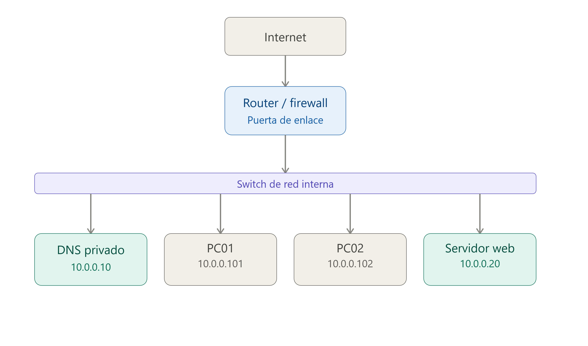
>     **Dónde:**
> 
>     - `10.0.0.0/24` es la red de la empresa.
>     - `10.0.0.10` es el servidor DNS interno.
>     - `10.0.0.20` es el servidor Web de la empresa.
>     - `10.0.0.101` es un dispositivo conectado a la red (p.e.: impresora) con el nombre DNS **impresora.empresa.local**
>     - `10.0.0.102` otro dispositivo conectado a la red (p.e.: nas) con el nombre DNS **nas.empresa.local** 
>     
>     !!! Warning "Estos nombres pueden (suelen) no existir en el DNS público de Internet"
### 8.4 DNS privado y acceso a Internet

- Un servidor DNS privado no tiene por qué limitarse a resolver nombres internos.

- También puede actuar como **resolver recursivo** para los dispositivos de la organización.

- Si miramos el siguiente esquema veremos que el servidor DNS puede resolver tanto `servidor.empresa.local` utilizando sus **zonas internas** como `www.google.com`, `www.wikipedia.org` y `www.aules.edu.gva.es` realizando consultas recursivas hacia otros servidores DNS.

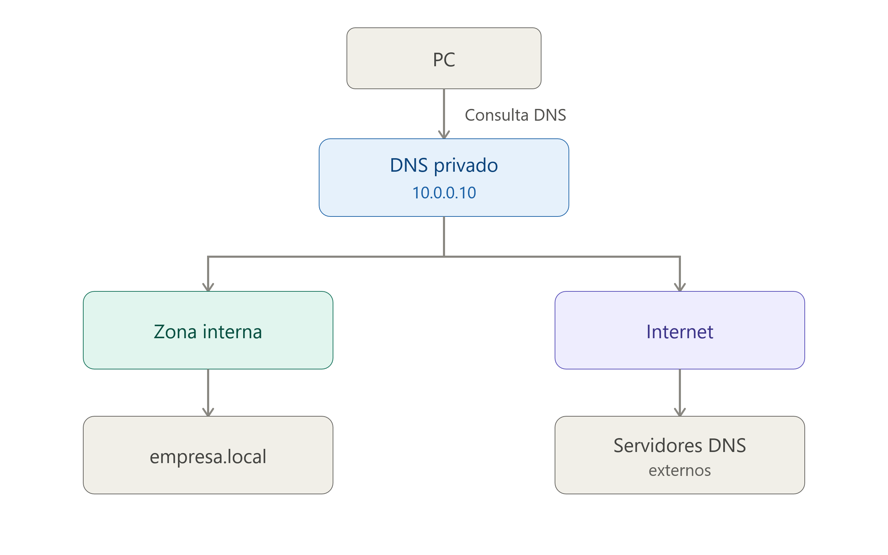

### 8.5 Servidor DNS privado en una red local

En una red local, los equipos suelen obtener automáticamente la dirección del servidor DNS mediante el protocolo **DHCP**.

> ℹ️ **Configurción dee red devuelta por el servidor DHCP**
>
>     ```text
>     Configuración recibida mediante DHCP
> 
>     Dirección IP:       192.168.10.101
>     Máscara:            255.255.255.0
>     Puerta de enlace:   192.168.10.1
>     Servidor DNS:       192.168.10.10
>     ```
> 
>     **Dónde:**
> 
>     - El ordenador cliente recibe la IP `192.168.10.101`.
>     - El ordenador cliente utilizará `192.168.10.10` para realizar consultas DNS.
>     - El ordenador cliente utilizará `192.168.10.1` como puerta de enlace es decir para acceder a internet.
>     - El servidor DNS privado podría resolver tanto nombres internos como nombres de Internet.
> ℹ️ **Ejemplo de consulta DNS interna**
>
>     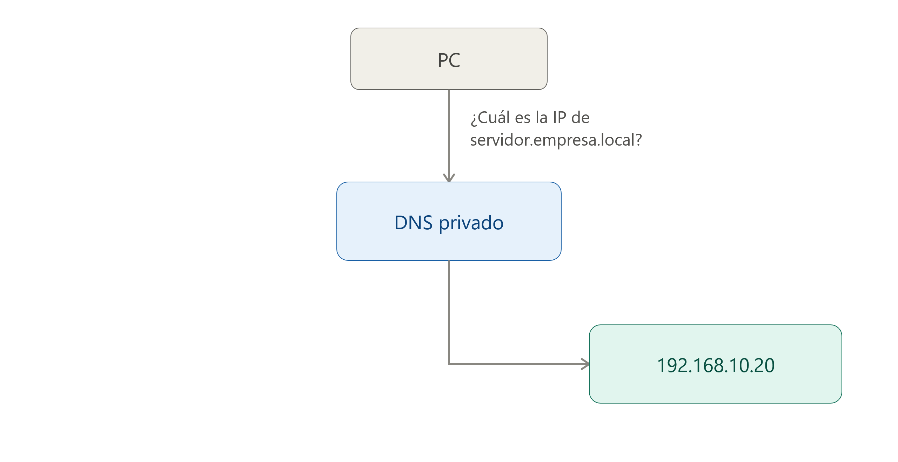
> ℹ️ **Ejemplo de consulta DNS externa**
>
>     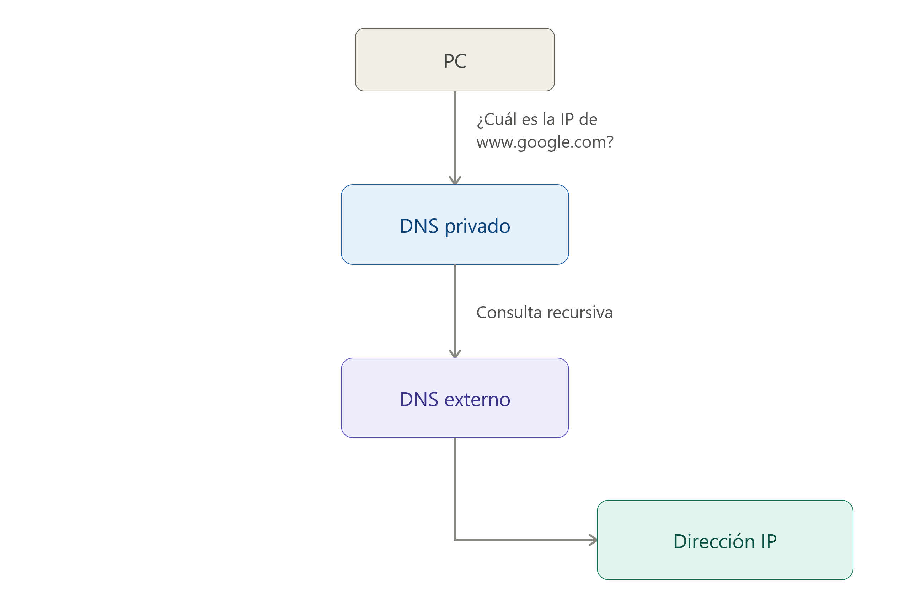
### 8.6 Comparativa DNS público vs. DNS privado

- Podemos comparar ambos tipos de servidores:

| Característica           | DNS público                  | DNS privado                          |
| ------------------------ | ---------------------------- | ------------------------------------ |
| Acceso                   | Público                      | Restringido                          |
| Usuarios                 | Cualquier usuario            | Usuarios de una organización o red   |
| Uso habitual             | Resolver nombres de Internet | Resolver nombres internos y externos |
| Ejemplo                  | `1.1.1.1`                    | `192.168.10.10`                      |
| Administración           | Proveedor externo            | Organización                         |
| Nombres internos         | Normalmente no               | Sí                                   |
| Uso en empresas          | Posible                      | Muy habitual                         |
| Accesible desde Internet | Generalmente sí              | Normalmente no                       |

## 9 - Evolución del protocolo DNS y seguridad

- El protocolo DNS ha evolucionado para adaptarse a las necesidades cada vez mayores de las redes y, especialmente, para solucionar algunos de sus problemas de seguridad.

- Dos de las principales tecnologías relacionadas con esta evolución son **DDNS (Dynamic DNS)** y **DNSSEC (DNS Security Extensions)**.

### 9.1 DDNS

- **El DDNS (Dynamic DNS o DNS dinámico)** permite actualizar automáticamente los registros de un servidor DNS cuando cambia la dirección IP asociada a un nombre de dominio.

- Su principal utilidad es permitir que un dispositivo o servidor cuya dirección IP es **dinámica** pueda seguir siendo accesible mediante un nombre de dominio, aunque su dirección IP cambie.

> ℹ️ **Ejemplo**
>
>     - Imaginemos un servidor al que queremos acceder utilizando el nombre:
> 
>         ```text
>         servidor.midominio.com
>         ```
> 
>     - Si el servidor tiene una dirección IP dinámica, esta podría cambiar periódicamente:
> 
>         ```text
>         servidor.midominio.com → 80.25.10.100
>         ```
> 
>     - y posteriormente:
> 
>         ```text
>         servidor.midominio.com → 80.25.15.200
>         ```
> 
>     - El servicio DDNS se encarga de actualizar el registro DNS para que el nombre continúe apuntando a la dirección IP actual.
> 
>     - Un mecanismo habitual consiste en que un dispositivo o servicio con conocimiento del cambio de IP comunique la nueva dirección al servidor DNS para actualizar el registro correspondiente.
> 
>     - En determinadas redes, el **servidor DHCP** puede participar en este proceso. Cuando asigna o modifica una dirección IP, puede actualizar también los registros DNS asociados. De esta forma, **DHCP y DNS pueden trabajar conjuntamente** para mantener actualizada la información de nombres y direcciones.
> 
>     !!! warning "Importante:"
>         - DDNS no es un protocolo DNS diferente.
>         - Es un mecanismo o servicio que permite realizar **actualizaciones dinámicas de los registros DNS**.
### 9.2 DNSSEC

- **DNSSEC (Domain Name System Security Extensions o extensiones de seguridad para el DNS)** es un conjunto de extensiones que permite añadir **autenticidad e integridad** a la información proporcionada por DNS.

- El funcionamiento tradicional de DNS presenta un problema: un atacante podría intentar proporcionar al cliente una respuesta DNS falsa.

> ℹ️ **Ejemplo**
>
>     - Ante una consulta como:
> 
>         ```text
>         www.banco.com → ¿cuál es su dirección IP?
>         ```
> 
>     - Un atacante podría intentar conseguir que el cliente recibiera una dirección IP incorrecta:
> 
>         ```text
>         www.banco.com → 203.0.113.50
>         ```
> 
>     - DNSSEC utiliza **firmas digitales** para que el resolver DNS pueda comprobar que los datos recibidos son auténticos y que no han sido modificados.
> 
>     - Por tanto, DNSSEC permite proteger principalmente:
> 
>         1. **La autenticidad:** comprobar que los datos DNS proceden de la zona DNS que tiene autoridad sobre ellos.
>         1. **La integridad:** comprobar que los datos no han sido modificados durante su transmisión.
> 
>     !!! warning "Importante"
>         
>         - DNSSEC **no cifra** las consultas ni las respuestas DNS. Por tanto, no proporciona confidencialidad.
>         - Tampoco garantiza por sí mismo que el usuario esté conectado directamente con su servidor DNS real. Su objetivo es permitir que el resolver pueda **validar criptográficamente la autenticidad de los datos DNS recibidos**.
> 
>     !!! warning "Importante"
>         
>         - DNSSEC protege la información DNS, pero **no protege la disponibilidad del servicio**. Por tanto, no evita los ataques de denegación de servicio (DoS o DDoS).  
>         - Además, las respuestas DNSSEC suelen ser de mayor tamaño debido a la información criptográfica que contienen. Esto puede contribuir a que determinadas configuraciones de DNS sean utilizadas en **ataques de amplificación DNS**, aunque DNSSEC no sea la causa de estos ataques.
> 
>     !!! note "En resumen"
>         - DNSSEC proporciona **autenticidad e integridad**, pero no **confidencialidad ni disponibilidad**.
### 9.3 Envenenamiento de la caché DNS

- Uno de los principales problemas de seguridad del DNS tradicional es que, si un atacante consigue introducir información DNS falsa en la caché de un servidor DNS, puede conseguir que las consultas de los usuarios sean redirigidas a direcciones IP incorrectas.

- Este ataque se conoce como **DNS cache poisoning o envenenamiento de la caché DNS**.

> ℹ️ **Ejemplo**
>
>     - Un usuario quiere acceder a la web de su banco:
> 
>         ```text
>         www.banco.com
>         ```
> 
>     - Normalmente, el servidor DNS debería proporcionar la dirección IP legítima:
>         ```text
>         www.banco.com → 198.51.100.20
>         ```
> 
>     - Sin embargo, si un atacante consigue introducir un registro falso en la caché DNS:
> 
>         ```text
>         www.banco.com → 203.0.113.50
>         ```
> 
>     - Los usuarios que reciban esa respuesta podrían ser enviados a un servidor controlado por el atacante.
> 
>     - El objetivo podría ser mostrar una página web falsa que imite a la original para intentar obtener **credenciales de acceso, datos personales u otra información confidencial**.
> 
>     - Este tipo de ataque puede utilizarse, por ejemplo, como parte de una campaña de **phishing**.
> 
>     !!! success "Prevención contra el DNS cache poisoning" 
>         - DNSSEC ayuda a prevenir el problema del ataque de envenenamiento de caché porque permite al resolver DNS comprobar mediante firmas digitales que los registros DNS recibidos son auténticos y no han sido modificados.
> 
>     !!! warning "Importante"
>         - No debemos confundir el **envenenamiento de la caché DNS** con el hecho de que un servidor DNS haya sido comprometido. 
>         - En el primer caso, el atacante intenta introducir información DNS falsa en la caché de un resolver.
>         - En el segundo, el propio servidor DNS puede haber sido tomado bajo control por el atacante.
### 9.4 Ataques Man-in-the-Middle

- Un ataque **Man-in-the-Middle (MITM)**, o **hombre en el medio**, se produce cuando un atacante consigue situarse entre dos dispositivos que se están comunicando.

> ℹ️ **Ejemplo**
>
>     - Imaginemos que un usuario cree estar comunicándose directamente con el servidor de su banco:
>         ```text
>         Cliente --→ Banco
>         ```
> 
>     - En un ataque MITM, el atacante intenta situarse entre ambos:
>         ```text
>         Cliente --→ Atacante --→ Banco
>         Cliente ←-- Atacante ←-- Banco
>         ```
> 
>     - El atacante puede recibir el tráfico, analizarlo y, dependiendo de las circunstancias y de las protecciones utilizadas, intentar modificarlo antes de reenviarlo.
> 
>     !!! warning "Importante"
>         - Un ataque MITM no es específico de DNS. **Puede producirse en diferentes tipos de comunicaciones de red**. 
>         - Además, utilizar DNSSEC no sustituye a mecanismos como **HTTPS/TLS**, que son los encargados de proteger la comunicación entre el navegador y el servidor web.
## 10 - Registros DNS

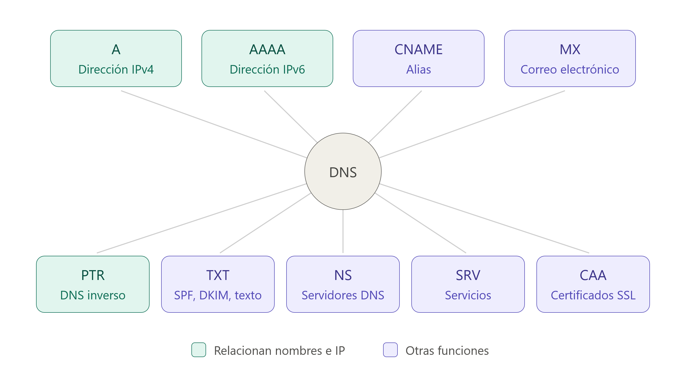

### 10.1 Introducción

1. Los **registros DNS** son datos que contienen información sobre los nombres de dominio y los servicios asociados a ellos.

    > ℹ️ **Ejemplo**
>
>         - Un registro de tipo **A** permite asociar un nombre de dominio con **una dirección IPv4**:
> 
>         ```text
>         www.ejemplo.com → 192.0.2.10
>         ```
1. En los **servidores DNS autoritativos**, estos registros pueden almacenarse en **archivos de zona**. Un archivo de zona es un archivo de texto que contiene los registros DNS y determinadas directivas que describen una zona DNS.

    > ℹ️ **Ejemplo**
>
>         - Un archivo de zona puede contener registros como:
> 
>             ```text
>             ejemplo.com.      IN    A       192.0.2.10
>             www               IN    A       192.0.2.10
>             mail              IN    A       192.0.2.20
>             ```
1. La **sintaxis de los archivos de zona** establece cómo deben escribirse estos registros y directivas para que el servidor DNS pueda interpretarlos correctamente.

    > ℹ️ **Ejemplo**
>
>         - Cuando un usuario introduce en su navegador una dirección como:
> 
>             ```text
>             https://www.ejemplo.com/index.html
>             ```
> 
>         - El navegador necesita conocer la dirección IP asociada al nombre de host **[www.ejemplo.com](http://www.ejemplo.com)**.
>         
>         - Para obtenerla, se inicia una **consulta DNS**.
> 
>         - El equipo del usuario normalmente realiza la consulta a un **servidor DNS recursivo** o *resolver*.
>         
>         - Este servidor puede disponer de la respuesta en su **caché**. Si no la tiene, puede realizar consultas a otros servidores DNS hasta encontrar la información necesaria.
1. En una resolución DNS pueden intervenir diferentes tipos de servidores, entre ellos:

    - **Servidores DNS recursivos:** reciben las consultas de los clientes y se encargan de obtener la respuesta.
    - **Servidores DNS raíz:** indican qué servidores son responsables de los diferentes dominios de nivel superior (*Top-Level Domains* o  TLD), como `.com`, `.org` o `.es`.
    - **Servidores DNS de TLD:** indican cuáles son los servidores autoritativos responsables de un dominio concreto.
    - **Servidores DNS autoritativos:** contienen la información oficial de una zona DNS y proporcionan los registros correspondientes.

### 10.2 TTL (Time To Live)

- Los registros DNS incluyen un valor denominado **TTL (Time To Live)**.

- El TTL indica **durante cuánto tiempo puede mantenerse un registro DNS en la caché de un servidor DNS recursivo antes de que deba volver a consultarse**.

    > ℹ️ **Ejemplo**
>
>         - Si un registro tiene:
> 
>             ```text
>             www.ejemplo.com.    3600    IN    A    192.0.2.10
>             ```
> 
>         - El valor `3600` representa un TTL de **3600 segundos**, es decir, **1 hora**.
> 
>         - Durante ese periodo, un servidor DNS recursivo puede utilizar la información almacenada en su caché sin tener que volver a consultar al servidor autoritativo.
> 
>         !!! warning "Importante" 
>             - El TTL **no indica cada cuánto tiempo se actualiza el registro en el servidor DNS autoritativo**.
>             - Indica cuánto tiempo otros servidores pueden conservar ese registro en su caché.
### 10.3 Tipos de Registros DNS

#### 10.3.1 Registro A (Address)

- Los registros de direcciones, o registros A, son los registros DNS más utilizados. Crean una conexión directa entre **una dirección IPv4** y un nombre de dominio.
- Permiten que un navegador web cargue un sitio utilizando un nombre de dominio legible, evitando que el usuario tenga que recordar complejas direcciones IP numéricas.
- **Redundancia**: Es posible configurar múltiples registros A para un mismo dominio, lo que proporciona respaldo y redundancia en caso de fallos.
- **Seguridad**: Se utiliza también en listas negras basadas en DNS (DNSBL) para bloquear correos provenientes de fuentes de spam conocidas.

> 💡 **Sintaxis típica**
>
>     midominio.com. IN A 192.0.2.15.
#### 10.3.2 Registro AAAA (Quad A)

- Funciona de manera similar al registro A, pero conecta nombres de dominio **con direcciones IPv6**.
- Aunque menos común que IPv4, su adopción global va en aumento para resolver el problema del agotamiento de las direcciones IPv4 tradicionales.

> 💡 **Sintaxis típica**
>
>     midominio.net. IN AAAA 2001:0db8:85a3:0000:0000:8a2e:0370:1234
#### 10.3.3 Registro CNAME (Canonical Name)

- Los registros de nombres canónicos, o registros CNAME, dirigen un dominio de alias a un dominio canónico.
- Los registros CNAME se usan a menudo para asignar un nombre de dominio con un alias al dominio principal que lleva el registro A o AAAA.

> ℹ️ **Ejemplo**
>
> 
>     - En lugar de crear dos registros A para `www.example.com` y `product.example.com`, puede vincular `product.example.com` a un **registro CNAME** que luego se **vincula a un registro A** para `example.com`.
>     - El valor es que si la dirección IP cambia para el dominio raíz, solo se tendrá que actualizar el registro A y el CNAME se actualizará en consecuencia.
>     - Restricciones de configuración:
>         1. No se puede ubicar un registro CNAME en el dominio de raíz.
>         1. Los registros de servidores de correo (MX) y servidores de nombres (NS) nunca deben estar dirigidos a un CNAME.
>         1. Aunque técnicamente es posible apuntar un CNAME a otro CNAME, esta práctica no se recomienda porque resulta ineficaz y ralentiza la velocidad de carga.
#### 10.3.4 Registro DNAME

- Los registros de nombres de delegación, o registros DNAME, se utilizan para redirigir varios subdominios con un registro y apuntarlos a otro dominio.

> ℹ️ **Ejemplo**
>
> 
>     - Un registro DNAME que vincule `domain.com` a `example.com` vinculará `product.domain.com`, `trial.domain.com`, y `blog.domain.com` a `example.com`. 
>     - Estos registros son útiles para administrar dominios a gran escala y para administrar cambios de nombres de dominio al garantizar que los subdominios estén vinculados correctamente.
#### 10.3.5 Registros CAA

- Los registros de autorización de autoridad de certificación, o registros CAA, permiten a los propietarios de dominios especificar qué **autoridades de certificación (CA)** pueden emitir certificados para su dominio.

- Una CA es una organización que valida la identidad de los sitios web y los conecta a claves criptográficas mediante la emisión de certificados digitales.

#### 10.3.6 Registro NS (Nameserver)

- Especifica qué servidor de nombres o servidor DNS en particular actúa como la autoridad autoritativa para un dominio o subdominio.

> ⚠️ **Importante**
>
>     - El registro NS indica qué servidor **alberga físicamente los archivos de zona del dominio**.
>     - Sin un registro NS debidamente configurado, es imposible cargar o acceder a un sitio web.
#### 10.3.7 Registro MX (Mail Exchange)

- Los registros MX son indispensables para la recepción de correos electrónicos bajo el nombre de dominio.

- Indica cuáles son los servidores de correo autorizados para recibir los mensajes mediante el protocolo SMTP.

> ℹ️ **Sintaxis típica**
>
>     midominio.com. IN MX 10 mail.midominio.com.
#### 10.3.8 Registro TXT

- Permite que un administrador pueda almacenar notas de texto en el registro. Estos registros se suelen utilizar para la seguridad del correo electrónico.

#### 10.3.9 Registros CERT

- Los certificados, o registros CERT, almacenan certificados que verifican la autenticidad de todas las partes involucradas.  

- Este tipo de registro es particularmente valioso cuando se protege y encripta información confidencial.

#### 10.3.10 Registros SOA

Los registros de inicio de autoridad, o registros SOA, almacenan información administrativa importante sobre un dominio. Esta información puede incluir la dirección de correo electrónico del administrador del dominio, información sobre las actualizaciones del dominio y cuándo un servidor debe actualizar su información.

#### 10.3.11 Registros PTR

Los registros de puntero, o registros PTR, funcionan en la dirección opuesta a los registros A. Se utilizan para **conectar una dirección IP con un nombre de dominio, en lugar de un nombre de dominio con una dirección IP**.

Cuando una búsqueda de DNS comienza con una dirección IP, encuentra el nombre de host correspondiente. Estos registros se utilizan para detectar spam comprobando si las direcciones IP y las direcciones de correo electrónico asociadas son utilizadas por servidores de correo electrónico legítimos. El host del servidor debe configurar los registros PTR.

## 11 - Herramientas de diagnóstico técnico de registros DNS

Para verificar y solucionar problemas con las zonas DNS, los administradores de sistemas y profesionales de redes emplean herramientas de terminal populares:

> 💡 **nslookup**
>
>     - **nslookup** permite consultar de forma rápida la dirección IP asociada a un dominio y ver registros básicos como A, MX o NS.
> 💡 **dig (Domain Information Groper)**
>
>     - **dig** (Domain Information Groper): Ofrece información mucho más profunda y detallada sobre las consultas DNS, incluyendo los tiempos de respuesta del servidor y la jerarquía de autoridad.
## 12 - Tarea RA2-CEb-1 - Resolución manual de un dominio

- El proposito de esta tarea es que el alumno comprenda cómo se resuelve un nombre de dominio en Internet y cómo se obtiene la dirección IP asociada a ese nombre.
- Para el ejemplo usaremos el dominio `www.aules.edu.gva.es` y realizaremos la resolución de forma manual, paso a paso, para comprender el proceso completo.

### 12.1 Paso 1: Consulta al servidor raíz

- El primer paso en la resolución de un nombre de dominio es consultar a un **servidor raíz**. Los servidores raíz son los encargados de dirigir las consultas hacia los servidores de nivel superior (TLD) correspondientes.

> ℹ️ **Enunciado paso 1**
>
>     ==Preguntas a responder==  
> 
>     - ¿Quién realiza la consulta inicial al servidor raíz para obtener información sobre el TLD?
>     - ¿Cuál es el TLD (Top-Level Domain) del dominio `www.aules.edu.gva.es`?
>     - Consultar la base de datos de [iana.org](https://www.iana.org/domains/root/db) para verificar si el TLD está registrado.
>     - Consultar la base de datos de [iana.org](https://www.iana.org/domains/root/servers) para obtener la lista de servidores raíz y sus direcciones IP (también se puede realizar la consulta a [root-servers.org](https://www.root-servers.org/)).
>     - ¿Cuál es la dirección IP del servidor raíz `Verisign, Inc.`?
>     ---
>     ==Realizar captura de pantalla==  
> 
>     - Para realizar la consulta al servidor raíz, podemos utilizar herramientas como `nslookup` o `dig`. Por ejemplo, podemos ejecutar el siguiente comando en la terminal:
>         ```bash
>         nslookup -type=NS es a.root-servers.net
>         ```
> 
>         !!! info "Explicación de la línea de comando"
>             - `nslookup`: herramienta de línea de comandos para consultar servidores DNS y resolver nombres de dominio.
>             - `-type=NS`: indica que queremos consultar los registros NS (Name Server), es decir, quieremos saber qué servidores DNS son los autoritativos (los "oficiales") para ese dominio.
>             - `es`: el TLD que estamos consultando.
>             - `a.root-servers.net`: el servidor raíz al que le estamos preguntando directamente (en lugar de usar el servidor DNS configurado por defecto en nuestro equipo).
>                 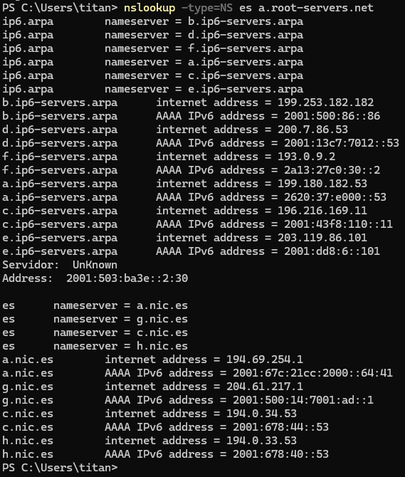
### 12.2 Paso 2: Consulta del dominio gva.es al servidor de dominio (.es)

> ℹ️ **Enunciado paso 2**
>
>     ==Preguntas a responder==  
> 
>     - ¿Quién realiza la consulta al servidor autoritativo del TLD .es para obtener información sobre el dominio gva.es?
> 
>     ---
> 
>     ==Realizar captura de pantalla==  
> 
>     - ¿Cuál sería la línea de comando para consultar los servidores autoritativos de gva.es?
>         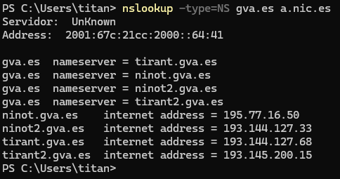
### 12.3 Paso 3: Consulta del subdominio aules.edu.gva.es al servidor de dominio (gva.es)

> ℹ️ **Enunciado paso 3**
>
>     ==Preguntas a responder==  
> 
>     - ¿Quién realiza la consulta al servidor autoritativo para obtener información sobre el dominio aules.edu.gva.es?
>     
>     ---
> 
>     ==Realizar captura de pantalla==  
> 
>     - ¿Cuál sería la línea de comando para consultar los servidores autoritativos de aules.edu.gva.es?
>         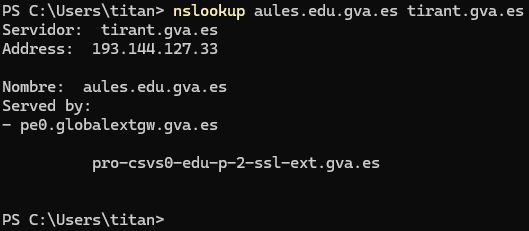
### 12.4 Paso 4: Consulta final del subdominio aules.edu.gva.es

> ℹ️ **Enunciado paso 4**
>
>     ==Preguntas a responder==  
> 
>     - ¿Quién realiza la consulta al servidor autoritativo para obtener información sobre el dominio aules.edu.gva.es?
>     
>     ---
> 
>     ==Realizar captura de pantalla==  
> 
>     - ¿Cuál sería la línea de comando para consultar los servidores autoritativos de aules.edu.gva.es?
>         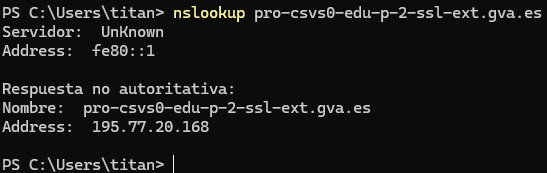
>     - ¿Cuál es el nombre canonico de aules.edu.gva.es?
>         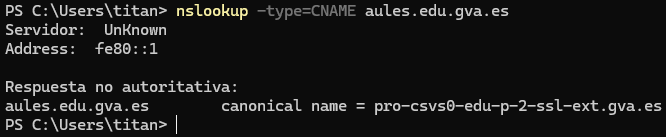
### 12.5 Paso 5: Confirmación de la IP

> ℹ️ **Enunciado paso 5**
>
>     ==Preguntas a responder==  
>     ==Realizar captura de pantalla==  
> 
>     - ¿Qué ocurre si escribimos la IP en el navegador? ¿Se abre la web de aules.edu.gva.es?
>     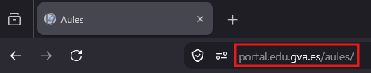
---

## 13 - Tarea RA2-CEb-2 - Resolución manual de un dominio

> ℹ️ **Pregunta**
>
>     ==Preguntas a responder==  
> 
>     - Redactar el comando para consultar el dominio gmail.es y obtener los servidores autoritativos de correo electrónico de gmail.es.
>     
>     ---
> 
>     ==Realizar captura de pantalla==  
> 
>     - Resultado esperado:
>         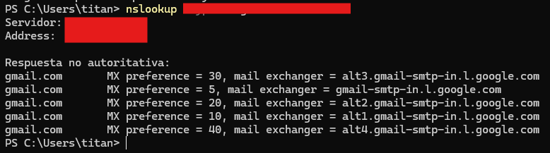
> 
>     ==Realizar captura de pantalla==  
> 
>     - Redactar el comando para consultar la IP de uno de los servidores.
>         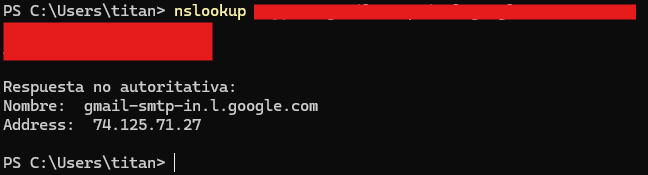

---

## 14 - Tarea RA2-CEde-1 - Instalación y configuración de un servidor DNS con Windows Server 2025

!!! abstract "Instalar AD DS con DNS"  
    - Antes de instalar y configurar el rol de servidor DNS, instalaremos el rol de Active Directory Domain Services (AD DS), ya que en este caso queremos un DNS integrado en un dominio de Active Directory (el escenario más habitual en entornos empresariales).

!!! abstract "Motivos para instalar AD DS con DNS"  
    - Aunque el rol DNS de Windows Server no requiere AD DS para funcionar, cuando DNS da servicio a un dominio de AD conviene que estén integrados.
    - Al promover el servidor a controlador de dominio, si no existe ya un servidor DNS accesible para el dominio, Windows instala y configura automáticamente el rol DNS, creando la zona correspondiente con los registros SRV necesarios para la localización de los controladores de dominio (LDAP, Kerberos, etc.).
    - Esto simplifica la práctica: en vez de instalar y configurar DNS manualmente y luego preparar la integración con AD, dejamos que el propio proceso de promoción a DC lo resuelva.

### 14.1 Active Directory Domain Services (AD DS)

> 💡 **Red domestica vs red empresarial**
>
>     1. **En una red doméstica**, cada equipo se administra de forma individual: el usuario configura sus propios permisos, contraseñas, accesos a dispositivos, etc.
>     1. **En una empresa empresarial** con decenas o cientos de equipos, gestionar la seguridad equipo por equipo es inviable al resultar lento, costoso y, sobre todo, inconsistente.
>     1. Una parte importante de los incidentes de seguridad en las organizaciones no se debe a fallos de las herramientas de protección (firewall, VPN, antivirus), sino a errores de configuración en los equipos y servicios de red.
>     1. Por ello, es fundamental poder definir de **forma centralizada** qué puede o no puede hacer el usuario final en los equipos de la empresa, por ejemplo:
> 
>         - Deshabilitar los puertos USB de los equipos de la empresa.
>         - Limitar el acceso a ciertos sitios web.
>         - Restringir el acceso al disco duro local de los equipos.
>         - Restringir el uso de archivos ejecutables descargados de Internet.
>         - Instalar software solo desde repositorios oficiales de la empresa.
>         - Forzar políticas de contraseñas seguras y definir la caducidad de las mismas.
> 💡 **AD DS**
>
>     1. AD DS es el rol de Windows Server que permite centralizar la gestión de identidades (usuarios, equipos, grupos) de toda la organización en un dominio, y aplicar de forma automática y uniforme políticas de seguridad y configuración mediante Directivas de Grupo (GPO – Group Policy Objects).
>     1. Por este motivo, antes de instalar y configurar el rol de servidor DNS, instalaremos primero el rol de Active Directory Domain Services (AD DS).
>     1. **AD DS Será la base** sobre la que se sustente la **gestión centralizada** de usuarios, equipos y políticas de seguridad de nuestra organización, y también porque el propio proceso de instalación de AD DS se encarga de configurar el servicio DNS necesario para el funcionamiento del dominio.
### 14.2 Instalación del rol AD DS en AWS

Para la instalación del rol AD DS en un servidor Windows Server 2025 en AWS, seguiremos los siguientes pasos:


> ℹ️ **:one: - Lanzar una nueva instancia de Windows Server 2025 en AWS**
>
>     - En este caso definiremos en qué subred de la VPC se encuentra la instancia EC2, ya que esto puede afectar a la conectividad y al rendimiento de la red
>     - Resumen de la configuración de la instancia (acordarse de seleccionar el par de clave `vockey` para el inicio de sesión y seleccionar `50GiB` de capacidad para el volumen de la instancia).  
>     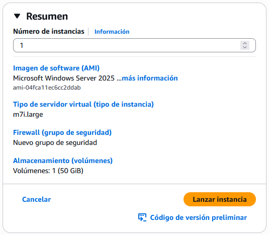
>     - Captura del apartado de configuración de red dónde eligiremos la Subred en la cual desplegaremos nuestra instancia.  
>     ==Realizar captura de pantalla==
>     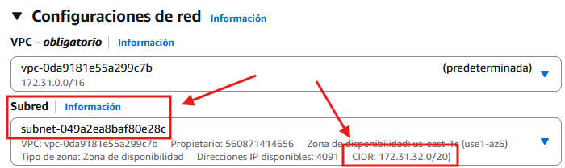
>     - Esperaremos a que la instancia esté disponible. A partir de entonces nos conectaremos a la instancia por `RDP`.
>     ==Realizar captura de pantalla==
>     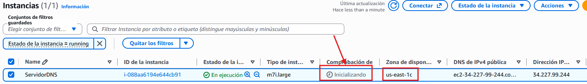
> ℹ️ **:two: - Renombrar la máquina creada**
>
>     ==Realizar captura de pantalla==
>     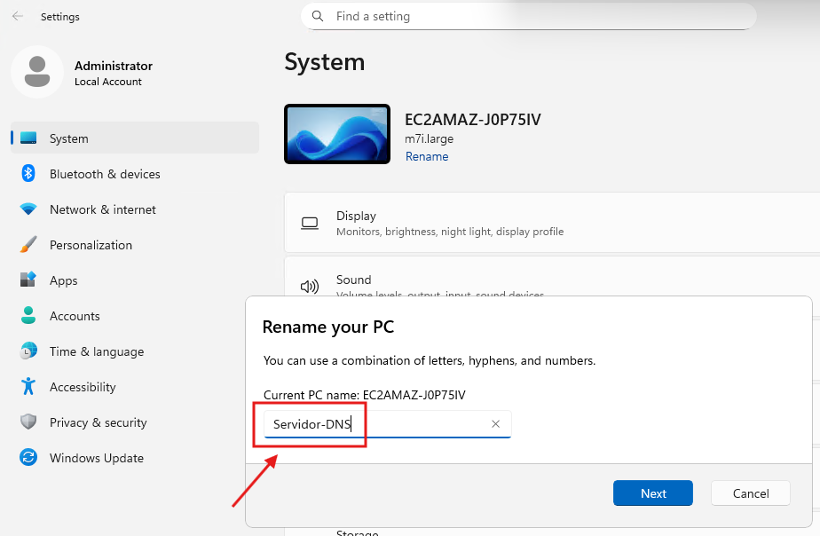
> ℹ️ **:three: - Añadir el rol Active Directory Domain Services (AD DS)**
>
>     ==Realizar captura de pantalla==
>     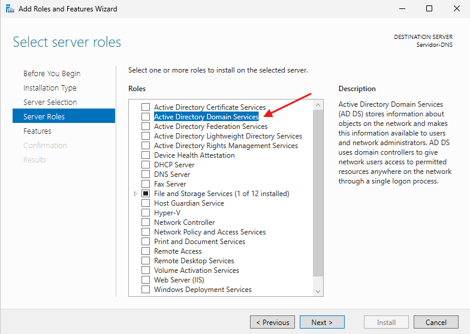
> 
>     - Dejamos el resto de opciones con los valores por defecto.
>     - En la página de `Confirmation` marcamos la opción de `Restart if required`.
>     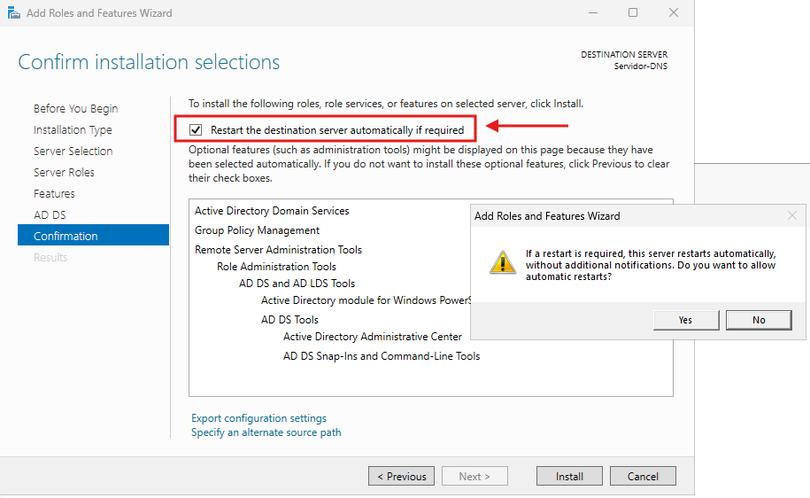
> ℹ️ **:four: - Promover el servidor a controlador de dominio**
>
>     - Una vez finalizada la instalación del servicio el sistema nos pedirá **promover el servidor a controlador de dominio**.
>     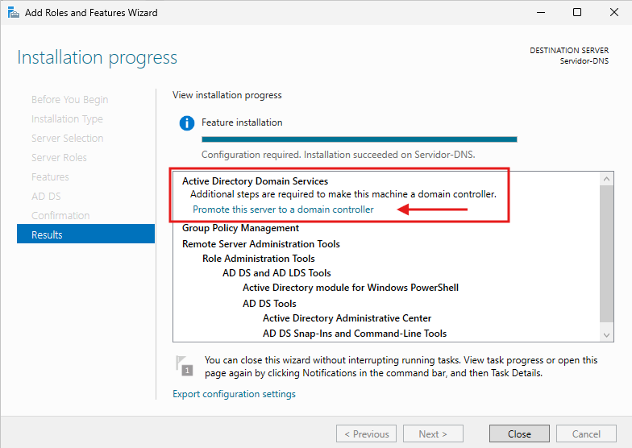
>     ==Realizar captura de pantalla==
>     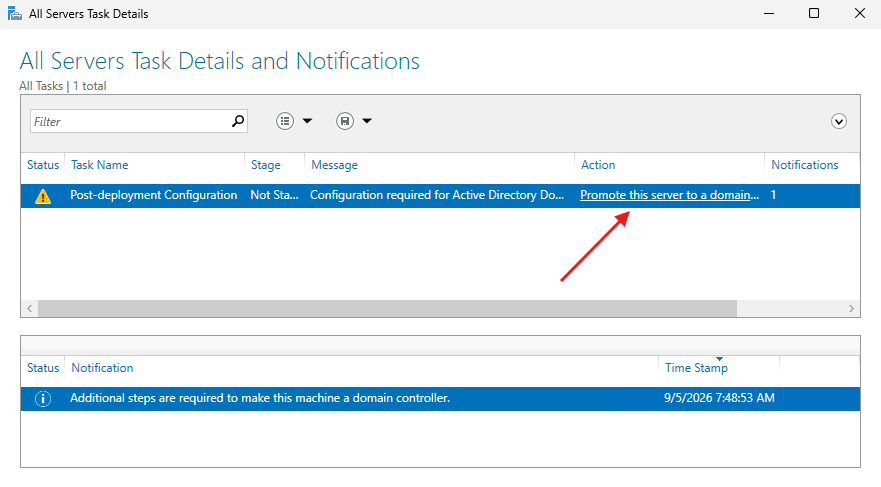
> ℹ️ **:five: - Creación de los bosques de AD DS**
>
>     !!! warning "- Un bosque de AD DS es una estructura que permite organizar y administrar de forma centralizada los usuarios, equipos y recursos de una organización.<br>- Para funcionar, utiliza la tecnología DNS, la misma que se emplea en Internet para traducir nombres en direcciones IP.<br>- Sin embargo, un bosque de Active Directory es independiente de los dominios de Internet, ya que tiene su propia estructura y finalidad."
> 
>     - En `Deployment Configuration` seleccionamos `Add a new forest` e introducimos un nombre de dominio para el dominio de AD interno.
>     - El código de buenas prácticas de Microsoft recomienda usar **el nombre de dominio de la empresa (de internet) + un subdominio (ad)**.  
>     ==Realizar captura de pantalla==
>     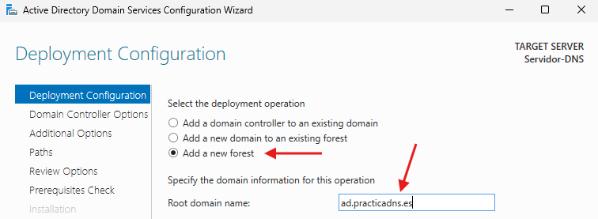
> 
>     - Al ser un bosque nuevo, dejaremos los valores por defecto de los niveles funcionales.  
>     - Como AD requiere de un servidor DNS para funcionar, nos viene la opción DNS marcada por defecto.  
> ℹ️ **:six: - Opciones del servidor DNS**
>
>     - Introduciremos la contraseña de restauración de servicios de directorio (**DSRM – Directory Services Restore Mode**), que se utiliza para iniciar el servidor en modo de recuperación de AD en caso de fallo grave. **No se recomienda que esta contraseña coincida con la contraseña de administrador**.
>     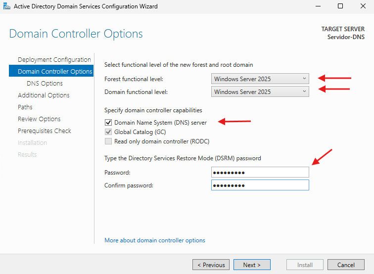
>     - En `DNS Options` nos aparecerá un aviso indicando que no se puede crear una delegación para este servidor DNS, ya que no existe una zona superior (padre) que la administre.
>     - Es un aviso esperado al crear un bosque nuevo (todavía no existe ningún dominio DNS previo al que delegar) y lo podemos ignorar.  
>     ==Realizar captura de pantalla==
>     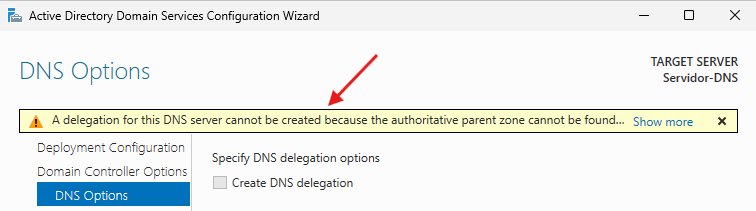
> ℹ️ **:seven: - Opciones adicionales de AD DS**
>
>     - En `Additional Options` dejaremos el nombre por defecto de dominio de NetBIOS (solo para compatibilidad con equipos antiguos / obsoletos).
>     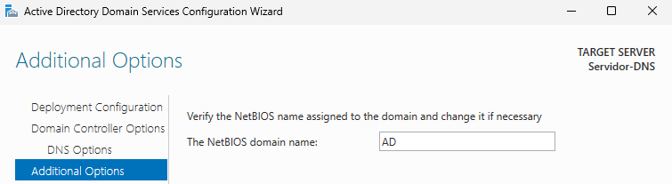
> ℹ️ **:eight: - Comprobación de pre-requisitos**
>
>     - Continuamos por las ventanas de `Paths` (donde se define la ubicación de la base de datos de AD, los logs y el volumen SYSVOL) y `Review Options` (resumen de toda la configuración elegida).  
>     - En `Prerequisites Check` apuntaremos las advertencias para gestionarlas más adelante (entre ellas, es habitual que aparezca un aviso relacionado con la configuración de IP estática del servidor).
>     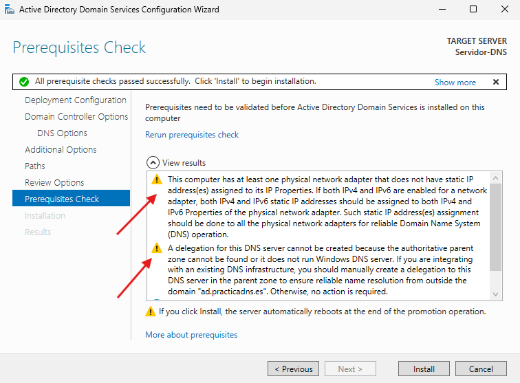
> ℹ️ **:nine: - Nuevo inicio de sesión bajo AD DS**
>
>     - Una vez reiniciada la máquina, veremos que aunque parezca que no ha ocurrido nada, ahora iniciamos sesión como **DOMINIO\Administrador** (cuenta de dominio) en lugar de como administrador local del servidor.
>     - Podemos comprobarlo, por ejemplo, ejecutando `whoami` en una consola.
>     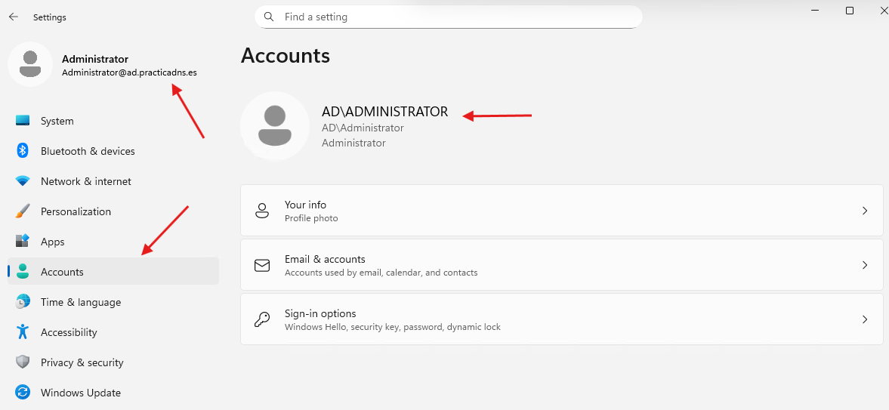
> ℹ️ **:one::zero: - Consideraciones sobre AD DS**
>
>     - Active Directory necesita que **la IP del controlador de dominio no cambie**, ya que los registros DNS y SRV del dominio se generan sobre esa IP.
>     - En AWS, la IP privada de una instancia EC2 es **estática por naturaleza** mientras no se elimine la instancia (sobrevive a stop/start, reinicios, etc.), por lo que no es necesario realizar ningún cambio a nivel de AWS.
>     - Aún así, es recomendable **fijar esa misma IP privada como estática dentro de la configuración de red de Windows** (en lugar de dejarla en modo DHCP), para evitar problemas si el adaptador de red se reinicia.
>     - Para ello, buscaremos en EC2 → Detalles la IP privada actual de nuestra instancia (en este ejemplo, 172.31.39.10) y configuraremos esa **misma IP** como estática en las propiedades de red de Windows.
> 
>     !!! warning "Importante"
>         ==Realizar captura de pantalla==  
> 
>         - La IP que configuremos manualmente en Windows debe **coincidir siempre** con la IP privada que AWS ya tiene asignada a la instancia.
>         - Si configuramos una IP diferente, la instancia perderá la conectividad de red, ya que AWS solo enruta tráfico a las IPs asociadas a esa interfaz de red (ENI).
>     - Si además de la IP privada estática queremos que el servidor tenga una **IP pública fija** para acceso desde Internet, esto se resuelve mediante una **Elastic IP (EIP)**, que es un concepto independiente de la IP privada usada por AD/DNS internamente:
> 
>         1. Al crear una Elastic IP y asociarla a la instancia, esta IP pública no cambiará mientras esté asociada, ni siquiera si la instancia se detiene y se vuelve a iniciar.
>         1. Si en el futuro queremos eliminar o reemplazar la instancia sin perder la IP pública, podemos mover la Elastic IP a una Elastic Network Interface (ENI) separada, que podremos desasociar y volver a asociar a otra instancia cuando haga falta.
>     
>     ==Pregunta a responder==  
>     !!! question "En un entorno no AWS (no virtual), ¿cómo se configuraría la interfaz de red de nuestra máquina a IP estática?"
> ℹ️ **:one::one: - Finalización de instalación del AD DS y del servidor DNS**
>
>     - Después de un tiempo, aparecerán los servicios AD DS y DNS en nuestra máquina.
>     - Servicio AD DS
>     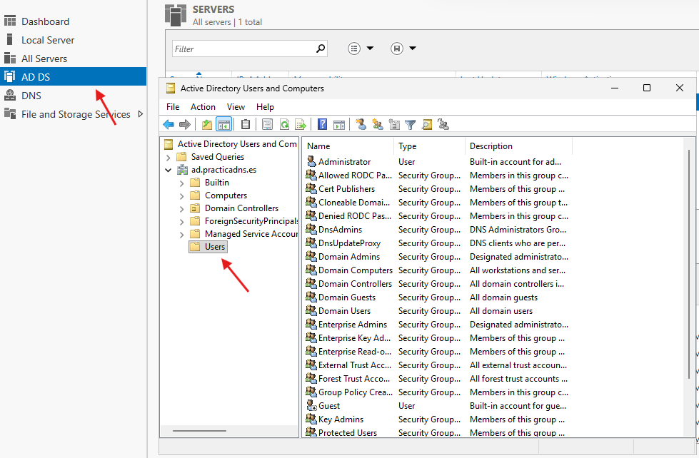
>     - Servicio DNS
>     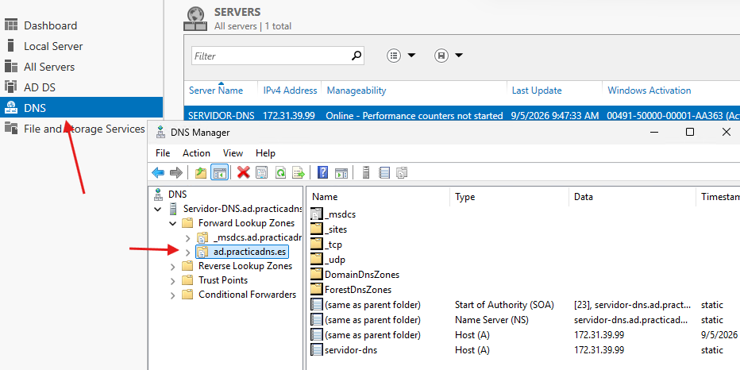
> ℹ️ **:one::two: - Verificación final**
>
>     Para comprobar que el dominio y el DNS han quedado correctamente configurados, haremos lo siguiente:  
> 
>     - Ejecutar `dcdiag` en una consola para diagnosticar el estado del controlador de dominio.  
>     ==Realizar captura de pantalla==  
> 
>     - Ejecutar `nslookup <nombre-del-dominio>` para comprobar que el propio servidor resuelve correctamente los registros de su dominio.  
>     ==Realizar captura de pantalla==  
> 
>     - Abrir la consola "Usuarios y equipos de Active Directory" para confirmar que el dominio se ha creado correctamente.  
>     ==Realizar captura de pantalla==  


---
