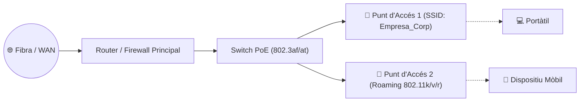

  

    🏆 <strong>Progrés d'aquesta secció:</strong> 0 de 4 superats (0%)
    ⭐ <strong>0 punts</strong>
  

  

    

  

# 5.2 Punts d'Accés (AP), Modes d'Operació i Encaminadors Sense Fils (RA7-CEa, CEb, CEc, CEf)

## 1. Modes de Funcionament dels Punts d'Accés (Access Points) — RA7-CEb

Un **Punt d'Accés (WAP / AP)** és un dispositiu de Capa 2 que actua com a pont (*bridge*) entre la xarxa cablejada Ethernet (`IEEE 802.3`) i la xarxa sense fils (`IEEE 802.11`).

### Modes d'Operació Principals:
1. **Mode Punt d'Accés (Root AP / Infrastructure Mode):** Crea una cel·la bàsica de servei (**BSS**) identificada per un **BSSID** (MAC de la ràdio) i publica un o diversos noms de xarxa (**SSID**).
2. **Mode Repetidor / Extensor de Rang (Repeater / Mesh):** Amplia la cobertura d'un AP existent reenviant el trànsit sense fil (o mitjançant *backhaul* dedicat en sistemes **Mesh**).
3. **Mode Client Sense Fil (Station / Bridge Client):** L'AP es connecta com a client a una altra xarxa Wi-Fi i dona eixida per cable Ethernet a equips que no tenen targeta Wi-Fi.
4. **Arquitectura Empresarial amb Controlador (WLC) i VLANs per SSID:** Permet publicar múltiples SSIDs sobre el mateix AP físic (ex. `Corporativa` en la `VLAN 10` i `Convidats` aïllada en la `VLAN 20`).

---

## 2. L'Encaminador Sense Fils (Wireless Router) — RA7-CEf

Un **encaminador sense fils** integra en un únic xassís tres dispositius lògics:
- **Router NAT/Firewall (Capa 3):** Connecta el port **WAN** (Internet/Xarxa pública) amb la **LAN** privada aplicant NAT/PAT i servidor DHCP.
- **Switch Ethernet (Capa 2):** Connecta equips per cable als ports LAN.
- **Punt d'Accés Wi-Fi (Capa 2):** Proporciona cobertura sense fil integrada amb la LAN.

---

## 🎮 Reptes Interactius d'Autoavaluació (+100 XP)

Comprova el teu domini sobre **5.2 Punts d'Accés (AP), Modes d'Operació i Encaminadors Sense Fils (RA7-CEa, CEb, CEc, CEf)** superant aquests 4 reptes gamificats (+25 punts cadascun):

  
🎯 <strong>Repte 1 (+25 pts):</strong> En el desplegament d'una xarxa sense fils corporativa segura, quin protocol d'autenticació evita compartir una mateixa clau precompartida (PSK) entre tots els usuaris?

  

    <button type="button" class="btn-mcq-opt" data-opt="A">A) WPA2/WPA3-Enterprise amb IEEE 802.1X i un servidor RADIUS.</button>
    <button type="button" class="btn-mcq-opt" data-opt="B">B) WEP de 64 bits amb filtratge MAC.</button>
    <button type="button" class="btn-mcq-opt" data-opt="C">C) WPS mitjançant PIN de 8 dígits.</button>
    <button type="button" class="btn-mcq-opt" data-opt="D">D) Cap de les anteriors és correcta.</button>
  

  

  
🎯 <strong>Repte 2 (+25 pts):</strong> Quins són els tres canals no solapats recomanats en la banda de 2,4 GHz (estàndard 802.11g/n/ax) a Europa?

  

    <button type="button" class="btn-mcq-opt" data-opt="A">A) Canals 1, 2 i 3</button>
    <button type="button" class="btn-mcq-opt" data-opt="B">B) Canals 36, 40 i 44</button>
    <button type="button" class="btn-mcq-opt" data-opt="C">C) Cap de les anteriors és correcta.</button>
    <button type="button" class="btn-mcq-opt" data-opt="D">D) Canals 1, 6 i 11</button>
  

  

  
✅ <strong>Repte 3 (Vertader o Fals · +25 pts):</strong> Un Punt d'Accés (AP) en mode Infraestructura (BSS/ESS) connecta els clients sense fils amb la xarxa cablejada mitjançant un pont a nivell d'enllaç.

  

    <button type="button" class="btn-vf" data-opt="V">Vertader (V)</button>
    <button type="button" class="btn-vf" data-opt="F">Fals (F)</button>
  

  

  
⌨️ <strong>Repte 4 (+25 pts):</strong> Quin és l'acrònim de l'identificador públic del nom d'una xarxa Wi-Fi (4 lletres)?

  

    <input type="text" class="quiz-input" placeholder="Escriu la resposta..." />
    <button type="button" class="btn-quiz-check">Comprovar</button>
  

  

### 📋 Llista de Comprovació i Rúbrica d'Assoliment

Marca cada criteri a mesura que completes l'estudi o la resolució pràctica d'aquesta pàgina (**5.2 Punts d'Accés (AP), Modes d'Operació i Encaminadors Sense Fils (RA7-CEa, CEb, CEc, CEf)**):

- [ ] He llegit detingudament la teoria o l'enunciat d'aquesta secció i he anotat els conceptes clau.
- [ ] He revisat els esquemes, taules o blocs de codi i he verificat que sé aplicar-los a l'entorn de treball.
- [ ] He resolt correctament els **4 reptes interactius** superiors obtenint els **100 punts XP**.
- [ ] He descarregat el comprovant oficial en PDF per a adjuntar-lo a la tasca d'**Aules**.

  <h3>📤 Comprovant de Lliurament per a Aules</h3>
  
Quan hages completat els reptes interactius i la llista d'autoavaluació d'aquesta pàgina, introdueix el teu nom i descarrega el teu certificat oficial en PDF per a adjuntar-lo a la tasca d'<strong>Aules</strong>.

  

    <label for="aules-student-name">👤 Nom i Cognoms de l'Alumne/a:</label>
    <input type="text" id="aules-student-name" class="aules-student-name" placeholder="Ex: Joan Garcia Pérez" />
  

  

    0/4 reptes completats (0%) · 0 punts · 0/4 criteris d'autoavaluació
  

  

    <button type="button" class="btn-aules-dl" data-module="SEX" data-unit="UD05" data-activity="ut0502">📥 Descarregar Comprovant PDF</button>
    <button type="button" class="btn-aules-copy">📋 Copiar Resum al Porta-retalls</button>
  

  

