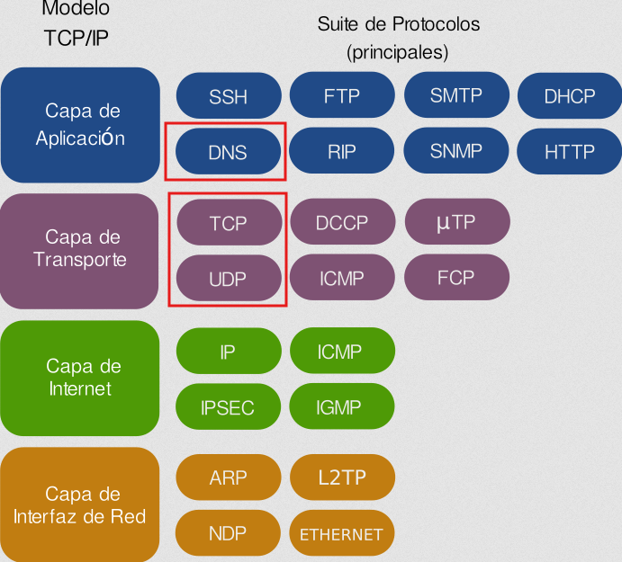
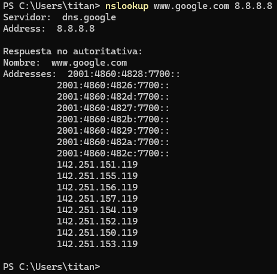

## 2 - Protocolo DNS

- **El servicio de nombres de dominio utiliza el protocolo DNS para realizar las consultas y las respuestas**.
- Se trata de un protocolo de **capa de aplicación** que puede utilizar tanto UDP como TCP en la capa de transporte.
- **El servidor DNS utiliza el puerto 53** para realizar las consultas y recibir las respuestas.
- Habitualmente, tanto las consultas del cliente como las respuestas del servidor caben en un datagrama (512 bytes) y se utiliza UDP (de hecho, generalmente se dice que el DNS usa UDP).
- Si la información a transmitir es amplia (por ejemplo, una respuesta con una lista con mucha información), la comunicación pasa a TCP automáticamente.
- Otro caso en el que la comunicación es por TCP es cuando se realiza la transferencia de información de una zona entre **servidores primarios y secundarios**.

> 💡 **Resumen de los que hemos visto**
>
>     - El protocolo DNS es habitualmente UDP, pero puede ser TCP y UDP.
>     - Se trata de un protocolo de capa de aplicación y utiliza el puerto 53.
>     - Los datagramas DNS se componen de varios apartados, tal como se puede ver en la siguiente consulta con host:
> 
>         !!! example "Ejemplo de consulta DNS"
>                 
> 
>             !!! abstract "Explicación del comando" 
>                 - **nslookup**: Herramienta utilizada para consultar a **los servidores de nombres DNS** y obtener información sobre direcciones IP o registros de dominio.
>                 - **www.google.es**: Dominio objetivo cuya dirección IP (o registros asociados) deseamos consultar.
>                 - **8.8.8.8**: Dirección IP del servidor DNS específico **al que hemos realizado la consulta**.        
>     
>             !!! question "¿Qué significa 'Respuesta no autoritativa'"
