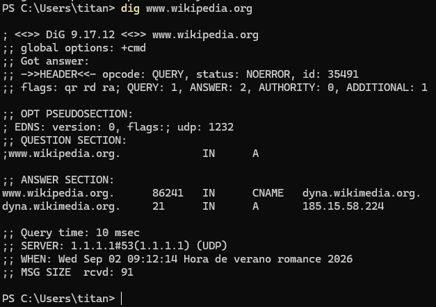

## 3 - Mecanismos de comunicación DNS

- La comunicación DNS es un mecanismo de consulta/respuesta de tipo **cliente / servidor**.
- Los datagramas, por tanto, serán de query (consulta) o de answer (respuesta).

> 💡 **Los apartados que componen un mensaje DNS son:**
>
> 
>      - **HEADER**. Cabecera del mensaje que indica si se trata de una consulta o de una respuesta. Contiene el id (identificador) del   mensaje, flags y un resumen de qué secciones del mensaje llevan información y cuánta.
>      - **QUESTION**. Esta sección contiene la consulta que se ha efectuado, es decir, qué dato se ha pedido al servidor. Puede ser la   resolución de un nombre de dominio a una dirección IP, pedir la lista de servidores de impresión, etc.
>      - **ANSWER**. Sección que contiene la respuesta obtenida del servidor. Esta respuesta será autoritativa o no en función de si el   servidor que responde es autoritativo para esa zona: cuando la respuesta procede de un servidor caché/resolver (no autoritativo), algunas utilidades de consulta la muestran como non-authoritative answer.
>      - **AUTHORITY**. Esta sección contiene las respuestas que son autoritativas para la consulta efectuada (puede estar vacía).
>      - **ADDITIONAL**. Contiene información adicional para completar la respuesta. En el ejemplo se observa que completa la resolución de los nombres de máquina que aparecen en la sección ANSWER, indicando su dirección IP correspondiente.
> ℹ️ **Ejemplo de comunicación DNS**
>
>     
> 
>     !!! abstract "Explicación del comando" 
>         - **dig**: Domain Information Groper (explorador de información de dominios) es una utilidad habitualmente utilizada para consultar servidores DNS de manera detallada.
>         - A diferencia de **nslookup**, **dig** muestra información mucho más técnica, limpia y sin interpretaciones automáticas que a veces confunden el diagnóstico.
>         - **www.wikipedia.org**: Es el dominio a consultar.
> 
>     !!! abstract "Explicación del resultado devuelto"
>         !!! success "HEADER / cabecera" 
>             ```bash
>             ;; ->>HEADER<<- opcode: QUERY, status: NOERROR, id: 7395
>             ;; flags: qr rd ra; QUERY: 1, ANSWER: 2, AUTHORITY: 0, ADDITIONAL: 1
>             ```
>             
>             - **Es la cabecera del mensaje DNS**.
>             - Indica que se trata de una respuesta a una consulta (opcode: QUERY) completada con éxito (status: NOERROR).
>             - Muestra el identificador del mensaje (id: 7395), las flags de control activas (qr para respuesta, rd de recursión deseada y ra de recursión disponible) y el resumen de las secciones que contienen información: 1 pregunta (QUERY), 2 respuestas (ANSWER), *0 autoridades (AUTHORITY) y 1 registro adicional (ADDITIONAL).
> 
>         !!! success "QUESTION / pregunta (consulta)" 
>             ```bash
>             ;; QUESTION SECTION:
>             ;www.wikipedia.org.             IN      A
>             ```
> 
>             - Consulta que se ha efectuado.
>             - En este caso, se ha pedido al servidor que resuelva el nombre de dominio www.wikipedia.org solicitando un registro de tipo A (es decir, la dirección IP IPv4 asociada). 
> 
>         !!! success "ANSWER / respuesta" 
>             ```bash
>             ;; ANSWER SECTION:
>             www.wikipedia.org.      86252   IN      CNAME   dyna.wikimedia.org.
>             dyna.wikimedia.org.     32      IN      A       185.15.58.224
>             ```
> 
>             - www.wikipedia.org es un alias (CNAME) que apunta a dyna.wikimedia.org.
>             - El servidor busca la dirección de ese alias y devuelve su registro A con la IP final 185.15.58.224.
>             
>         !!! success "AUTHORITY / autoridad"
>             - La sección de autoridad no aparece listada (o está vacía).
>             - No es una sorpresa ya que la **cabecera** marca **AUTHORITY: 0**.
>             - Esta sección contendría la información sobre los servidores que son autoritativos para la consulta efectuada. 
> 
>         !!! success "ADDITIONAL / adicional"
>             ```bash
>             ;; OPT PSEUDOSECTION:
>             ; EDNS: version: 0, flags:; udp: 1232
>             ```
> 
>             - Información adicional para completar la gestión de la respuesta técnica. 
>             - En este caso se incluye la pseudosección EDNS (Extension Mechanisms for DNS), que indica que se soporta la versión 0 del protocolo extendido y establece un tamaño máximo de búfer UDP de 1232 bytes para evitar la fragmentación de paquetes en la red.
