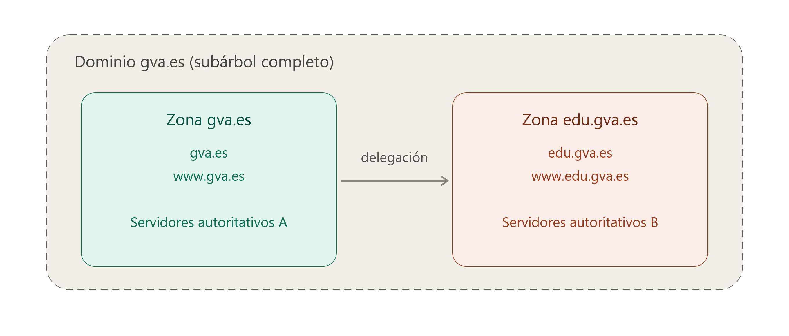

## 4 - Servidores DNS

- **Un servidor DNS es el elemento de la infraestructura de red que aloja la información de uno o más espacios de nombres de dominio y que responde a las consultas (queries) que le llegan, ya sea resolviéndolas directamente (si tiene autoridad sobre los datos) o remitiendo al cliente hacia otros servidores que sí la tienen**.
- Un mismo servidor puede ser autoritativo para unas zonas y actuar solo como intermediario (resolutor) para otras, y puede alojar simultáneamente varias zonas con roles distintos.

??? question "¿Qué es un servidor autoritativo?"
    - Un **servidor autoritativo** es aquel que tiene autoridad sobre una zona concreta y puede responder a las consultas con información oficial y actualizada de esa zona.
    - Por ejemplo, el servidor autoritativo para la zona `edu.gva.es` puede responder a consultas sobre nombres como `www.edu.gva.es` o `correo.edu.gva.es`, proporcionando las direcciones IP correspondientes.

### 4.1 Zonas DNS

- **Una zona DNS es la porción del espacio de nombres cuya administración corresponde a uno (o varios) servidores autoritativos, que mantienen sus registros y responden las consultas sobre ella**.
- Una zona no tiene por qué coincidir con un dominio completo: si un subdominio se delega a otros servidores, deja de formar parte de la zona padre.
- Por ejemplo, dentro del dominio `gva.es`, si `edu.gva.es` está delegado, `www.edu.gva.es` pertenece a la zona `edu.gva.es` y no a `gva.es`.

- La información de una zona (sus registros de recursos) se puede almacenar en un archivo de texto en el propio servidor o en un directorio centralizado (como AD DS en entornos Windows). En este último caso se habla de *zonas integradas*, que permiten que varios servidores compartan y escriban sobre la misma copia de datos.

??? question "¿Qué es un AD DS"
    - AD DS (Active Directory Domain Services o Servicios de dominio de Active Directory) es el servicio de directorio principal de Microsoft para Windows Server.
    - Funciona como una base de datos centralizada y jerárquica que almacena, organiza y gestiona los recursos de una red informática.

### 4.2 Tipos de zonas

- **Zona primaria.** Es el origen editable de la zona. Todas las altas, bajas y modificaciones de registros se hacen aquí. El servidor que la aloja se llama **servidor primario** de esa zona.
- **Zona secundaria.** Es una copia de solo lectura de una zona primaria, obtenida por red desde otro servidor DNS. No se puede editar directamente ni almacenarse como zona integrada, ya que siempre depende de la fuente primaria.
- **Zona de rutas internas (*stub*).** Contiene únicamente los registros NS (y sus direcciones) necesarios para identificar qué servidores son autoritativos para una zona concreta, sin el resto de datos. Se usa para mantener actualizada la lista de servidores de una zona delegada y para mejorar la resolución evitando consultas innecesarias a los servidores raíz.
- **Zona de búsqueda inversa.** Permite la consulta contraria a la habitual: a partir de una dirección IP, obtener el nombre del equipo (en vez de nombre → IP).

> ⚠️ **Zona de búsqueda inversa**
>
> 
>     - Para llevar a cabo la resolución de nombre inversa, el DNS utiliza un dominio especial llamado **in-addr.arpa** (para IPv4) o **ip6.arpa** (para IPv6). 
>     - La dirección IP se transforma e inserta dentro de este dominio en orden inverso a como se escribe normalmente.  
> 
>         !!! example "Ejemplo"
>             
>             - Para averiguar el nombre asociado a la IP `192.168.10.20`, el *resolver* consulta el dominio:  
>             `20.10.168.192.in-addr.arpa`  
>             - El registro que responde a este tipo de consulta se llama **registro PTR** (*pointer record*), y es el encargado de indicar qué nombre de dominio corresponde a esa dirección IP.  
>     
>     - **Usos habituales de la resolución inversa:**
>         1. Verificación de correo electrónico: muchos servidores de correo comprueban que la IP del remitente tenga un PTR válido antes de aceptar el mensaje, como medida contra el *spam*.
>         1. Diagnóstico y registro (*logging*): en herramientas como `traceroute`, `ping` o en los logs de un servidor, es más legible ver el nombre de una máquina que su dirección IP.
>         1. Auditoría y seguridad: permite identificar qué equipo hay detrás de una IP concreta durante el análisis de tráfico o incidentes.
>     
>         !!! failure "A diferencia de la resolución directa, la resolución inversa requiere que el administrador de la red configure explícitamente esta zona y sus registros PTR, ya que no se genera de forma automática a partir de los registros A o AAAA."
> ⚠️ **Importante**
>
>     Un mismo servidor no puede alojar a la vez una zona primaria y una secundaria o *stub* para el mismo nombre de dominio.
### 4.3 Transferencia de zona

Se conoce como **transferencia de zona** el proceso de replicar el contenido de una zona desde el servidor que la genera (primario) hacia los servidores que tienen copia de ella (secundarios). Se puede iniciar de dos maneras:

1. Por **notificación**: el servidor primario avisa a los secundarios cuando ha habido un cambio (mecanismo definido en el RFC 1996).
1. Por **intervalo de refresco**: al arrancar el servicio o al caducar dicho intervalo (por defecto, 15 minutos, definido en el registro SOA de la zona), el servidor secundario consulta al primario para comprobar si hay cambios.

Hay dos tipos de transferencia:

1. **AXFR (transferencia completa):** replica todo el archivo de zona.
1. **IXFR (transferencia incremental):** replica solo los registros modificados desde la última sincronización, reduciendo el tráfico de red.

Por motivos de seguridad, es recomendable restringir qué servidores pueden solicitar una transferencia de zona (habitualmente, solo los indicados en los registros NS de la zona), ya que una transferencia abierta a cualquier host expondría toda la estructura de la red interna.

### 4.4 Delegación de zonas

- El espacio de nombres se puede dividir en varias zonas para delegar su administración a otros departamentos u organizaciones (por ejemplo, delegar `edu.gva.es` desde la zona `gva.es`).
- Para cada delegación es necesario crear registros NS en la zona padre que apunten a los servidores autoritativos de la nueva subzona, de modo que otros servidores y clientes puedan encontrarlos correctamente.

### 4.5 Control de acceso

- El acceso de escritura a una zona y a sus registros se puede restringir mediante listas de control de acceso (ACL), que determinan qué usuarios o grupos pueden crear o modificar registros concretos.
- Esto permite, por ejemplo, reservar ciertos nombres para que solo determinados usuarios los puedan registrar, protegiendo la zona de modificaciones no autorizadas sin dejar de permitir su uso general.
