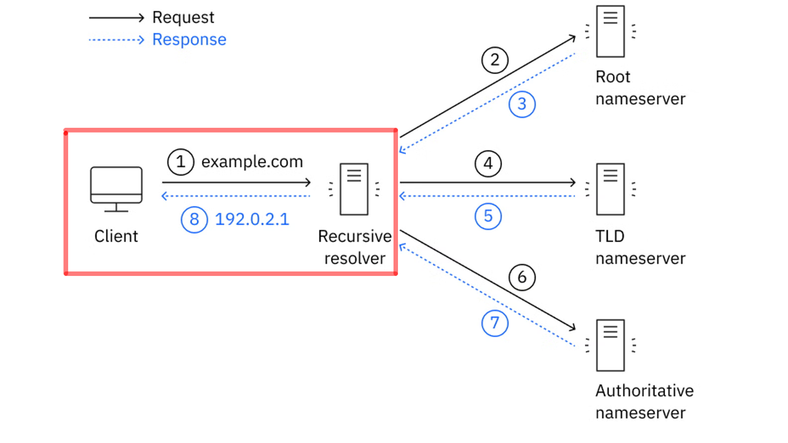
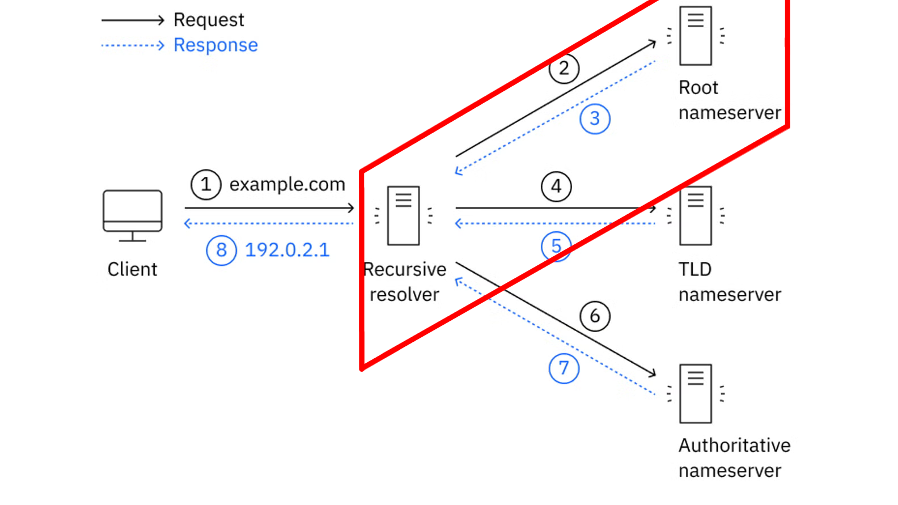
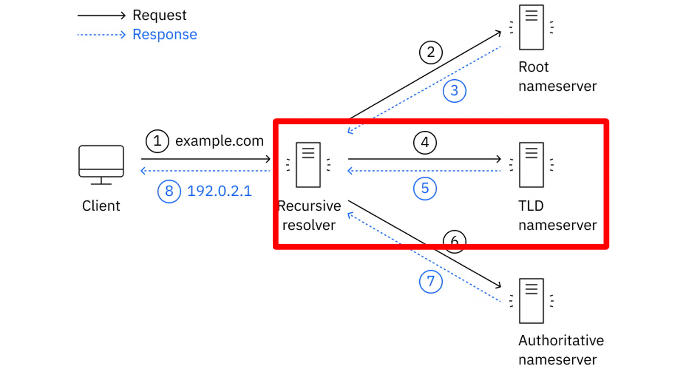
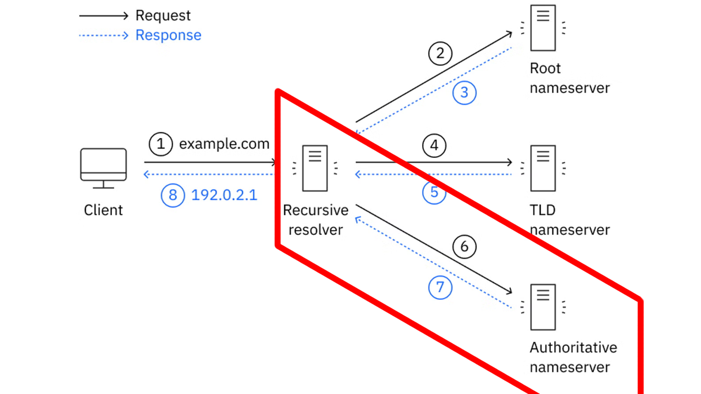

## 6 - Funcionamiento del servicio DNS

- El funcionamiento del DNS se basa en un sistema **jerárquico y distribuido**.

- Como hemos visto, la resolución de un nombre puede implicar diferentes servidores DNS.

- De forma simplificada, el proceso es el siguiente:

### 6.1 Inicio de la consulta y comprobación de la caché

- El dispositivo realiza una consulta a un **servidor DNS recursivo**, también denominado **DNS resolver**.

- Habitualmente, este servidor es proporcionado por el proveedor de acceso a Internet, aunque también puede pertenecer a una organización, una empresa o ser **configurado manualmente**.


- Antes de realizar nuevas consultas, pueden comprobarse diferentes **cachés DNS**.

- Por ejemplo, pueden existir cachés en:

    1. El navegador.
    1. El sistema operativo.
    1. El servidor DNS recursivo.

- Si alguno de estos componentes dispone de una respuesta válida almacenada en caché, no será necesario realizar (repetir) todo el proceso de resolución.

- La información almacenada en caché tiene un tiempo de validez denominado **TTL (*Time To Live*)** pasado el cual caducará y se deberá volver a consultar los servidores DNS correspondientes.

### 6.2 Consulta al servidor raíz (*Root Server*)

- Si el resolver recursivo no dispone de la respuesta en su caché, comienza la búsqueda consultando la jerarquía DNS.

- El primer nivel corresponde a los **servidores raíz**.


- Existen **13 servidores raíz lógicos**, identificados mediante las letras de la **A a la M**. Cada uno de ellos está replicado mediante numerosas instancias distribuidas geográficamente por diferentes lugares del mundo.

- Los servidores raíz **no conocen directamente la dirección IP** del dominio que estamos buscando. Su función es indicar qué servidores son responsables del **dominio de nivel superior (TLD Top-Level Domain)** correspondiente.

- Por ejemplo, si estamos buscando:

      ```text
      www.aules.edu.gva.es.
      ```

    el [**servidor raíz**](https://root-servers.org/) puede indicar qué servidores se encargan del TLD `.es`.

### 6.3 Consulta al servidor de nivel superior (TLD)

- El resolver recursivo consulta entonces a un [**servidor TLD**](https://www.iana.org/domains/root/db) (*Top-Level Domain*).


- Un TLD es la parte final de un nombre de dominio, como:

      ```text
      .com
      .es
      .org
      .net
      ```

- El servidor TLD no proporciona necesariamente la dirección IP del equipo que buscamos. Su función es indicar cuáles son los **servidores DNS autoritativos** encargados del dominio correspondiente.

- Por ejemplo, los servidores TLD `.es` pueden indicar qué servidores DNS son autoritativos para:

      ```text
      aules.edu.gva.es
      ```

??? question "¿A qué servidores el TLD de .es. delega sus consultas?"
    - NS a.nic.es 194.69.254.1, 2001:67c:21cc:2000:0:0:64:41
    - NS c.nic.es 194.0.34.53, 2001:678:44:0:0:0:0:53
    - NS g.nic.es 204.61.217.1, 2001:500:14:7001:ad:0:0:1
    - NS h.nic.es 194.0.33.53, 2001:678:40:0:0:0:0:53

### 6.4 Consulta al servidor de nombres autoritativo

- El resolver recursivo consulta finalmente a uno de los **servidores DNS autoritativos** responsables de la zona correspondiente.


- Un servidor autoritativo dispone de la **información oficial de la zona DNS que administra**. Esta información contiene diferentes registros DNS que permiten conocer los servicios asociados a los nombres del dominio.

- Por ejemplo, un registro **A** puede asociar un nombre con una dirección IPv4:

      ```text
      www.aules.edu.gva.es  →  195.77.20.168
      ```

- Para IPv6 se utiliza normalmente un registro **AAAA**.

- Un dominio puede disponer de **varios servidores autoritativos**, proporcionando redundancia y disponibilidad.

### 6.5 Resolución final y almacenamiento en caché

- El resolver recursivo recibe la respuesta del servidor autoritativo y se la proporciona al dispositivo que realizó la consulta.


- El navegador ya puede utilizar la dirección IP obtenida para establecer una conexión con el servicio correspondiente.

- Además, el resolver puede almacenar la respuesta en su **caché DNS** durante el tiempo indicado por el **TTL** del registro.

- De esta forma, si otro dispositivo realiza posteriormente la misma consulta, el resolver puede responder utilizando la información almacenada en caché sin tener que volver a consultar a los servidores raíz, TLD y autoritativos.

### 6.6 Resumen del proceso

- De forma simplificada, podemos representar la resolución de un nombre de dominio de la siguiente manera:

      ```mermaid
      flowchart TD
          A[Cliente] -->|1. Consulta DNS| B[DNS recursivo<br/>Resolver]
          B -->|2-3. Consulta a servidor raíz | C[Servidor raíz]
          C -->|4-5. Consulta a servidor TLD| D["Servidor TLD<br/>(.es)"]
          D -->|6-7. Indica los servidores<br/>autoritativos| E[Servidor autoritativo]
          E -->|Registro A / AAAA| F[Dirección IP]
          F -->|192.0.2.1| G[DNS Resolver]
          G -->|8. Entrega de IP a cliente <br/>192.0.2.1| H[Cliente]
          H -->|192.0.2.1| I["Servidor (web)"]
      style A fill:#f9f,stroke:#333,stroke-width:4px
      style B fill:#bbf,stroke:#333,stroke-width:4px
      style C fill:#bbf,stroke:#333,stroke-width:4px
      style D fill:#bbf,stroke:#333,stroke-width:4px
      style E fill:#bbf,stroke:#333,stroke-width:4px
      style F fill:#bbf,stroke:#333,stroke-width:4px
      style G fill:#bbf,stroke:#333,stroke-width:4px
      style H fill:#f9f,stroke:#333,stroke-width:4px
      style I fill:#bbf,stroke:#333,stroke-width:4px
      ```

> 💡 **Resumen de los que hemos visto**
>
> 
>     1. El **cliente no suele consultar directamente a los servidores raíz, TLD y autoritativos**. 
>     1. Normalmente realiza una consulta a un **resolver DNS recursivo**, que se encarga de realizar las consultas necesarias y devolver finalmente la respuesta al cliente.
>     1. Por tanto, debemos distinguir entre:
> 
>           | Servidor DNS                 | Función principal                                                 |
>           | ---------------------------- | ----------------------------------------------------------------- |
>           | **DNS recursivo (Resolver)** | Realiza la búsqueda en nombre del cliente y devuelve la respuesta |
>           | **Servidor raíz (Root)**     | Indica qué servidores gestionan el TLD solicitado                 |
>           | **Servidor TLD**             | Indica qué servidores son autoritativos para el dominio           |
>           | **Servidor autoritativo**    | Proporciona la información oficial de la zona DNS                 |
> 
>     4. Esta jerarquía permite que el DNS sea un sistema **distribuido, escalable y resistente**, capaz de gestionar una enorme cantidad de  nombres de dominio sin depender de un único servidor central.
