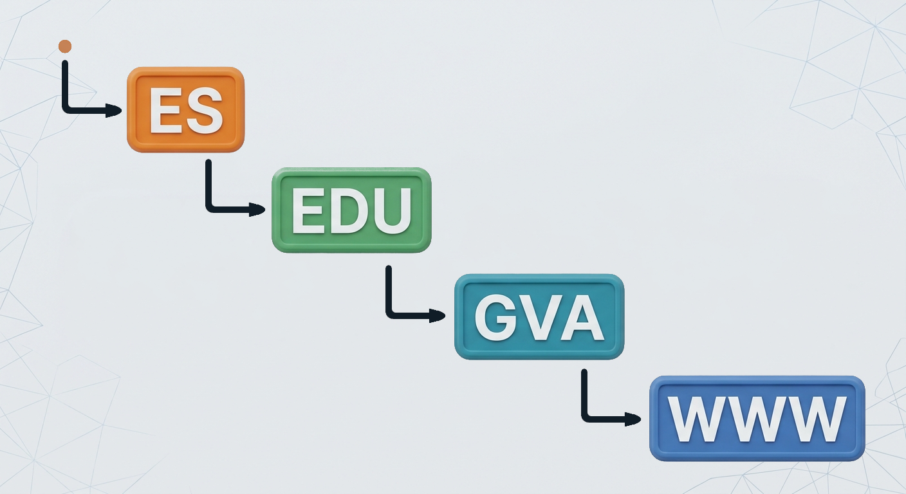
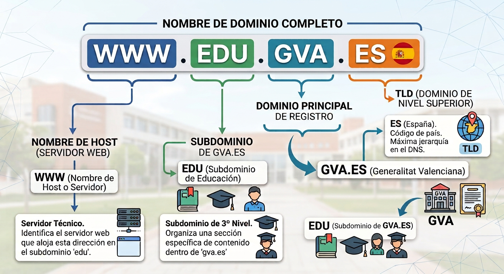

## 7 - Jerarquía de nombres DNS

- El sistema DNS está organizado mediante una **estructura jerárquica**, similar a un árbol invertido. En la parte superior se encuentra la **raíz (`.`)** y, a medida que descendemos por la jerarquía, encontramos los diferentes dominios y subdominios.

- Si tenemos el siguiente nombre:


- Su estructura jerárquica sería:


- Cada nivel representa una parte diferente de la jerarquía DNS.

### 7.1 La raíz DNS

- En la parte superior de la jerarquía se encuentra la **raíz DNS**, representada mediante un punto:

      ```text
      .
      ```

- La raíz es el nivel superior de todo el sistema DNS.

- Un nombre de dominio completamente cualificado (*FQDN, Fully Qualified Domain Name*) podría escribirse de la siguiente manera:


- Normalmente este punto final no se escribe cuando utilizamos un nombre de dominio en un navegador pero forma parte de la estructura completa del nombre.


### 7.2 Dominios de nivel superior (TLD)

- Por debajo de la raíz se encuentran los **dominios de nivel superior**, conocidos como **TLD (*Top-Level Domain*)**.

- Algunos ejemplos son:

      ```text
      .com
      .org
      .net
      .es
      .edu
      ```

- Existen diferentes tipos de TLD. Por ejemplo:

    1. **gTLD (*generic Top-Level Domain*)**: `.com`, `.org`, `.net`, etc.
    1. **ccTLD (*country code Top-Level Domain*)**: `.es`, `.fr`, `.it`, `.de`, etc.

- En el caso de:

      ```text
      www.edu.gva.es
      ```

    el **TLD** es:

      ```text
      .es
      ```

### 7.3 Dominio

- A la izquierda del TLD encontramos otros niveles de la jerarquía.

- En el caso de:

      ```text
      www.edu.gva.es
      ```

    **Un dominio dentro del TLD** `.es` sería.

      ```text
      gva.es
      ```

### 7.4 Subdominios

- Un **subdominio** es un dominio que se encuentra por debajo de otro dominio dentro de la jerarquía DNS.

- En el caso de:

      ```text
      gva.es
      ```

    podría tener diferentes subdominios:

      ```text
      edu.gva.es
      san.gva.es
      just.gva.es
      ```

    Y, a su vez, `edu.gva.es` podría tener otros niveles:

      ```text
      www.edu.gva.es
      aules.edu.gva.es
      correo.edu.gva.es
      ```

- Los subdominios permiten organizar diferentes servicios, departamentos o recursos dentro de una misma estructura de nombres.

### 7.5 FQDN

- Un **FQDN (*Fully Qualified Domain Name*)**, o **nombre de dominio completamente cualificado**, identifica de forma completa una posición dentro de la jerarquía DNS.

- En nuestro caso tendríamos el siguiente FQDN:

      ```text
      www.edu.gva.es.
      ```

> 💡 **Importante**
>
>     Los nombres DNS se interpretan **de derecha a izquierda**.
### 7.6 Nombre de host

- En una red, un **host** es un dispositivo o sistema que puede comunicarse mediante una red.

- En DNS, un nombre como `www.edu.gva.es` puede utilizarse para identificar un servicio o un host.

- Por ejemplo, podríamos tener:

      ```text
      www.edu.gva.es
      correo.edu.gva.es
      ftp.edu.gva.es
      ```

- Cada nombre podría estar asociado mediante DNS a una dirección IP diferente:

      ```text
      www.edu.gva.es       → 192.168.1.10
      correo.edu.gva.es    → 192.168.1.20
      ftp.edu.gva.es       → 192.168.1.30
      ```

> ⚠️ **Importante**
>
>     - Cada nombre DNS **no representa necesariamente un único equipo físico**.  
>     - Un mismo servicio puede estar distribuido entre varios servidores y una misma dirección IP puede utilizarse para diferentes nombres.
### 7.7 Zona DNS

- Una **zona DNS** es una parte de la jerarquía DNS que está administrada por una organización o servidor DNS determinado.

- La zona contiene los **registros DNS** que proporcionan información sobre los nombres y servicios que administra.

- Por ejemplo, una organización podría administrar la zona:

      ```text
      edu.gva.es
      ```

    y dentro de ella tener, en un primer escenario, todos los nombres agrupados en una única zona:

      ```text
      www.edu.gva.es
      correo.edu.gva.es
      ftp.edu.gva.es
      ```

    La zona podría contener registros como:

      ```text
      www.edu.gva.es      → 192.168.10.10
      correo.edu.gva.es   → 192.168.10.20
      ftp.edu.gva.es      → 192.168.10.30
      ```

> ⚠️ **Dominio y zona no son exactamente lo mismo**
>
>     1. Aunque en el ejemplo anterior el dominio `edu.gva.es` y la zona que lo administra coinciden, **dominio y zona son conceptos diferentes**.
>     1. Un dominio representa una parte de la **jerarquía de nombres DNS**, mientras que una zona representa una parte de esa jerarquía que está **administrativamente gestionada mediante servidores DNS autoritativos**.
>     1. Un dominio puede contener diferentes subdominios y estos pueden estar delegados en otras zonas.
>     - Veamos un segundo escenario, alternativo al anterior, en el que la organización decide **dividir** la administración de `edu.gva.es` en dos zonas distintas:
>     ```mermaid
> 
>     flowchart TD
>         A[edu.gva.es] --> X((　))
>         X --> B[Zona A]
>         X --> C[Zona B]
>         B --> D[www.edu.gva.es </br>+</br>correo.edu.gva.es]
>         C --> E[ftp.edu.gva.es]
>     style X fill:#
>     style A fill:#bbf,stroke:#333,stroke-width:4px
>     style B fill:#bbf,stroke:#333,stroke-width:4px
>     style C fill:#bbf,stroke:#333,stroke-width:4px
>     style D fill:#bbf,stroke:#333,stroke-width:4px
>     style E fill:#bbf,stroke:#333,stroke-width:4px
>     ```
>     - En este segundo escenario, la organización administra directamente una zona con `www.edu.gva.es` y `correo.edu.gva.es` (Zona A), mientras que `ftp.edu.gva.es` está delegado a otros servidores DNS que administran la Zona B. Ambas zonas siguen perteneciendo al mismo dominio `edu.gva.es`, pero están gestionadas de forma independiente.
### 7.8 Resumen de la jerarquía DNS

- Podemos resumir los diferentes conceptos mediante la siguiente imagen:


- De esta forma, el DNS organiza los nombres mediante una estructura jerárquica en la que cada nivel puede ser administrado de forma independiente.  

    | Concepto | Significado | Ejemplo |
    ||||
    | **Raíz** | Nivel superior de la jerarquía DNS | `.` |
    | **TLD** | Dominio de nivel superior | `.es` |
    | **Dominio** | Nombre registrado dentro de un TLD | `gva.es` |
    | **Subdominio** | Dominio situado dentro de otro dominio | `edu.gva.es` |
    | **FQDN** | Nombre DNS completamente cualificado (incluye el punto raíz final) | `www.edu.gva.es.` |
    | **Host** | Equipo o servicio identificado mediante un nombre | `www.edu.gva.es` |
    | **Zona** | Parte de la jerarquía administrada por unos servidores autoritativos concretos | `edu.gva.es` (zona delegada, con sus propios servidores autoritativos dentro del dominio `gva.es`) |
