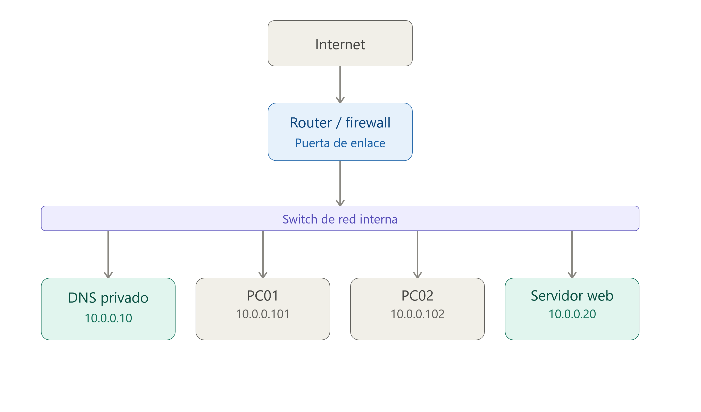
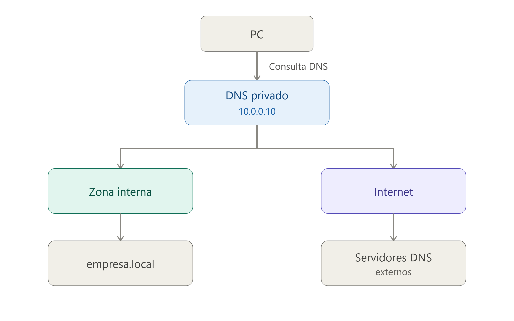
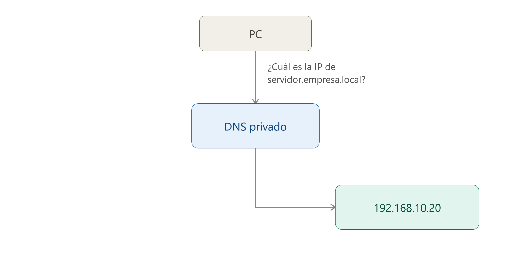
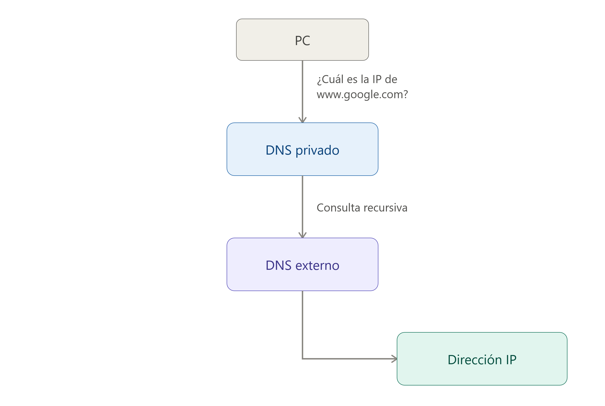

## 8 - Servidores DNS públicos y privados

- No todos los servidores DNS tienen la misma función ni están disponibles para los mismos usuarios.

- Dependiendo de quién pueda utilizarlos y de dónde se encuentren, podemos distinguir entre **servidores DNS públicos** y **servidores DNS privados**.

### 8.1 Servidores DNS públicos

- Un **servidor DNS público** es un servidor DNS que ofrece su servicio de resolución de nombres a usuarios y dispositivos de Internet de forma pública.

- Estos servidores suelen estar gestionados por empresas, organizaciones o proveedores de servicios de Internet y pueden ser utilizados por cualquier usuario que tenga acceso a Internet.

- Algunos ejemplos conocidos son:

    | Servicio DNS          | Dirección IPv4 |
    | --------------------- | -------------- |
    | **Google Public DNS** | `8.8.8.8`      |
    | **Google Public DNS** | `8.8.4.4`      |
    | **Cloudflare DNS**    | `1.1.1.1`      |
    | **Cloudflare DNS**    | `1.0.0.1`      |
    | **Quad9**             | `9.9.9.9`      |

- Por ejemplo, podemos configurar un ordenador para que utilice:

      ```text
      Servidor DNS preferido: 1.1.1.1
      Servidor DNS alternativo: 1.0.0.1
      ```

- A partir de ese momento, las consultas DNS realizadas por el dispositivo podrán enviarse a los servidores de Cloudflare.

> 💡 **Importante**
>
>     - Un servidor DNS público **no significa que sea un servidor raíz ni un servidor autoritativo**.
>     - Por ejemplo, `1.1.1.1` es un **resolver DNS recursivo público**. Recibe consultas de los clientes y, cuando es necesario, realiza las consultas correspondientes a otros servidores DNS de la jerarquía.
### 8.2 ¿Por qué utilizar un DNS público?

- Existen diferentes motivos para utilizar un servidor DNS público en lugar del servidor DNS proporcionado automáticamente por nuestro proveedor de Internet:

#### 8.2.1 Rendimiento

- Algunos proveedores de DNS público disponen de una infraestructura distribuida por diferentes partes del mundo. Esto permite que las consultas puedan ser atendidas desde servidores cercanos al usuario.

- El tiempo necesario para obtener una respuesta DNS se denomina habitualmente **latencia DNS**.

- Una menor latencia puede hacer que la resolución de nombres sea más rápida.

#### 8.2.2 Disponibilidad y redundancia

- Los grandes proveedores de DNS público utilizan infraestructuras distribuidas y redundantes.

- Si uno de sus servidores o centros de datos deja de funcionar, otros servidores pueden continuar atendiendo las consultas.

- Esto proporciona una elevada **disponibilidad** del servicio.

#### 8.2.3 Seguridad

- Algunos servicios DNS públicos incorporan mecanismos de seguridad adicionales, como el bloqueo de determinados dominios asociados a:

    1. Malware.
    1. Phishing.
    1. Botnets.
    1. Otros tipos de amenazas.

- Por ejemplo, algunos resolvers públicos están diseñados específicamente para proporcionar una capa adicional de protección frente a determinados dominios maliciosos.

> ⚠️ **DNS y seguridad**
>
>     - El uso de un DNS público **no garantiza por sí mismo que una conexión sea segura**.
>     - DNS se encarga principalmente de resolver nombres. La seguridad de la comunicación dependerá también de otros mecanismos, como **HTTPS/TLS**, firewalls, sistemas de detección de intrusiones y otros controles de seguridad.
### 8.3 Servidores DNS privados

- Un **servidor DNS privado** es un servidor DNS que está destinado a una organización, red o conjunto limitado de usuarios.

- A diferencia de un servidor DNS público, no está pensado para que cualquier usuario de Internet pueda realizar consultas libremente.

- Los servidores DNS privados son muy habituales en:

    1. Empresas.
    1. Centros educativos.
    1. Organismos públicos.
    1. Redes domésticas.
    1. Centros de datos.
    1. Redes virtuales en la nube.

> ℹ️ **Ejemplo de red empresarial**
>
>     
>     **Dónde:**
> 
>     - `10.0.0.0/24` es la red de la empresa.
>     - `10.0.0.10` es el servidor DNS interno.
>     - `10.0.0.20` es el servidor Web de la empresa.
>     - `10.0.0.101` es un dispositivo conectado a la red (p.e.: impresora) con el nombre DNS **impresora.empresa.local**
>     - `10.0.0.102` otro dispositivo conectado a la red (p.e.: nas) con el nombre DNS **nas.empresa.local** 
>     
>     !!! Warning "Estos nombres pueden (suelen) no existir en el DNS público de Internet"
### 8.4 DNS privado y acceso a Internet

- Un servidor DNS privado no tiene por qué limitarse a resolver nombres internos.

- También puede actuar como **resolver recursivo** para los dispositivos de la organización.

- Si miramos el siguiente esquema veremos que el servidor DNS puede resolver tanto `servidor.empresa.local` utilizando sus **zonas internas** como `www.google.com`, `www.wikipedia.org` y `www.aules.edu.gva.es` realizando consultas recursivas hacia otros servidores DNS.



### 8.5 Servidor DNS privado en una red local

En una red local, los equipos suelen obtener automáticamente la dirección del servidor DNS mediante el protocolo **DHCP**.

> ℹ️ **Configurción dee red devuelta por el servidor DHCP**
>
>     ```text
>     Configuración recibida mediante DHCP
> 
>     Dirección IP:       192.168.10.101
>     Máscara:            255.255.255.0
>     Puerta de enlace:   192.168.10.1
>     Servidor DNS:       192.168.10.10
>     ```
> 
>     **Dónde:**
> 
>     - El ordenador cliente recibe la IP `192.168.10.101`.
>     - El ordenador cliente utilizará `192.168.10.10` para realizar consultas DNS.
>     - El ordenador cliente utilizará `192.168.10.1` como puerta de enlace es decir para acceder a internet.
>     - El servidor DNS privado podría resolver tanto nombres internos como nombres de Internet.
> ℹ️ **Ejemplo de consulta DNS interna**
>
>     
> ℹ️ **Ejemplo de consulta DNS externa**
>
>     
### 8.6 Comparativa DNS público vs. DNS privado

- Podemos comparar ambos tipos de servidores:

| Característica           | DNS público                  | DNS privado                          |
| ------------------------ | ---------------------------- | ------------------------------------ |
| Acceso                   | Público                      | Restringido                          |
| Usuarios                 | Cualquier usuario            | Usuarios de una organización o red   |
| Uso habitual             | Resolver nombres de Internet | Resolver nombres internos y externos |
| Ejemplo                  | `1.1.1.1`                    | `192.168.10.10`                      |
| Administración           | Proveedor externo            | Organización                         |
| Nombres internos         | Normalmente no               | Sí                                   |
| Uso en empresas          | Posible                      | Muy habitual                         |
| Accesible desde Internet | Generalmente sí              | Normalmente no                       |
