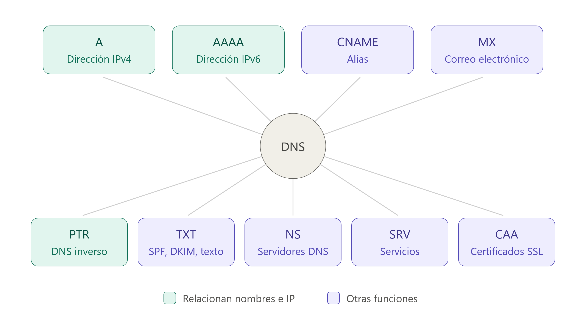

## 10 - Registros DNS



### 10.1 Introducción

1. Los **registros DNS** son datos que contienen información sobre los nombres de dominio y los servicios asociados a ellos.

    > ℹ️ **Ejemplo**
>
>         - Un registro de tipo **A** permite asociar un nombre de dominio con **una dirección IPv4**:
> 
>         ```text
>         www.ejemplo.com → 192.0.2.10
>         ```
1. En los **servidores DNS autoritativos**, estos registros pueden almacenarse en **archivos de zona**. Un archivo de zona es un archivo de texto que contiene los registros DNS y determinadas directivas que describen una zona DNS.

    > ℹ️ **Ejemplo**
>
>         - Un archivo de zona puede contener registros como:
> 
>             ```text
>             ejemplo.com.      IN    A       192.0.2.10
>             www               IN    A       192.0.2.10
>             mail              IN    A       192.0.2.20
>             ```
1. La **sintaxis de los archivos de zona** establece cómo deben escribirse estos registros y directivas para que el servidor DNS pueda interpretarlos correctamente.

    > ℹ️ **Ejemplo**
>
>         - Cuando un usuario introduce en su navegador una dirección como:
> 
>             ```text
>             https://www.ejemplo.com/index.html
>             ```
> 
>         - El navegador necesita conocer la dirección IP asociada al nombre de host **[www.ejemplo.com](http://www.ejemplo.com)**.
>         
>         - Para obtenerla, se inicia una **consulta DNS**.
> 
>         - El equipo del usuario normalmente realiza la consulta a un **servidor DNS recursivo** o *resolver*.
>         
>         - Este servidor puede disponer de la respuesta en su **caché**. Si no la tiene, puede realizar consultas a otros servidores DNS hasta encontrar la información necesaria.
1. En una resolución DNS pueden intervenir diferentes tipos de servidores, entre ellos:

    - **Servidores DNS recursivos:** reciben las consultas de los clientes y se encargan de obtener la respuesta.
    - **Servidores DNS raíz:** indican qué servidores son responsables de los diferentes dominios de nivel superior (*Top-Level Domains* o  TLD), como `.com`, `.org` o `.es`.
    - **Servidores DNS de TLD:** indican cuáles son los servidores autoritativos responsables de un dominio concreto.
    - **Servidores DNS autoritativos:** contienen la información oficial de una zona DNS y proporcionan los registros correspondientes.

### 10.2 TTL (Time To Live)

- Los registros DNS incluyen un valor denominado **TTL (Time To Live)**.

- El TTL indica **durante cuánto tiempo puede mantenerse un registro DNS en la caché de un servidor DNS recursivo antes de que deba volver a consultarse**.

    > ℹ️ **Ejemplo**
>
>         - Si un registro tiene:
> 
>             ```text
>             www.ejemplo.com.    3600    IN    A    192.0.2.10
>             ```
> 
>         - El valor `3600` representa un TTL de **3600 segundos**, es decir, **1 hora**.
> 
>         - Durante ese periodo, un servidor DNS recursivo puede utilizar la información almacenada en su caché sin tener que volver a consultar al servidor autoritativo.
> 
>         !!! warning "Importante" 
>             - El TTL **no indica cada cuánto tiempo se actualiza el registro en el servidor DNS autoritativo**.
>             - Indica cuánto tiempo otros servidores pueden conservar ese registro en su caché.
### 10.3 Tipos de Registros DNS

#### 10.3.1 Registro A (Address)

- Los registros de direcciones, o registros A, son los registros DNS más utilizados. Crean una conexión directa entre **una dirección IPv4** y un nombre de dominio.
- Permiten que un navegador web cargue un sitio utilizando un nombre de dominio legible, evitando que el usuario tenga que recordar complejas direcciones IP numéricas.
- **Redundancia**: Es posible configurar múltiples registros A para un mismo dominio, lo que proporciona respaldo y redundancia en caso de fallos.
- **Seguridad**: Se utiliza también en listas negras basadas en DNS (DNSBL) para bloquear correos provenientes de fuentes de spam conocidas.

> 💡 **Sintaxis típica**
>
>     midominio.com. IN A 192.0.2.15.
#### 10.3.2 Registro AAAA (Quad A)

- Funciona de manera similar al registro A, pero conecta nombres de dominio **con direcciones IPv6**.
- Aunque menos común que IPv4, su adopción global va en aumento para resolver el problema del agotamiento de las direcciones IPv4 tradicionales.

> 💡 **Sintaxis típica**
>
>     midominio.net. IN AAAA 2001:0db8:85a3:0000:0000:8a2e:0370:1234
#### 10.3.3 Registro CNAME (Canonical Name)

- Los registros de nombres canónicos, o registros CNAME, dirigen un dominio de alias a un dominio canónico.
- Los registros CNAME se usan a menudo para asignar un nombre de dominio con un alias al dominio principal que lleva el registro A o AAAA.

> ℹ️ **Ejemplo**
>
> 
>     - En lugar de crear dos registros A para `www.example.com` y `product.example.com`, puede vincular `product.example.com` a un **registro CNAME** que luego se **vincula a un registro A** para `example.com`.
>     - El valor es que si la dirección IP cambia para el dominio raíz, solo se tendrá que actualizar el registro A y el CNAME se actualizará en consecuencia.
>     - Restricciones de configuración:
>         1. No se puede ubicar un registro CNAME en el dominio de raíz.
>         1. Los registros de servidores de correo (MX) y servidores de nombres (NS) nunca deben estar dirigidos a un CNAME.
>         1. Aunque técnicamente es posible apuntar un CNAME a otro CNAME, esta práctica no se recomienda porque resulta ineficaz y ralentiza la velocidad de carga.
#### 10.3.4 Registro DNAME

- Los registros de nombres de delegación, o registros DNAME, se utilizan para redirigir varios subdominios con un registro y apuntarlos a otro dominio.

> ℹ️ **Ejemplo**
>
> 
>     - Un registro DNAME que vincule `domain.com` a `example.com` vinculará `product.domain.com`, `trial.domain.com`, y `blog.domain.com` a `example.com`. 
>     - Estos registros son útiles para administrar dominios a gran escala y para administrar cambios de nombres de dominio al garantizar que los subdominios estén vinculados correctamente.
#### 10.3.5 Registros CAA

- Los registros de autorización de autoridad de certificación, o registros CAA, permiten a los propietarios de dominios especificar qué **autoridades de certificación (CA)** pueden emitir certificados para su dominio.

- Una CA es una organización que valida la identidad de los sitios web y los conecta a claves criptográficas mediante la emisión de certificados digitales.

#### 10.3.6 Registro NS (Nameserver)

- Especifica qué servidor de nombres o servidor DNS en particular actúa como la autoridad autoritativa para un dominio o subdominio.

> ⚠️ **Importante**
>
>     - El registro NS indica qué servidor **alberga físicamente los archivos de zona del dominio**.
>     - Sin un registro NS debidamente configurado, es imposible cargar o acceder a un sitio web.
#### 10.3.7 Registro MX (Mail Exchange)

- Los registros MX son indispensables para la recepción de correos electrónicos bajo el nombre de dominio.

- Indica cuáles son los servidores de correo autorizados para recibir los mensajes mediante el protocolo SMTP.

> ℹ️ **Sintaxis típica**
>
>     midominio.com. IN MX 10 mail.midominio.com.
#### 10.3.8 Registro TXT

- Permite que un administrador pueda almacenar notas de texto en el registro. Estos registros se suelen utilizar para la seguridad del correo electrónico.

#### 10.3.9 Registros CERT

- Los certificados, o registros CERT, almacenan certificados que verifican la autenticidad de todas las partes involucradas.  

- Este tipo de registro es particularmente valioso cuando se protege y encripta información confidencial.

#### 10.3.10 Registros SOA

Los registros de inicio de autoridad, o registros SOA, almacenan información administrativa importante sobre un dominio. Esta información puede incluir la dirección de correo electrónico del administrador del dominio, información sobre las actualizaciones del dominio y cuándo un servidor debe actualizar su información.

#### 10.3.11 Registros PTR

Los registros de puntero, o registros PTR, funcionan en la dirección opuesta a los registros A. Se utilizan para **conectar una dirección IP con un nombre de dominio, en lugar de un nombre de dominio con una dirección IP**.

Cuando una búsqueda de DNS comienza con una dirección IP, encuentra el nombre de host correspondiente. Estos registros se utilizan para detectar spam comprobando si las direcciones IP y las direcciones de correo electrónico asociadas son utilizadas por servidores de correo electrónico legítimos. El host del servidor debe configurar los registros PTR.
