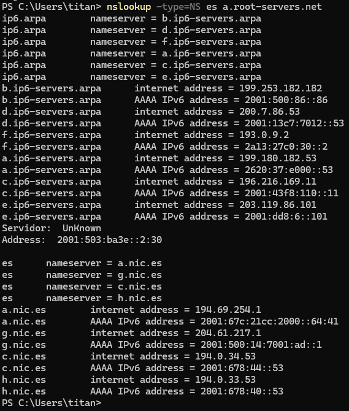
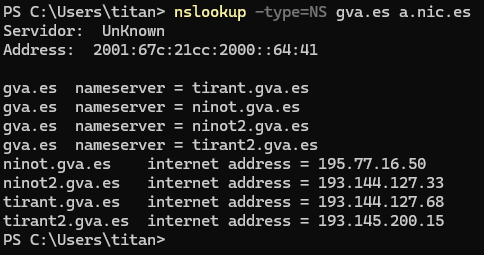
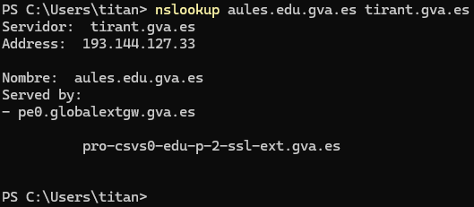
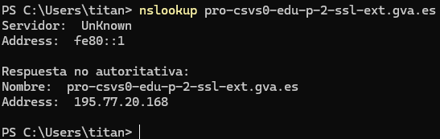
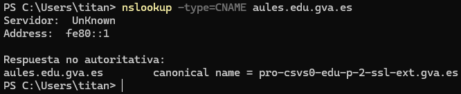
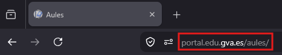

## 12 - Tarea RA2-CEb-1 - Resolución manual de un dominio

- El proposito de esta tarea es que el alumno comprenda cómo se resuelve un nombre de dominio en Internet y cómo se obtiene la dirección IP asociada a ese nombre.
- Para el ejemplo usaremos el dominio `www.aules.edu.gva.es` y realizaremos la resolución de forma manual, paso a paso, para comprender el proceso completo.

### 12.1 Paso 1: Consulta al servidor raíz

- El primer paso en la resolución de un nombre de dominio es consultar a un **servidor raíz**. Los servidores raíz son los encargados de dirigir las consultas hacia los servidores de nivel superior (TLD) correspondientes.

> ℹ️ **Enunciado paso 1**
>
>     ==Preguntas a responder==  
> 
>     - ¿Quién realiza la consulta inicial al servidor raíz para obtener información sobre el TLD?
>     - ¿Cuál es el TLD (Top-Level Domain) del dominio `www.aules.edu.gva.es`?
>     - Consultar la base de datos de [iana.org](https://www.iana.org/domains/root/db) para verificar si el TLD está registrado.
>     - Consultar la base de datos de [iana.org](https://www.iana.org/domains/root/servers) para obtener la lista de servidores raíz y sus direcciones IP (también se puede realizar la consulta a [root-servers.org](https://www.root-servers.org/)).
>     - ¿Cuál es la dirección IP del servidor raíz `Verisign, Inc.`?
>     ---
>     ==Realizar captura de pantalla==  
> 
>     - Para realizar la consulta al servidor raíz, podemos utilizar herramientas como `nslookup` o `dig`. Por ejemplo, podemos ejecutar el siguiente comando en la terminal:
>         ```bash
>         nslookup -type=NS es a.root-servers.net
>         ```
> 
>         !!! info "Explicación de la línea de comando"
>             - `nslookup`: herramienta de línea de comandos para consultar servidores DNS y resolver nombres de dominio.
>             - `-type=NS`: indica que queremos consultar los registros NS (Name Server), es decir, quieremos saber qué servidores DNS son los autoritativos (los "oficiales") para ese dominio.
>             - `es`: el TLD que estamos consultando.
>             - `a.root-servers.net`: el servidor raíz al que le estamos preguntando directamente (en lugar de usar el servidor DNS configurado por defecto en nuestro equipo).
>                 
### 12.2 Paso 2: Consulta del dominio gva.es al servidor de dominio (.es)

> ℹ️ **Enunciado paso 2**
>
>     ==Preguntas a responder==  
> 
>     - ¿Quién realiza la consulta al servidor autoritativo del TLD .es para obtener información sobre el dominio gva.es?
> 
>     ---
> 
>     ==Realizar captura de pantalla==  
> 
>     - ¿Cuál sería la línea de comando para consultar los servidores autoritativos de gva.es?
>         
### 12.3 Paso 3: Consulta del subdominio aules.edu.gva.es al servidor de dominio (gva.es)

> ℹ️ **Enunciado paso 3**
>
>     ==Preguntas a responder==  
> 
>     - ¿Quién realiza la consulta al servidor autoritativo para obtener información sobre el dominio aules.edu.gva.es?
>     
>     ---
> 
>     ==Realizar captura de pantalla==  
> 
>     - ¿Cuál sería la línea de comando para consultar los servidores autoritativos de aules.edu.gva.es?
>         
### 12.4 Paso 4: Consulta final del subdominio aules.edu.gva.es

> ℹ️ **Enunciado paso 4**
>
>     ==Preguntas a responder==  
> 
>     - ¿Quién realiza la consulta al servidor autoritativo para obtener información sobre el dominio aules.edu.gva.es?
>     
>     ---
> 
>     ==Realizar captura de pantalla==  
> 
>     - ¿Cuál sería la línea de comando para consultar los servidores autoritativos de aules.edu.gva.es?
>         
>     - ¿Cuál es el nombre canonico de aules.edu.gva.es?
>         
### 12.5 Paso 5: Confirmación de la IP

> ℹ️ **Enunciado paso 5**
>
>     ==Preguntas a responder==  
>     ==Realizar captura de pantalla==  
> 
>     - ¿Qué ocurre si escribimos la IP en el navegador? ¿Se abre la web de aules.edu.gva.es?
>     
---
