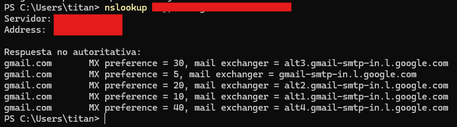
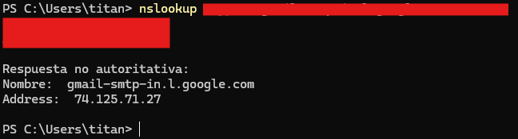

## 13 - Tarea RA2-CEb-2 - Resolución manual de un dominio

> ℹ️ **Pregunta**
>
>     ==Preguntas a responder==  
> 
>     - Redactar el comando para consultar el dominio gmail.es y obtener los servidores autoritativos de correo electrónico de gmail.es.
>     
>     ---
> 
>     ==Realizar captura de pantalla==  
> 
>     - Resultado esperado:
>         
> 
>     ==Realizar captura de pantalla==  
> 
>     - Redactar el comando para consultar la IP de uno de los servidores.
>         

---
