## 14 - Tarea RA2-CEde-1 - Instalación y configuración de un servidor DNS con Windows Server 2025

!!! abstract "Instalar AD DS con DNS"  
    - Antes de instalar y configurar el rol de servidor DNS, instalaremos el rol de Active Directory Domain Services (AD DS), ya que en este caso queremos un DNS integrado en un dominio de Active Directory (el escenario más habitual en entornos empresariales).

!!! abstract "Motivos para instalar AD DS con DNS"  
    - Aunque el rol DNS de Windows Server no requiere AD DS para funcionar, cuando DNS da servicio a un dominio de AD conviene que estén integrados.
    - Al promover el servidor a controlador de dominio, si no existe ya un servidor DNS accesible para el dominio, Windows instala y configura automáticamente el rol DNS, creando la zona correspondiente con los registros SRV necesarios para la localización de los controladores de dominio (LDAP, Kerberos, etc.).
    - Esto simplifica la práctica: en vez de instalar y configurar DNS manualmente y luego preparar la integración con AD, dejamos que el propio proceso de promoción a DC lo resuelva.

### 14.1 Active Directory Domain Services (AD DS)

> 💡 **Red domestica vs red empresarial**
>
>     1. **En una red doméstica**, cada equipo se administra de forma individual: el usuario configura sus propios permisos, contraseñas, accesos a dispositivos, etc.
>     1. **En una empresa empresarial** con decenas o cientos de equipos, gestionar la seguridad equipo por equipo es inviable al resultar lento, costoso y, sobre todo, inconsistente.
>     1. Una parte importante de los incidentes de seguridad en las organizaciones no se debe a fallos de las herramientas de protección (firewall, VPN, antivirus), sino a errores de configuración en los equipos y servicios de red.
>     1. Por ello, es fundamental poder definir de **forma centralizada** qué puede o no puede hacer el usuario final en los equipos de la empresa, por ejemplo:
> 
>         - Deshabilitar los puertos USB de los equipos de la empresa.
>         - Limitar el acceso a ciertos sitios web.
>         - Restringir el acceso al disco duro local de los equipos.
>         - Restringir el uso de archivos ejecutables descargados de Internet.
>         - Instalar software solo desde repositorios oficiales de la empresa.
>         - Forzar políticas de contraseñas seguras y definir la caducidad de las mismas.
> 💡 **AD DS**
>
>     1. AD DS es el rol de Windows Server que permite centralizar la gestión de identidades (usuarios, equipos, grupos) de toda la organización en un dominio, y aplicar de forma automática y uniforme políticas de seguridad y configuración mediante Directivas de Grupo (GPO – Group Policy Objects).
>     1. Por este motivo, antes de instalar y configurar el rol de servidor DNS, instalaremos primero el rol de Active Directory Domain Services (AD DS).
>     1. **AD DS Será la base** sobre la que se sustente la **gestión centralizada** de usuarios, equipos y políticas de seguridad de nuestra organización, y también porque el propio proceso de instalación de AD DS se encarga de configurar el servicio DNS necesario para el funcionamiento del dominio.
### 14.2 Instalación del rol AD DS en AWS

Para la instalación del rol AD DS en un servidor Windows Server 2025 en AWS, seguiremos los siguientes pasos:

> ℹ️ **:one: - Lanzar una nueva instancia de Windows Server 2025 en AWS**
>
>     - En este caso definiremos en qué subred de la VPC se encuentra la instancia EC2, ya que esto puede afectar a la conectividad y al rendimiento de la red
>     - Resumen de la configuración de la instancia (acordarse de seleccionar el par de clave `vockey` para el inicio de sesión y seleccionar `50GiB` de capacidad para el volumen de la instancia).  
>     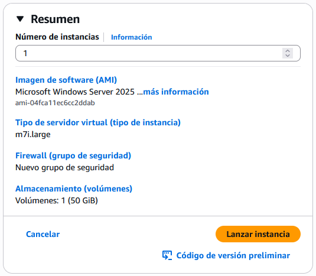
>     - Captura del apartado de configuración de red dónde eligiremos la Subred en la cual desplegaremos nuestra instancia.  
>     ==Realizar captura de pantalla==
>     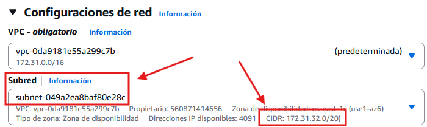
>     - Esperaremos a que la instancia esté disponible. A partir de entonces nos conectaremos a la instancia por `RDP`.
>     ==Realizar captura de pantalla==
>     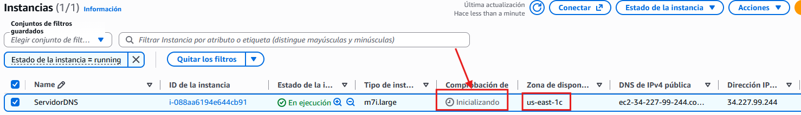
> ℹ️ **:two: - Renombrar la máquina creada**
>
>     ==Realizar captura de pantalla==
>     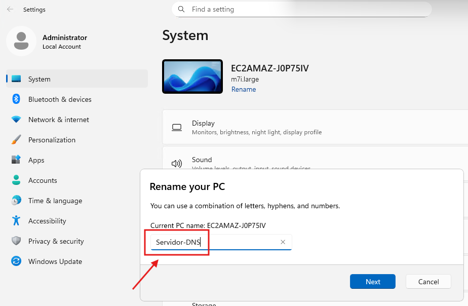
> ℹ️ **:three: - Añadir el rol Active Directory Domain Services (AD DS)**
>
>     ==Realizar captura de pantalla==
>     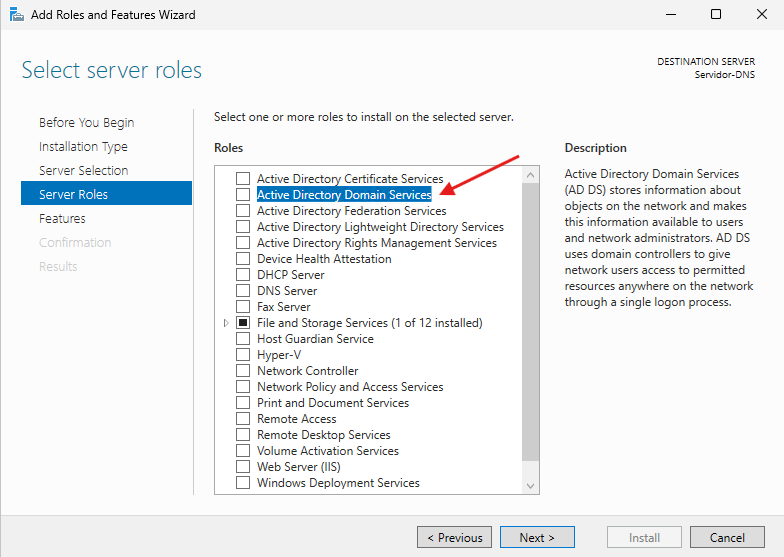
> 
>     - Dejamos el resto de opciones con los valores por defecto.
>     - En la página de `Confirmation` marcamos la opción de `Restart if required`.
>     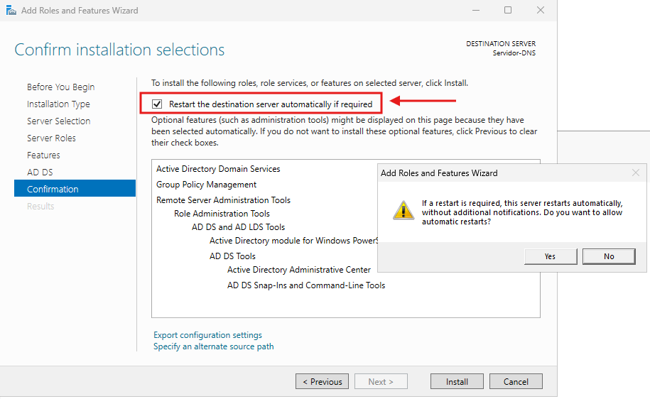
> ℹ️ **:four: - Promover el servidor a controlador de dominio**
>
>     - Una vez finalizada la instalación del servicio el sistema nos pedirá **promover el servidor a controlador de dominio**.
>     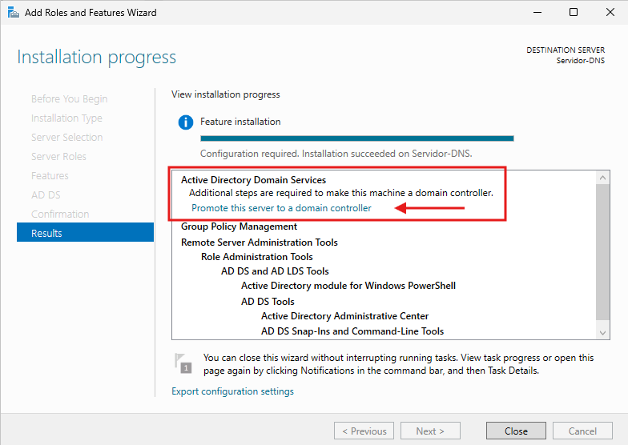
>     ==Realizar captura de pantalla==
>     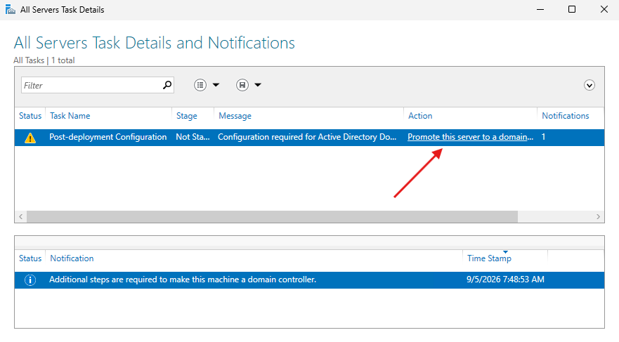
> ℹ️ **:five: - Creación de los bosques de AD DS**
>
>     !!! warning "- Un bosque de AD DS es una estructura que permite organizar y administrar de forma centralizada los usuarios, equipos y recursos de una organización. - Para funcionar, utiliza la tecnología DNS, la misma que se emplea en Internet para traducir nombres en direcciones IP. - Sin embargo, un bosque de Active Directory es independiente de los dominios de Internet, ya que tiene su propia estructura y finalidad."
> 
>     - En `Deployment Configuration` seleccionamos `Add a new forest` e introducimos un nombre de dominio para el dominio de AD interno.
>     - El código de buenas prácticas de Microsoft recomienda usar **el nombre de dominio de la empresa (de internet) + un subdominio (ad)**.  
>     ==Realizar captura de pantalla==
>     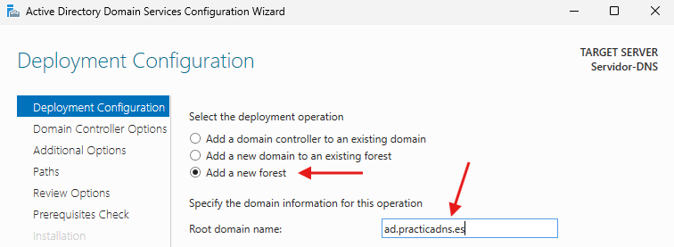
> 
>     - Al ser un bosque nuevo, dejaremos los valores por defecto de los niveles funcionales.  
>     - Como AD requiere de un servidor DNS para funcionar, nos viene la opción DNS marcada por defecto.  
> ℹ️ **:six: - Opciones del servidor DNS**
>
>     - Introduciremos la contraseña de restauración de servicios de directorio (**DSRM – Directory Services Restore Mode**), que se utiliza para iniciar el servidor en modo de recuperación de AD en caso de fallo grave. **No se recomienda que esta contraseña coincida con la contraseña de administrador**.
>     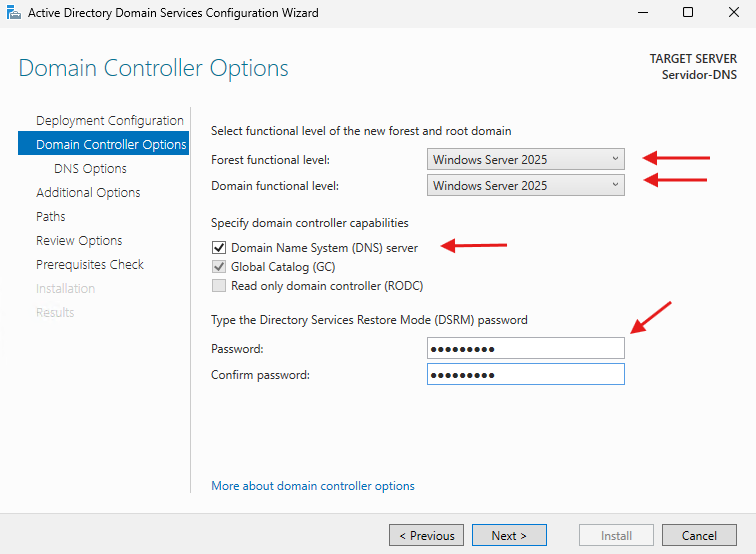
>     - En `DNS Options` nos aparecerá un aviso indicando que no se puede crear una delegación para este servidor DNS, ya que no existe una zona superior (padre) que la administre.
>     - Es un aviso esperado al crear un bosque nuevo (todavía no existe ningún dominio DNS previo al que delegar) y lo podemos ignorar.  
>     ==Realizar captura de pantalla==
>     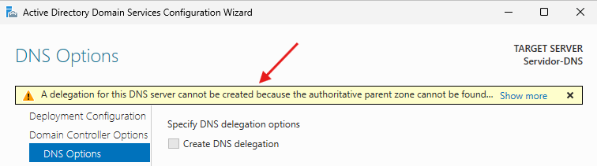
> ℹ️ **:seven: - Opciones adicionales de AD DS**
>
>     - En `Additional Options` dejaremos el nombre por defecto de dominio de NetBIOS (solo para compatibilidad con equipos antiguos / obsoletos).
>     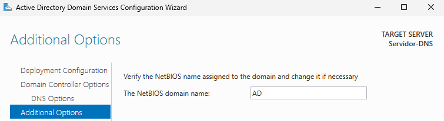
> ℹ️ **:eight: - Comprobación de pre-requisitos**
>
>     - Continuamos por las ventanas de `Paths` (donde se define la ubicación de la base de datos de AD, los logs y el volumen SYSVOL) y `Review Options` (resumen de toda la configuración elegida).  
>     - En `Prerequisites Check` apuntaremos las advertencias para gestionarlas más adelante (entre ellas, es habitual que aparezca un aviso relacionado con la configuración de IP estática del servidor).
>     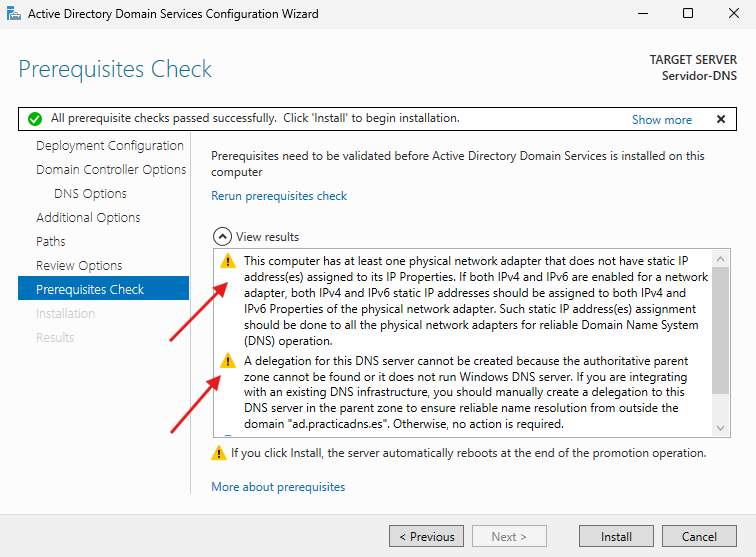
> ℹ️ **:nine: - Nuevo inicio de sesión bajo AD DS**
>
>     - Una vez reiniciada la máquina, veremos que aunque parezca que no ha ocurrido nada, ahora iniciamos sesión como **DOMINIO\Administrador** (cuenta de dominio) en lugar de como administrador local del servidor.
>     - Podemos comprobarlo, por ejemplo, ejecutando `whoami` en una consola.
>     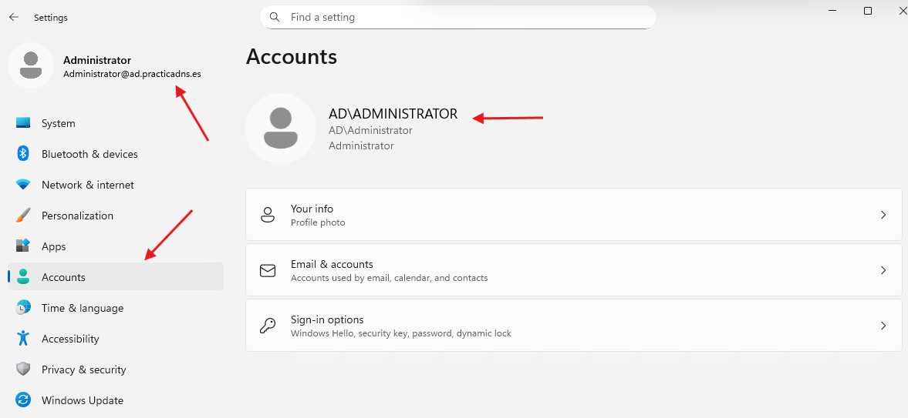
> ℹ️ **:one::zero: - Consideraciones sobre AD DS**
>
>     - Active Directory necesita que **la IP del controlador de dominio no cambie**, ya que los registros DNS y SRV del dominio se generan sobre esa IP.
>     - En AWS, la IP privada de una instancia EC2 es **estática por naturaleza** mientras no se elimine la instancia (sobrevive a stop/start, reinicios, etc.), por lo que no es necesario realizar ningún cambio a nivel de AWS.
>     - Aún así, es recomendable **fijar esa misma IP privada como estática dentro de la configuración de red de Windows** (en lugar de dejarla en modo DHCP), para evitar problemas si el adaptador de red se reinicia.
>     - Para ello, buscaremos en EC2 → Detalles la IP privada actual de nuestra instancia (en este ejemplo, 172.31.39.10) y configuraremos esa **misma IP** como estática en las propiedades de red de Windows.
> 
>     !!! warning "Importante"
>         ==Realizar captura de pantalla==  
> 
>         - La IP que configuremos manualmente en Windows debe **coincidir siempre** con la IP privada que AWS ya tiene asignada a la instancia.
>         - Si configuramos una IP diferente, la instancia perderá la conectividad de red, ya que AWS solo enruta tráfico a las IPs asociadas a esa interfaz de red (ENI).
>     - Si además de la IP privada estática queremos que el servidor tenga una **IP pública fija** para acceso desde Internet, esto se resuelve mediante una **Elastic IP (EIP)**, que es un concepto independiente de la IP privada usada por AD/DNS internamente:
> 
>         1. Al crear una Elastic IP y asociarla a la instancia, esta IP pública no cambiará mientras esté asociada, ni siquiera si la instancia se detiene y se vuelve a iniciar.
>         1. Si en el futuro queremos eliminar o reemplazar la instancia sin perder la IP pública, podemos mover la Elastic IP a una Elastic Network Interface (ENI) separada, que podremos desasociar y volver a asociar a otra instancia cuando haga falta.
>     
>     ==Pregunta a responder==  
>     !!! question "En un entorno no AWS (no virtual), ¿cómo se configuraría la interfaz de red de nuestra máquina a IP estática?"
> ℹ️ **:one::one: - Finalización de instalación del AD DS y del servidor DNS**
>
>     - Después de un tiempo, aparecerán los servicios AD DS y DNS en nuestra máquina.
>     - Servicio AD DS
>     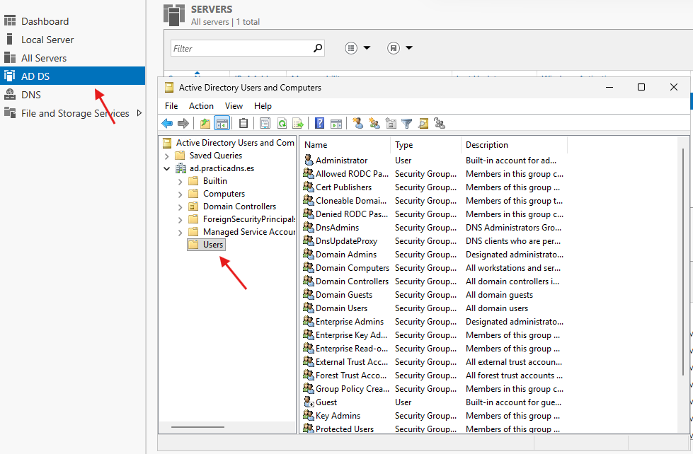
>     - Servicio DNS
>     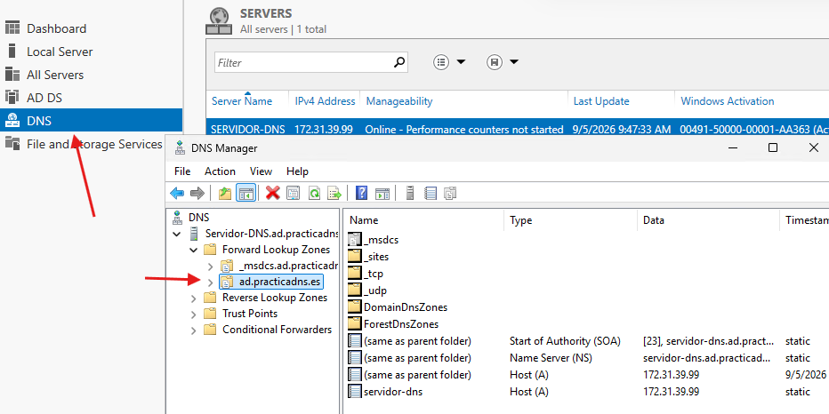
> ℹ️ **:one::two: - Verificación final**
>
>     Para comprobar que el dominio y el DNS han quedado correctamente configurados, haremos lo siguiente:  
> 
>     - Ejecutar `dcdiag` en una consola para diagnosticar el estado del controlador de dominio.  
>     ==Realizar captura de pantalla==  
> 
>     - Ejecutar `nslookup <nombre-del-dominio>` para comprobar que el propio servidor resuelve correctamente los registros de su dominio.  
>     ==Realizar captura de pantalla==  
> 
>     - Abrir la consola "Usuarios y equipos de Active Directory" para confirmar que el dominio se ha creado correctamente.  
>     ==Realizar captura de pantalla==  

---
