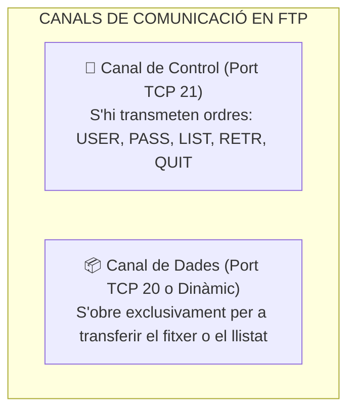

# UT06 — Serveis de Transferència de Fitxers (FTP, FTPS, SFTP)

La transferència de fitxers és una funció elemental en qualsevol infraestructura de xarxa per a permetre l'intercanvi de documents, còpies de seguretat i actualitzacions de programari entre clients i servidors.

---

## 📌 1. El Protocol FTP i els seus Canals de Comunicació

A diferència de la majoria de protocols de xarxa que utilitzen una sola connexió TCP, el protocol **FTP (*File Transfer Protocol* - RFC 959)** utilitza **dos canals separats**:



---

## 📌 2. Modes de Connexió: Actiu vs Passiu

<div style="background: linear-gradient(135deg, #0f172a 0%, #1e293b 100%); border-radius: 12px; padding: 20px; margin: 25px 0; box-shadow: 0 10px 25px -5px rgba(0, 0, 0, 0.3); border: 1px solid #334155;">
  <div style="text-align: center; margin-bottom: 15px;">
    <span style="background: #38bdf8; color: #0f172a; font-weight: 700; font-size: 0.75rem; text-transform: uppercase; letter-spacing: 0.05em; padding: 4px 10px; border-radius: 9999px;">Infografia Tècnica</span>
    <h3 style="color: #f8fafc; margin: 10px 0 5px 0; font-size: 1.25rem;">Modes de Connexió FTP: Actiu vs Passiu (PASV)</h3>
    <p style="color: #94a3b8; font-size: 0.85rem; margin: 0;">Comportament dels canals de control i dades davant routers NAT i tallafocs perimetrals</p>
  </div>
  <svg viewBox="0 0 860 270" width="100%" height="100%" xmlns="http://www.w3.org/2000/svg" style="display: block; font-family: system-ui, -apple-system, sans-serif;">
    <defs>
      <linearGradient id="actGrad" x1="0%" y1="0%" x2="100%" y2="100%">
        <stop offset="0%" stop-color="#ef4444" stop-opacity="0.3"/>
        <stop offset="100%" stop-color="#991b1b" stop-opacity="0.1"/>
      </linearGradient>
      <linearGradient id="pasGrad" x1="0%" y1="0%" x2="100%" y2="100%">
        <stop offset="0%" stop-color="#10b981" stop-opacity="0.3"/>
        <stop offset="100%" stop-color="#047857" stop-opacity="0.1"/>
      </linearGradient>
    </defs>

    <!-- Secció Esquerra: Mode Actiu -->
    <rect x="20" y="20" width="395" height="230" rx="8" fill="url(#actGrad)" stroke="#ef4444" stroke-width="1.5"/>
    <text x="217" y="48" fill="#f87171" font-size="13" font-weight="bold" text-anchor="middle">MODE ACTIU (PORT) · OBSOLET</text>
    <text x="217" y="65" fill="#94a3b8" font-size="10" text-anchor="middle">El servidor inicia la connexió de dades cap al client</text>
    <line x1="35" y1="78" x2="400" y2="78" stroke="#334155"/>

    <text x="40" y="102" fill="#cbd5e1" font-size="10.5">1. <tspan fill="#38bdf8" font-weight="bold">Control (TCP 21):</tspan> Client demana dades i envia ordre PORT</text>
    <text x="40" y="125" fill="#cbd5e1" font-size="10.5">2. <tspan fill="#f59e0b" font-weight="bold">Dades (TCP 20):</tspan> Servidor intenta obrir port cap al client</text>
    <text x="40" y="150" fill="#f87171" font-size="10.5" font-weight="bold">⚠️ EL TALLAFOC / ROUTER NAT DEL CLIENT EL BLOQUEJA!</text>
    <text x="40" y="172" fill="#94a3b8" font-size="10">El router de l'usuari descarta connexions entrants desconegudes</text>

    <rect x="35" y="195" width="365" height="40" rx="6" fill="#1e293b" stroke="#ef4444" stroke-width="1"/>
    <text x="217" y="220" fill="#f87171" font-size="10" text-anchor="middle" font-weight="bold">Resultat: Error 425 'Can't open data connection'</text>

    <!-- Secció Dreta: Mode Passiu -->
    <rect x="445" y="20" width="395" height="230" rx="8" fill="url(#pasGrad)" stroke="#34d399" stroke-width="1.5"/>
    <text x="642" y="48" fill="#34d399" font-size="13" font-weight="bold" text-anchor="middle">MODE PASSIU (PASV) · ESTÀNDARD ACTUAL</text>
    <text x="642" y="65" fill="#94a3b8" font-size="10" text-anchor="middle">El client inicia totes dues connexions cap a fora</text>
    <line x1="460" y1="78" x2="825" y2="78" stroke="#334155"/>

    <text x="465" y="102" fill="#cbd5e1" font-size="10.5">1. <tspan fill="#38bdf8" font-weight="bold">Control (TCP 21):</tspan> Client envia l'ordre PASV</text>
    <text x="465" y="125" fill="#cbd5e1" font-size="10.5">2. <tspan fill="#34d399" font-weight="bold">Resposta Servidor:</tspan> 'Connecta't al meu port dinàmic 40050'</text>
    <text x="465" y="150" fill="#cbd5e1" font-size="10.5">3. <tspan fill="#38bdf8" font-weight="bold">Dades:</tspan> El client obre la connexió sortint cap al port 40050</text>
    <text x="465" y="172" fill="#34d399" font-size="10" font-weight="bold">✅ Compatible 100% amb qualsevol router domèstic o NAT</text>

    <rect x="460" y="195" width="365" height="40" rx="6" fill="#1e293b" stroke="#34d399" stroke-width="1"/>
    <text x="642" y="220" fill="#34d399" font-size="10" text-anchor="middle" font-weight="bold">Requereix obrir rang pasv_min/max_port al servidor</text>
  </svg>
</div>

- **Mode Actiu:** El client demana dades i el servidor intenta obrir una connexió des del port **TCP 20** cap a l'ordinador del client. En xarxes actuals amb routers NAT, el router descarta la connexió entrant del servidor.
- **Mode Passiu (*Passive Mode*):** El client envia l'ordre `PASV`. El servidor respon amb un port dinàmic alt (p. ex., entre `40000` i `40100`). És el client qui inicia totes dues connexions cap a fora, fent-lo totalment compatible amb les connexions d'Internet habituals.

---

## 📌 3. Variants Segures: FTPS vs SFTP

| Característica | FTP Clàssic | FTPS (*FTP sobre TLS/SSL*) | SFTP (*SSH File Transfer Protocol*) |
| :--- | :--- | :--- | :--- |
| **Seguretat** | **Cap** (text pla) | Xifratge fort amb certificats X.509 | Xifratge fort del protocol SSH |
| **Ports de xarxa** | TCP 21 (control) + TCP 20/dinàmics | TCP 21/990 + rang dinàmic de dades | **Únicament TCP 22** |
| **Complexitat de tallafocs** | Mitjana / Alta | Alta (cal obrir rangs de ports passius) | **Molt senzilla** (un sol port obert) |
| **Subsistema** | Servidor FTP natiu | Servidor FTP amb mòdul TLS | Dimoni OpenSSH |

---

## 📌 4. Configuració Pràctica de `vsftpd` en Ubuntu Server

`vsftpd` (*Very Secure FTP Daemon*) és el servidor FTP més ràpid i segur per a entorns Linux:

```bash
# 1. Instal·lar vsftpd
sudo apt update && sudo apt install vsftpd -y
```

### Configuració del fitxer `/etc/vsftpd.conf`:
```text
# Desactivar accés anònim per seguretat
anonymous_enable=NO

# Permetre autenticació d'usuaris locals del sistema
local_enable=YES

# Permetre pujada i escriptura de fitxers
write_enable=YES

# Enjaulament (chroot): L'usuari no pot sortir de la seua carpeta personal
chroot_local_user=YES
allow_writeable_chroot=YES

# Rangs de ports per a Mode Passiu (cal obrir-los al tallafoc UFW)
pasv_enable=YES
pasv_min_port=40000
pasv_max_port=40100

# Xifratge segur FTPS amb certificat OpenSSL
ssl_enable=YES
rsa_cert_file=/etc/ssl/certs/ssl-cert-snakeoil.pem
rsa_private_key_file=/etc/ssl/private/ssl-cert-snakeoil.key
```

```bash
# Reiniciar el servei per a aplicar canvis
sudo systemctl restart vsftpd

# Obrir els ports necessaris al tallafoc
sudo ufw allow 21/tcp
sudo ufw allow 40000:40100/tcp
```

---

## 📌 5. Aïllament d'Usuaris en Windows Server (IIS FTP)

En entorns Windows Server 2022, el servei FTP s'habilita com a rol d'**Internet Information Services (IIS)**:
- **Aïllament d'Usuaris (*User Isolation*):** S'activa l'opció «Directori de nom d'usuari (desactivar directoris globals)».
- Dins de la carpeta arrel del lloc FTP (`C:\inetpub\ftproot`), es crea una subcarpeta anomenada `LocalUser` i a dins una carpeta per a cada usuari local (p. ex., `C:\inetpub\ftproot\LocalUser\alumne_redes`).
- Quan l'usuari `alumne_redes` inicia sessió des de FileZilla, el servidor l'enclaustra automàticament a la seua carpeta privada impedint-li veure les dades dels altres usuaris.

---

## 📝 Quadern d'Activitats Pràctiques i Reptes de Laboratori

### 📋 Bloc A: Anàlisi de Canals i Seguretat en Transferència de Fitxers
1. **Dimensionament de Ports Passius:**
   - Un servidor de fitxers `vsftpd` corporatiu ha de donar servei simultani a un màxim estimat de **40 treballadors** descarregant informes alhora.
   - Quants ports TCP caldrà obrir com a mínim al tallafocs per al canal de dades passiu? Quina directiva de `/etc/vsftpd.conf` estableix el límit inferior i superior del rang?
2. **Comparativa de Complexitat de Tallafocs: FTPS vs SFTP:**
   - Per què els administradors de sistemes prefereixen implementar **SFTP** per sobre de **FTPS** quan els usuaris treballen des de casa a través d'Internet?
   - Quants ports cal obrir i inspeccionar al tallafocs perimetral per a SFTP i quants per a FTPS en mode passiu?
3. **El Mecanisme d'Enjaulament (*chroot*):**
   - Què és una "gàbia chroot"? Si un usuari maliciós aconsegueix credencials FTP en un servidor sense enjaular, a quins fitxers crítics del sistema operatiu (com `/etc/passwd` o `/var/log`) podria accedir fent `cd ../../`?

### 💻 Bloc B: Reptes Pràctics de Laboratori i Configuració

#### Repte 1: Creació d'un Usuari Enjaulat per a `vsftpd`
A la màquina Ubuntu Server de laboratori:
1. Crea un usuari de transferència sense accés a la consola Bash per seguretat:
   ```bash
   sudo useradd -m -s /usr/sbin/nologin client_fitxers
   echo "client_fitxers:ClauSegura2026!" | sudo chpasswd
   ```
2. Perquè `vsftpd` permeta l'enjaulament segur, la carpeta arrel de l'usuari no ha de tindre permisos d'escriptura, però sí una subcarpeta interna de càrrega:
   ```bash
   sudo mkdir -p /home/client_fitxers/ftp/pujades
   sudo chown root:root /home/client_fitxers/ftp
   sudo chmod 755 /home/client_fitxers/ftp
   sudo chown client_fitxers:client_fitxers /home/client_fitxers/ftp/pujades
   ```
3. Edita `/etc/vsftpd.conf` assegurant les línies:
   ```text
   chroot_local_user=YES
   local_root=/home/$USER/ftp
   allow_writeable_chroot=YES
   pasv_enable=YES
   pasv_min_port=40000
   pasv_max_port=40050
   ```
4. Reinicia el servei: `sudo systemctl restart vsftpd`.

#### Repte 2: Connexió amb Client FileZilla i Verificació de Gàbia
1. Des de la màquina client (Windows o Ubuntu Desktop), obre el client **FileZilla**:
   - Servidor: `192.168.1.10` (IP del teu servidor).
   - Usuari: `client_fitxers`.
   - Contrasenya: `ClauSegura2026!`.
   - Port: `21`.
2. Obre la configuració de la connexió a FileZilla i comprova que està seleccionat **Mode Passiu**.
3. Connecta't i puja un document de text a la carpeta `pujades`.
4. Intenta canviar de directori cap a `/etc/` o cap a l'arrel `/`. Documenta com el servidor respon amb error i manté el client estrictament enclaustrat dins de la seua gàbia.

### 🎯 Bloc C: Llista de Verificació i Rúbrica d'Avaluació

| Criteri d'Avaluació | Nivell Assolit (Excel·lent: 9-10) | Nivell Mitjà (Notable: 7-8) | Nivell Inicial (Aprovat: 5-6) |
| :--- | :--- | :--- | :--- |
| **Diferenciació de modes i protocols** | Explica amb claredat el canal de control vs dades, Actiu vs Passiu i FTPS vs SFTP. | Coneix la diferència entre Actiu i Passiu però confon FTPS (port 21/990) amb SFTP (port 22). | No comprèn per què el mode actiu falla darrere d'un router amb NAT. |
| **Configuració de `vsftpd` i enjaulament** | Configura `chroot`, permisos POSIX estrictes i rang de ports passius sense cap error. | El servei funciona però l'usuari pot sortir de la gàbia o no pot escriure a la carpeta. | Errors de directiva que impedeixen arrencar el dimoni o connexió rebutjada (Error 500). |
| **Operativa i auditoria amb FileZilla** | Connecta, transfereix fitxers, valida registres de log i comprova l'aïllament amb èxit. | Transfereix fitxers però no sap interpretar els codis de resposta (220, 230, 425, 550). | No aconsegueix autenticar-se des del client o el tallafocs talla la connexió de dades. |
