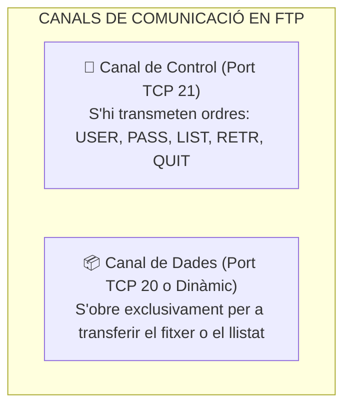
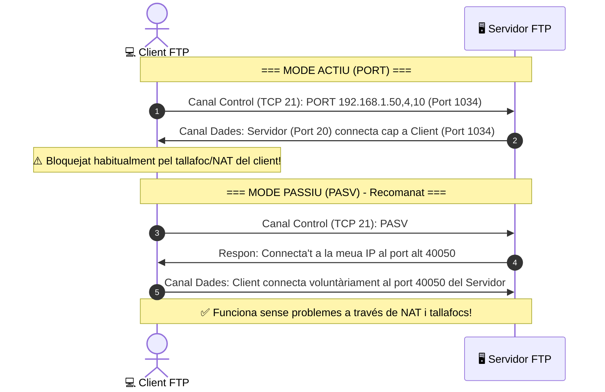

# UT06 — Serveis de Transferència de Fitxers (FTP, FTPS, SFTP)

La transferència de fitxers és una funció elemental en qualsevol infraestructura de xarxa per a permetre l'intercanvi de documents, còpies de seguretat i actualitzacions de programari entre clients i servidors.

---

## 📌 1. El Protocol FTP i els seus Canals de Comunicació

A diferència de la majoria de protocols de xarxa que utilitzen una sola connexió TCP, el protocol **FTP (*File Transfer Protocol* - RFC 959)** utilitza **dos canals separats**:



---

## 📌 2. Modes de Connexió: Actiu vs Passiu

La coexistència de routers amb NAT domèstic i tallafocs va forçar la creació de dos modes de funcionament per al canal de dades:



- **Mode Actiu:** El client demana dades i el servidor intenta obrir una connexió des del port **TCP 20** cap a l'ordinador del client. En xarxes actuals amb routers NAT, el router descarta la connexió entrant del servidor.
- **Mode Passiu (*Passive Mode*):** El client envia l'ordre `PASV`. El servidor respon amb un port dinàmic alt (p. ex., entre `40000` i `40100`). És el client qui inicia totes dues connexions cap a fora, fent-lo totalment compatible amb les connexions d'Internet habituals.

---

## 📌 3. Variants Segures: FTPS vs SFTP

| Característica | FTP Clàssic | FTPS (*FTP sobre TLS/SSL*) | SFTP (*SSH File Transfer Protocol*) |
| :--- | :--- | :--- | :--- |
| **Seguretat** | **Cap** (text pla) | Xifratge fort amb certificats X.509 | Xifratge fort del protocol SSH |
| **Ports de xarxa** | TCP 21 (control) + TCP 20/dinàmics | TCP 21/990 + rang dinàmic de dades | **Únicament TCP 22** |
| **Complexitat de tallafocs** | Mitjana / Alta | Alta (cal obrir rangs de ports passius) | **Molt senzilla** (un sol port obert) |
| **Subsistema** | Servidor FTP natiu | Servidor FTP amb mòdul TLS | Dimoni OpenSSH |

---

## 📌 4. Configuració Pràctica de `vsftpd` en Ubuntu Server

`vsftpd` (*Very Secure FTP Daemon*) és el servidor FTP més ràpid i segur per a entorns Linux:

```bash
# 1. Instal·lar vsftpd
sudo apt update && sudo apt install vsftpd -y
```

### Configuració del fitxer `/etc/vsftpd.conf`:
```text
# Desactivar accés anònim per seguretat
anonymous_enable=NO

# Permetre autenticació d'usuaris locals del sistema
local_enable=YES

# Permetre pujada i escriptura de fitxers
write_enable=YES

# Enjaulament (chroot): L'usuari no pot sortir de la seua carpeta personal
chroot_local_user=YES
allow_writeable_chroot=YES

# Rangs de ports per a Mode Passiu (cal obrir-los al tallafoc UFW)
pasv_enable=YES
pasv_min_port=40000
pasv_max_port=40100

# Xifratge segur FTPS amb certificat OpenSSL
ssl_enable=YES
rsa_cert_file=/etc/ssl/certs/ssl-cert-snakeoil.pem
rsa_private_key_file=/etc/ssl/private/ssl-cert-snakeoil.key
```

```bash
# Reiniciar el servei per a aplicar canvis
sudo systemctl restart vsftpd

# Obrir els ports necessaris al tallafoc
sudo ufw allow 21/tcp
sudo ufw allow 40000:40100/tcp
```

---

## 📌 5. Aïllament d'Usuaris en Windows Server (IIS FTP)

En entorns Windows Server 2022, el servei FTP s'habilita com a rol d'**Internet Information Services (IIS)**:
- **Aïllament d'Usuaris (*User Isolation*):** S'activa l'opció «Directori de nom d'usuari (desactivar directoris globals)».
- Dins de la carpeta arrel del lloc FTP (`C:\inetpub\ftproot`), es crea una subcarpeta anomenada `LocalUser` i a dins una carpeta per a cada usuari local (p. ex., `C:\inetpub\ftproot\LocalUser\alumne_redes`).
- Quan l'usuari `alumne_redes` inicia sessió des de FileZilla, el servidor l'enclaustra automàticament a la seua carpeta privada impedint-li veure les dades dels altres usuaris.
