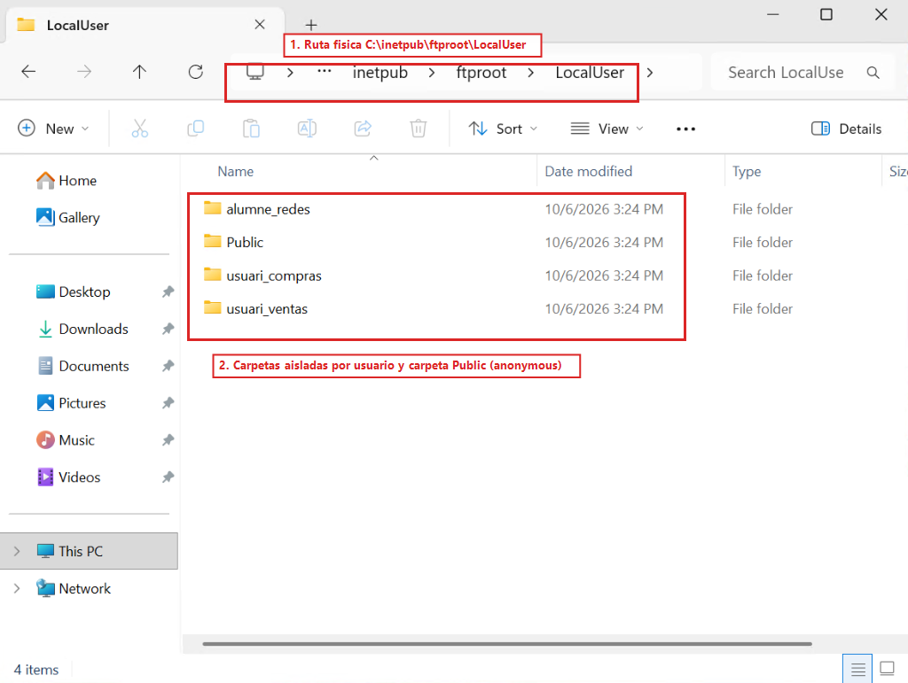
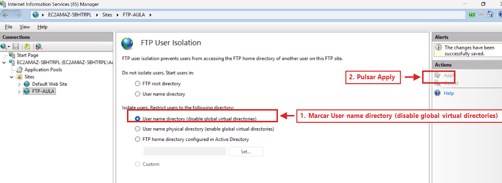
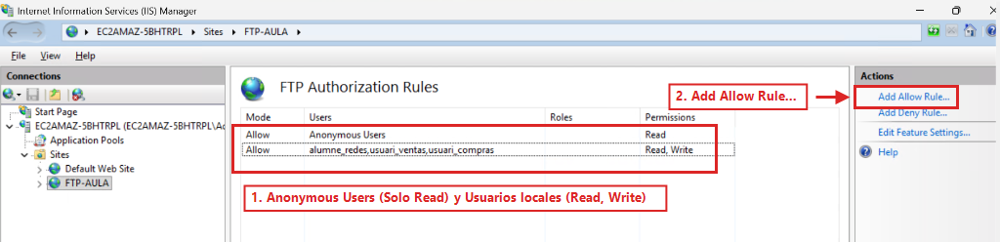
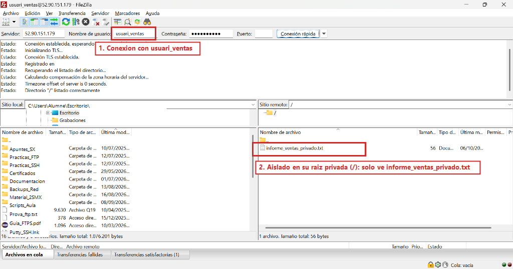
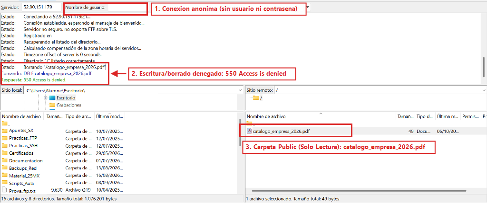

<div class="interactive-progress-tracker">
  <div class="tracker-header">
    <span>🏆 <strong>Progrés d'aquesta secció:</strong> <span class="tracker-count">0 de 4 superats (0%)</span></span>
    <span class="tracker-pts">⭐ <strong>0 punts</strong></span>
  </div>
  <div class="tracker-bar">
    <div class="tracker-fill" style="width: 0%;"></div>
  </div>
</div>

# 6.8 - [Windows Server] Aïllament d'usuaris (User Isolation), carpeta pública i permisos NTFS (RA3-CEd)

⚠️ **Obligatori seguir les normes per a la presentació de treballs escritos.**

Totes les evidències hauran d'incloure capturas de pantalla completes on es aprecie clarament el nom de l'equip, usuari i la data/hora.

En un entorn empresarial real, cada departament o usuari ha de disposar d'un espai privat exclusivo per a emmagatzemar els seus fitxers confidencials, sense que altres usuaris puguen accedir ni manipular-los. A més, sol habilitar-se una carpeta pública compartida (per a catálogos, formularis o drivers) accesible per qualsevol usuari de forma anònima, però amb permisos estrictos de només lectura.

### 8.1 Creació d'usuaris departamentals i estructura LocalUser en Windows Server

💡 **Retomas aquest apartat en una sessió posterior?**

- **Comprovació de IP:** Conéctate amb FileZilla utilitzant la IP pública actual de Windows Server. Asegúrate de que la IP en IIS estiga actualitzada (Apartat 6.5).

- **Requisits previos:** Verifica que tens l'estructura de carpetes `C:\inetpub\ftproot\LocalUser` creada i l'usuari `usuari_ventas` donat d'alta en Windows Server amb els permisos NTFS corresponents.

1. Obrir **Computer Management** (`compmgmt.msc`).

1. Desplegar **Local Users and Groups** -> carpeta **Users**.

1. Crear dos usuaris locals nous (**New User...**):

1. **User 1:** `usuari_ventas` (Password: `Smx2026..@`).

1. **User 2:** `usuari_compras` (Password: `Smx2026..@`).

1. Per a tots dos usuaris: desmarcar **User must change password at next logon**, i marcar **User cannot change password** i **Password never expires**.

1. Obrir **File Explorer** en `C:\inetpub\ftproot` i crear la següent estructura exacta de carpetes i fitxers de prova dins de `LocalUser` (en IIS, quan es activa l'aïllament per nom d'usuari, els usuaris locals entran en `LocalUser\<usuario>` i l'usuari `anonymous` entra automàticament en `LocalUser\Public`):
   

```bash
C:\inetpub\ftproot\
└── LocalUser\
    ├── alumne_redes\
    ├── usuari_ventas\
    │   └── informe_ventas_privado.txt
    ├── usuari_compras\
    │   └── presupuesto_compras_privado.txt
    └── Public\
        └── catalogo_empresa_2026.pdf
```

1. Conceder permisos NTFS de modificació (**Modify**) a `usuari_ventas` sobre la seua carpeta `C:\inetpub\ftproot\LocalUser\usuari_ventas` i a `usuari_compras` sobre `C:\inetpub\ftproot\LocalUser\usuari_compras` (pestanya **Security** -> **Edit...** -> **Add...**), mantenint la carpeta `LocalUser\Public` únicament amb permisos de lectura per a `IUSR` / `Users`:



*Figura 33b: Estructura física de carpetes en C:\inetpub\ftproot\LocalUser per a usuaris locals aïllats i carpeta Public per a accés anònim.*

📷 **Evidència 9 (inserir en el teu document Word) — Realitzar captura de pantalla** de File Explorer en Windows Server mostrant l'estructura de carpetes dins de `C:\inetpub\ftproot\LocalUser`.

### 8.2 Configuració del Aïllament de Usuaris en IIS (FTP User Isolation)

1. Obrir **Internet Information Services (IIS) Manager** (`inetmgr`).

1. Desplegar el servidor -> carpeta **Sites** -> fer clic sobre el lloc **`FTP-AULA`**.

1. En el panell central, fer doble clic sobre l'icono **FTP User Isolation**.

1. Dins de **Isolate users. Restrict users to the following directory:**, seleccionar l'opció: **User name directory (disable global virtual directories)**.

1. En el panell lateral dret (**Actions**), fer clic en **Apply**:



*Figura 33c: Activació de la directiva User name directory (disable global virtual directories) en FTP User Isolation.*

### 8.3 Configuració de Accés Anònim (Només Lectura) i Regles de Autorizació

1. En IIS, seleccionar el lloc **`FTP-AULA`** -> fer doble clic en l'icono **FTP Authentication**:

1. Seleccionar **Anonymous Authentication** i en el panell dret (**Actions**) polsar en **Enable** perquè la seua estat passe a **Enabled** (juntament amb **Basic Authentication** en **Enabled**).

1. Tornar al lloc **`FTP-AULA`** -> fer doble clic en l'icono **FTP Authorization Rules**:

1. Polsar en **Add Allow Rule...** en el panell dret:

  - **Regla 1 (Usuaris departamentals amb Lectura i Escriptura):** Seleccionar **Specified users**, escriure `alumne_redes, usuari_ventas, usuari_compras` i marcar els permisos **Read** i **Write** -> polsar **OK**.

  - **Regla 2 (Usuaris anónimos amb Només Lectura):** Polsar de nou en **Add Allow Rule...**, seleccionar **All anonymous users** i en **Permissions** marcar únicament **Read** (mantenint **Write** desmarcado) -> polsar **OK**:



*Figura 33d: Regles d'autorizació en FTP Authorization Rules concedent només lectura a Anonymous Users i lectura/escriptura als usuaris locals.*

### 8.4 Verificació de l'aïllament i permisos des de FileZilla

1. Obrir **FileZilla Client** en el vostre PC de l'aula.

1. **Prova d'usuari aislado (`usuari_ventas`):**

1. En la barra de **Connexió ràpida**, introduir Servidor `<IP_PUBLICA_WINDOWS>`, Nom d'usuari `usuari_ventas`, Contrasenya `Smx2026..@` i Port `21` -> polsar **Connexió ràpida**.

1. Comprovar que accedeix directament al seu arrel privada (`/`) on veu exclusivament el seu fitxer `informe_ventas_privado.txt`, sense possibilitat de pujar de nivell ni veure la carpeta de `usuari_compras`:



*Figura 33e: Usuari usuari_ventas enjaulado en el seu directori privat veient únicament informe_ventas_privado.txt.*

1. **Prova d'usuari anònim (`anonymous` - Només Lectura):**

1. En la barra de **Connexió ràpida**, introduir Servidor `<IP_PUBLICA_WINDOWS>`, Nom d'usuari `anonymous` (o deixar usuari i contrasenya en blanc) i Port `21` -> polsar **Connexió ràpida**.

1. Comprovar que accedeix directament a la carpeta pública (`LocalUser\Public`) i veu el fitxer `catalogo_empresa_2026.pdf` (podent descargar-lo sense problema).

1. Intentar **esborrar `catalogo_empresa_2026.pdf`** (o pujar un fitxer des del panell esquerre cap al servidor).

1. Comprovar que el servidor FTP deniega l'escriptura o l'esborrat devolvent el codi d'error **`Respuesta: 550 Access is denied`**:



*Figura 33f: Accés anònim de només lectura a la carpeta Public amb denegació d'esborrat/escriptura (550 Access is denied).*

📷 **Evidència 10 (inserir en el teu document Word) — Realitzar captura de pantalla** de FileZilla mostrant la vista privada de `usuari_ventas` i una altra captura mostrant l'error `550 Access is denied` a l'intentar pujar o esborrar un fitxer com usuari `anonymous`.

### 8.5 Diagnóstic d'avería: Error 550 en usuaris locals per discrepancia de permisos NTFS

- **Escenario de la incidencia:** L'usuari `usuari_ventas` es connecta per FTP correctament, però a l'intentar pujar un fitxer o crear una carpeta en el seu propi directori rep `Respuesta: 550 Access is denied`.

- **Causa tècnica:** Encara que en IIS Manager les **FTP Authorization Rules** permitan escriure (`Read, Write`), els permisos de seguretat del sistema de fitxers de Windows (**NTFS**) de la carpeta física `C:\inetpub\ftproot\LocalUser\usuari_ventas` no conceden permís de modificació (`Modify`) a l'usuari local.

- **Resolució:** Fer clic dret sobre la carpeta de l'usuari -> **Properties** -> pestanya **Security** -> **Edit...** -> **Add...** -> afegir a l'usuari i marcar **Modify** i **Write**.

ℹ️ **Què has d'afegir al teu document Word a l'acabar el Apartat 8**

En el **Apartat 8** del teu document Word, inclou les **Evidències 9 i 10**:

- **Evidència 9:** Estructura de carpetes dins de `C:\inetpub\ftproot\LocalUser` en el Explorador de fitxers de Windows Server.

- **Evidència 10:** Capturas en FileZilla mostrant la vista privada aïllada de `usuari_ventas` (`informe_ventas_privado.txt`) i l'error `550 Access is denied` a l'intentar esborrar o pujar fitxers com usuari `anonymous`.


---

## 🎮 Reptes Interactius d'Autoavaluació (+100 XP)

Comprova el teu domini sobre **6.8 - [Windows Server] Aïllament d'usuaris (User Isolation), carpeta pública i permisos NTFS (RA3-CEd)** superant aquests 4 reptes gamificats (+25 punts cadascun):

<div class="interactive-mcq" data-answer="D" data-hint="Revisa els conceptes teòrics i pràctics d'aquesta secció.">
  <div class="mcq-question">🎯 <strong>Repte 1 (+25 pts):</strong> En Windows Server amb IIS FTP, quina opció de 'FTP User Isolation' permet que cada usuari entre directament a la seua carpeta LocalUser\&lt;usuari&gt; però puga accedir a carpetes virtuals si coneix la ruta?</div>
  <div class="mcq-options">
    <button type="button" class="btn-mcq-opt" data-opt="A">A) Do not isolate users. Start users in FTP root directory.</button>
    <button type="button" class="btn-mcq-opt" data-opt="B">B) Isolate users using Active Directory only.</button>
    <button type="button" class="btn-mcq-opt" data-opt="C">C) Cap de les anteriors és correcta.</button>
    <button type="button" class="btn-mcq-opt" data-opt="D">D) User name directory (disable global virtual directories).</button>
  </div>
  <div class="quiz-feedback"></div>
</div>

<div class="interactive-mcq" data-answer="C" data-hint="Comprova l'apartat corresponent de la unitat.">
  <div class="mcq-question">🎯 <strong>Repte 2 (+25 pts):</strong> Quan comparem amb Wireshark una sessió FTP tradicional amb una sessió FTPS o SFTP, què observem en capturar el trànsit de xarxa?</div>
  <div class="mcq-options">
    <button type="button" class="btn-mcq-opt" data-opt="A">A) Wireshark no pot capturar paquets TCP del port 21.</button>
    <button type="button" class="btn-mcq-opt" data-opt="B">B) Cap de les anteriors és correcta.</button>
    <button type="button" class="btn-mcq-opt" data-opt="C">C) En FTP tradicional les ordres USER i PASS es veuen en text clar, mentre que en FTPS (TLS) i SFTP (SSH) el contingut viatja completament xifrat.</button>
    <button type="button" class="btn-mcq-opt" data-opt="D">D) En tots tres protocols la contrasenya viatja en text clar.</button>
  </div>
  <div class="quiz-feedback"></div>
</div>

<div class="interactive-vf" data-answer="V" data-hint="Verifica l'afirmació amb els apunts de la unitat.">
  <div class="vf-statement">✅ <strong>Repte 3 (Vertader o Fals · +25 pts):</strong> Per a bastionar un servidor OpenSSH i impedir atacs de força bruta per contrasenya una vegada configurada la clau pública, s'estableix PasswordAuthentication no en sshd_config.</div>
  <div class="vf-buttons">
    <button type="button" class="btn-vf" data-opt="V">Vertader (V)</button>
    <button type="button" class="btn-vf" data-opt="F">Fals (F)</button>
  </div>
  <div class="quiz-feedback" style="width: 100%;"></div>
</div>

<div class="interactive-quiz" data-answer="550" data-hint="És el famós error 550.">
  <div class="quiz-question">⌨️ <strong>Repte 4 (+25 pts):</strong> Quin codi d'error numèric de 3 xifres retorna un servidor FTP quan es denega una acció sobre un fitxer per falta de permisos NTFS o POSIX (Permission denied)?</div>
  <div class="quiz-controls">
    <input type="text" class="quiz-input" placeholder="Escriu la resposta..." />
    <button type="button" class="btn-quiz-check">Comprovar</button>
  </div>
  <div class="quiz-feedback"></div>
</div>

### 📋 Llista de Comprovació i Rúbrica d'Assoliment

Marca cada criteri a mesura que completes l'estudi o la resolució pràctica d'aquesta pàgina (**6.8 - [Windows Server] Aïllament d'usuaris (User Isolation), carpeta pública i permisos NTFS (RA3-CEd)**):

- [ ] He llegit detingudament la teoria o l'enunciat d'aquesta secció i he anotat els conceptes clau.
- [ ] He revisat els esquemes, taules o blocs de codi i he verificat que sé aplicar-los a l'entorn de treball.
- [ ] He resolt correctament els **4 reptes interactius** superiors obtenint els **100 punts XP**.
- [ ] He descarregat el comprovant oficial en PDF per a adjuntar-lo a la tasca d'**Aules**.

<div class="aules-delivery-card">
  <h3>📤 Comprovant de Lliurament per a Aules</h3>
  <p>Quan hages completat els reptes interactius i la llista d'autoavaluació d'aquesta pàgina, introdueix el teu nom i descarrega el teu certificat oficial en PDF per a adjuntar-lo a la tasca d'<strong>Aules</strong>.</p>
  <div class="aules-student-field">
    <label for="aules-student-name">👤 Nom i Cognoms de l'Alumne/a:</label>
    <input type="text" id="aules-student-name" class="aules-student-name" placeholder="Ex: Joan Garcia Pérez" />
  </div>
  <div class="aules-score-badge">
    <span class="aules-score-count">0/4 reptes completats (0%) · 0 punts · 0/4 criteris d'autoavaluació</span>
  </div>
  <div class="aules-actions">
    <button type="button" class="btn-aules-dl" data-module="SEX" data-unit="UD06" data-activity="ut0608">📥 Descarregar Comprovant PDF</button>
    <button type="button" class="btn-aules-copy">📋 Copiar Resum al Porta-retalls</button>
  </div>
  <div class="aules-toast"></div>
</div>

