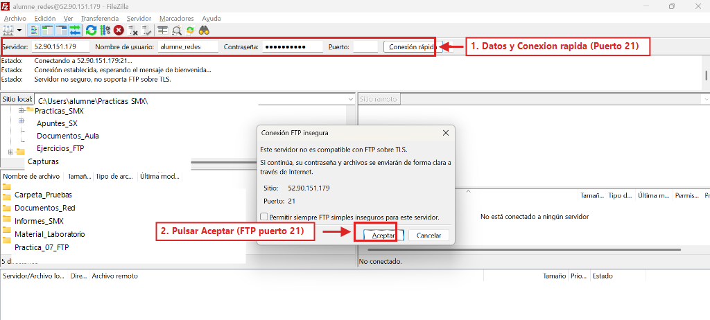
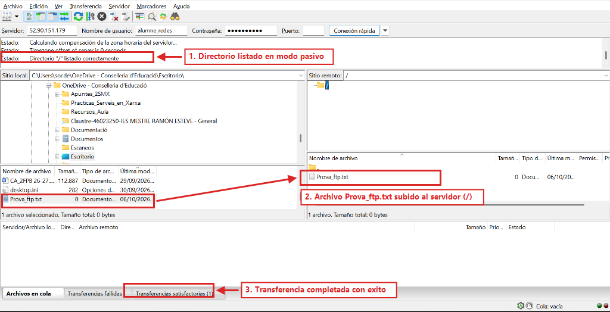

## 7 - [Windows Server] Transferencia de ficheros con FileZilla y diagnóstico de modo pasivo (RA3-CEe)

> ⚠️ **Obligatorio seguir las normas para la presentación de trabajos escritos.**
>
> Todas las evidencias deberán incluir capturas de pantalla completas donde se aprecie claramente el nombre del equipo, usuario y la fecha/hora.
>

Una vez instalado y configurado el servidor FTP en **Windows Server (`Servidor_FTPSSH`)**, vamos a verificar inmediatamente desde nuestro equipo del aula que el canal de control (`21` TCP) y el canal de datos en **modo pasivo** (`50000-50100` TCP) funcionan correctamente antes de avanzar a configuraciones más complejas.

---

### 7.1 Conexión y transferencia hacia Windows Server con FileZilla

> ⚠️ **¿Retomas la práctica en un día diferente o tras reiniciar Windows Server?**
>
> Si la instancia `Servidor_FTPSSH` se ha detenido y reiniciado hoy, **su IP pública habrá cambiado**:
> * **En FileZilla:** Introduce en el campo **Servidor** la **nueva IP pública de Windows** (consúltala en la consola de AWS EC2).
> * **Problema típico si no actualizas IIS:** FileZilla conectará con éxito al puerto 21 (`230 User logged in`), pero al enviar la orden `PASV` el servidor responderá con la IP vieja. FileZilla se quedará esperando y fallará con `Error: Conexión superó el tiempo de espera` y `No se pudo recibir la lista de directorios`.
> * 👉 **Solución:** Actualiza la IP pública en IIS siguiendo el [Apartado 6.5: Soporte de Firewall de FTP](#actualizar-ip-windows) (o ejecuta el comando rápido de PowerShell indicado allí).
>

1. Abrir **FileZilla Client** en vuestro ordenador del aula.
2. En la barra superior de **Conexión rápida** introducir:
   * **Servidor:** `<IP_PUBLICA_WINDOWS>` (en nuestro ejemplo, `52.90.151.179`)
   * **Nombre de usuario:** `alumne_redes`
   * **Contraseña:** `Smx2026..@`
   * **Puerto:** `21` (si se deja en blanco, FileZilla utiliza por defecto el puerto `21`)
3. Pulsar en el botón **Conexión rápida**.
4. Al tratarse inicialmente de una conexión FTP estándar sin cifrar (antes de configurar FTPS en la Tarea 9), FileZilla mostrará la ventana emergente **Conexión FTP insegura** (**Este servidor no es compatible con FTP sobre TLS**). Pulsar en **Aceptar**:

*Figura 32: Introducción de credenciales en la barra de Conexión rápida de FileZilla y confirmación del diálogo de conexión FTP en el puerto 21.*

5. Comprobar que en el log de conexión superior aparece el listado correcto del directorio (`Directorio "/" listado correctamente`) gracias al modo pasivo configurado.
6. Crear en vuestro PC un archivo llamado `Prova_ftp.txt` (o `prueba_win.txt`) y subirlo arrastrándolo al panel derecho (Sitio remoto `/`). Comprobar en la pestaña inferior **Transferencias satisfactorias (1)** que el fichero se ha transferido sin errores:

*Figura 33: Directorio raíz listado en modo pasivo y archivo Prova_ftp.txt transferido con éxito al servidor Windows Server.*

> 📷 **Evidencia 8 (insertar en tu documento Word) — Realizar captura de pantalla** de FileZilla mostrando la conexión exitosa en modo pasivo y el archivo subido al servidor Windows Server.

---

### 7.2 Diagnóstico de avería: Bloqueo del modo pasivo por cortafuegos o IP externa

* **Escenario de la incidencia:** Un usuario introduce su usuario y contraseña en FileZilla correctamente (`230 User logged in`), pero justo después la conexión se queda congelada mostrando `Comando: MLSD` o `LIST` y tras 20 segundos devuelve `Error: Conexión superó el tiempo de espera. No se pudo recuperar el listado del directorio`.
* **Causa técnica:** El canal de control (puerto `21`) está abierto, pero el canal de datos pasivo (`50000-50100`) está bloqueado por el Firewall de Windows Defender (`wf.msc`), por el Security Group de AWS, o bien se olvidó introducir la IPv4 pública de AWS en **FTP Firewall Support** de IIS.
* **Comprobación práctica:**
  1. Verificar en el log superior de FileZilla que el servidor responde al comando `PASV` con la IP pública correcta y un puerto del rango `50000-50100`.
  2. Verificar en Windows Server que la regla `FTP Pasivo Datos (50000-50100)` está activa en `wf.msc`.

> ℹ️ **Qué debes añadir a tu documento Word al terminar el Apartado 7**
>
> En el **Apartado 7** de tu documento Word, incluye:
>
> * **Evidencia 8:** Captura de FileZilla mostrando la conexión exitosa en modo pasivo hacia Windows Server y el archivo `Prova_ftp.txt` transferido en la pestaña de **Transferencias satisfactorias**.
>

---
