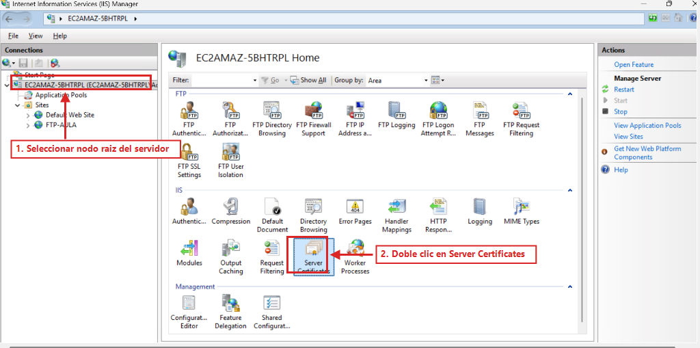
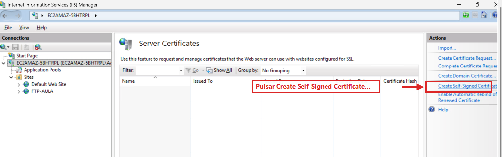
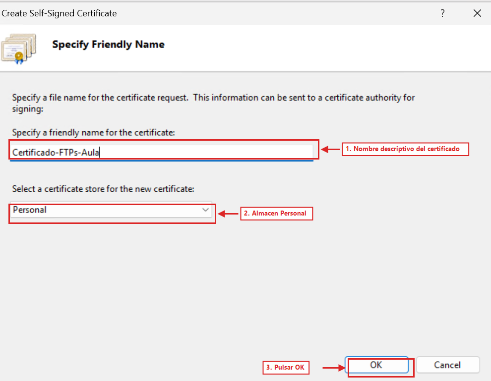
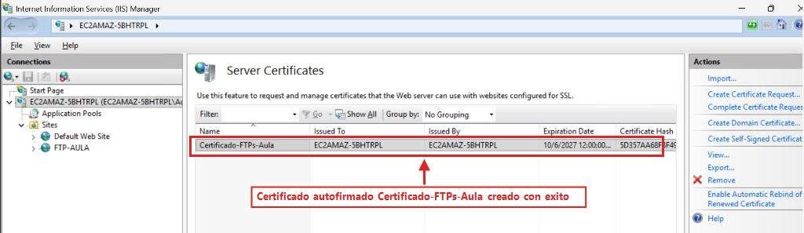
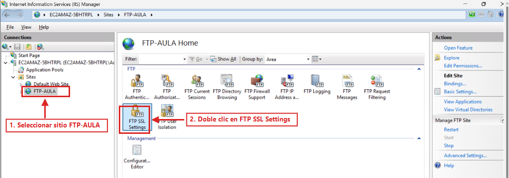
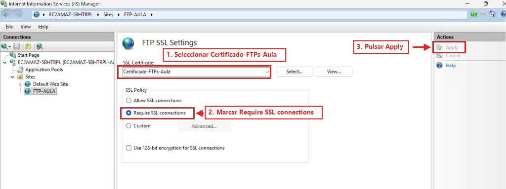
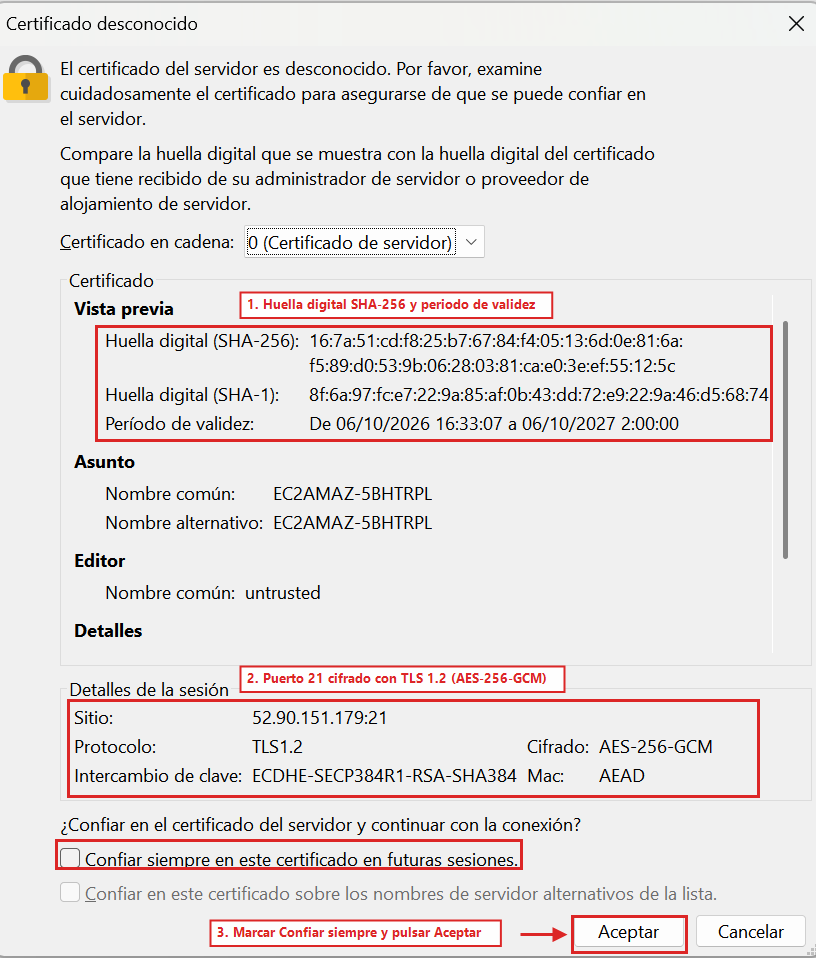
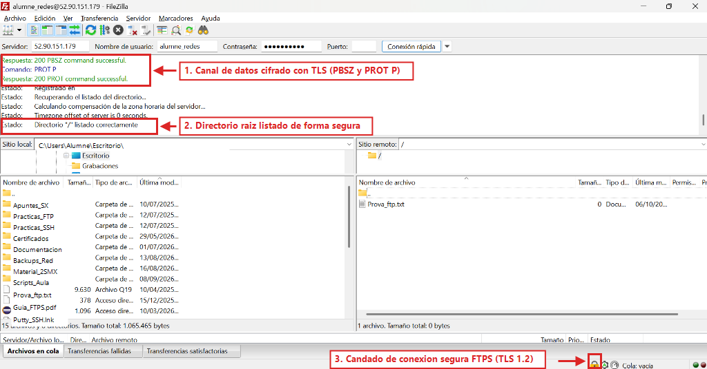

  

    🏆 <strong>Progrés d'aquesta secció:</strong> 0 de 4 superats (0%)
    ⭐ <strong>0 punts</strong>
  

  

    

  

# 6.9 - [Windows Server] Seguretat i cifrado amb FTPS (FTP sobre TLS/SSL) (RA3-CEf)

⚠️ **Obligatori seguir les normes per a la presentació de treballs escritos.**

Totes les evidències hauran d'incloure capturas de pantalla completes on es aprecie clarament el nom de l'equip, usuari i la data/hora.

El protocol FTP tradicional transmet contrasenyes i dades en text clar sense cifrar. En aquesta tasca asegurarem el nostre servidor **Windows Server (`Servidor_FTPSSH`)** mitjançant **FTPS (FTP sobre SSL/TLS)**, creant un certificat digital autosignat en IIS i implementant cifrado obligatori.

### 9.1 Creació d'un Certificat Digital Autosignat en Windows Server

💡 **Retomas aquest apartat en una sessió posterior?**

- **Comprovació de IP:** Utilitza la IP pública actual de Windows en FileZilla i confirma que el mode pasivo de IIS té la IP al dia (Apartat 6.5).

- **Avís de certificat al canviar de IP:** Al canviar la IP pública de la màquina, FileZilla detectará la connexió com un nou destí i volverá a mostrar la finestra de validació del certificat autosignat `Certificado-FTPs-Aula`. Simplement marca **Confiar sempre en aquest certificat** i polsa **Acceptar**.

1. Obrir **Internet Information Services (IIS) Manager** (`inetmgr`).

1. En el panell esquerre (**Connections**), fer clic sobre el **nom del servidor** (node arrel).

1. En el panell central, dins del bloc **IIS**, fer doble clic en l'icono **Server Certificates**:

*Figura 36: Selecció del node arrel del servidor i accés a Server Certificates en IIS Manager.*

1. En el panell lateral dret (**Actions**), fer clic en l'enllaç **Create Self-Signed Certificate...**:

*Figura 37: Accés a l'assistent de creació de certificat autosignat.*

1. En la finestra **Specify Friendly Name**:

1. **Specify a friendly name for the certificate:** `Certificado-FTPs-Aula`

1. **Select a certificate store for the new certificate:** Mantindre seleccionat `Personal`.

1. Polsar en **OK**.

*Figura 38: Configuració del nom descriptivo Certificat-FTPs-Aula en el magatzem Personal.*

1. Comprovar que el certificat `Certificado-FTPs-Aula` apareix llistat en el panell central de **Server Certificates** amb la seua data de caducitat (**Expiration Date**) i la seua huella (**Certificate Hash**):

*Figura 39: Certificat digital Certificat-FTPs-Aula generat en el servidor.*

📷 **Evidència 11 (inserir en el teu document Word) — Realitzar captura de pantalla** del panell Server Certificates mostrant el nou certificat creat amb la seua data de caducitat i emissor.

### 9.2 Configuració del cifrado SSL en el lloc FTP (FTP SSL Settings)

1. En el panell esquerre de IIS, desplegar **Sites** i fer clic sobre el lloc FTP **`FTP-AULA`**.

1. En el panell central, fer doble clic en l'icono **FTP SSL Settings**:

*Figura 40: Selecció del lloc FTP-AULA i obertura de FTP SSL Settings.*

1. Configurar el cifrado del lloc:

1. En el desplegable **SSL Certificate**, seleccionar `Certificado-FTPs-Aula`.

1. En la directiva **SSL Policy**, marcar **Require SSL connections**.

1. En el panell lateral dret (**Actions**), fer clic en **Apply**.

*Figura 41: Assignació del certificat Certificat-FTPs-Aula i activació de Require SSL connections en FTP SSL Settings.*

1. Reiniciar el lloc FTP polsant en **Restart** dins de la secció **Manage FTP Site** de la columna dreta de IIS (o reiniciant **Microsoft FTP Service** des de `services.msc`).

### 9.3 Connexió segura amb FileZilla i validació de certificat TLS

1. Obrir **FileZilla Client** en el vostre PC de l'aula.

1. Connectar cap al servidor en el port **`21`** (podéis fer-ho directament des de la barra de **Connexió ràpida** introducent Servidor `<IP_PUBLICA_WINDOWS>`, Usuari `alumne_redes`, Contrasenya `Smx2026..@` i Port `21`, ja que FileZilla negocia automàticament **FTP explícit sobre TLS** si el servidor el suporta, o bé guardant el perfil en **Fitxer** -> **Gestor de llocs...** amb cifrado **Requereix FTP explícit sobre TLS**).

1. Polsar en **Connexió ràpida** (o **Connectar**).

1. A l'establir la negociació segura en el port `21`, apareixerà la finestra emergente **Certificat desconocido**:

1. Revisar la informació del bloc **Certificat**: huella digital (**SHA-256**) i período de validesa, així com els **Detalls de la sessió** (`Protocolo: TLS1.2`, `Cifrado: AES-256-GCM`).

1. Marcar la casella **Confiar sempre en aquest certificat en futuras sessions**.

1. Polsar en **Acceptar**:

*Figura 42: Verificació del certificat digital autosignat (SHA-256) i sessió cifrada TLS 1.2 (AES-256-GCM) en el port 21.*

1. Comprovar en el panell de log de FileZilla que es negocia el cifrado del canal de dades (`Respuesta: 200 PBSZ command successful` i `Comando: PROT P` -> `200 PROT command successful`) i es llista el directori arrel (`Directorio "/" listado correctamente`).

1. En la barra d'estat inferior dreta de FileZilla, comprovar que apareix el **icono del candado tancat** indicant que tant el canal de control com el canal de dades viatgen cifrats mitjançant TLS 1.2:

*Figura 43: Connexió FTPS establecida en el port 21 amb cifrado del canal de dades (PROT P) i candado de seguretat activo.*

📷 **Evidència 12 (inserir en el teu document Word) — Realitzar captura de pantalla** de la finestra del certificat en FileZilla mostrant la huella digital SHA-256 i de FileZilla connectat amb el candado de connexió segura activo.

ℹ️ **Què has d'afegir al teu document Word a l'acabar el Apartat 9**

En el **Apartat 9** del teu document Word, inclou les **Evidències 11 i 12**:

- **Evidència 11:** Panell **Server Certificates** de IIS mostrant el certificat `Certificado-FTPs-Aula` creat.

- **Evidència 12:** Finestra de validació del certificat TLS (huella SHA-256) en FileZilla i sessió FTPS connectada mostrant els comandes `PBSZ 0` / `PROT P` i el candado de seguretat activo.

---

## 🎮 Reptes Interactius d'Autoavaluació (+100 XP)

Comprova el teu domini sobre **6.9 - [Windows Server] Seguretat i cifrado amb FTPS (FTP sobre TLS/SSL) (RA3-CEf)** superant aquests 4 reptes gamificats (+25 punts cadascun):

  
🎯 <strong>Repte 1 (+25 pts):</strong> En Windows Server amb IIS FTP, quina opció de 'FTP User Isolation' permet que cada usuari entre directament a la seua carpeta LocalUser\&lt;usuari&gt; però puga accedir a carpetes virtuals si coneix la ruta?

  

    <button type="button" class="btn-mcq-opt" data-opt="A">A) Do not isolate users. Start users in FTP root directory.</button>
    <button type="button" class="btn-mcq-opt" data-opt="B">B) Isolate users using Active Directory only.</button>
    <button type="button" class="btn-mcq-opt" data-opt="C">C) Cap de les anteriors és correcta.</button>
    <button type="button" class="btn-mcq-opt" data-opt="D">D) User name directory (disable global virtual directories).</button>
  

  

  
🎯 <strong>Repte 2 (+25 pts):</strong> Quan comparem amb Wireshark una sessió FTP tradicional amb una sessió FTPS o SFTP, què observem en capturar el trànsit de xarxa?

  

    <button type="button" class="btn-mcq-opt" data-opt="A">A) Wireshark no pot capturar paquets TCP del port 21.</button>
    <button type="button" class="btn-mcq-opt" data-opt="B">B) Cap de les anteriors és correcta.</button>
    <button type="button" class="btn-mcq-opt" data-opt="C">C) En FTP tradicional les ordres USER i PASS es veuen en text clar, mentre que en FTPS (TLS) i SFTP (SSH) el contingut viatja completament xifrat.</button>
    <button type="button" class="btn-mcq-opt" data-opt="D">D) En tots tres protocols la contrasenya viatja en text clar.</button>
  

  

  
✅ <strong>Repte 3 (Vertader o Fals · +25 pts):</strong> Per a bastionar un servidor OpenSSH i impedir atacs de força bruta per contrasenya una vegada configurada la clau pública, s'estableix PasswordAuthentication no en sshd_config.

  

    <button type="button" class="btn-vf" data-opt="V">Vertader (V)</button>
    <button type="button" class="btn-vf" data-opt="F">Fals (F)</button>
  

  

  
⌨️ <strong>Repte 4 (+25 pts):</strong> Quin codi d'error numèric de 3 xifres retorna un servidor FTP quan es denega una acció sobre un fitxer per falta de permisos NTFS o POSIX (Permission denied)?

  

    <input type="text" class="quiz-input" placeholder="Escriu la resposta..." />
    <button type="button" class="btn-quiz-check">Comprovar</button>
  

  

### 📋 Llista de Comprovació i Rúbrica d'Assoliment

Marca cada criteri a mesura que completes l'estudi o la resolució pràctica d'aquesta pàgina (**6.9 - [Windows Server] Seguretat i cifrado amb FTPS (FTP sobre TLS/SSL) (RA3-CEf)**):

- [ ] He llegit detingudament la teoria o l'enunciat d'aquesta secció i he anotat els conceptes clau.
- [ ] He revisat els esquemes, taules o blocs de codi i he verificat que sé aplicar-los a l'entorn de treball.
- [ ] He resolt correctament els **4 reptes interactius** superiors obtenint els **100 punts XP**.
- [ ] He descarregat el comprovant oficial en PDF per a adjuntar-lo a la tasca d'**Aules**.

  <h3>📤 Comprovant de Lliurament per a Aules</h3>
  
Quan hages completat els reptes interactius i la llista d'autoavaluació d'aquesta pàgina, introdueix el teu nom i descarrega el teu certificat oficial en PDF per a adjuntar-lo a la tasca d'<strong>Aules</strong>.

  

    <label for="aules-student-name">👤 Nom i Cognoms de l'Alumne/a:</label>
    <input type="text" id="aules-student-name" class="aules-student-name" placeholder="Ex: Joan Garcia Pérez" />
  

  

    0/4 reptes completats (0%) · 0 punts · 0/4 criteris d'autoavaluació
  

  

    <button type="button" class="btn-aules-dl" data-module="SEX" data-unit="UD06" data-activity="ut0609">📥 Descarregar Comprovant PDF</button>
    <button type="button" class="btn-aules-copy">📋 Copiar Resum al Porta-retalls</button>
  

  

