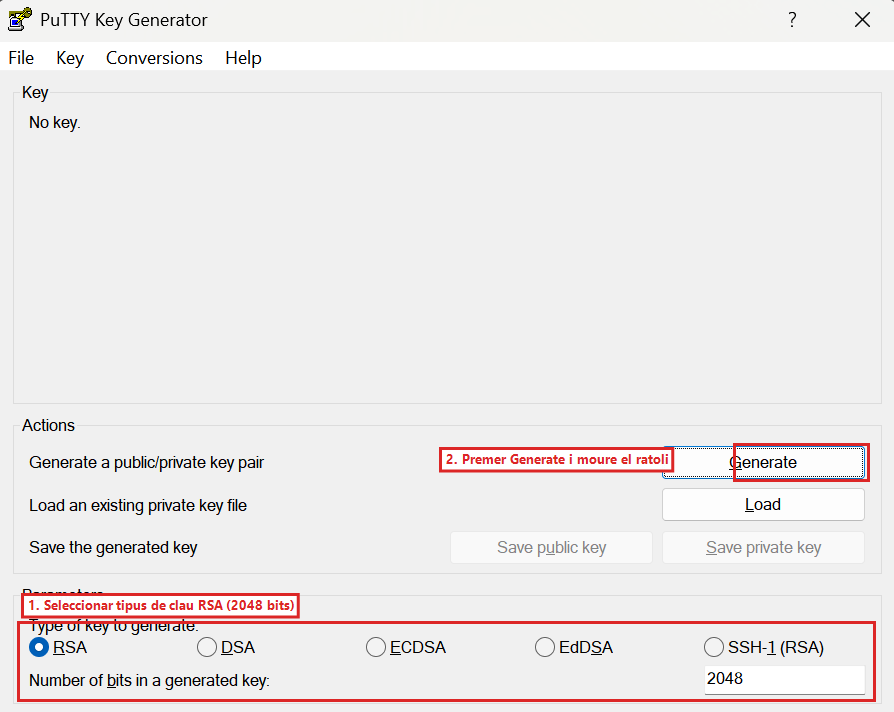
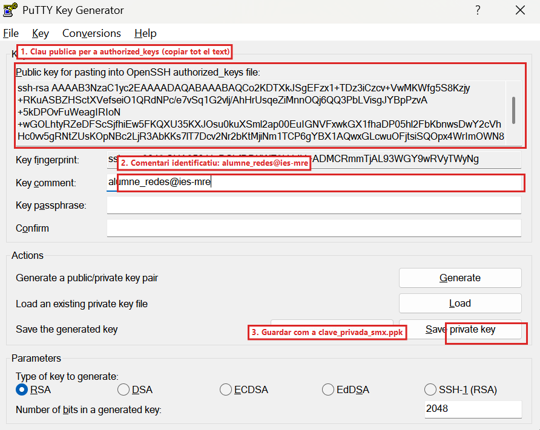
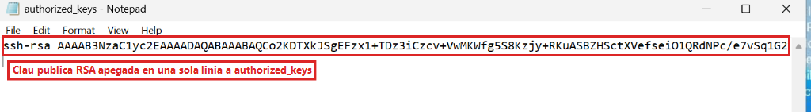
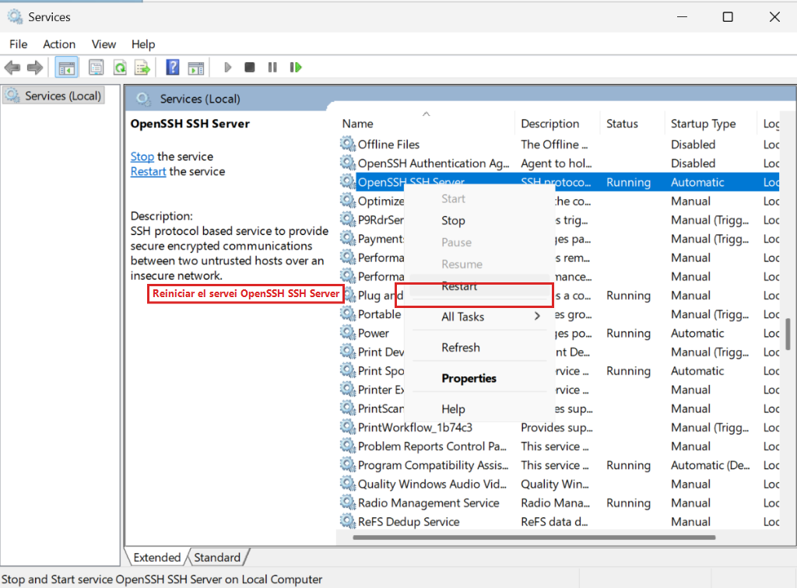
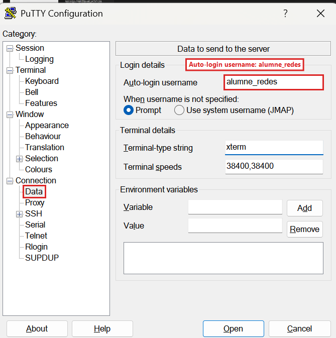
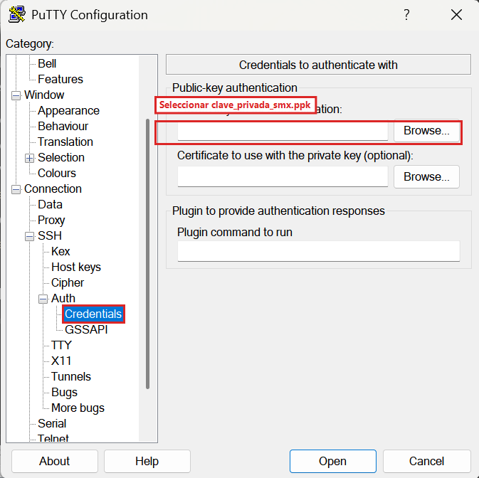
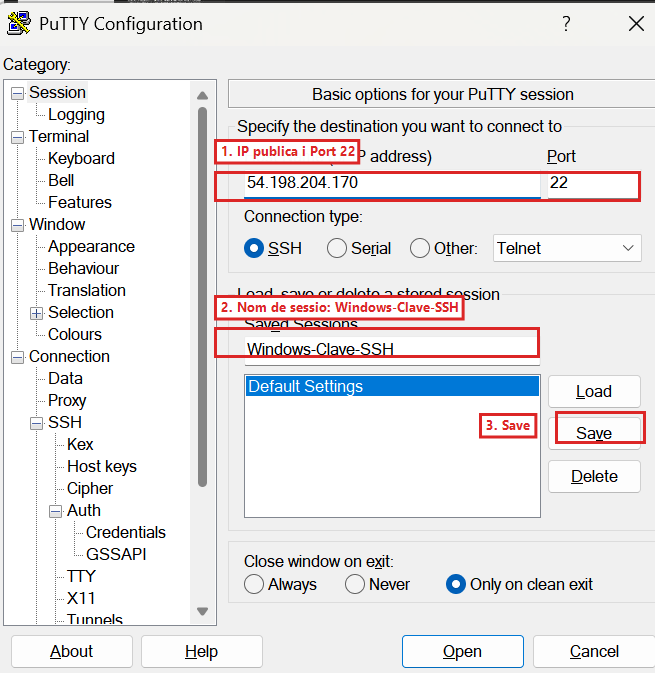
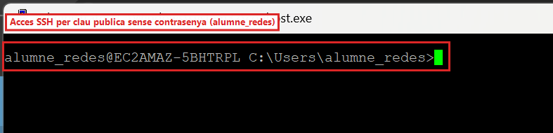
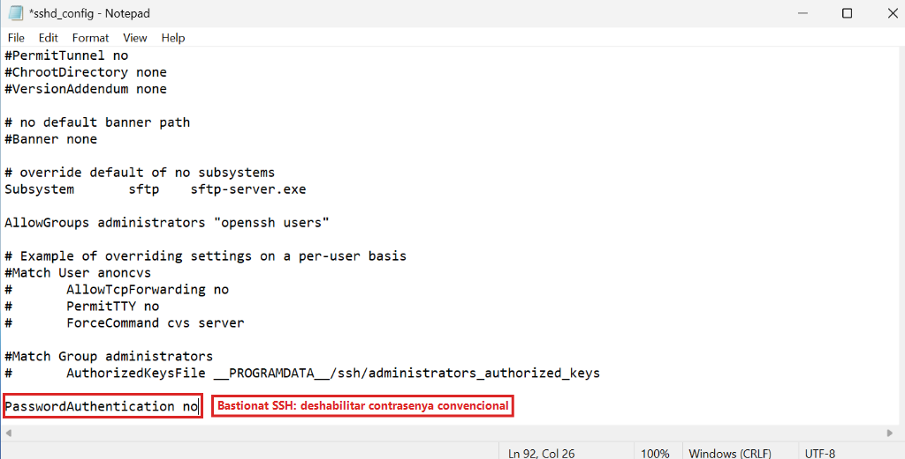
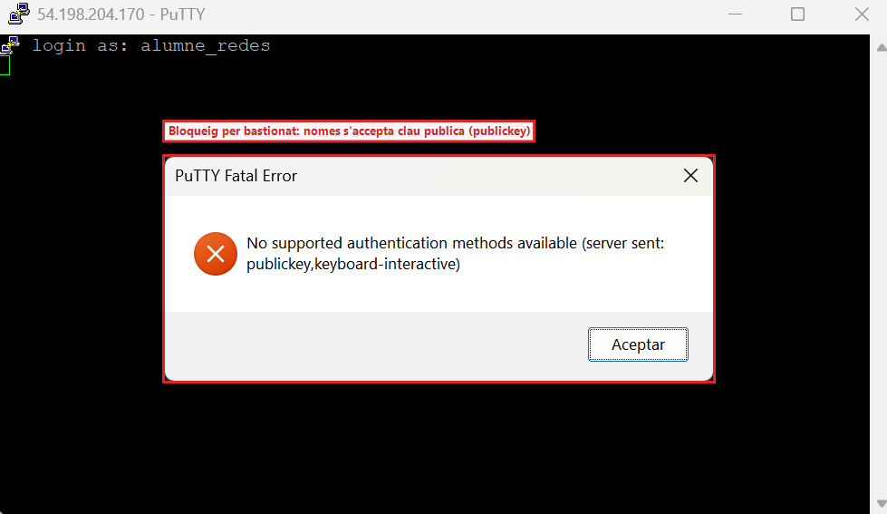

<div class="interactive-progress-tracker">
  <div class="tracker-header">
    <span>🏆 <strong>Progrés d'aquesta secció:</strong> <span class="tracker-count">0 de 4 superats (0%)</span></span>
    <span class="tracker-pts">⭐ <strong>0 punts</strong></span>
  </div>
  <div class="tracker-bar">
    <div class="tracker-fill" style="width: 0%;"></div>
  </div>
</div>

# 6.10 - [Windows Server] Administració remota i bastionado de SSH amb PuTTY i PuTTYgen (RA3-CEf)

⚠️ **Obligatori seguir les normes per a la presentació de treballs escritos.**

Totes les evidències hauran d'incloure capturas de pantalla completes on es aprecie clarament el nom de l'equip, usuari i la data/hora.

L'accés per contrasenya convencional està expuesto a ataques de fuerza bruta. En aquesta tasca aprovecharem el servei **OpenSSH Server** que dejamos activo en **Windows Server (`Servidor_FTPSSH`)** en l'apartat 6.3.1 per a connectar remotament pel port `22` amb **PuTTY**, generar un parell de claus asimétriques amb **PuTTYgen** i bastionar el servidor deshabilitant l'accés per contrasenya.

### 10.1 Connexió SSH bàsica cap a Windows Server amb PuTTY

⚠️ **Retomas la pràctica en un dia diferent per a configurar SSH?**

- **Problema si uses la IP vieja:** Si introduces en PuTTY la IP del dia anterior, la connexió es quedarà congelada i retornarà `Network error: Connection timed out`.

- **Solució:** Consulta la **nova IP pública** de `Servidor_FTPSSH` en la consola de AWS EC2 (Apartat 6.0) i indícala en el camp **Host Name** de PuTTY amb el port `22`.

- **Alerta de clau host en PuTTY:** Al canviar la IP, PuTTY mostrarà l'avís `The server's host key is not cached in the registry`. És un comportament completament normal; fes clic en **Accept** per a continuar.

1. Obrir **PuTTY** en el vostre PC de l'aula.

1. En el camp **Host Name (or IP address)** introduir la **IP pública de Windows Server** (`<IP_PUBLICA_WINDOWS>`), **Port** `22` i **Connection type** `SSH`.

1. Polsar en **Open**, acceptar l'advertencia inicial de clau host del servidor (**PuTTY Security Alert** polsant `Accept`) i iniciar sessió indicant l'usuari `alumne_redes` i la seua contrasenya (`Smx2026..@`).

1. A l'entrar, executar `whoami` i `hostname` per a verificar que estáis connectats a la consola de comandes remota de Windows Server.

No obstant això, el mètode professional i segur recomanat per a entorns de producció és **sustituir les contrasenyes per autenticació asimétrica de clau pública** i bastionar el servei, tal com configuramos a continuació.

### 10.2 Generació del parell de claus amb PuTTYgen

1. En el vostre ordinador de l'aula, obrir **PuTTYgen** (**PuTTY Key Generator**).

1. En la part inferior (**Parameters**), mantindre seleccionat el tipus de clau **RSA** (`2048` bits) o **EdDSA (Ed25519)**.

1. Polsar en el botó **Generate** i mover continuament el cursor del ratolí sobre l'àrea buida per a generar entropía criptográfica aleatoria:



*Figura 45b: Selecció del tipus de clau RSA (2048 bits) i ubicació del botó Generate en PuTTYgen.*

1. En el camp **Key comment**, escriure: `alumne_redes@ies-mre`.

1. Polsar en **Save private key** (confirmar guardar sense contrasenya de pas per a aquest laboratorio) i guardar-la com `clave_privada_smx.ppk` en la vostra carpeta de treball.

1. En el cuadro superior que indica **Public key for pasting into OpenSSH authorized_keys file**, seleccionar i **copiar tot el text complet de la clau pública** (`ssh-rsa AAAA...`):



*Figura 46: Clau pública RSA generada en PuTTYgen amb comentari identificatiu alumne_redes@ies-mre i guardat de clau privada (.ppk).*

📷 **Evidència 13 (inserir en el teu document Word) — Realitzar captura de pantalla** de la finestra de PuTTYgen mostrant la clau generada i el comentari `alumne_redes@ies-mre`.

### 10.3 Instal·lació de la clau pública en Windows Server i ajuste de sshd_config

1. En el Escriptori Remoto (RDP) de **Windows Server**:

1. Obrir el **Bloc de notes (Notepad)** com Administrador.

1. Obrir el fitxer `C:\ProgramData\ssh\sshd_config` (seleccionant **All Files `(**.**)`** en el diálogo d'obertura).

1. Baixar fins a les dos últimes línies del fitxer (`Match Group administrators` i `AuthorizedKeysFile __PROGRAMDATA__/ssh/administrators_authorized_keys`) i comprovar que estan comentades amb una almohadilla `#` davant perquè Windows utilitze sempre la carpeta `.ssh` estàndard de cada usuari:
     

```bash
#Match Group administrators
#       AuthorizedKeysFile __PROGRAMDATA__/ssh/administrators_authorized_keys
```

1. Crear la carpeta `C:\Users\alumne_redes\.ssh` (si no existeix) i dins d'ella crear/obrir amb **Notepad** el fitxer **`authorized_keys`** (sense extensió `.txt`), pegant en una sola línia la clau pública copiada des de PuTTYgen:



*Figura 46b: Clau pública RSA pegada en una sola línia dins del fitxer authorized_keys de alumne_redes.*

1. Reiniciar el servei **OpenSSH SSH Server** des de la consola gràfica `services.msc`:



*Figura 46c: Reinicio del servei OpenSSH SSH Server en Windows Server després d'actualitzar les claus autoritzades.*

### 10.4 Connexió automàtica mitjançant clau privada en PuTTY

1. Obrir **PuTTY** en el vostre PC de l'aula.

1. En el menú esquerre, anar a **Connection** -> **Data** i en **Auto-login username** escriure `alumne_redes`:



*Figura 46d: Configuració de l'inici de sessió desatendido per a alumne_redes en Connection -> Data.*

1. En l'arbre esquerre, desplegar **Connection** -> **SSH** -> **Auth** -> **Credentials**:

1. En el camp **Private key file for authentication**, fer clic en **Browse...** i seleccionar el vostre fitxer `clave_privada_smx.ppk`:



*Figura 46e: Associació del fitxer de clau privada clave_privada_smx.ppk en Connection -> SSH -> Auth -> Credentials.*

1. Tornar adalt a **Session**:

1. **Host Name:** IP pública de Windows Server (`<IP_PUBLICA_WINDOWS>`). **Port:** `22`.

1. En **Saved Sessions**, escriure `Windows-Clave-SSH` i fer clic en **Save**:



*Figura 46f: Perfil de sessió Windows-Clau-SSH guardat en PuTTY amb IP pública, port 22 i clau asimétrica vinculada.*

1. Polsar en **Open** i comprovar que la consola accedeix directament a Windows Server **sense solicitar contrasenya**:



*Figura 47a: Sessió SSH oberta en el port 22 conectant de forma directa i autenticada amb la clau privada de alumne_redes.*

### 10.5 Bastionado del servidor SSH en Windows Server (Deshabilitar contrasenya)

1. En **Windows Server**, tornar a obrir `C:\ProgramData\ssh\sshd_config` amb **Notepad (com Administrador)**.

1. Afegir o assegurar al final del fitxer la directiva de seguretat que prohíbe l'accés mitjançant contrasenya convencional:
   

```bash
PasswordAuthentication no
```



*Figura 47b: Bastionado de OpenSSH mitjançant la directiva PasswordAuthentication no en sshd_config.*

1. Guardar els canvis (`Ctrl + S`) i reiniciar el servei **OpenSSH SSH Server** en `services.msc`.

1. Obrir una nova finestra limpia de **PuTTY** posant només la IP de Windows Server (sense carregar la clau `.ppk`) i intentar entrar com `alumne_redes`: comprovar que el servidor rebutja inmediatament l'accés mostrant l'error de seguretat:
   

```bash
No supported authentication methods available (server sent: publickey,keyboard-interactive)
```



*Figura 47c: Rebuig d'accés en PuTTY (No supported authentication methods available) demostrant que el servidor només accepta claus públiques criptogràfiques.*

📷 **Evidència 14 (inserir en el teu document Word) — Realitzar captura de pantalla** de la sessió de PuTTY entrant automàticament sense contrasenya mitjançant clau privada (`Figura 47a`) i una altra captura del bloqueig per bastionado (`Figura 47c`) a l'intentar accedir sense clau.

ℹ️ **Què has d'afegir al teu document Word a l'acabar el Apartat 10**

En el **Apartat 10** del teu document Word, inclou les **Evidències 13 i 14**:

- **Evidència 13:** Generació del parell de claus asimétriques en PuTTYgen amb el comentari `alumne_redes@ies-mre`.

- **Evidència 14:** Sessió de PuTTY entrant automàticament sense contrasenya mitjançant clau pública i captura del rechazo (`No supported authentication methods available`) a l'intentar accedir sense clau privada.


---

## 🎮 Reptes Interactius d'Autoavaluació (+100 XP)

Comprova el teu domini sobre **6.10 - [Windows Server] Administració remota i bastionado de SSH amb PuTTY i PuTTYgen (RA3-CEf)** superant aquests 4 reptes gamificats (+25 punts cadascun):

<div class="interactive-mcq" data-answer="D" data-hint="Revisa els conceptes teòrics i pràctics d'aquesta secció.">
  <div class="mcq-question">🎯 <strong>Repte 1 (+25 pts):</strong> En Windows Server amb IIS FTP, quina opció de 'FTP User Isolation' permet que cada usuari entre directament a la seua carpeta LocalUser\&lt;usuari&gt; però puga accedir a carpetes virtuals si coneix la ruta?</div>
  <div class="mcq-options">
    <button type="button" class="btn-mcq-opt" data-opt="A">A) Do not isolate users. Start users in FTP root directory.</button>
    <button type="button" class="btn-mcq-opt" data-opt="B">B) Isolate users using Active Directory only.</button>
    <button type="button" class="btn-mcq-opt" data-opt="C">C) Cap de les anteriors és correcta.</button>
    <button type="button" class="btn-mcq-opt" data-opt="D">D) User name directory (disable global virtual directories).</button>
  </div>
  <div class="quiz-feedback"></div>
</div>

<div class="interactive-mcq" data-answer="C" data-hint="Comprova l'apartat corresponent de la unitat.">
  <div class="mcq-question">🎯 <strong>Repte 2 (+25 pts):</strong> Quan comparem amb Wireshark una sessió FTP tradicional amb una sessió FTPS o SFTP, què observem en capturar el trànsit de xarxa?</div>
  <div class="mcq-options">
    <button type="button" class="btn-mcq-opt" data-opt="A">A) Wireshark no pot capturar paquets TCP del port 21.</button>
    <button type="button" class="btn-mcq-opt" data-opt="B">B) Cap de les anteriors és correcta.</button>
    <button type="button" class="btn-mcq-opt" data-opt="C">C) En FTP tradicional les ordres USER i PASS es veuen en text clar, mentre que en FTPS (TLS) i SFTP (SSH) el contingut viatja completament xifrat.</button>
    <button type="button" class="btn-mcq-opt" data-opt="D">D) En tots tres protocols la contrasenya viatja en text clar.</button>
  </div>
  <div class="quiz-feedback"></div>
</div>

<div class="interactive-vf" data-answer="V" data-hint="Verifica l'afirmació amb els apunts de la unitat.">
  <div class="vf-statement">✅ <strong>Repte 3 (Vertader o Fals · +25 pts):</strong> Per a bastionar un servidor OpenSSH i impedir atacs de força bruta per contrasenya una vegada configurada la clau pública, s'estableix PasswordAuthentication no en sshd_config.</div>
  <div class="vf-buttons">
    <button type="button" class="btn-vf" data-opt="V">Vertader (V)</button>
    <button type="button" class="btn-vf" data-opt="F">Fals (F)</button>
  </div>
  <div class="quiz-feedback" style="width: 100%;"></div>
</div>

<div class="interactive-quiz" data-answer="550" data-hint="És el famós error 550.">
  <div class="quiz-question">⌨️ <strong>Repte 4 (+25 pts):</strong> Quin codi d'error numèric de 3 xifres retorna un servidor FTP quan es denega una acció sobre un fitxer per falta de permisos NTFS o POSIX (Permission denied)?</div>
  <div class="quiz-controls">
    <input type="text" class="quiz-input" placeholder="Escriu la resposta..." />
    <button type="button" class="btn-quiz-check">Comprovar</button>
  </div>
  <div class="quiz-feedback"></div>
</div>

### 📋 Llista de Comprovació i Rúbrica d'Assoliment

Marca cada criteri a mesura que completes l'estudi o la resolució pràctica d'aquesta pàgina (**6.10 - [Windows Server] Administració remota i bastionado de SSH amb PuTTY i PuTTYgen (RA3-CEf)**):

- [ ] He llegit detingudament la teoria o l'enunciat d'aquesta secció i he anotat els conceptes clau.
- [ ] He revisat els esquemes, taules o blocs de codi i he verificat que sé aplicar-los a l'entorn de treball.
- [ ] He resolt correctament els **4 reptes interactius** superiors obtenint els **100 punts XP**.
- [ ] He descarregat el comprovant oficial en PDF per a adjuntar-lo a la tasca d'**Aules**.

<div class="aules-delivery-card">
  <h3>📤 Comprovant de Lliurament per a Aules</h3>
  <p>Quan hages completat els reptes interactius i la llista d'autoavaluació d'aquesta pàgina, introdueix el teu nom i descarrega el teu certificat oficial en PDF per a adjuntar-lo a la tasca d'<strong>Aules</strong>.</p>
  <div class="aules-student-field">
    <label for="aules-student-name">👤 Nom i Cognoms de l'Alumne/a:</label>
    <input type="text" id="aules-student-name" class="aules-student-name" placeholder="Ex: Joan Garcia Pérez" />
  </div>
  <div class="aules-score-badge">
    <span class="aules-score-count">0/4 reptes completats (0%) · 0 punts · 0/4 criteris d'autoavaluació</span>
  </div>
  <div class="aules-actions">
    <button type="button" class="btn-aules-dl" data-module="SEX" data-unit="UD06" data-activity="ut0610">📥 Descarregar Comprovant PDF</button>
    <button type="button" class="btn-aules-copy">📋 Copiar Resum al Porta-retalls</button>
  </div>
  <div class="aules-toast"></div>
</div>

