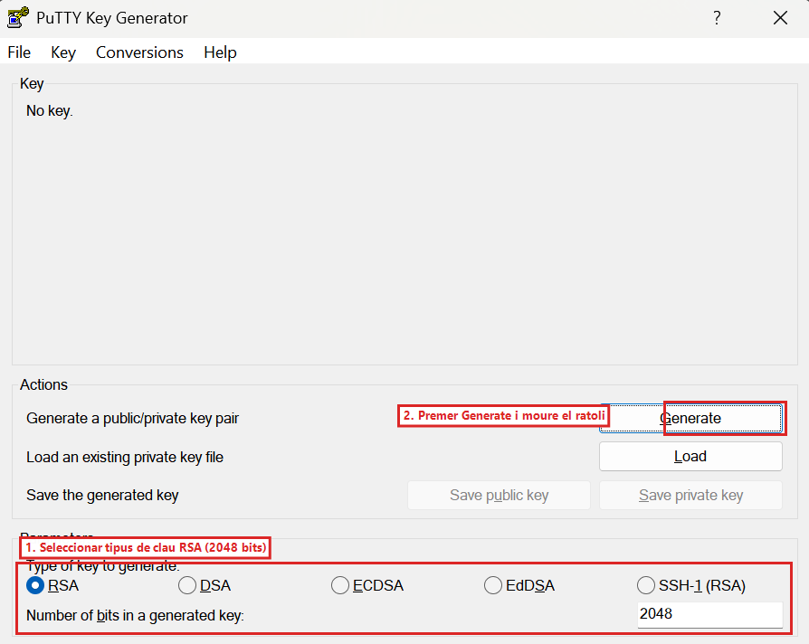
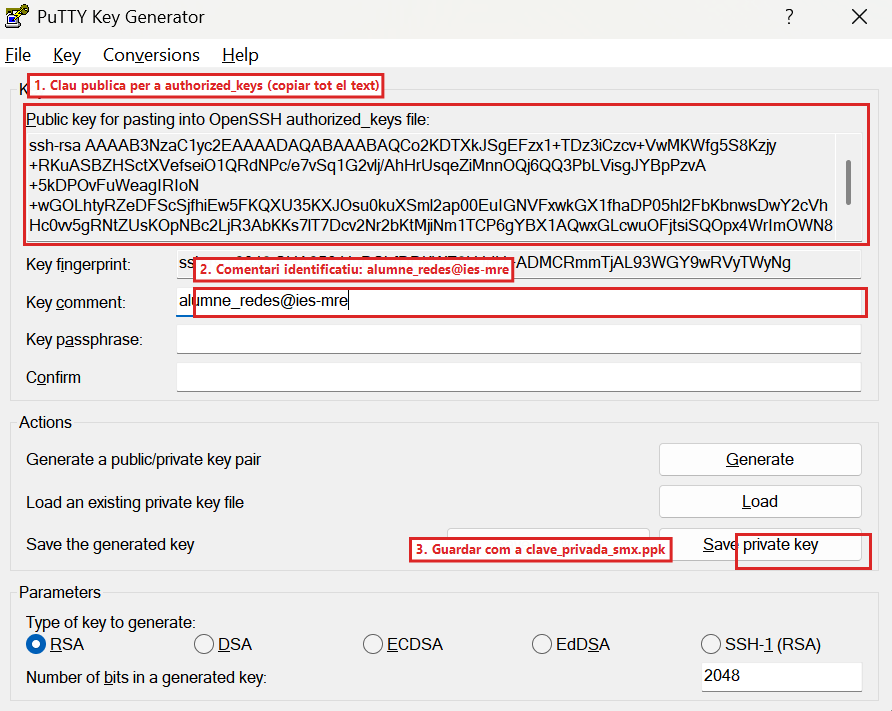
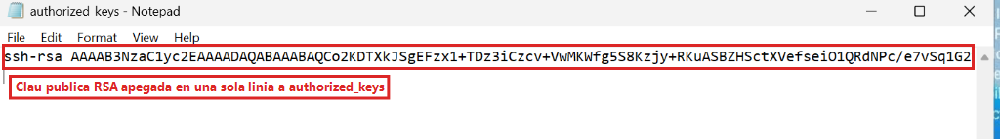
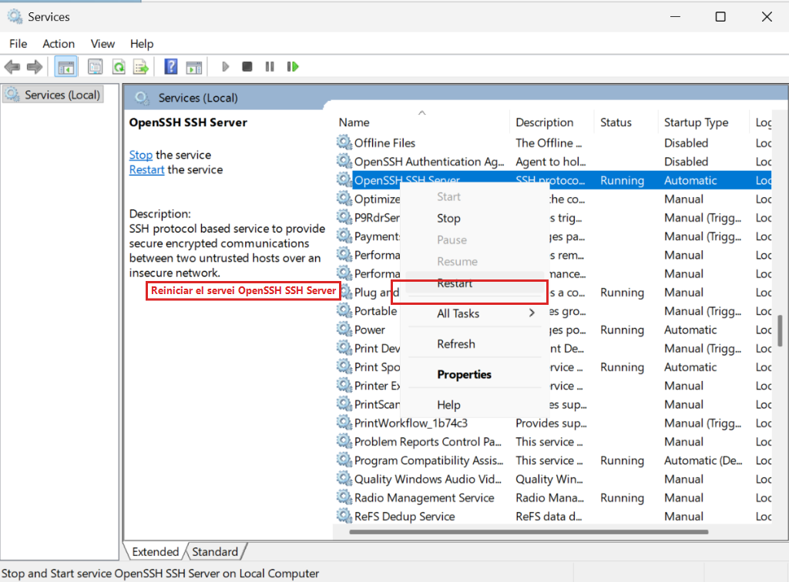
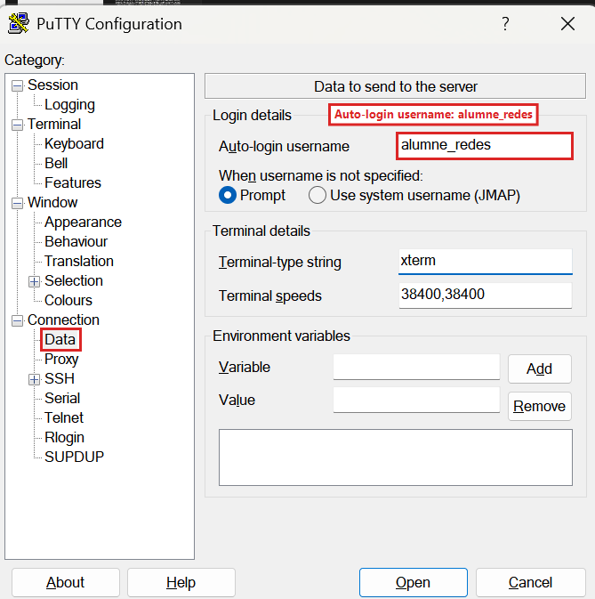
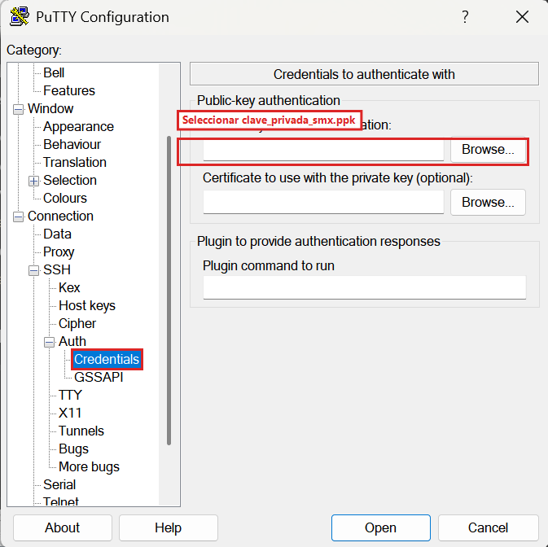
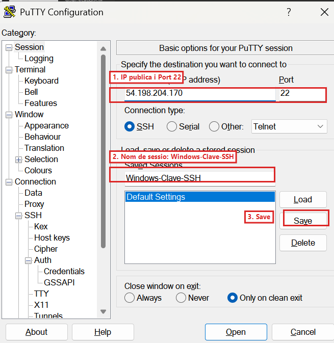
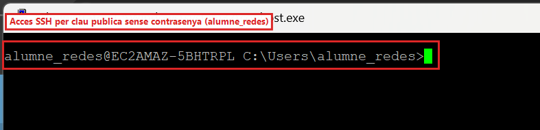
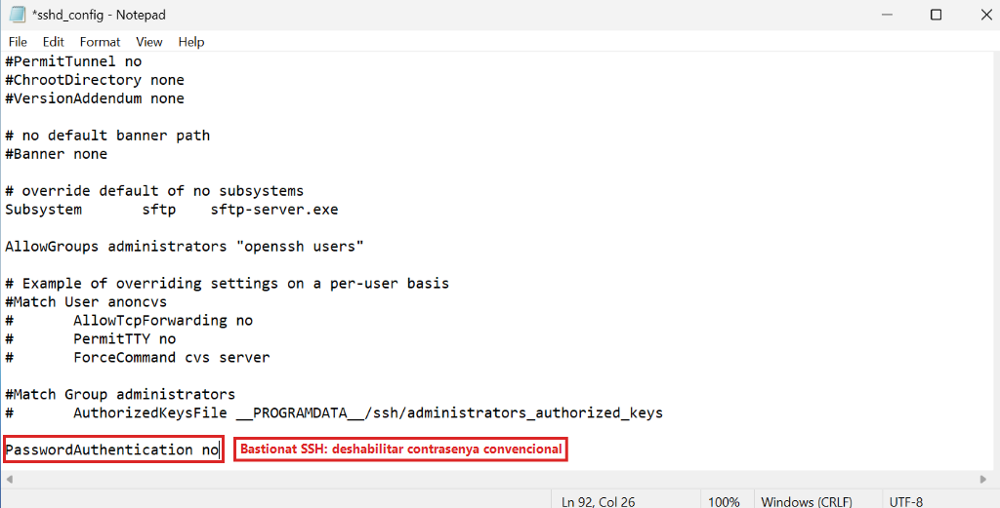
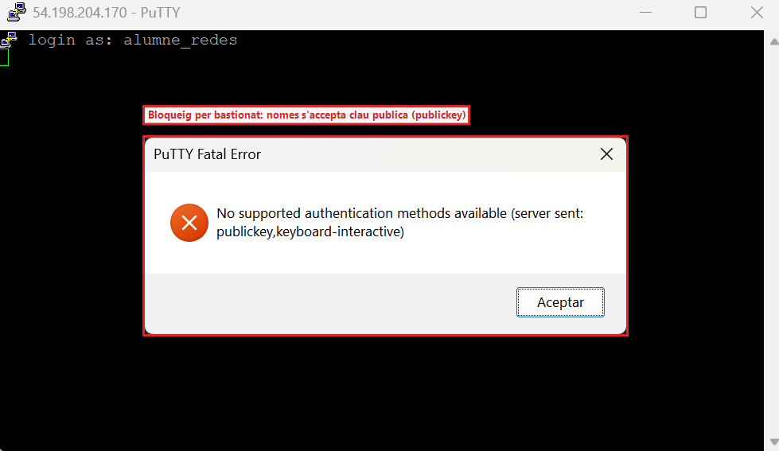

## 10 - [Windows Server] Administración remota y bastionado de SSH con PuTTY y PuTTYgen (RA3-CEf)

> ⚠️ **Obligatorio seguir las normas para la presentación de trabajos escritos.**
>
> Todas las evidencias deberán incluir capturas de pantalla completas donde se aprecie claramente el nombre del equipo, usuario y la fecha/hora.
>

El acceso por contraseña convencional está expuesto a ataques de fuerza bruta. En esta tarea aprovecharemos el servicio **OpenSSH Server** que dejamos activo en **Windows Server (`Servidor_FTPSSH`)** en el apartado 6.3.1 para conectar remotamente por el puerto `22` con **PuTTY**, generar un par de claves asimétricas con **PuTTYgen** y bastionar el servidor deshabilitando el acceso por contraseña.

---

### 10.1 Conexión SSH básica hacia Windows Server con PuTTY

> ⚠️ **¿Retomas la práctica en un día diferente para configurar SSH?**
>
> * **Problema si usas la IP vieja:** Si introduces en PuTTY la IP del día anterior, la conexión se quedará congelada y devolverá `Network error: Connection timed out`.
> * **Solución:** Consulta la **nueva IP pública** de `Servidor_FTPSSH` en la consola de AWS EC2 ([Apartado 6.0](#60-lanzamiento-de-la-instancia-ec2-de-windows-server-2022-en-aws)) e indícala en el campo **Host Name** de PuTTY con el puerto `22`.
> * **Alerta de clave host en PuTTY:** Al cambiar la IP, PuTTY mostrará el aviso `The server's host key is not cached in the registry`. Es un comportamiento completamente normal; haz clic en **Accept** para continuar.
>

1. Abrir **PuTTY** en vuestro PC del aula.
2. En el campo **Host Name (or IP address)** introducir la **IP pública de Windows Server** (`<IP_PUBLICA_WINDOWS>`), **Port** `22` y **Connection type** `SSH`.
3. Pulsar en **Open**, aceptar la advertencia inicial de clave host del servidor (**PuTTY Security Alert** pulsando `Accept`) e iniciar sesión indicando el usuario `alumne_redes` y su contraseña (`Smx2026..@`).
4. Al entrar, ejecutar `whoami` y `hostname` para verificar que estáis conectados a la consola de comandos remota de Windows Server.

No obstante, el método profesional y seguro recomendado para entornos de producción es **sustituir las contraseñas por autenticación asimétrica de clave pública** y bastionar el servicio, tal y como configuramos a continuación.

---

### 10.2 Generación del par de claves con PuTTYgen

1. En vuestro ordenador del aula, abrir **PuTTYgen** (**PuTTY Key Generator**).
2. En la parte inferior (**Parameters**), mantener seleccionado el tipo de clave **RSA** (`2048` bits) o **EdDSA (Ed25519)**.
3. Pulsar en el botón **Generate** y mover continuamente el cursor del ratón sobre el área vacía para generar entropía criptográfica aleatoria:


*Figura 45b: Selección del tipo de clave RSA (2048 bits) y ubicación del botón Generate en PuTTYgen.*

4. En el campo **Key comment**, escribir: `alumne_redes@ies-mre`.
5. Pulsar en **Save private key** (confirmar guardar sin contraseña de paso para este laboratorio) y guardarla como `clave_privada_smx.ppk` en vuestra carpeta de trabajo.
6. En el cuadro superior que indica **Public key for pasting into OpenSSH authorized_keys file**, seleccionar y **copiar todo el texto completo de la clave pública** (`ssh-rsa AAAA...`):


*Figura 46: Clave pública RSA generada en PuTTYgen con comentario identificativo alumne_redes@ies-mre y guardado de clave privada (.ppk).*

> 📷 **Evidencia 13 (insertar en tu documento Word) — Realizar captura de pantalla** de la ventana de PuTTYgen mostrando la clave generada y el comentario `alumne_redes@ies-mre`.

---

### 10.3 Instalación de la clave pública en Windows Server y ajuste de sshd_config

1. En el Escritorio Remoto (RDP) de **Windows Server**:
   * Abrir el **Bloc de notas (Notepad)** como Administrador.
   * Abrir el fichero `C:\ProgramData\ssh\sshd_config` (seleccionando **All Files `(**.**)`** en el diálogo de apertura).
   * Bajar hasta las dos últimas líneas del archivo (`Match Group administrators` y `AuthorizedKeysFile __PROGRAMDATA__/ssh/administrators_authorized_keys`) y comprobar que están comentadas con una almohadilla `#` delante para que Windows utilice siempre la carpeta `.ssh` estándar de cada usuario:
     ```ini
     #Match Group administrators
     #       AuthorizedKeysFile __PROGRAMDATA__/ssh/administrators_authorized_keys
     ```
2. Crear la carpeta `C:\Users\alumne_redes\.ssh` (si no existe) y dentro de ella crear/abrir con **Notepad** el archivo **`authorized_keys`** (sin extensión `.txt`), pegando en una sola línea la clave pública copiada desde PuTTYgen:


*Figura 46b: Clave pública RSA pegada en una sola línea dentro del archivo authorized_keys de alumne_redes.*

3. Reiniciar el servicio **OpenSSH SSH Server** desde la consola gráfica `services.msc`:


*Figura 46c: Reinicio del servicio OpenSSH SSH Server en Windows Server tras actualizar las claves autorizadas.*

---

### 10.4 Conexión automática mediante clave privada en PuTTY

1. Abrir **PuTTY** en vuestro PC del aula.
2. En el menú izquierdo, ir a **Connection** -> **Data** y en **Auto-login username** escribir `alumne_redes`:


*Figura 46d: Configuración del inicio de sesión desatendido para alumne_redes en Connection -> Data.*

3. En el árbol izquierdo, desplegar **Connection** -> **SSH** -> **Auth** -> **Credentials**:
   * En el campo **Private key file for authentication**, hacer clic en **Browse...** y seleccionar vuestro archivo `clave_privada_smx.ppk`:


*Figura 46e: Asociación del archivo de clave privada clave_privada_smx.ppk en Connection -> SSH -> Auth -> Credentials.*

4. Volver arriba a **Session**:
   * **Host Name:** IP pública de Windows Server (`<IP_PUBLICA_WINDOWS>`). **Port:** `22`.
   * En **Saved Sessions**, escribir `Windows-Clave-SSH` y hacer clic en **Save**:


*Figura 46f: Perfil de sesión Windows-Clave-SSH guardado en PuTTY con IP pública, puerto 22 y clave asimétrica vinculada.*

5. Pulsar en **Open** y comprobar que la consola accede directamente a Windows Server **sin solicitar contraseña**:


*Figura 47a: Sesión SSH abierta en el puerto 22 conectando de forma directa y autenticada con la clave privada de alumne_redes.*

---

### 10.5 Bastionado del servidor SSH en Windows Server (Deshabilitar contraseña)

1. En **Windows Server**, volver a abrir `C:\ProgramData\ssh\sshd_config` con **Notepad (como Administrador)**.
2. Añadir o asegurar al final del archivo la directiva de seguridad que prohíbe el acceso mediante contraseña convencional:
   ```ini
   PasswordAuthentication no
   ```


*Figura 47b: Bastionado de OpenSSH mediante la directiva PasswordAuthentication no en sshd_config.*

3. Guardar los cambios (`Ctrl + S`) y reiniciar el servicio **OpenSSH SSH Server** en `services.msc`.
4. Abrir una nueva ventana limpia de **PuTTY** poniendo solo la IP de Windows Server (sin cargar la clave `.ppk`) e intentar entrar como `alumne_redes`: comprobar que el servidor rechaza inmediatamente el acceso mostrando el error de seguridad:
   ```text
   No supported authentication methods available (server sent: publickey,keyboard-interactive)
   ```


*Figura 47c: Rebuig d'accés en PuTTY (No supported authentication methods available) demostrant que el servidor només accepta claus públiques criptogràfiques.*

> 📷 **Evidencia 14 (insertar en tu documento Word) — Realizar captura de pantalla** de la sesión de PuTTY entrando automáticamente sin contraseña mediante clave privada (`Figura 47a`) y otra captura del bloqueo por bastionado (`Figura 47c`) al intentar acceder sin clave.

> ℹ️ **Qué debes añadir a tu documento Word al terminar el Apartado 10**
>
> En el **Apartado 10** de tu documento Word, incluye las **Evidencias 13 y 14**:
>
> * **Evidencia 13:** Generación del par de claves asimétricas en PuTTYgen con el comentario `alumne_redes@ies-mre`.
> * **Evidencia 14:** Sesión de PuTTY entrando automáticamente sin contraseña mediante clave pública y captura del rechazo (`No supported authentication methods available`) al intentar acceder sin clave privada.
>

---
