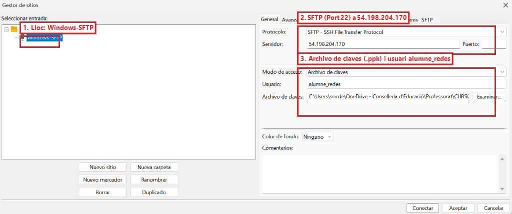
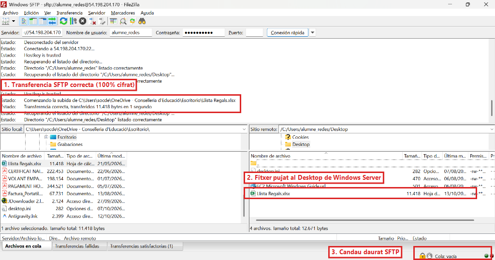
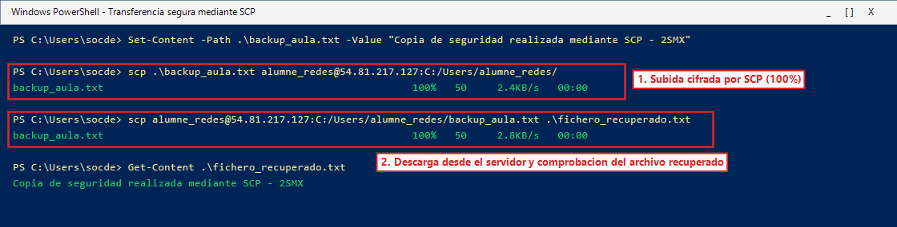
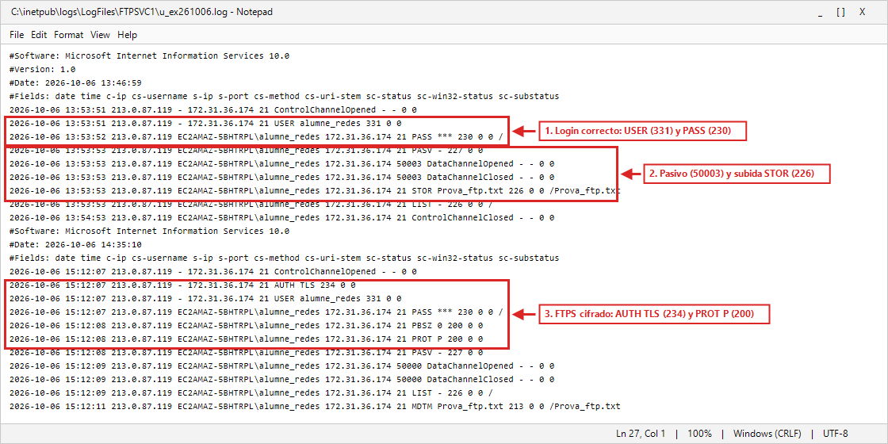
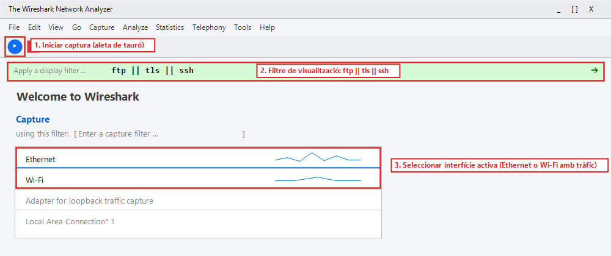
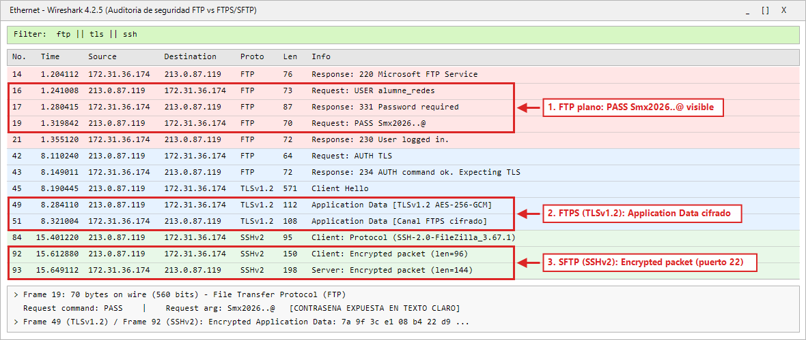

## 11 - [Windows Server] Transferencia segura con SFTP/SCP y auditoría de Logs y Wireshark (RA3-CEe,f,g)

> ⚠️ **Obligatorio seguir las normas para la presentación de trabajos escritos.**
>
> Todas las evidencias deberán incluir capturas de pantalla completas donde se aprecie claramente el nombre del equipo, usuario y la fecha/hora.
>

Para completar todo el bloque práctico sobre **Windows Server (`Servidor_FTPSSH`)**, realizaremos transferencias seguras por el puerto `22` mediante **SFTP** y **SCP**, y auditaremos tanto los registros de actividad W3C de IIS como los paquetes de red capturados con **Wireshark**.

---

<a id="filtro-wireshark"></a>
### 11.1 Transferencia gráfica por SFTP hacia Windows Server en FileZilla (Puerto 22)

> ⚠️ **Comprobaciones de red si realizas este apartado en un día posterior**
>
> Si la instancia de Windows Server se ha reiniciado:
> * **FileZilla SFTP (11.1):** Actualiza el campo **Servidor** con la nueva IP pública de Windows Server.
> * **PowerShell SCP (11.2):** En el comando `scp`, sustituye `<IP_PUBLICA_WINDOWS>` por la IP pública actual ([Consultar IP en AWS](#60-lanzamiento-de-la-instancia-ec2-de-windows-server-2022-en-aws)).
> * **Filtro de Wireshark (11.4):** Si utilizas el filtro opcional por IP `(ftp || tls || ssh) && ip.addr == <IP_PUBLICA_WINDOWS>`, **debes poner la IP pública actual**. Si dejas la IP de una sesión anterior, Wireshark filtrará todo el tráfico y la captura aparecerá vacía.
>

1. Abrir **FileZilla Client**.
2. Dado que en el apartado anterior hemos bastionado el servidor SSH deshabilitando la autenticación por contraseña (`PasswordAuthentication no`), para conectar por SFTP debemos utilizar la clave privada generada con PuTTYgen (`clave_privada_smx.ppk`):
   * Ir al menú **Archivo** -> **Gestor de sitios...** (o pulsar `Ctrl + S`).
   * Crear un **Nuevo sitio** (por ejemplo, `Windows-SFTP`).
   * En **Protocolo**, seleccionar **SFTP - SSH File Transfer Protocol**.
   * En **Servidor**, escribir la IP pública de Windows Server (`54.198.204.170`) y en **Puerto** `22`.
   * En **Modo de acceso**, seleccionar **Archivo de claves** (**Key file**).
   * En **Usuario**, indicar `alumne_redes`.
   * En **Archivo de claves**, pulsar **Examinar...** y seleccionar vuestro archivo `clave_privada_smx.ppk`.


*Figura 34b: Parámetros del sitio SFTP en FileZilla: protocolo SFTP (puerto 22), IP pública del servidor y autenticación mediante clave privada (.ppk).*

3. Pulsar en **Conectar**. Al ser la primera vez, aceptar la clave del servidor (**Hostkey is trusted**).
4. Comprobar que en el log superior se autentica con la clave y lista el directorio remoto `C:/Users/alumne_redes`.
5. Arrastrar un archivo local de prueba (por ejemplo, `Llista Regals.xlsx` o cualquier documento de texto) hacia la carpeta remota para realizar la subida cifrada.
6. Verificar que la transferencia se completa con éxito y que en la esquina inferior derecha aparece el **candado dorado cerrado**:


*Figura 35: Conexión SFTP activa en el puerto 22 hacia Windows Server con subida completada con éxito y candado de seguridad activo.*

> 📷 **Evidencia 15 (insertar en tu documento Word) — Realizar captura de pantalla** de FileZilla conectado por el protocolo SFTP al puerto 22 de Windows Server mostrando la transferencia completada y el icono del candado inferior.

---

### 11.2 Transferencia por línea de comandos mediante SCP hacia Windows Server

1. En vuestro ordenador del aula, abrir una ventana de **Windows PowerShell**.
2. Dado que el servidor tiene deshabilitada la contraseña tras el bastionado, `scp` utilizará automáticamente el par de claves asimétricas alojado en vuestro perfil (`~/.ssh/id_rsa` o indicando `-i .\clave_privada_smx.pem`).
3. Crear un archivo local de prueba y enviarlo hacia Windows Server mediante `scp`:
   ```powershell
   Set-Content -Path .\backup_aula.txt -Value "Copia de seguridad realizada mediante SCP - 2SMX"
   scp .\backup_aula.txt alumne_redes@<IP_PUBLICA_WINDOWS>:C:/Users/alumne_redes/
   ```
4. Comprobar en la consola la barra de progreso al `100%` y descargar el archivo de vuelta con un nuevo nombre (`fichero_recuperado.txt`) para verificar su integridad:
   ```powershell
   scp alumne_redes@<IP_PUBLICA_WINDOWS>:C:/Users/alumne_redes/backup_aula.txt .\fichero_recuperado.txt
   Get-Content .\fichero_recuperado.txt
   ```


*Figura 48: Subida y descarga segura de archivos hacia Windows Server por línea de comandos mediante SCP sobre el puerto 22 autenticando por clave.*

> 📷 **Evidencia 16 (insertar en tu documento Word) — Realizar captura de pantalla** de PowerShell ejecutando los comandos `scp` de subida y descarga mostrando la transferencia completada al `100%`.

---

### 11.3 Auditoría de registros de actividad en Windows Server (Logs W3C de IIS)

1. En Windows Server, abrir **File Explorer** y navegar a la ruta donde IIS almacena los registros de FTP:
   ```text
   C:\inetpub\logs\LogFiles\FTPSVC1\
   ```
2. Abrir el fichero de log más reciente (`u_exAAMMDD.log`, por ejemplo `u_ex261006.log`) con **Notepad**:


*Figura 44: Inspección en Notepad del fichero de registro W3C (u_ex261006.log) mostrando la autenticación (230), apertura de puertos pasivos (50000-50003), subida de archivo (STOR Prova_ftp.txt -> 226) y negociación FTPS (AUTH TLS -> 234 y PROT P -> 200).*

3. Identificar en el log los códigos de estado de vuestras operaciones:
   * `234`: Negociación de cifrado `AUTH TLS` aceptada.
   * `230`: Inicio de sesión correcto (`PASS ***`).
   * `227`: Entrada en Modo Pasivo (`PASV`).
   * `226`: Transferencia de archivo completada (`STOR Prova_ftp.txt`).
   * `550`: Permiso denegado (cuando el usuario `anonymous` intentó borrar el catálogo).

> 📷 **Evidencia 17 (insertar en tu documento Word) — Realizar captura de pantalla** del fichero de log de IIS en Notepad destacando una línea con un comando de subida exitoso (`STOR` con código `226`) y la negociación FTPS (`AUTH TLS` con código `234`).

---

### 11.4 Auditoría de tráfico con Wireshark: FTP en texto claro vs. FTPS y SFTP cifrados

Para comprobar empíricamente por qué nunca debe utilizarse FTP sin cifrar en redes públicas o corporativas, realizaremos una captura de paquetes con **Wireshark** desde el ordenador del aula mientras nos comunicamos con nuestro servidor Windows Server.

#### 11.4.1 Instalación y preparación previa de Wireshark
1. Si no disponéis de Wireshark en vuestro equipo del aula, descargar el instalador oficial de Windows (64-bit) desde [wireshark.org](https://www.wireshark.org/download.html).
2. Durante el asistente de instalación, es imprescindible mantener marcada la casilla de **Npcap** (controlador de captura de paquetes en modo promiscuo de Windows) con las opciones predeterminadas.

#### 11.4.2 Selección de la interfaz e inicio de la captura
1. Abrir **Wireshark**.
2. En la pantalla inicial de bienvenida (**Welcome to Wireshark**), identificar la tarjeta de red activa del equipo (la que muestra una línea con picos de actividad o tráfico):
   * En los ordenadores de sobremesa del aula suele ser **Ethernet**.
   * Si estáis trabajando con un ordenador portátil, seleccionar **Wi-Fi**.
3. Hacer doble clic sobre la interfaz activa o seleccionarla y pulsar el botón azul con forma de **aleta de tiburón** (esquina superior izquierda) para comenzar a capturar tráfico en tiempo real.
4. En la barra superior de filtro de visualización (**Apply a display filter ...**), escribir el siguiente filtro y pulsar `Enter` (la barra se pondrá en color verde claro si la sintaxis es correcta):
   ```text
   ftp || tls || ssh
   ```
   *(Opcional: Si queréis aislar exclusivamente el tráfico con vuestro servidor Windows en AWS, podéis usar: `(ftp || tls || ssh) && ip.addr == <IP_PUBLICA_WINDOWS>`)*.


*Figura 44c: Selección de la interfaz activa de red (Ethernet/Wi-Fi), inicio de captura con la aleta de tiburón y aplicación del filtro ftp || tls || ssh en Wireshark.*

#### 11.4.3 Procedimiento de generación de tráfico de prueba
Con la captura de Wireshark corriendo en segundo plano:
1. **Generar tráfico FTP plano (en texto claro):**
   * En FileZilla, conectar por FTP ordinario sin cifrado (`ftp://<IP_PUBLICA_WINDOWS>`, puerto `21`) con el usuario `alumne_redes` y su contraseña `Smx2026..@`.
2. **Generar tráfico FTPS (cifrado con TLS):**
   * Conectar con FileZilla requiriendo TLS explícito (**Requiere FTP explícito sobre TLS**).
3. **Generar tráfico SFTP (cifrado con SSH):**
   * Conectar con FileZilla por el puerto `22` (SFTP) o ejecutar un comando `scp` en PowerShell.
4. Volver a Wireshark y pulsar el botón **rojo cuadrado** (**Stop capturing packets**) en la barra de herramientas para detener la captura.

#### 11.4.4 Inspección y análisis comparativo de paquetes (Auditoría de seguridad)
Al examinar la lista de tramas filtradas comprobaremos la diferencia fundamental entre protocolos:

1. **FTP plano (Vulnerabilidad crítica):**
   * En las tramas de color rosa asociadas al protocolo FTP, buscar la petición de autenticación:
     * `Request: USER alumne_redes`
     * `Request: PASS Smx2026..@`
   * Al hacer clic sobre el paquete `PASS`, en el panel inferior de inspección de datos se comprueba que **la contraseña viaja en texto completamente plano y legible**, lo que permitiría a cualquier atacante en la red interceptarla (*sniffing* o ataque Man-In-The-Middle).
2. **FTPS sobre TLS (Cifrado de canal):**
   * Se aprecia la negociación inicial en el puerto 21 (`AUTH TLS -> 234 AUTH command ok`).
   * A partir de ese instante, todos los comandos y datos viajan cifrados bajo el protocolo **`TLSv1.2`** clasificados como **`Application Data`**.
3. **SFTP sobre SSH (Blindaje total):**
   * En el puerto `22`, toda la sesión queda encapsulada bajo **`SSHv2`** mostrando únicamente paquetes de tipo **`Encrypted packet`**. Ni las credenciales ni los nombres de los archivos transferidos son accesibles.


*Figura 44b: Auditoría en Wireshark contrastando la exposición de credenciales en FTP plano (Request: PASS Smx2026..@) frente al tráfico cifrado en FTPS (TLSv1.2 Application Data) y SFTP (SSHv2 Encrypted packet).*

> 📷 **Evidencia 18 (insertar en tu documento Word) — Realizar captura de pantalla** de Wireshark mostrando los paquetes capturados donde se contrasten los paquetes en texto claro de FTP frente a los paquetes cifrados `TLSv1.2 Application Data` (FTPS) y `SSHv2 Encrypted packet` (SFTP).

> ℹ️ **Qué debes añadir a tu documento Word al terminar el Apartado 11 (Fin del Bloque Windows Server)**
>
> En el **Apartado 11** de tu documento Word, incluye las **Evidencias 15 a 18**:
>
> * **Evidencia 15:** FileZilla conectado por SFTP (puerto `22`) a Windows Server con el candado activo.
> * **Evidencia 16:** Consola de PowerShell ejecutando la subida y descarga con `scp` al `100%`.
> * **Evidencia 17:** Fichero de log de IIS (`u_exAAMMDD.log`) en Notepad destacando las líneas `STOR` (`226`) y `AUTH TLS` (`234`).
> * **Evidencia 18:** Captura de paquetes en Wireshark comparando FTP plano frente a `TLSv1.2 Application Data` (FTPS) y `SSHv2 Encrypted packet` (SFTP).
>

---
